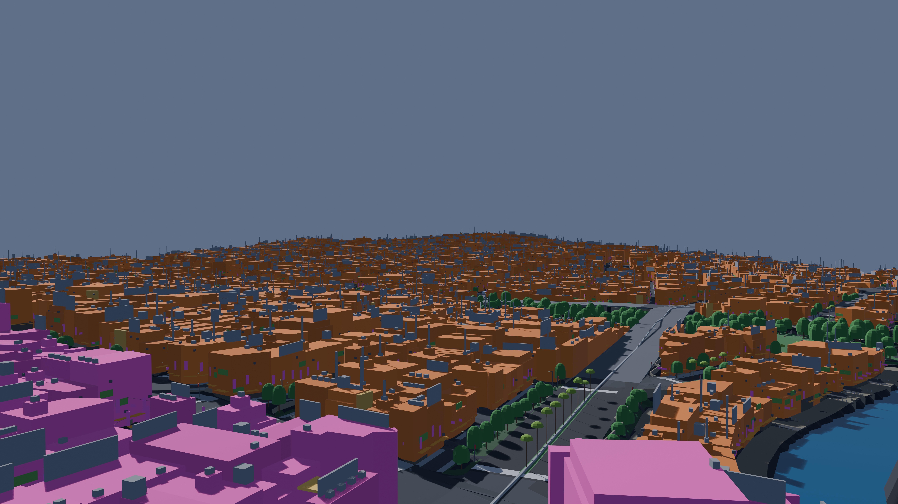
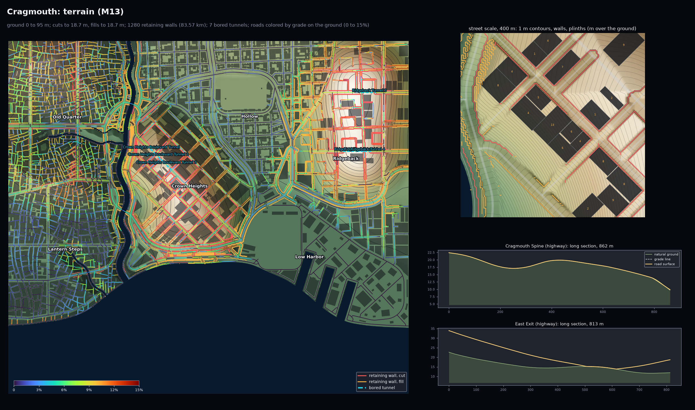
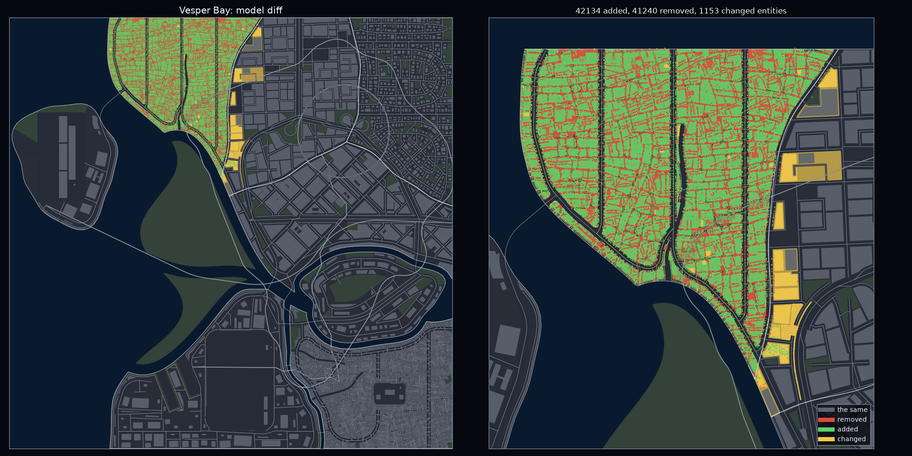
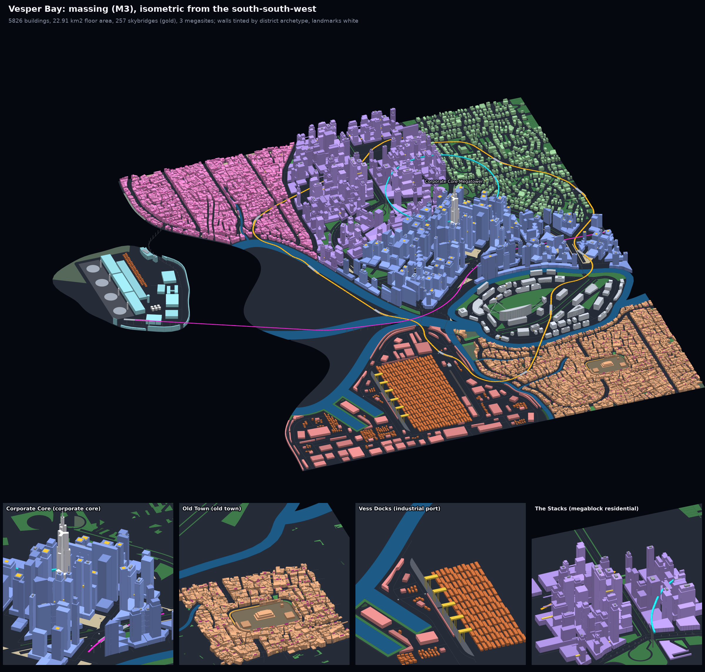
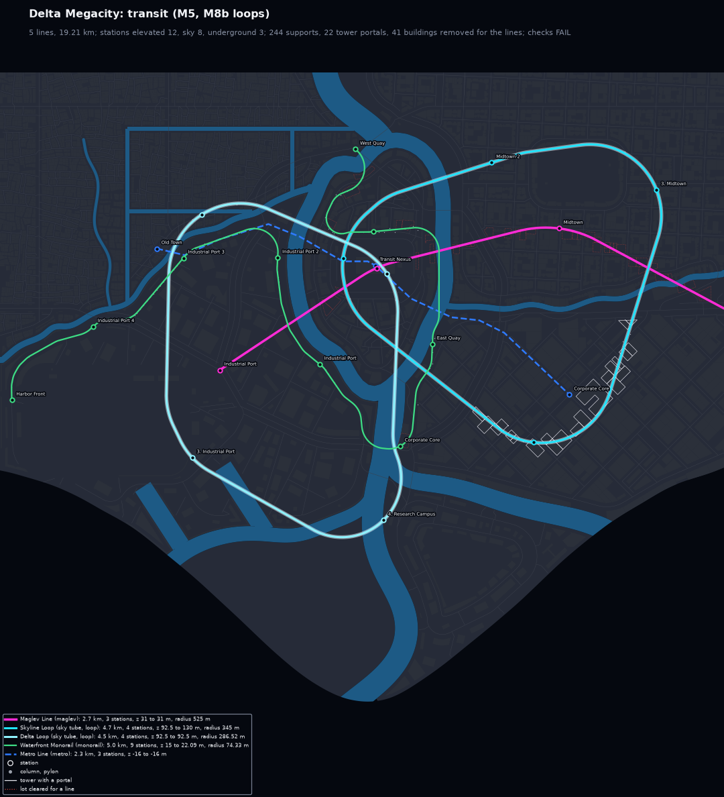
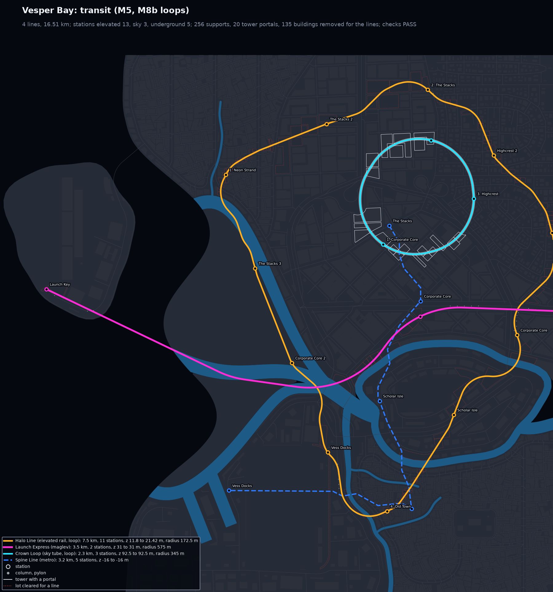

# CyberGen

Offline generators for cyberpunk open cities. Stage 1, **citygen**, turns one text prompt (plus
an optional concept image) into a complete, water-first coastal city: deterministic offline
Python, then a Blender blockout and exports for Unreal. No API calls anywhere: a Claude Code
session turns the prompt into a spec through the `citygen` skill, and everything after that is
code.

| Stage | Generator | What it makes | Status |
|---|---|---|---|
| 1 | layoutgen (`citygen`) | Water, districts, roads, tunnels, stack interchanges, terrain, streets, lots, buildings, transit, props, gameplay layer; Blender blockout, Unreal export; editing, pins, locked releases | M0 to M13 done; M14 and M15 planned |
| 2 | assetgen | A unique 3D model for every building, plus roads, sidewalks and street furniture; textures | Planned |
| 3 | atmosgen | Lighting, sky, weather and atmospherics in Unreal | Planned |
| 4 | lifegen | Traffic, crowds, trains and aircraft, placed and driven procedurally | Planned |
| 5 | storygen | Story, characters, cutscenes | Planned |

Stages 1 and 2 are city-agnostic and live here. Nyxllor, the Cyberpunk 2077-inspired
open-city game in Unreal Engine 5 that CyberGen is built for, gets its own repo at stage 3.
The sample city called Nyxllor up to M8c is **Vesper Bay** (`cities/vesper_bay`) from then on;
the earlier `docs/progress/<milestone>/nyxllor*` folders keep the old name.

Full plan for stage 1: [`docs/citygen_scope.md`](docs/citygen_scope.md).

## Progress

| Milestone | What it adds | Status | Outputs |
|---|---|---|---|
| M0 | Spec format, district presets, `citygen` skill, schematic | Done | [`docs/progress/M0`](docs/progress/M0) |
| M1a | Coast, rivers, deltas, islands, districts, canals, `citygen build` | Done | [`docs/progress/M1a`](docs/progress/M1a) |
| M1a2 | Organic polish: curved districts, meandering water, real deltas | Done | [`docs/progress/M1a2`](docs/progress/M1a2) |
| M1b | Highways, avenues, bridges, megasite reserves | Done | [`docs/progress/M1b`](docs/progress/M1b) |
| M1b_det | Same city byte for byte on x86 and ARM, stage traces | Done | [`docs/progress/M1b_det`](docs/progress/M1b_det) |
| M2 | Local streets, alleys, junctions, sidewalks, blocks, lots, open space | Done | [`docs/progress/M2`](docs/progress/M2) |
| M3 | Buildings, complexes, skybridges, landmarks, megasites | Done | [`docs/progress/M3`](docs/progress/M3) |
| M3p | Polish: megablocks as towers on podiums, complexes in place, canal straddles, boulevard skylines | Done | [`docs/progress/M3p`](docs/progress/M3p) |
| M4 | Blender blockout (.blend, USD, glTF tiles), renders, labeled 2D map, Unreal and graph exports | Done | [`docs/progress/M4`](docs/progress/M4) |
| M5 | Transit: metro, elevated rail, monorail, maglev, sky tubes through towers; stations, supports, station walkways | Done | [`docs/progress/M5`](docs/progress/M5) |
| M6 | Props, vegetation, ground clutter (instanced in the blockout) | Done | [`docs/progress/M6`](docs/progress/M6) |
| M7a | Elevated highways: viaducts, diamond ramps, overpasses, bridge approach grades, underpass streets, road columns | Done | [`docs/progress/M7`](docs/progress/M7) |
| M7b | Trumpet and partial cloverleaf interchanges, art-direction loop, Corporate Core pinned import | Done | [`docs/progress/M7b`](docs/progress/M7b) |
| M8a | Robustness sweep (`citygen sweep`, 68 builds at many seeds) and the fixes it led to: 33 to 49 of 68 builds passing (57 apart from transit), no crashes | Done | [`docs/progress/M8a`](docs/progress/M8a) |
| M8b | Transit loops as one simple ring, stations in route order, lines independent of each other, `transit_self_crossing` check; fast lines placed so their curves fit, faster transit routing; on M8a's code the sweep passes 51 of 68 builds (M8a alone 49) | Done | [`docs/progress/M8b`](docs/progress/M8b) |
| M8c | Transit that passes on a city's first layout: flying loops as Dubins rings, open lines off the roads or as Dubins paths where the roads fail them; Delta Megacity from 9 full-city tries to 1, the sweep 58 of 68 (M8b 51), no transit failures left in it | Done | [`docs/progress/M8c`](docs/progress/M8c) |
| M8d | Trumpet in its textbook form: one loop and one level-2 flyover round it (crest 16.6 m in Vesper Bay, then Nyxllor), the two-loop form as the fallback; the sweep passes 51 of 68 builds as before, all five trumpets in it take the flyover, the 63 builds without one are byte-identical | Done | [`docs/progress/M8d`](docs/progress/M8d) |
| M9 | Tunnels as level -1 of the road network: cut-and-cover tunnels under districts and immersed tubes under water (portals, walled approaches, ventilation buildings), metro tunnels lowered under foundations and road tunnels, pedestrian underpasses; four tunnel checks (70 in all), tunnel boxes and a cutaway render in the blockout; Nexus City gets the Midtown Tunnel, Greyhook the Neckwater Tube; the sweep passes 58 of 68 as on M8c | Done | [`docs/progress/M9`](docs/progress/M9) |
| M10 | Edit, lock and regenerate: stable ids from what an entity is and where it sits, `citygen build --district` regenerates one district in under a minute with every road outside it held and everything away from its seam byte for byte, pins and overrides (`overrides.json`), `citygen lock` releases that rebuild byte for byte, `citygen model diff` with a map | Done | [`docs/progress/M10`](docs/progress/M10) |
| M11 | Gameplay layer: named points of interest (bars, clinics, vendors, fixers, hideouts, apartments) with their doors, faction territories and police precincts, wealth, danger and police fields, traffic, crowd and spawn density per street and hour band, parking, taxi stands, fast travel, sign and ad slots; every place reachable on foot and by car (9 checks, 75 in all), `gameplay.json` | Done | [`docs/progress/M11`](docs/progress/M11) |
| M12 | Stack interchanges: four-level highway-highway crossings (one highway lifted through the crossing, eight one-way directional ramps, the left turns as flyovers at 18 and 27 m), the turbine as their fallback, M7's crossing where neither fits; 2 checks (81 in all); a stack demo (the pinned demo with two crosstowns), the samples and the pinned demo unchanged | Done | [`docs/progress/M12`](docs/progress/M12) |
| M13 | Terrain: a height field from the spec (hills, ridges, cliff plateaus, flat districts), water at its own levels, every road on a grade line fitted to the ground within its class's grade (cuts and fills between retaining walls, bored tunnels through hills, terrain viaducts), highways routed round steep ground, hillside greens, buildings on stepped plinths, the ground as a heightfield in the blockout; five terrain checks (86 in all); the hilly sample Cragmouth with a release lock; flat cities byte-identical; on M10, terrain entities get stable ids and a regenerated district keeps the held roads' grade lines | Done | [`docs/progress/M13`](docs/progress/M13) |
| M14 | Layered districts: streets, lots and buildings stacked on several deck levels, joined by ramps, stairs and elevators | Planned | |
| M15 | Unreal export tool (end of stage 1): a built city into an Unreal 5.8 World Partition level with collision, materials, instanced props, ids and graphs; updated as later stages come online | Planned | |

## Latest maps (M13 and M10)

Five sample cities are rebuilt and checked at every milestone, so quality is judged across
different coast forms, not one map, and since M13 a hilly sample with them.

M13 adds terrain (on M10, M12, M11 and M9). Cragmouth, the new hilly sample, is a cliffside
port climbing out of a bay. Its harbor is levelled at the water. The towers of Crown Heights
stand on a plateau 34 m over the bay, and the old quarter climbs a 75 m hill. Megablocks step
up a ridge among hillside greens, and the highways bore through the hills. A district of a
hilly city can be regenerated like any other: every road outside it keeps its grade line (see
[`docs/progress/M13`](docs/progress/M13)):


| The old quarter's hill (8K) | The ground: grades, walls, bored tunnels |
|---|---|
|  |  |

Before it, M10 made a built city editable: every entity has a stable id from what it is and where it sits, one district can be built again on its own
(`citygen build SPEC OUT --district NAME`, under a minute) while every road outside it comes
back as it was and everything away from its seam stays byte for byte, pins and overrides
keep or change single buildings, open spaces and roads, and `citygen lock` freezes a city
as a release that rebuilds byte for byte (see [`docs/progress/M10`](docs/progress/M10)).

M12 added stack interchanges where two highways cross with room for one: one
highway lifted to 9 m through the crossing, the other at grade, and eight one-way
directional ramps, the left turns as flyovers at 18 m and 27 m (a turbine, then M7's
crossing, where the stack does not fit). None of the five samples or the pinned demo has
such a crossing, so a stack demo, Vesper Bay Stacks, is the pinned demo with two crosstown
highways that cross in a stack in The Stacks (see [`docs/progress/M12`](docs/progress/M12)).

The stack in Vesper Bay Stacks (8K): the Stacks Crosstown on its viaduct over the Bayline,
the tier-2 flyovers at 18 m, the tier-3 flyovers at 27 m over them, the right turns in their
quadrants:


Its road levels: the stack in the inset, each left turn with its tier, and the profiles of
its eight ramps over the 9, 18 and 27 m levels:


M11 added the gameplay layer ([`docs/progress/M11`](docs/progress/M11)), M8a swept the
samples over many seeds ([`docs/progress/M8a`](docs/progress/M8a)), M8b made transit loops
simple rings, M8d built the trumpet as one loop and a flyover, and M8c made transit pass on
a city's first layout ([`docs/progress/M8c`](docs/progress/M8c)).
M9 added tunnels: Nexus City's ring highway
runs under Midtown in a cut-and-cover tunnel, and Greyhook's spine highway crosses its river
in an immersed tube instead of on a bridge; every city's metro is lowered under the tower
foundations, and pedestrian underpasses take sidewalks under the at-grade highways (see
[`docs/progress/M9`](docs/progress/M9)).

Vesper Bay with Neon Strand regenerated on a new seed (`citygen model diff --png`): what is
the same in grey, removed in red, added in green, moved or reshaped in yellow (the seam: the
junctions where the new streets meet the held border roads and what stands next to them):



| Before | After (Neon Strand regenerated) |
|---|---|
|  |  |

The gameplay layer (Vesper Bay, M11): territories in faction colors (contested turfs hatched)
with points of interest, taxi stands and fast travel; the wealth and danger fields; evening
traffic and late crowds per street; a 300 m street inset with names, doors, curb points and
sign slots:


| Nexus City | Delta Megacity |
|---|---|
|  |  |

Whole cities in the Blender blockout, seen isometrically from the south (8K images; open one
for full size):

| Nexus City (from the concept image) | Vesper Bay (bay, river delta) |
|---|---|
|  |  |

| Vesper Bay with the traced Corporate Core on its island | Delta Megacity |
|---|---|
|  |  |

| Saltreach Free Port (archipelago) | Greyhook (peninsula) |
|---|---|
|  |  |

Vesper Bay Stacks, the stack demo (the pinned demo with two crosstowns; the stack in The
Stacks, right of center):


Tunnels (M9): Greyhook's Neckwater Tube, 756 m long, 15.8 m down under the river bed, with a
ventilation building at each shore portal, and Nexus City's Midtown Tunnel under a street that
crosses its lid (each with a street-scale inset and the road and metro profiles):

| Greyhook, Neckwater Tube | Nexus City, Midtown Tunnel |
|---|---|
|  |  |

The cutaway render (8K): the city cut along the tunnel, the earth taken away on the camera's
side, looking down the open approach and through the portal:

| Greyhook | Nexus City |
|---|---|
|  |  |

The traced Corporate Core on its island (megatower, traced towers and water pockets):


At street level, beside the viaducts:

| Delta Megacity, beside a viaduct | Vesper Bay, corporate core |
|---|---|
|  |  |

Road levels (Vesper Bay, M8d): every raised road by deck height, the interchanges (a diamond, a
partial cloverleaf and a trumpet), columns, and the profile of one viaduct. The trumpet
(inset) now has one loop and a flyover that wraps round it, crosses the deck at 16.6 m
beside the stem and comes down to it:


Vesper Bay's trumpet in the blockout (8K): the loop inside, the flyover's bell wrapping round it:


Props and plants at street level (Vesper Bay, 180 m insets):


Transit maps (M8c): Delta Megacity on its first layout, before M8c (the Delta Loop's
curve at Research Campus and the monorail's turn at a bridge foot too tight, so the city was
built again eight times) and now:

| Before M8c (same layout) | M8c |
|---|---|
|  |  |

| Nexus City | Vesper Bay |
|---|---|
|  |  |

Each M10 city folder has every generator preview, the build report, the stage trace, the 8K whole-city render and the release lock (`city.lock.json`), and `docs/progress/M10/regenerated/` a regenerated district of every sample with its diff map; each M12 city folder has every generator preview, the build report, the stage trace and the 8K whole-city render (the stack demo also its stack close-up); each M9 city folder has every generator preview (`preview_tunnels.png` where a city has tunnels), the build report, the stage trace and the 8K renders, the cutaways among them; each M11 city folder the same on M8c without tunnels; each M8c city folder has every generator preview, the transit map of M8b, the Blender
renders, the build report and the stage trace, and `docs/progress/M8c/same_layout/` the
transit of M8b and M8c on the same saved layouts; the M8d builds (the trumpet) are in
`docs/progress/M8d/`, the M8b ones in `docs/progress/M8b/`, the M8a sweep tables in
`docs/progress/M8a/`, the M7b builds in `docs/progress/M7b/`, the M7a ones in
`docs/progress/M7/`, the 2D maps in `docs/progress/M4/`. Sample specs live in
`docs/progress/M1a2/<city>/city_spec.json` and `cities/vesper_bay/city_spec.json`; the pinned
demo's in `cities/vesper_bay_pinned/city_spec.json` (first in
`docs/progress/M7b/nyxllor_pinned/`), its round 1 and round 2 transit in
`docs/progress/M8b/nyxllor_pinned_round1/` and `nyxllor_pinned_round2/`. `docs/progress/M8c/vesper_bay*/`
are the same layouts as `nyxllor*/` there, built again under the new name.

## Where things are

- **Milestone outputs:** `docs/progress/<milestone>/<city>/` (preview images, reports, traces).
- **Work in progress:** while a milestone session runs, it pushes snapshot images to its branch under
  `docs/progress/<milestone>/wip/`. Open the branch on GitHub (Branches tab) to see them before
  the PR is up.
- **Generator:** `citygen/`, tests in `tests/`, skill in `.claude/skills/citygen/`.
- **Earlier hand-traced pipeline** (Corporate Core, Nyxllor's first district; moves to the
  nyxllor repo at stage 3 except the traced map, which the pinned demo imports): `maps/`,
  `pipeline/`, `out/`, `unreal/`.

## Run it

```
python3.13 -m venv .venv && .venv/bin/pip install -r requirements.txt
.venv/bin/python -m citygen build cities/vesper_bay/city_spec.json out/vesper_bay --blockout
.venv/bin/python -m pytest -q
```

`--blockout` needs Blender 5.2 (found in `/Applications/Blender*.app`, `$BLENDER` or on PATH)
and adds `city.blend`, `city.usdc`, `tiles/*.glb`, renders and the 2D map to `out/vesper_bay`.

Editing a built city (M10): change a district in the spec (or nothing, for a new seed) and
regenerate it alone, see what changed, and freeze the result as a release:

```
.venv/bin/python -m citygen build cities/vesper_bay/city_spec.json out/vesper_bay --district "Neon Strand"
.venv/bin/python -m citygen model diff before/city_model.json out/vesper_bay/city_model.json --png diff.png
.venv/bin/python -m citygen lock out/vesper_bay --release 1.0
.venv/bin/python -m citygen lock --verify out/vesper_bay/city.lock.json
```

Pins and overrides go in `overrides.json` beside the spec (see `docs/progress/M10`).

To make a new city, open Claude Code in this repo and ask for one (the `citygen` skill takes it
from there).
