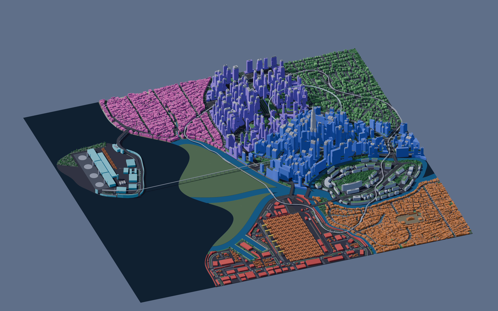
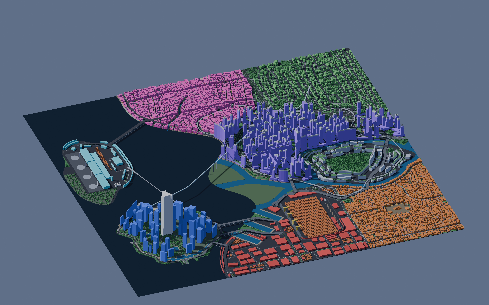
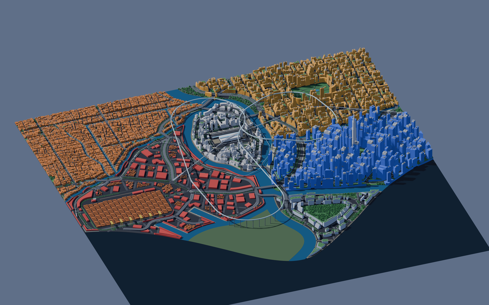
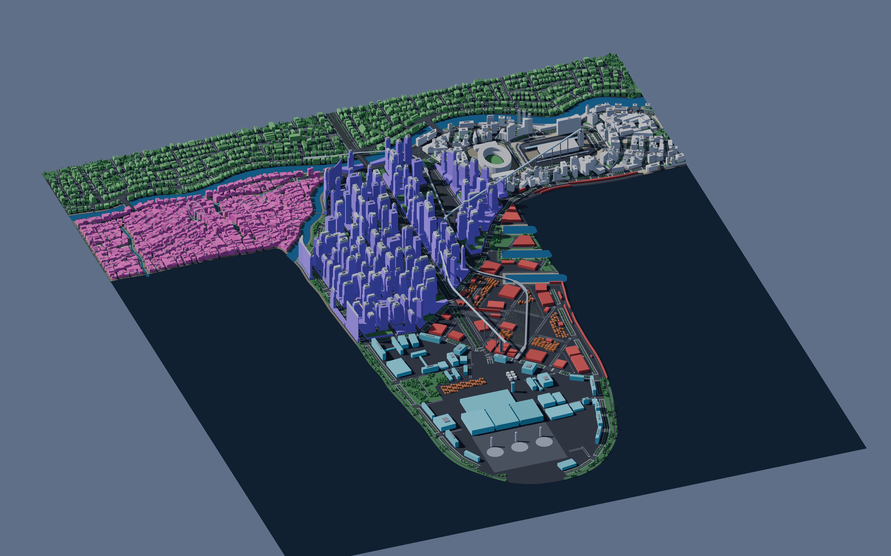
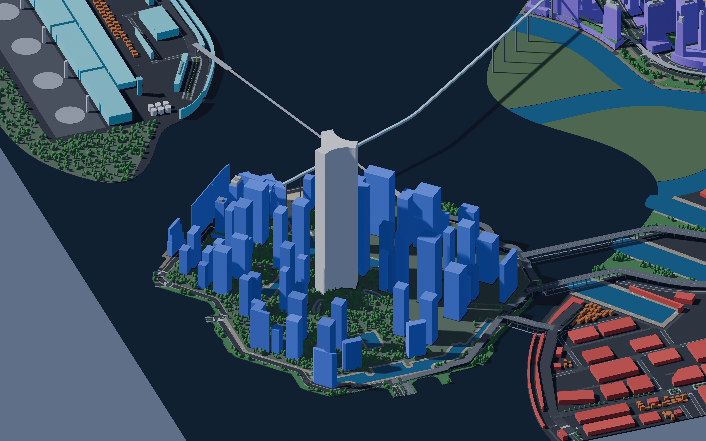
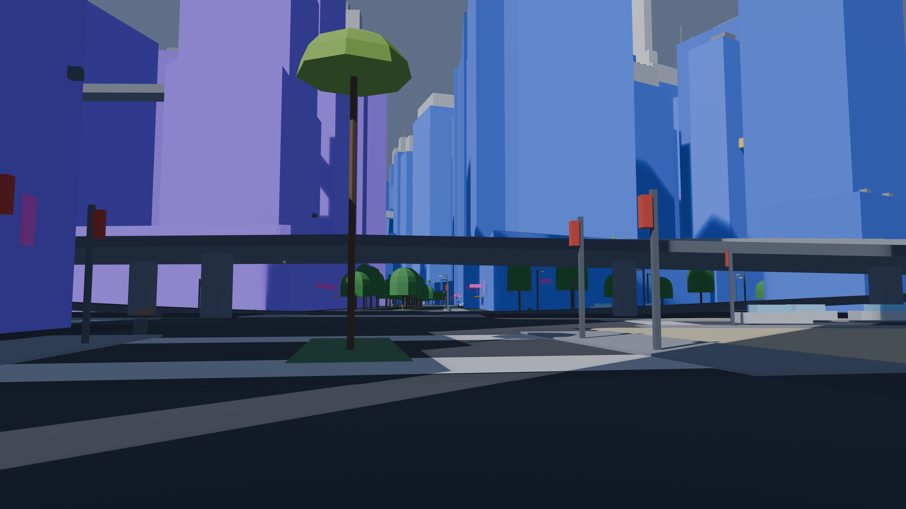
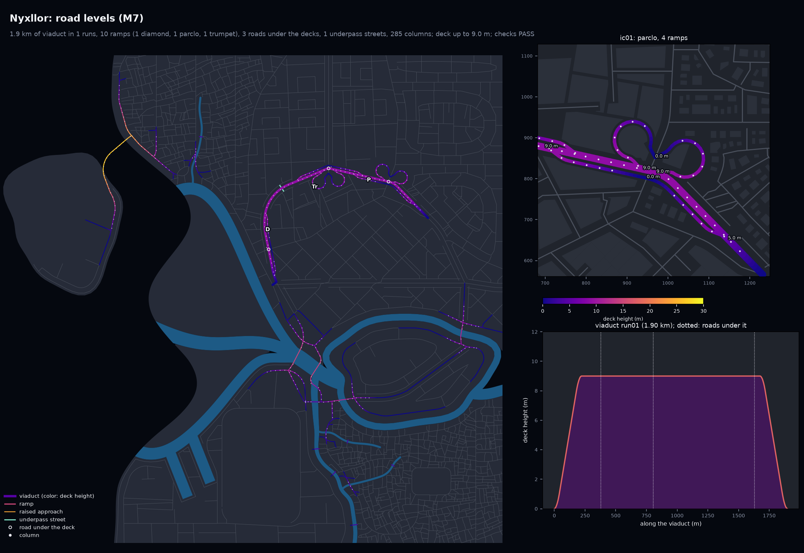

# Nyxllor

A Cyberpunk 2077-inspired open-city game in Unreal Engine 5. The city layout comes from
**citygen**: one text prompt (plus an optional concept image) becomes a complete, water-first
coastal city, built as deterministic offline Python and later as a Blender blockout and Unreal
map. No API calls anywhere: a Claude Code session turns the prompt into a spec through the
`citygen` skill, and everything after that is code.

Full plan: [`docs/citygen_scope.md`](docs/citygen_scope.md).

## Progress

| Milestone | What it adds | Status | Outputs |
|---|---|---|---|
| M0 | Spec format, district presets, `citygen` skill, schematic | Done | [`docs/progress/M0`](docs/progress/M0) |
| M1a | Coast, rivers, deltas, islands, districts, canals, `citygen build` | Done | [`docs/progress/M1a`](docs/progress/M1a) |
| M1a2 | Organic polish: curved districts, meandering water, real deltas | Done | [`docs/progress/M1a2`](docs/progress/M1a2) |
| M1b | Highways, avenues, bridges, megasite reserves | Done | [`docs/progress/M1b`](docs/progress/M1b) |
| M1b_det | Same city byte for byte on x86 and ARM, stage traces | Done | [`docs/progress/M1b_det`](docs/progress/M1b_det) |
| M2 | Local streets, alleys, junctions, sidewalks, blocks, lots, open space | Done | [`docs/progress/M2`](docs/progress/M2) |
| M3 | Buildings, complexes, skybridges, landmarks, megasites | Done | [`docs/progress/M3`](docs/progress/M3) |
| M3p | Polish: megablocks as towers on podiums, complexes in place, canal straddles, boulevard skylines | Done | [`docs/progress/M3p`](docs/progress/M3p) |
| M4 | Blender blockout (.blend, USD, glTF tiles), renders, labeled 2D map, Unreal and graph exports | Done | [`docs/progress/M4`](docs/progress/M4) |
| M5 | Transit: metro, elevated rail, monorail, maglev, sky tubes through towers; stations, supports, station walkways | Done | [`docs/progress/M5`](docs/progress/M5) |
| M6 | Props, vegetation, ground clutter (instanced in the blockout) | Done | [`docs/progress/M6`](docs/progress/M6) |
| M7a | Elevated highways: viaducts, diamond ramps, overpasses, bridge approach grades, underpass streets, road columns | Done | [`docs/progress/M7`](docs/progress/M7) |
| M7b | Trumpet and partial cloverleaf interchanges, art-direction loop, Corporate Core pinned import | Done | [`docs/progress/M7b`](docs/progress/M7b) |
| M8a | Robustness sweep (`citygen sweep`, 68 builds at many seeds) and the fixes it led to: 33 to 49 of 68 builds passing (57 apart from transit), no crashes | Done | [`docs/progress/M8a`](docs/progress/M8a) |
| M8b | Transit loops as one simple ring, stations in route order, lines independent of each other, `transit_self_crossing` check; fast lines placed so their curves fit, faster transit routing; on M8a's code the sweep passes 51 of 68 builds (M8a alone 49) | Done | [`docs/progress/M8b`](docs/progress/M8b) |
| M8c | Transit that passes on a city's first layout: flying loops as Dubins rings, open lines off the roads or as Dubins paths where the roads fail them; Delta Megacity from 9 full-city tries to 1, the sweep 58 of 68 (M8b 51), no transit failures left in it | Done | [`docs/progress/M8c`](docs/progress/M8c) |
| M8d | Trumpet interchange with one loop and one flyover | In progress (paused) | |
| M9 | Tunnels: road tunnels and underwater crossings with portals, metro tunnel geometry, pedestrian underpasses | Planned | |
| M10 | Edit, lock and regenerate: stable ids, one district regenerated alone, pins and overrides, locked versioned cities, model diff | Planned | |
| M11 | Gameplay layer: points of interest, faction and danger zones, traffic and crowd density, parking and fast travel, sign and ad slots, reachability checks | Planned | |
| M12 | Stack interchanges: four-level highway-highway crossings with directional flyovers | Planned | |
| M13 | Terrain: hills, ridges and cliffs; roads, lots and buildings on slopes; tunnels through hills | Planned | |
| M14 | Layered districts: streets, lots and buildings stacked on several deck levels, joined by ramps, stairs and elevators | Planned | |
| M15 | Unreal export tool (end of stage 1): a built city into an Unreal 5.8 World Partition level with collision, materials, instanced props, ids and graphs; updated as later stages come online | Planned | |

## Latest maps (M8c)

Five sample cities are rebuilt and checked at every milestone, so quality is judged across
different coast forms, not one map. M8a swept them and the test specs over many seeds and
fixed what failed (see [`docs/progress/M8a`](docs/progress/M8a)); M8b made every transit
loop one simple ring through its stops in route order. M8c makes transit pass on the layout
a city is first built on: a sky tube or maglev loop is one ring of Dubins paths (straight
runs and arcs at the mode's radius) through its stops, and an open line the roads fail goes
off them, or from stop to stop on Dubins paths. Delta Megacity now builds on its first try
in about a minute (9 tries, about 6 minutes, before), and the sweep passes 58 of 68 builds
with no transit failure left (see [`docs/progress/M8c`](docs/progress/M8c)).

Whole cities in the Blender blockout, seen isometrically from the south (8K images; open one
for full size):

| Nexus City (from the concept image) | Nyxllor (bay, river delta) |
|---|---|
|  |  |

| Nyxllor with the traced Corporate Core on its island | Delta Megacity |
|---|---|
|  |  |

| Saltreach Free Port (archipelago) | Greyhook (peninsula) |
|---|---|
|  |  |

The traced Corporate Core on its island (megatower, traced towers and water pockets):



At street level, beside the viaducts:

| Delta Megacity, beside a viaduct | Nyxllor, corporate core |
|---|---|
|  |  |

Road levels (Nyxllor): every raised road by deck height, the interchanges (a diamond, a
partial cloverleaf and a trumpet), columns, and the profile of one viaduct:



Props and plants at street level (Nyxllor, 180 m insets):


Transit maps (M8c): Delta Megacity on its first layout, before M8c (the Delta Loop's
curve at Research Campus and the monorail's turn at a bridge foot too tight, so the city was
built again eight times) and now:

| Before M8c (same layout) | M8c |
|---|---|
|  |  |

| Nexus City | Nyxllor |
|---|---|
|  |  |

Each M8c city folder has every generator preview, the transit map of M8b, the Blender
renders, the build report and the stage trace, and `docs/progress/M8c/same_layout/` the
transit of M8b and M8c on the same saved layouts; the M8b builds are in
`docs/progress/M8b/`, the M8a sweep tables in `docs/progress/M8a/`, the M7b builds in `docs/progress/M7b/`, the M7a ones in
`docs/progress/M7/`, the 2D maps in `docs/progress/M4/`. Sample specs live in
`docs/progress/M1a2/<city>/city_spec.json` and `cities/nyxllor/city_spec.json`; the pinned
demo's in `docs/progress/M7b/nyxllor_pinned/city_spec.json`, its round 1 and round 2 transit
in `docs/progress/M8b/nyxllor_pinned_round1/` and `nyxllor_pinned_round2/`.

## Where things are

- **Milestone outputs:** `docs/progress/<milestone>/<city>/` (preview images, reports, traces).
- **Work in progress:** while a cloud session runs, it pushes snapshot images to its branch under
  `docs/progress/<milestone>/wip/`. Open the branch on GitHub (Branches tab) to see them before
  the PR is up.
- **Generator:** `citygen/`, tests in `tests/`, skill in `.claude/skills/citygen/`.
- **Earlier hand-traced pipeline** (Corporate Core): `maps/`, `pipeline/`, `out/`, `unreal/`.

## Run it

```
python3.13 -m venv .venv && .venv/bin/pip install -r requirements.txt
.venv/bin/python -m citygen build cities/nyxllor/city_spec.json out/nyxllor --blockout
.venv/bin/python -m pytest -q
```

`--blockout` needs Blender 5.2 (found in `/Applications/Blender*.app`, `$BLENDER` or on PATH)
and adds `city.blend`, `city.usdc`, `tiles/*.glb`, renders and the 2D map to `out/nyxllor`.

To make a new city, open Claude Code in this repo and ask for one (the `citygen` skill takes it
from there).
