# CyberGen

Offline generators for cyberpunk open cities. Stage 1, **citygen**, turns one text prompt (plus
an optional concept image) into a complete, water-first coastal city: deterministic offline
Python, then a Blender blockout and exports for Unreal. No API calls anywhere: a Claude Code
session turns the prompt into a spec through the `citygen` skill, and everything after that is
code.

| Stage | Generator | What it makes | Status |
|---|---|---|---|
| 1 | layoutgen (`citygen`) | Water, districts, roads, streets, lots, buildings, transit, props; Blender blockout, Unreal export | M0 to M8 done, M9 to M15 planned |
| 2 | assetgen | A unique 3D model for every building, plus roads, sidewalks and street furniture; textures | Planned |
| 3 | atmosgen | Lighting, sky, weather and atmospherics in Unreal | Planned |
| 4 | lifegen | Traffic, crowds, trains and aircraft, placed and driven procedurally | Planned |
| 5 | storygen | Story, characters, cutscenes | Planned |

Stages 1 and 2 are city-agnostic and live here. Nyxllor, the Cyberpunk 2077-inspired
open-city game in Unreal Engine 5 that CyberGen is built for, gets its own repo at stage 3.
The sample city called Nyxllor up to M8c is **Vesper Bay** (`cities/vesper_bay`) from then on;
the earlier `docs/progress/<milestone>/nyxllor*` folders keep the old name.

Full plan for stage 1: [`docs/citygen_scope.md`](docs/citygen_scope.md).

## Progress

| Milestone | What it adds | Status | Outputs |
|---|---|---|---|
| M0 | Spec format, district presets, `citygen` skill, schematic | Done | [`docs/progress/M0`](docs/progress/M0) |
| M1a | Coast, rivers, deltas, islands, districts, canals, `citygen build` | Done | [`docs/progress/M1a`](docs/progress/M1a) |
| M1a2 | Organic polish: curved districts, meandering water, real deltas | Done | [`docs/progress/M1a2`](docs/progress/M1a2) |
| M1b | Highways, avenues, bridges, megasite reserves | Done | [`docs/progress/M1b`](docs/progress/M1b) |
| M1b_det | Same city byte for byte on x86 and ARM, stage traces | Done | [`docs/progress/M1b_det`](docs/progress/M1b_det) |
| M2 | Local streets, alleys, junctions, sidewalks, blocks, lots, open space | Done | [`docs/progress/M2`](docs/progress/M2) |
| M3 | Buildings, complexes, skybridges, landmarks, megasites | Done | [`docs/progress/M3`](docs/progress/M3) |
| M3p | Polish: megablocks as towers on podiums, complexes in place, canal straddles, boulevard skylines | Done | [`docs/progress/M3p`](docs/progress/M3p) |
| M4 | Blender blockout (.blend, USD, glTF tiles), renders, labeled 2D map, Unreal and graph exports | Done | [`docs/progress/M4`](docs/progress/M4) |
| M5 | Transit: metro, elevated rail, monorail, maglev, sky tubes through towers; stations, supports, station walkways | Done | [`docs/progress/M5`](docs/progress/M5) |
| M6 | Props, vegetation, ground clutter (instanced in the blockout) | Done | [`docs/progress/M6`](docs/progress/M6) |
| M7a | Elevated highways: viaducts, diamond ramps, overpasses, bridge approach grades, underpass streets, road columns | Done | [`docs/progress/M7`](docs/progress/M7) |
| M7b | Trumpet and partial cloverleaf interchanges, art-direction loop, Corporate Core pinned import | Done | [`docs/progress/M7b`](docs/progress/M7b) |
| M8a | Robustness sweep (`citygen sweep`, 68 builds at many seeds) and the fixes it led to: 33 to 49 of 68 builds passing (57 apart from transit), no crashes | Done | [`docs/progress/M8a`](docs/progress/M8a) |
| M8b | Transit loops as one simple ring, stations in route order, lines independent of each other, `transit_self_crossing` check; fast lines placed so their curves fit, faster transit routing; on M8a's code the sweep passes 51 of 68 builds (M8a alone 49) | Done | [`docs/progress/M8b`](docs/progress/M8b) |
| M8c | Transit that passes on a city's first layout: flying loops as Dubins rings, open lines off the roads or as Dubins paths where the roads fail them; Delta Megacity from 9 full-city tries to 1, the sweep 58 of 68 (M8b 51), no transit failures left in it | Done | [`docs/progress/M8c`](docs/progress/M8c) |
| M8d | Trumpet in its textbook form: one loop and one level-2 flyover round it (crest 16.6 m in Vesper Bay, then Nyxllor), the two-loop form as the fallback; the sweep passes 51 of 68 builds as before, all five trumpets in it take the flyover, the 63 builds without one are byte-identical | Done | [`docs/progress/M8d`](docs/progress/M8d) |
| M9 | Tunnels: road tunnels and underwater crossings with portals, metro tunnel geometry, pedestrian underpasses | Planned | |
| M10 | Edit, lock and regenerate: stable ids, one district regenerated alone, pins and overrides, locked versioned cities, model diff | Planned | |
| M11 | Gameplay layer: named points of interest (bars, clinics, vendors, fixers, hideouts, apartments) with their doors, faction territories and police precincts, wealth, danger and police fields, traffic, crowd and spawn density per street and hour band, parking, taxi stands, fast travel, sign and ad slots; every place reachable on foot and by car (9 checks, 75 in all), `gameplay.json` | Done | [`docs/progress/M11`](docs/progress/M11) |
| M12 | Stack interchanges: four-level highway-highway crossings (one highway lifted through the crossing, eight one-way directional ramps, the left turns as flyovers at 18 and 27 m), the turbine as their fallback, M7's crossing where neither fits; 2 checks (77 in all); the pinned demo's two crosstowns cross in a stack, the five samples are unchanged | Done | [`docs/progress/M12`](docs/progress/M12) |
| M13 | Terrain: hills, ridges and cliffs; roads, lots and buildings on slopes; tunnels through hills | Planned | |
| M14 | Layered districts: streets, lots and buildings stacked on several deck levels, joined by ramps, stairs and elevators | Planned | |
| M15 | Unreal export tool (end of stage 1): a built city into an Unreal 5.8 World Partition level with collision, materials, instanced props, ids and graphs; updated as later stages come online | Planned | |

## Latest maps (M12)

Five sample cities are rebuilt and checked at every milestone, so quality is judged across
different coast forms, not one map. M12 adds stack interchanges where two highways cross with
room for one: one highway lifted to 9 m through the crossing, the other at grade, and eight
one-way directional ramps, the left turns as flyovers at 18 m and 27 m (a turbine, then M7's
crossing, where the stack does not fit). None of the five samples has such a crossing, so
they are as in M11; the pinned demo's highways are now two crosstowns that cross in a stack
in The Stacks (see [`docs/progress/M12`](docs/progress/M12)).

The stack in Vesper Bay Pinned (8K): the Stacks Crosstown on its viaduct over the Bayline,
the tier-2 flyovers at 18 m, the tier-3 flyovers at 27 m over them, the right turns in their
quadrants:

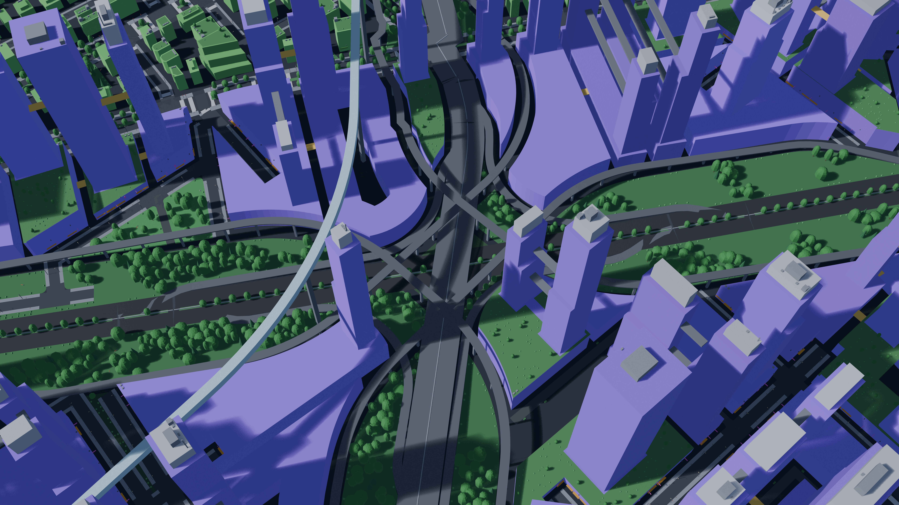

Its road levels: the stack in the inset, each left turn with its tier, and the profiles of
its eight ramps over the 9, 18 and 27 m levels:


M11 added the gameplay layer on top of the finished city:
named points of interest with their doors, gang, corporate and police territories, wealth,
danger and police fields, traffic, crowd and spawn density per street and hour band for
lifegen, parking, taxi stands, fast-travel points, and sign and ad slots for stages 2 and 3.
Every place is reachable on foot and by car, by construction, so no city retries more than
on M8c (see [`docs/progress/M11`](docs/progress/M11)). Before it, M8a swept the samples over
many seeds ([`docs/progress/M8a`](docs/progress/M8a)), M8b made transit loops simple rings,
M8d built the trumpet as one loop and a flyover, and M8c made transit pass on a city's first
layout ([`docs/progress/M8c`](docs/progress/M8c)).

The gameplay layer (Vesper Bay): territories in faction colors (contested turfs hatched) with
points of interest, taxi stands and fast travel; the wealth and danger fields; evening traffic
and late crowds per street; a 300 m street inset with names, doors, curb points and sign
slots:


| Nexus City | Delta Megacity |
|---|---|
| 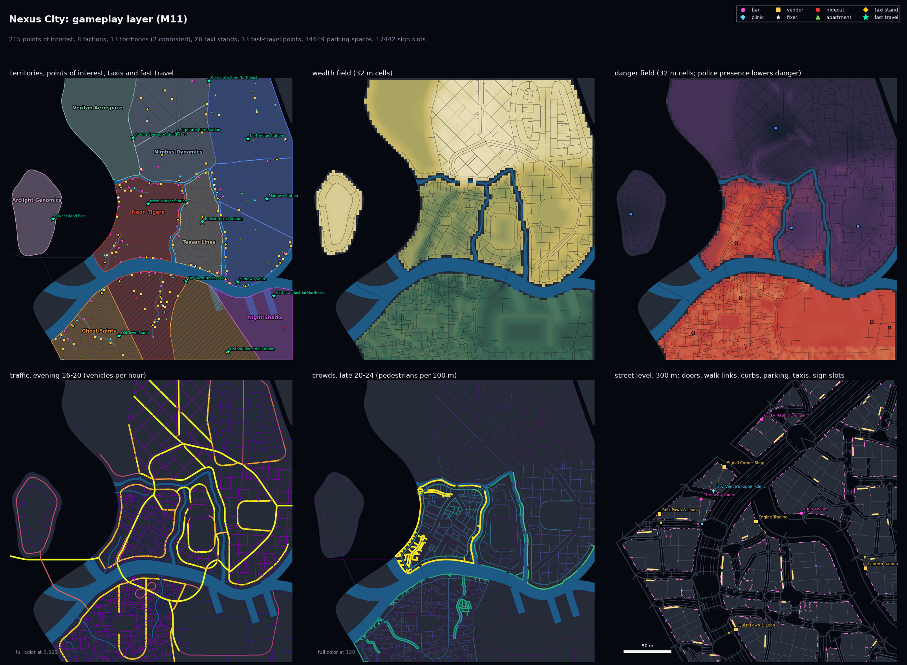 | 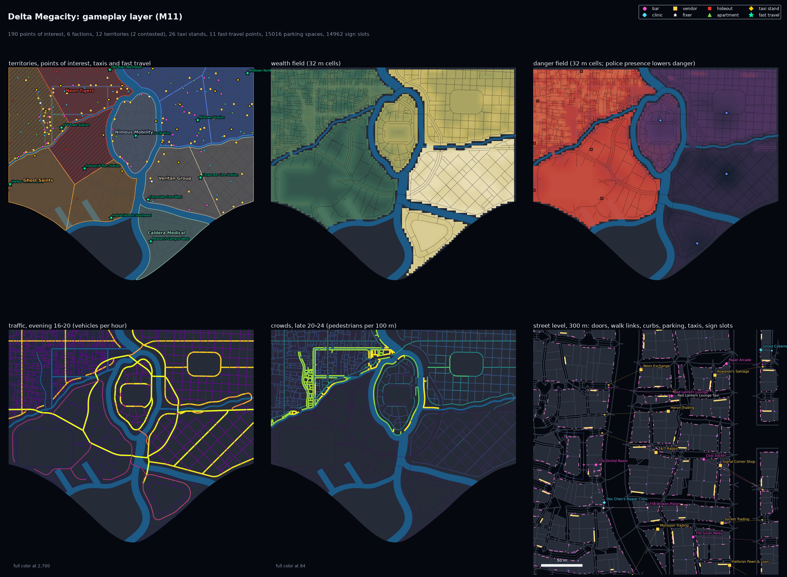 |

Whole cities in the Blender blockout, seen isometrically from the south (8K images; open one
for full size):

| Nexus City (from the concept image) | Vesper Bay (bay, river delta) |
|---|---|
| 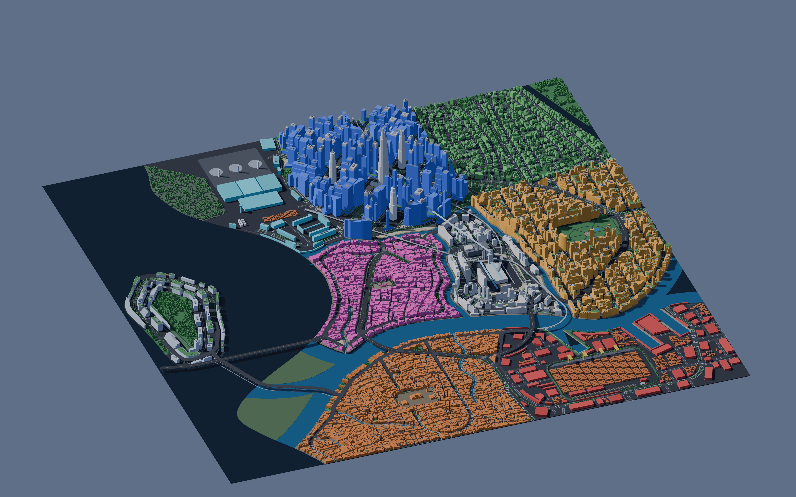 | 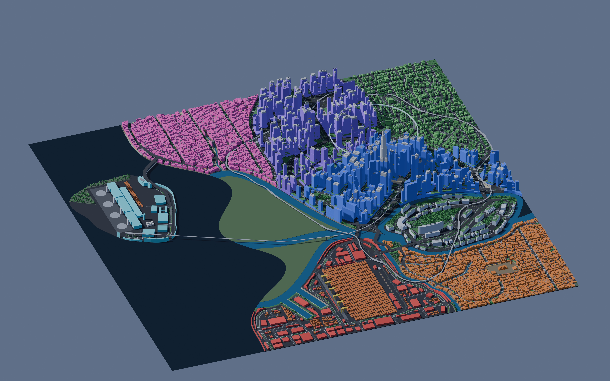 |

| Vesper Bay with the traced Corporate Core on its island and the stack | Delta Megacity |
|---|---|
| 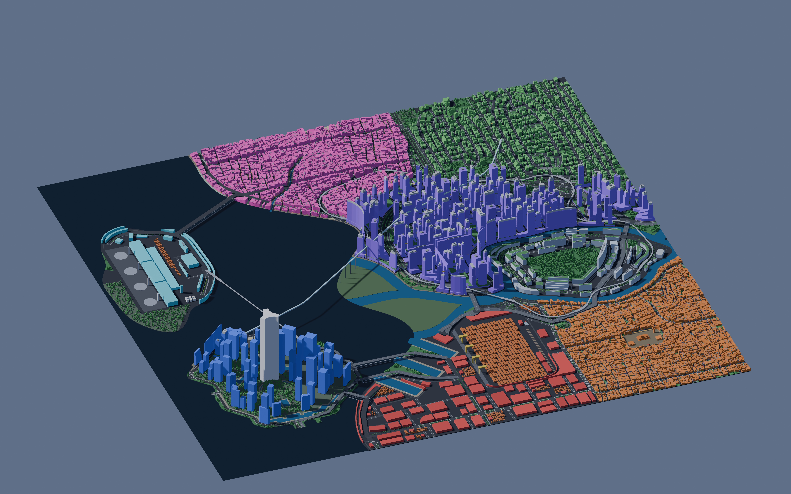 | 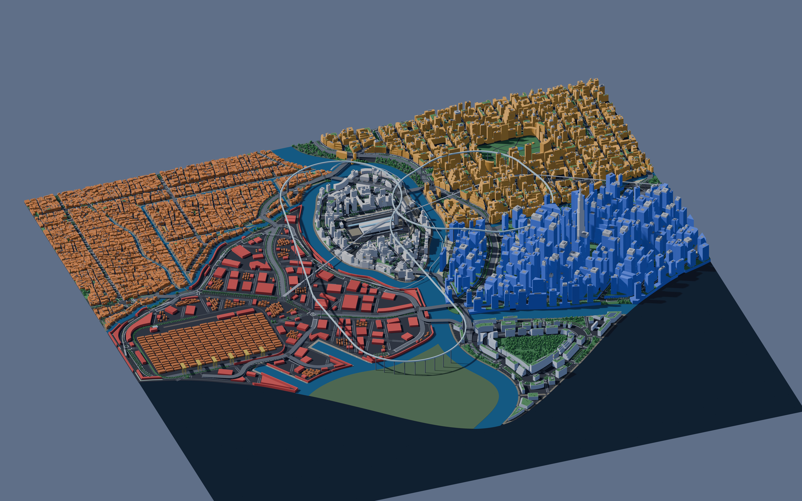 |

| Saltreach Free Port (archipelago) | Greyhook (peninsula) |
|---|---|
| 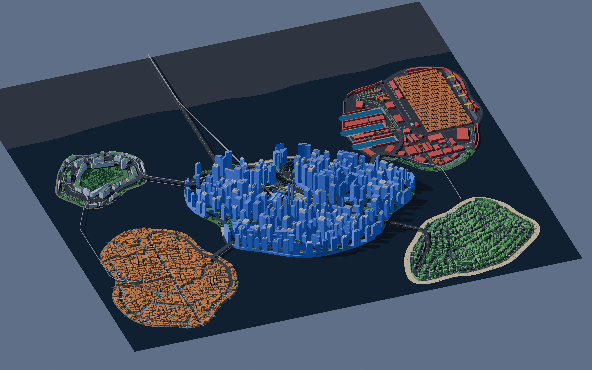 | 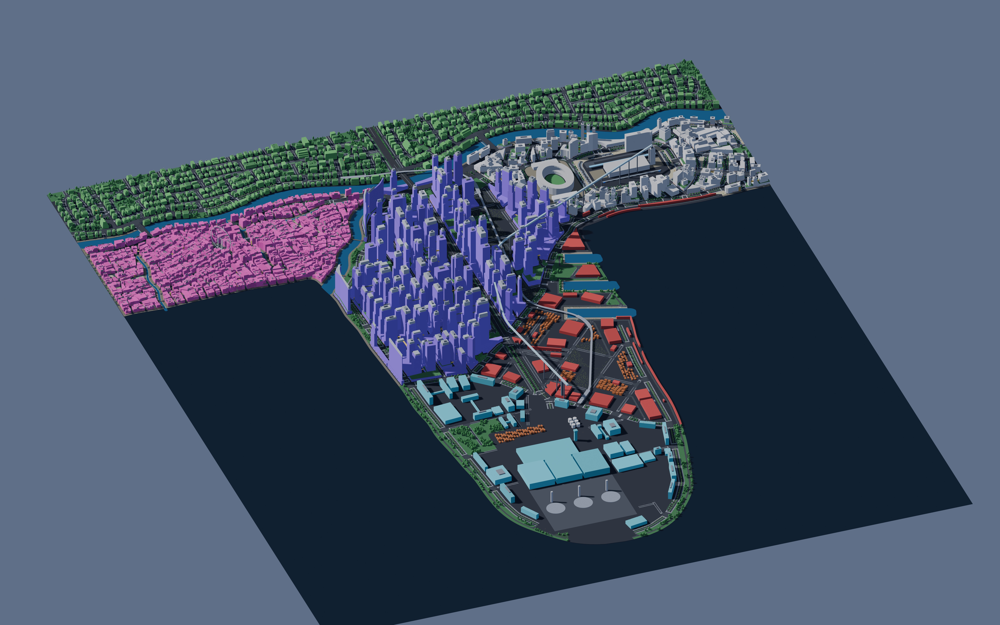 |

The traced Corporate Core on its island (megatower, traced towers and water pockets):


At street level, beside the viaducts:

| Delta Megacity, beside a viaduct | Vesper Bay, corporate core |
|---|---|
|  |  |

Road levels (Vesper Bay, M8d): every raised road by deck height, the interchanges (a diamond, a
partial cloverleaf and a trumpet), columns, and the profile of one viaduct. The trumpet
(inset) now has one loop and a flyover that wraps round it, crosses the deck at 16.6 m
beside the stem and comes down to it:

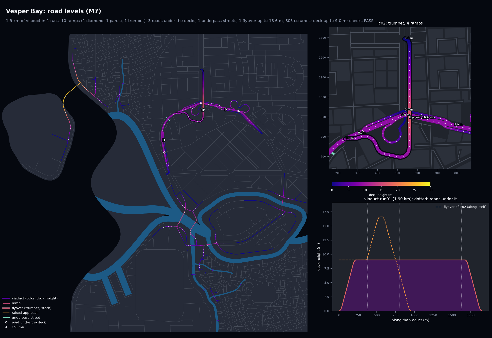

Vesper Bay's trumpet in the blockout (8K): the loop inside, the flyover's bell wrapping round it:


Props and plants at street level (Vesper Bay, 180 m insets):

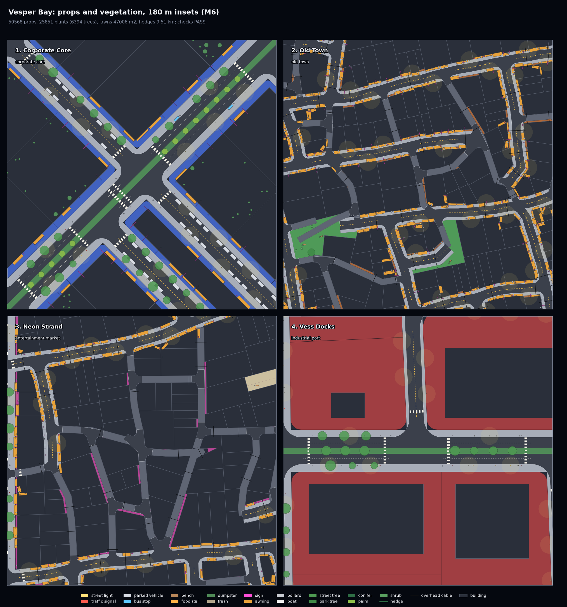

Transit maps (M8c): Delta Megacity on its first layout, before M8c (the Delta Loop's
curve at Research Campus and the monorail's turn at a bridge foot too tight, so the city was
built again eight times) and now:

| Before M8c (same layout) | M8c |
|---|---|
|  |  |

| Nexus City | Vesper Bay |
|---|---|
|  |  |

Each M12 city folder has every generator preview, the build report, the stage trace and the 8K whole-city render (the pinned demo also the stack close-up and its M11 maps); each M11 city folder has every generator preview (`preview_gameplay.png` first), the build report, the stage trace and the 8K whole-city render; each M8c city folder has every generator preview, the transit map of M8b, the Blender
renders, the build report and the stage trace, and `docs/progress/M8c/same_layout/` the
transit of M8b and M8c on the same saved layouts; the M8d builds (the trumpet) are in
`docs/progress/M8d/`, the M8b ones in `docs/progress/M8b/`, the M8a sweep tables in
`docs/progress/M8a/`, the M7b builds in `docs/progress/M7b/`, the M7a ones in
`docs/progress/M7/`, the 2D maps in `docs/progress/M4/`. Sample specs live in
`docs/progress/M1a2/<city>/city_spec.json` and `cities/vesper_bay/city_spec.json`; the pinned
demo's in `cities/vesper_bay_pinned/city_spec.json` (first in
`docs/progress/M7b/nyxllor_pinned/`), its round 1 and round 2 transit in
`docs/progress/M8b/nyxllor_pinned_round1/` and `nyxllor_pinned_round2/`. `docs/progress/M8c/vesper_bay*/`
are the same layouts as `nyxllor*/` there, built again under the new name.

## Where things are

- **Milestone outputs:** `docs/progress/<milestone>/<city>/` (preview images, reports, traces).
- **Work in progress:** while a milestone session runs, it pushes snapshot images to its branch under
  `docs/progress/<milestone>/wip/`. Open the branch on GitHub (Branches tab) to see them before
  the PR is up.
- **Generator:** `citygen/`, tests in `tests/`, skill in `.claude/skills/citygen/`.
- **Earlier hand-traced pipeline** (Corporate Core, Nyxllor's first district; moves to the
  nyxllor repo at stage 3 except the traced map, which the pinned demo imports): `maps/`,
  `pipeline/`, `out/`, `unreal/`.

## Run it

```
python3.13 -m venv .venv && .venv/bin/pip install -r requirements.txt
.venv/bin/python -m citygen build cities/vesper_bay/city_spec.json out/vesper_bay --blockout
.venv/bin/python -m pytest -q
```

`--blockout` needs Blender 5.2 (found in `/Applications/Blender*.app`, `$BLENDER` or on PATH)
and adds `city.blend`, `city.usdc`, `tiles/*.glb`, renders and the 2D map to `out/vesper_bay`.

To make a new city, open Claude Code in this repo and ask for one (the `citygen` skill takes it
from there).
