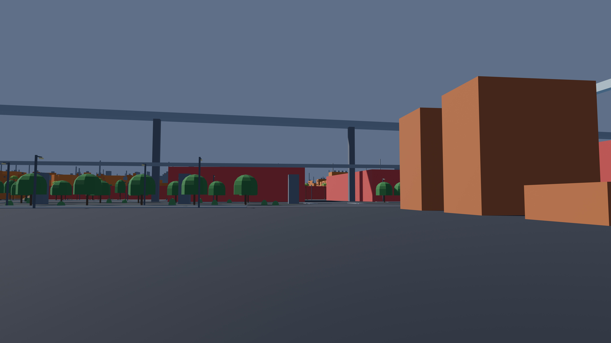
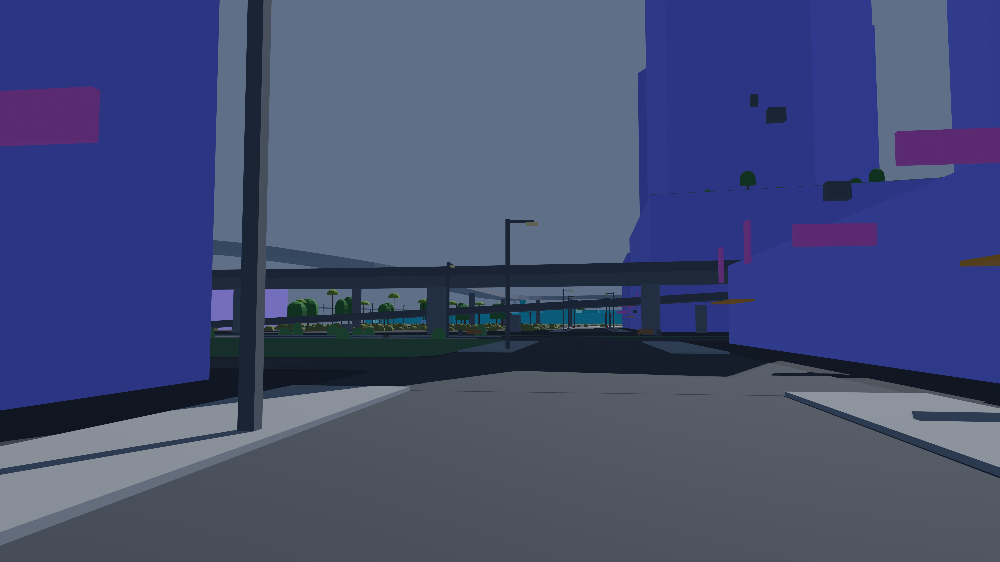
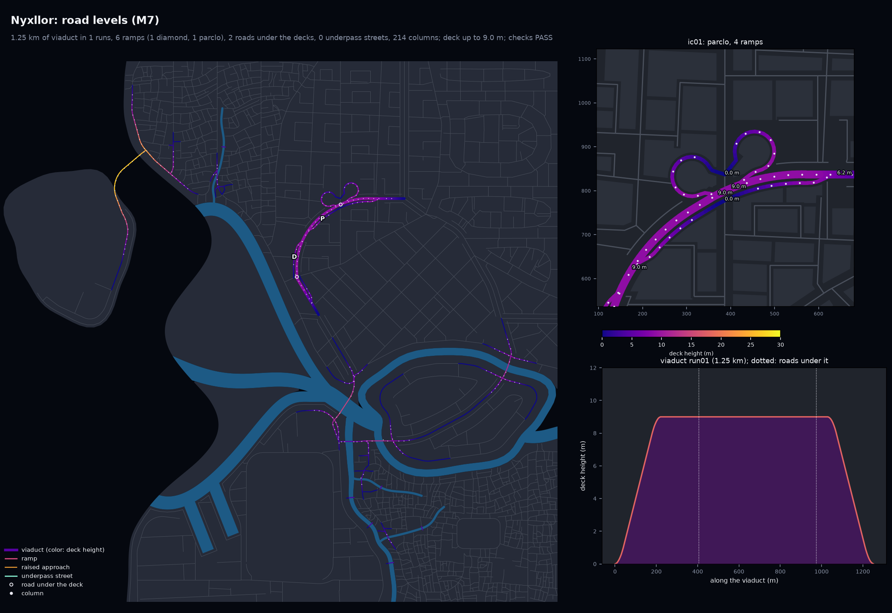

# Nyxllor

A Cyberpunk 2077-inspired open-city game in Unreal Engine 5. The city layout comes from
**citygen**: one text prompt (plus an optional concept image) becomes a complete, water-first
coastal city, built as deterministic offline Python and later as a Blender blockout and Unreal
map. No API calls anywhere: a Claude Code session turns the prompt into a spec through the
`citygen` skill, and everything after that is code.

Full plan: [`docs/citygen_scope.md`](docs/citygen_scope.md).

## Progress

| Milestone | What it adds | Status | Outputs |
|---|---|---|---|
| M0 | Spec format, district presets, `citygen` skill, schematic | Done | [`docs/progress/M0`](docs/progress/M0) |
| M1a | Coast, rivers, deltas, islands, districts, canals, `citygen build` | Done | [`docs/progress/M1a`](docs/progress/M1a) |
| M1a2 | Organic polish: curved districts, meandering water, real deltas | Done | [`docs/progress/M1a2`](docs/progress/M1a2) |
| M1b | Highways, avenues, bridges, megasite reserves | Done | [`docs/progress/M1b`](docs/progress/M1b) |
| M1b_det | Same city byte for byte on x86 and ARM, stage traces | Done | [`docs/progress/M1b_det`](docs/progress/M1b_det) |
| M2 | Local streets, alleys, junctions, sidewalks, blocks, lots, open space | Done | [`docs/progress/M2`](docs/progress/M2) |
| M3 | Buildings, complexes, skybridges, landmarks, megasites | Done | [`docs/progress/M3`](docs/progress/M3) |
| M3p | Polish: megablocks as towers on podiums, complexes in place, canal straddles, boulevard skylines | Done | [`docs/progress/M3p`](docs/progress/M3p) |
| M4 | Blender blockout (.blend, USD, glTF tiles), renders, labeled 2D map, Unreal and graph exports | Done | [`docs/progress/M4`](docs/progress/M4) |
| M5 | Transit: metro, elevated rail, monorail, maglev, sky tubes through towers; stations, supports, station walkways | Done | [`docs/progress/M5`](docs/progress/M5) |
| M6 | Props, vegetation, ground clutter (instanced in the blockout) | Done | [`docs/progress/M6`](docs/progress/M6) |
| M7a | Elevated highways: viaducts, diamond ramps, overpasses, bridge approach grades, underpass streets, road columns | Done | [`docs/progress/M7`](docs/progress/M7) |
| M7b | Trumpet and partial cloverleaf interchanges, art-direction loop, Corporate Core pinned import | Done | [`docs/progress/M7b`](docs/progress/M7b) |
| M8a | Robustness sweep (`citygen sweep`, 68 builds at many seeds) and the fixes it led to: 33 to 49 of 68 builds passing (57 apart from transit), no crashes | Done | [`docs/progress/M8a`](docs/progress/M8a) |

## Latest maps (M8a)

Five sample cities are rebuilt and checked at every milestone, so quality is judged across
different coast forms, not one map. M8a swept them and the test specs over many seeds and fixed
what failed: highways that hooked along the map edge at exits, islands that did not fit,
islands cut off from the roads, level steps on loop roads and footbridges, side-by-side
duplicate roads, a crash. The sweep went from 33 to 49 of 68 builds passing every check
(see [`docs/progress/M8a`](docs/progress/M8a)).

Whole cities in the Blender blockout, seen isometrically from the south (8K images; open one
for full size):

| Nexus City (from the concept image) | Nyxllor (bay, river delta) |
|---|---|
|  |  |

| Nyxllor with the traced Corporate Core on its island | Delta Megacity |
|---|---|
|  |  |

| Saltreach Free Port (archipelago) | Greyhook (peninsula) |
|---|---|
|  |  |

The traced Corporate Core on its island (megatower, traced towers and water pockets):


At street level, beside the viaducts:

| Delta Megacity, beside a viaduct | Nyxllor, corporate core |
|---|---|
|  |  |

Road levels (Nyxllor, M8a): every raised road by deck height, the interchanges (a diamond, a
partial cloverleaf and a trumpet), columns, and the profile of one viaduct:



Props and plants at street level (M6, Nyxllor, 180 m insets):


Transit maps (M5):

| Nexus City | Nyxllor |
|---|---|
|  |  |

Each M8a city folder has the previews, the Blender renders, the build report and the stage
trace; the M7b ones are in `docs/progress/M7b/`, the M7a ones in `docs/progress/M7/`. The
props previews are in `docs/progress/M6/`, the transit maps in `docs/progress/M5/`, the 2D
maps in `docs/progress/M4/`, the other generator previews in `docs/progress/M3p/`. Sample specs live
in `docs/progress/M1a2/<city>/city_spec.json` and `cities/nyxllor/city_spec.json`; the
pinned demo's in `docs/progress/M7b/nyxllor_pinned/city_spec.json`.

## Where things are

- **Milestone outputs:** `docs/progress/<milestone>/<city>/` (preview images, reports, traces).
- **Work in progress:** while a cloud session runs, it pushes snapshot images to its branch under
  `docs/progress/<milestone>/wip/`. Open the branch on GitHub (Branches tab) to see them before
  the PR is up.
- **Generator:** `citygen/`, tests in `tests/`, skill in `.claude/skills/citygen/`.
- **Earlier hand-traced pipeline** (Corporate Core): `maps/`, `pipeline/`, `out/`, `unreal/`.

## Run it

```
python3.13 -m venv .venv && .venv/bin/pip install -r requirements.txt
.venv/bin/python -m citygen build cities/nyxllor/city_spec.json out/nyxllor --blockout
.venv/bin/python -m pytest -q
```

`--blockout` needs Blender 5.2 (found in `/Applications/Blender*.app`, `$BLENDER` or on PATH)
and adds `city.blend`, `city.usdc`, `tiles/*.glb`, renders and the 2D map to `out/nyxllor`.

To make a new city, open Claude Code in this repo and ask for one (the `citygen` skill takes it
from there).
