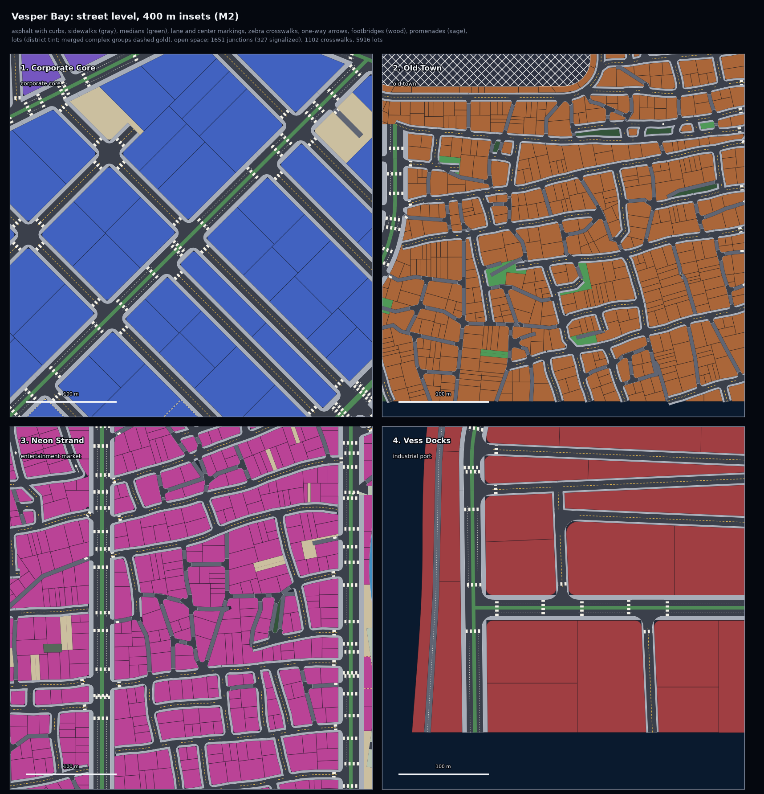
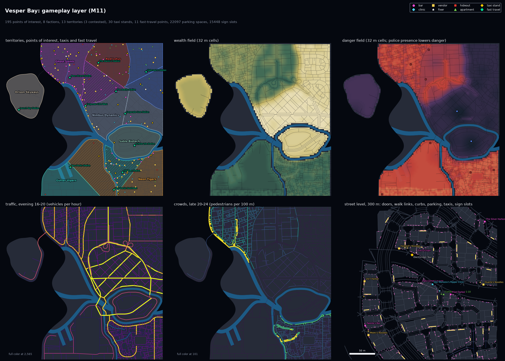
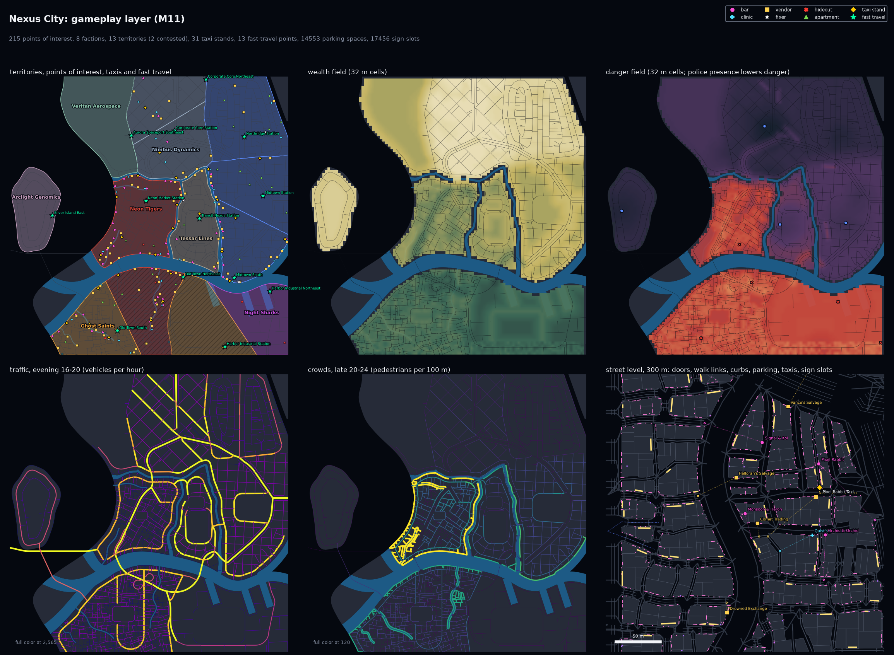
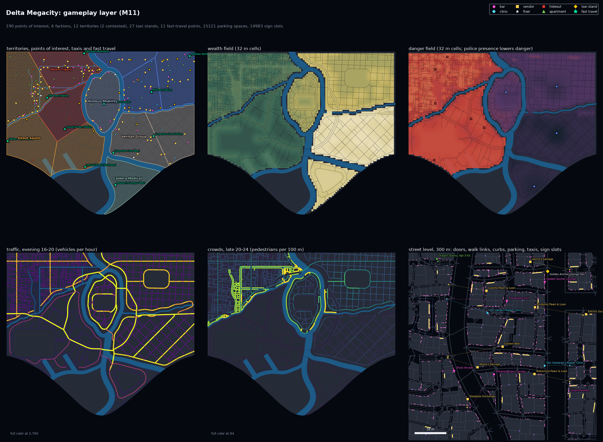
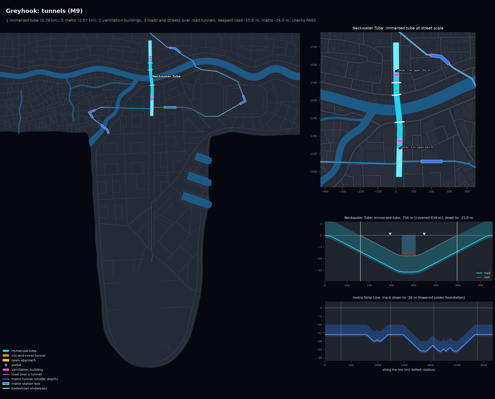
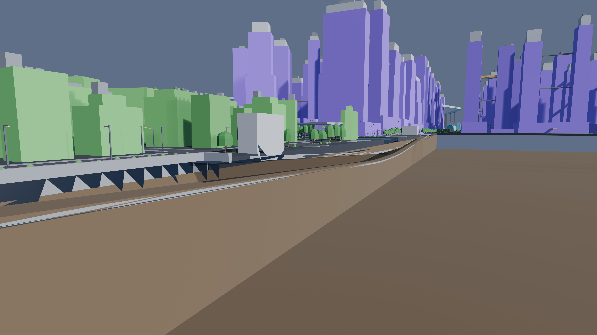
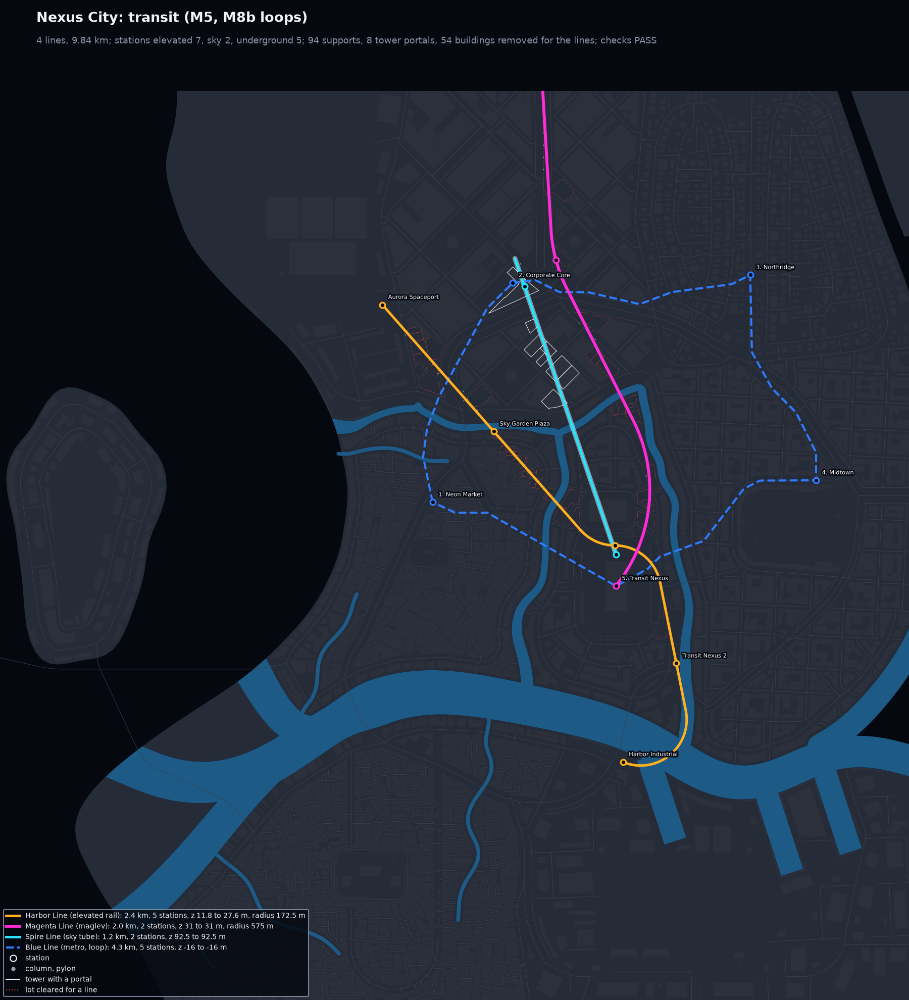

# CyberGen

Offline generators for cyberpunk open cities, in five stages: from one text prompt to a city
that is laid out, modelled, lit, populated and given a story. Describe a city to Claude Code,
the `citygen` skill turns the description into a spec, and the generators build the rest on
your machine.

| Stage | Generator | What it makes | Status |
|---|---|---|---|
| 1 | [layoutgen](#stage-1-layoutgen) (`citygen`) | The city's layout: water, districts, roads, buildings, transit, props and gameplay data, as a Blender blockout | M0 to M12 done, M13 to M15 to come |
| 2 | [assetgen](#stage-2-assetgen) | A unique 3D model for every building, plus street elements and textures | Planning |
| 3 | [atmosgen](#stages-3-to-5) | Lighting, sky, weather and atmospherics | Planned |
| 4 | [lifegen](#stages-3-to-5) | Traffic, crowds, trains and aircraft, generated | Planned |
| 5 | [storygen](#stages-3-to-5) | Story, characters and cutscenes | Planned |

---

## Stage 1: layoutgen

`citygen` turns a prompt (and an optional concept image) into a complete city layout, then
builds a 3D blockout of it in Blender and exports it for game engines such as Unreal.

Spec: [`docs/citygen_scope.md`](docs/citygen_scope.md) · Full milestone log:
[`docs/citygen_milestones.md`](docs/citygen_milestones.md) · Builds:
[`docs/progress/`](docs/progress)

### Cities

Whole cities in the Blender blockout, seen from the south (8K; open one for full size).

| Vesper Bay | Nexus City |
|---|---|
|  |  |

| Delta Megacity | Saltreach Free Port |
|---|---|
|  |  |

| Greyhook | Vesper Bay with the hand-traced Corporate Core |
|---|---|
|  |  |

| Vesper Bay Stacks (stack interchange demo) | The traced Corporate Core up close |
|---|---|
|  |  |

### Layers

| Districts, water, roads and lots | Buildings |
|---|---|
|  |  |

| Street level: lanes, sidewalks, crosswalks | Props and plants |
|---|---|
|  |  |

Gameplay layer: faction turf, places to go, wealth and danger, traffic and crowds by hour.



| Gameplay, Nexus City | Gameplay, Delta Megacity |
|---|---|
|  |  |

| Road levels: viaducts, ramps, interchanges | Stack interchange levels and ramp profiles |
|---|---|
|  |  |

| Stack interchange (8K) | Trumpet interchange (8K) |
|---|---|
|  |  |

| Tunnel under a river (Greyhook) | Tunnel under a district (Nexus City) |
|---|---|
|  |  |

| Cutaway along the river tunnel (8K) | Cutaway along the district tunnel (8K) |
|---|---|
|  |  |

| Transit, Delta Megacity | Transit, Nexus City | Transit, Vesper Bay |
|---|---|---|
|  |  |  |

| Street level beside a viaduct (Delta Megacity) | Street level in the Corporate Core (Vesper Bay) |
|---|---|
|  |  |

### Milestones

| | Milestone | What it adds | Status |
|---|---|---|---|
| M0 | City spec | Spec format, district presets, the prompt-to-spec skill | ✅ Done |
| M1 | Water, districts, main roads | Coasts, rivers, deltas, islands, districts, highways, avenues, bridges | ✅ Done |
| M2 | Streets and lots | Local streets, junctions, sidewalks, crosswalks, blocks, lots, open space | ✅ Done |
| M3 | Buildings | Towers, megablocks, landmarks, complexes, skybridges, megasites | ✅ Done |
| M4 | Blockout | Blender model, renders, 2D map, USD and glTF exports | ✅ Done |
| M5 | Transit | Metro, elevated rail, monorail, maglev, sky tubes, stations | ✅ Done |
| M6 | Props and plants | Street furniture, parked cars, signs, trees, greenery | ✅ Done |
| M7 | Elevated highways | Viaducts, ramps, interchanges; importing a hand-traced district | ✅ Done |
| M8 | Reliability | A working city from any seed; better transit and interchanges | ✅ Done |
| M9 | Tunnels | Road tunnels under districts and water, metro tunnels, pedestrian underpasses | ✅ Done |
| M10 | Editing | Regenerate one district, keep or change single buildings, freeze a version | ✅ Done |
| M11 | Gameplay layer | Places, factions, wealth and danger, traffic and crowd data, parking, fast travel | ✅ Done |
| M12 | Stack interchanges | Four-level highway crossings | ✅ Done |
| M13 | Terrain | Hills, cliffs and plateaus; roads and buildings on slopes | 🚧 In progress |
| M14 | Layered districts | Streets and buildings on stacked deck levels | Planned |
| M15 | Unreal export | The city as an Unreal Engine 5.8 level (end of stage 1) | 🚧 In progress |

### Run it

```
python3.13 -m venv .venv && .venv/bin/pip install -r requirements.txt
.venv/bin/python -m citygen build cities/vesper_bay/city_spec.json out/vesper_bay --blockout
.venv/bin/python -m pytest -q
```

`--blockout` needs Blender 5.2. To make a new city, open Claude Code in this repo and ask for
one (the `citygen` skill takes it from there). Editing, locking and the other commands:
[`docs/citygen_milestones.md`](docs/citygen_milestones.md).

---

## Stage 2: assetgen

A unique 3D model for every building in a stage 1 city, generated from its footprint, massing
and use, plus roads, sidewalks, street furniture and textures. Each milestone's assets go
into Unreal through the same exporter as stage 1's city, replacing the blockout piece by piece.

Spec: [`docs/assetgen_scope.md`](docs/assetgen_scope.md) · Full milestone log:
[`docs/assetgen_milestones.md`](docs/assetgen_milestones.md)


Every facade edge of Vesper Bay by what it faces: the main street (red), other streets,
alleys, water, plazas and parks, party walls (black), blind walls, yards, and walls above
their neighbors.

```bash
.venv/bin/python -m assetgen spec validate cities/vesper_bay/asset_spec.json --build out/vesper_bay
.venv/bin/python -m assetgen brief out/vesper_bay --spec cities/vesper_bay/asset_spec.json
.venv/bin/python -m assetgen brief diff out/vesper_bay out/vesper_bay_regenerated
```

The asset spec (art direction per era, district, owner and landmark) is written from the
city prompt by a Claude Code session through the repo's `assetgen` skill; the brief stage
writes `out/<city>/assets/briefs.json`, everything each building's model will be made from,
with a hash per building, so a regenerated district rebuilds only its own assets.

### Milestones

| | Milestone | What it adds | Status |
|---|---|---|---|
| AG0 | Groundwork | Art direction spec and skill, a brief of what every building is made from (facade edges by what they face), glTF writer, three test buildings in Unreal | Done |
| AG1 | Building shells | Walls, floors and window openings for every building | Planned |
| AG2 | Facades | Windows, balconies, fins and facade styles per era; massing details | Planned |
| AG3 | Street fronts | Shopfronts, doors, lobbies, loading docks, awnings, sign boxes | Planned |
| AG4 | Roofs and connections | Roof equipment, helipads, green roofs, skybridges, sky tube portals | Planned |
| AG5 | Building types and landmarks | Megabuildings, shanties, industrial and civic types, landmarks, buildings on slopes | Planned |
| AG6 | Materials and textures | Texture library per era, trim sheets, decals, window interiors, signage | Planned |
| AG7 | Street elements | Roads with markings, sidewalks, bridges, viaducts, tunnels, quays, transit structures | Planned |
| AG8 | Props, plants and signs | Street furniture, trees, neon signs, billboards, holo-ads | Planned |
| AG9 | Every city modelled | All sample cities with their assets, in Blender and Unreal; frozen releases | Planned |
| AG10 | Layered districts | Buildings and streets on stacked decks | Planned |
| AG11 | Interiors | Enterable bars, clinics, shops and apartments | Maybe |

---

## Stages 3 to 5

- **atmosgen:** lighting, shadows, sky, clouds and weather in Unreal.
- **lifegen:** cars, crowds, trains and aircraft placed and driven procedurally on stage 1's
  lane, walkway and transit graphs.
- **storygen:** story, characters and cutscenes.

---

## Repo layout

- `citygen/`: the stage 1 generator. Tests in `tests/`, prompt-to-spec skill in
  `.claude/skills/citygen/`.
- `cities/`: city specs (Vesper Bay and its two demos; the other samples' specs are in
  `docs/progress/M1a2/<city>/`).
- `docs/`: each stage's spec (`<generator>_scope.md`) and full milestone log
  (`<generator>_milestones.md`); `docs/progress/<milestone>/` holds each milestone's builds
  and images; `docs/unreal_export.md` describes the Unreal exporter every stage shares.
- `maps/`, `pipeline/`, `reference/`, `unreal/`, `out/`: an earlier hand-tracing pipeline; its
  traced Corporate Core map is the pinned demo's input.

Each later stage adds its own package, spec, milestone log and README section the same way.
