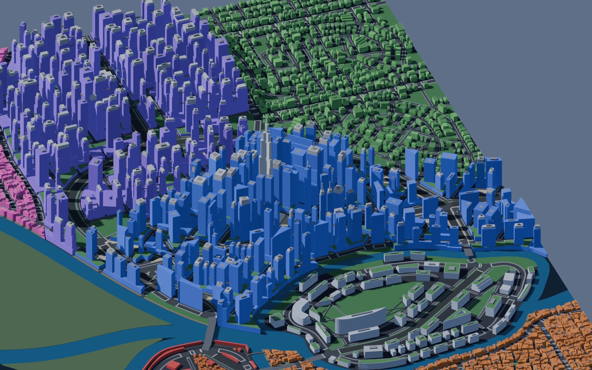
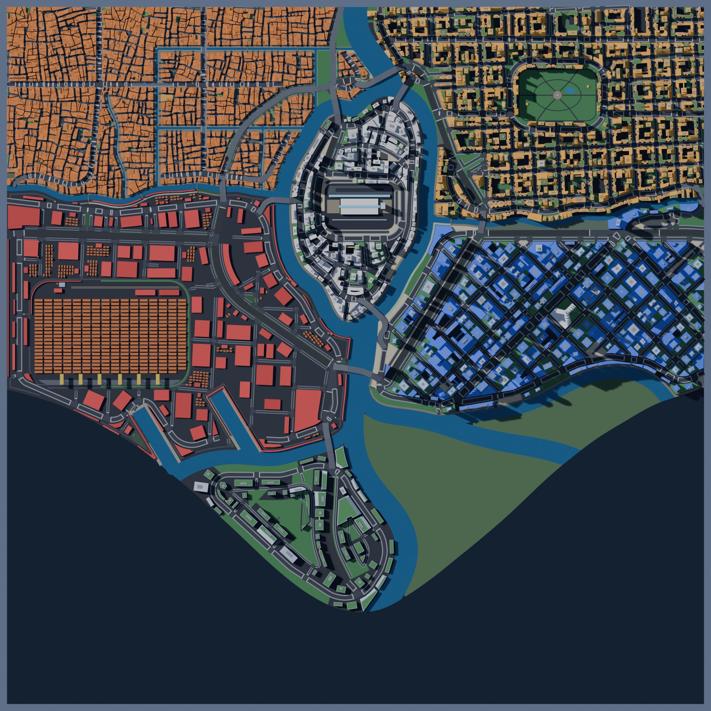
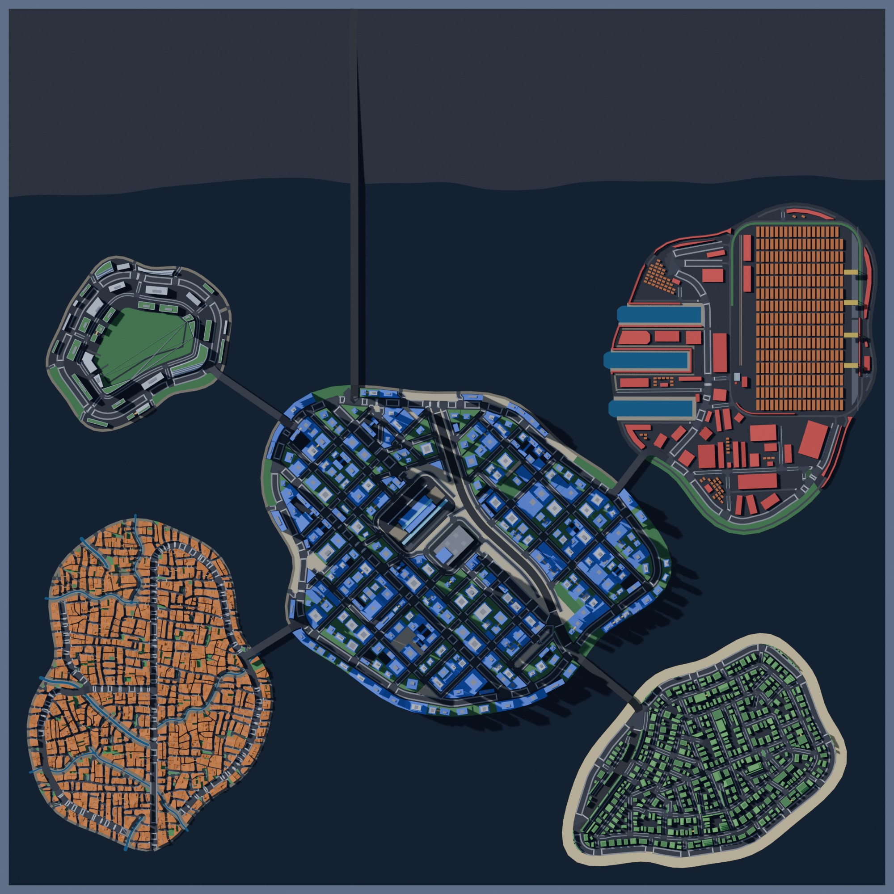

# Nyxllor

A Cyberpunk 2077-inspired open-city game in Unreal Engine 5. The city layout comes from
**citygen**: one text prompt (plus an optional concept image) becomes a complete, water-first
coastal city, built as deterministic offline Python and later as a Blender blockout and Unreal
map. No API calls anywhere: a Claude Code session turns the prompt into a spec through the
`citygen` skill, and everything after that is code.

Full plan: [`docs/citygen_scope.md`](docs/citygen_scope.md).

## Progress

| Milestone | What it adds | Status | Outputs |
|---|---|---|---|
| M0 | Spec format, district presets, `citygen` skill, schematic | Done | [`docs/progress/M0`](docs/progress/M0) |
| M1a | Coast, rivers, deltas, islands, districts, canals, `citygen build` | Done | [`docs/progress/M1a`](docs/progress/M1a) |
| M1a2 | Organic polish: curved districts, meandering water, real deltas | Done | [`docs/progress/M1a2`](docs/progress/M1a2) |
| M1b | Highways, avenues, bridges, megasite reserves | Done | [`docs/progress/M1b`](docs/progress/M1b) |
| M1b_det | Same city byte for byte on x86 and ARM, stage traces | Done | [`docs/progress/M1b_det`](docs/progress/M1b_det) |
| M2 | Local streets, alleys, junctions, sidewalks, blocks, lots, open space | Done | [`docs/progress/M2`](docs/progress/M2) |
| M3 | Buildings, complexes, skybridges, landmarks, megasites | Done | [`docs/progress/M3`](docs/progress/M3) |
| M3p | Polish: megablocks as towers on podiums, complexes in place, canal straddles, boulevard skylines | Done | [`docs/progress/M3p`](docs/progress/M3p) |
| M4 | Blender blockout (.blend, USD, glTF tiles), renders, labeled 2D map, Unreal and graph exports | Done | [`docs/progress/M4`](docs/progress/M4) |
| M5 | Transit (metro to sky tubes), elevated walkways | Planned | |
| M6 | Props, vegetation, ground clutter | Planned | |
| M7 | Elevated highways, ramps, interchanges | Planned | |

## Latest maps (M4)

Five sample cities are rebuilt and checked at every milestone, so quality is judged across
different coast forms, not one map. Blender blockout renders (EEVEE, walls tinted by district
archetype, landmarks white, skybridges gold):

| Nyxllor, Corporate Core (bay, river delta) | Nexus City from the top (from the concept image) |
|---|---|
|  |  |

| Delta Megacity (delta) | Saltreach Free Port (archipelago) | Greyhook, The Stacks (peninsula) |
|---|---|---|
|  |  |  |

Eye level in Saltreach's old town, toward the Crown Island towers:


Each M4 city folder has one isometric render per district (`render_iso_<district>.jpg`),
street views, the labeled 2D map (`map_2d.png`, and `map_2d.svg` with Inkscape layers) and
`blockout_report.txt`. The generator's own previews (`preview_map.png`,
`preview_detail.png`, `preview_massing.png`, reports and stage traces) are in
`docs/progress/M3p/`. Sample specs live in `docs/progress/M1a2/<city>/city_spec.json` and
`cities/nyxllor/city_spec.json`.

## Where things are

- **Milestone outputs:** `docs/progress/<milestone>/<city>/` (preview images, reports, traces).
- **Work in progress:** while a cloud session runs, it pushes snapshot images to its branch under
  `docs/progress/<milestone>/wip/`. Open the branch on GitHub (Branches tab) to see them before
  the PR is up.
- **Generator:** `citygen/`, tests in `tests/`, skill in `.claude/skills/citygen/`.
- **Earlier hand-traced pipeline** (Corporate Core): `maps/`, `pipeline/`, `out/`, `unreal/`.

## Run it

```
python3.13 -m venv .venv && .venv/bin/pip install -r requirements.txt
.venv/bin/python -m citygen build cities/nyxllor/city_spec.json out/nyxllor --blockout
.venv/bin/python -m pytest -q
```

`--blockout` needs Blender 5.2 (found in `/Applications/Blender*.app`, `$BLENDER` or on PATH)
and adds `city.blend`, `city.usdc`, `tiles/*.glb`, renders and the 2D map to `out/nyxllor`.

To make a new city, open Claude Code in this repo and ask for one (the `citygen` skill takes it
from there).
