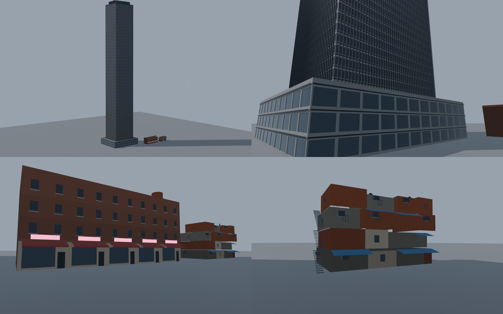
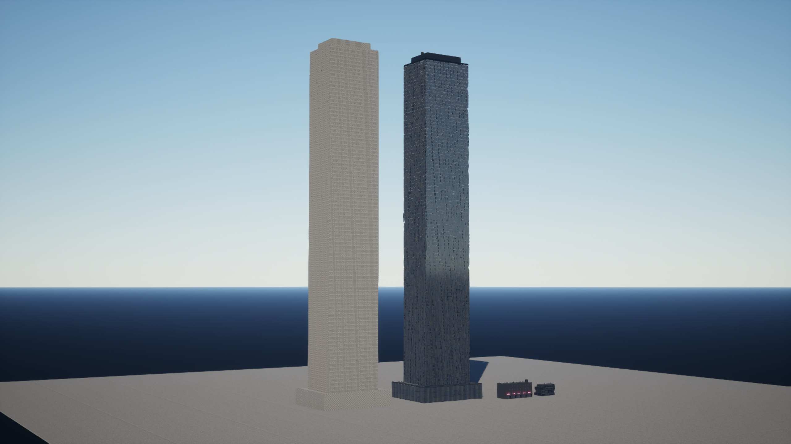
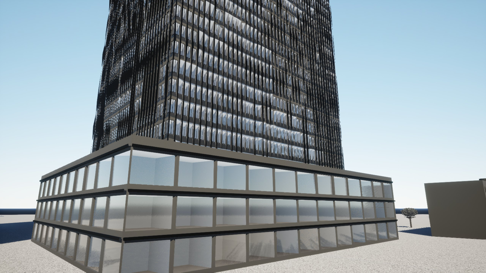
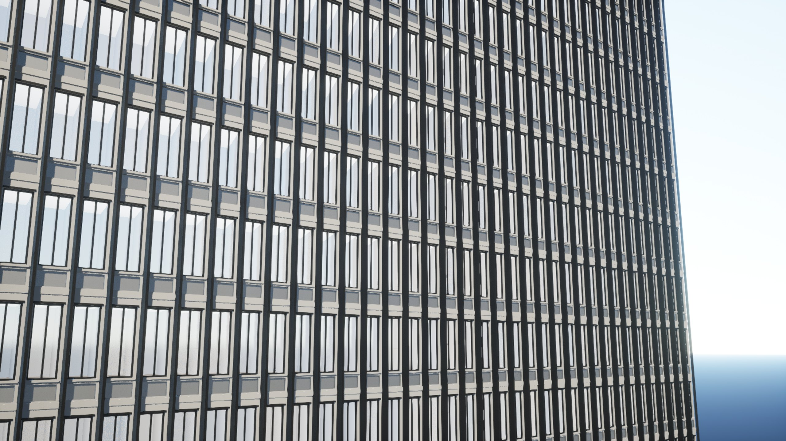
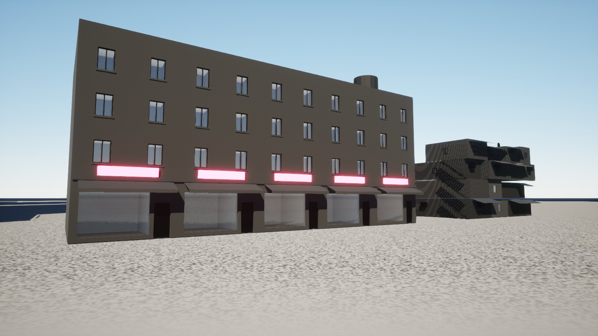
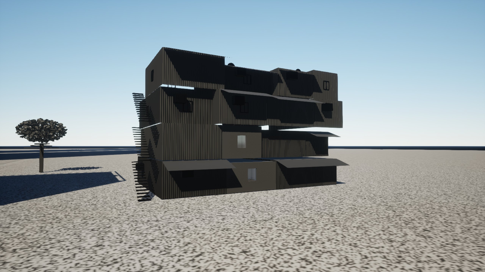
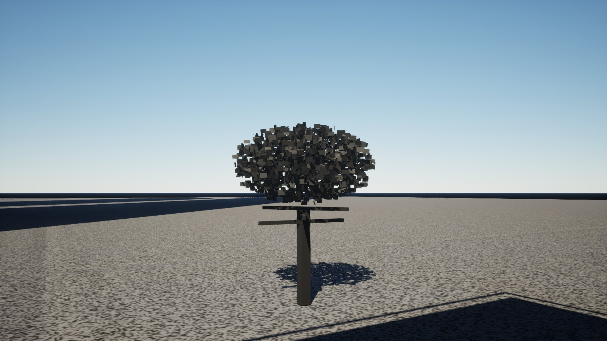

# AG0: contract and spike

The first milestone of stage 2. assetgen can now read a built city and say, for every
building, everything its model will be made from (its brief, hashed), write meshes as
deterministic glTF on integer millimeters, and take art direction from an asset spec written
by a session from the city prompt. The spike put three generated buildings (and a test tree)
into Unreal 5.8 to measure what the scope had only estimated; the numbers replace section 11's
estimates.

| Command | What it does |
|---|---|
| `assetgen spec validate SPEC [--build BUILD] [--filled OUT]` | checks an asset spec (names against the city with `--build`), fills every era from its preset |
| `assetgen spec schema [OUT]` | the asset spec's JSON Schema (`assetgen/schemas/asset_spec.schema.json`) |
| `assetgen brief BUILD [--spec S] [--overrides O] [--out DIR]` | `BUILD/assets/briefs.json` (a brief and sha256 per building), `brief_report.json`, `preview_edges.png` |
| `assetgen brief diff A B [--json F]` | briefs added, removed and changed between two builds, and which fields |
| `assetgen brief schema [OUT]` | the brief's JSON Schema (`assetgen/schemas/brief.schema.json`), the contract for AG1 on |
| `assetgen spike OUT [--quantized]` | the spike buildings as glTF, `unreal_contribution.json` (assetgen's entries for the Unreal exporter), `spike_report.json` |

The skill `.claude/skills/assetgen/SKILL.md` turns a city prompt into an asset spec (no API
call); `cities/vesper_bay/asset_spec.json` was written by following it and validates against
the build. Changing it changes exactly the 5,653 briefs of the buildings it names (its five
districts, four owners, the landmark, the heritage era) and only their `spec` field.

## Briefs

Every facade edge of Vesper Bay by class, the whole city and four 300 m insets.

Each brief is in the building's own frame (origin at the middle of its footprint's bounding
box, on the 0.01 m grid; millimeters) and holds: the building record (masses with their floor
grid, units, entrances, roof items with the mass they stand on, portals, style, M13's
`base_m` and `plinth_m` when the model has them), every mass edge, neighbors within 3 m,
skybridge ends, sign slots, mounted props, facade plants, green roofs, POIs, the lot and its
frontage, the property (owner, complex, its buildings), the district's style values, the
asset spec's sections that apply to it and its overrides. Things on a facade carry a locator
(mass, edge, distance along it and from it).

**Edges.** Every edge of every mass is split into facade regions, rectangles of (distance
along the edge, height), each with a class: `hidden` behind another mass of the same building,
`party` where another building is within 0.5 m, `blind` within 3 m, `upper` above every
neighbor that covers the part below, and otherwise what the facade faces, found by probes
stepping out from it (0.75 to 60 m) at eye height above the region's base: `front` (the road
of the lot's main frontage, chosen as M3 chooses it), `street` (another road, with its class),
`alley` (alleys and service lanes), `canal` (any water), `plaza`, `park`, `courtyard` (a
courtyard open space, or the hole of a footprint; `atrium` in a megabuilding with an atrium),
or `open` (a yard, or a building more than 3 m away). The edge's own class is its largest
region's. Regions tile each facade exactly; neighbors are mutual (the distance between
footprints, the same from both sides).

**Mounted props.** Scaffolding by `attrs.building`; AC units, awnings, wall lights, signs and
overhead cable ends by their mount point (their position moved back to the wall by how far
M6 places them out from it) on the building whose facade is nearest. `on_wall` when that
point is within 0.5 m of a facade whose mass spans its height, else the prop is still the
building's (up to 2 m off) with its gap, for AG3: M6 places AC units by floor number and
signs over ground-floor units, not by the mass at that height, so some hang above a lower
roof (Vesper Bay: 1,419 AC units, 573 signs and 484 awnings off a wall; a scope 4.5 ask).

| City | Buildings | Edges | front / street / alley | party / blind | open / upper / hidden | Props on a wall, off | Brief time |
|---|---|---|---|---|---|---|---|
| Vesper Bay | 5,793 | 90,743 | 28,255 / 20,043 / 10,854 | 17,735 / 1,085 | 5,746 / 1,477 / 3,502 | 33,232, 2,581 | 17.6 s |
| Saltreach Free Port | 3,135 | 48,179 | 14,872 / 12,447 / 4,805 | 8,463 / 581 | 3,053 / 781 / 1,796 | 17,811, 1,787 | 10.0 s |
| Delta Megacity | 5,417 | 92,358 | 28,579 / 21,983 / 9,601 | 16,521 / 1,675 | 7,005 / 1,614 / 3,239 | 33,200, 3,202 | 18.8 s |
| Nexus City | 6,519 | 101,458 | 31,774 / 23,200 / 10,062 | 19,717 / 1,741 | 7,664 / 1,741 / 3,460 | 36,650, 3,294 | 18.1 s |
| Greyhook | 2,460 | 33,647 | 10,451 / 7,696 / 2,919 | 5,068 / 236 | 4,170 / 522 / 1,111 | 12,642, 816 | 5.1 s |
| Vesper Bay Pinned | 6,658 | 103,834 | 32,296 / 20,363 / 14,175 | 20,607 / 1,204 | 6,300 / 1,756 / 4,118 | 35,179, 3,027 | 17.5 s |
| Vesper Bay Stacks | 6,686 | 104,459 | 32,534 / 21,064 / 14,288 | 20,874 / 1,190 | 6,069 / 1,763 / 4,180 | 35,324, 3,111 | 16.9 s |

Times are the brief stage after loading the model, single process, on the Mac shared with
other sessions (load 15 to 25). `briefs.json` is about the size of the city model (57 MB for
Vesper Bay). Edge previews and brief reports of every sample: `<city>/`.

**Regenerated districts.** M10's eight district regenerations (`citygen build --district`,
the same seeds and the same seam counts as M10's table) change only the briefs of their
district and seam: every changed brief outside the district is of a building that changed in
the model or names an entity that did (a neighbor, a road it faces, a prop on it), in either
build ([`regenerated/seam.json`](regenerated/seam.json)):

| City, district | Added, removed, changed | In the district | Seam | Farthest seam building | Unexplained |
|---|---|---|---|---|---|
| Vesper Bay, Neon Strand | 1835, 1802, 27 | 3649 | 15 | 166 m | 0 |
| Vesper Bay, Old Town | 2846, 2899, 22 | 5767 | 0 | | 0 |
| Saltreach Free Port, Westreef | 2305, 2278, 14 | 4597 | 0 | | 0 |
| Delta Megacity, Midtown | 865, 856, 5 | 1726 | 0 | | 0 |
| Nexus City, Neon Market | 1444, 1508, 8 | 2960 | 0 | | 0 |
| Greyhook, Lantern Strip | 1377, 1390, 7 | 2774 | 0 | | 0 |
| Vesper Bay Pinned, Old Town | 3257, 3304, 21 | 6575 | 7 | 185 m | 0 |
| Vesper Bay Stacks, The Stacks | 113, 121, 34 | 236 | 32 | 46 m | 0 |

The far seam buildings are where M10's seam reaches far (Neon Strand into The Stacks'
megablocks, the pinned Old Town into Vess Docks' port blocks).

## Geometry and determinism

- **Triangulator** (`assetgen/triangulate.py`): ear clipping with holes on Python integers,
  every decision an exact orientation test; holes bridged from their rightmost vertex to the
  nearest vertex it sees. Tested on facades with window grids, collinear combs and 1,500
  random polygons with holes: triangle areas add up exactly, every triangle counterclockwise.
  A facade of 360 windows in 1.2 s (AG1 triangulates per bay or floor band).
- **glTF writer** (`assetgen/gltf.py`) and **mesh builder** (`assetgen/mesh.py`): faces from
  integer-millimeter rings in a plane frame, flat normals, UV0 in meters along the face, UV1
  0 to 1 over the face, COLOR_0; glTF's frame (x, z, -y), float32 meters; canonical JSON,
  4-byte alignment, attributes in a fixed buffer order. Options: `KHR_mesh_quantization`
  (int16 positions to the nearest step of the mesh's span, int8 normals, undone by the node's
  scale) and `EXT_mesh_gpu_instancing`. COLOR_0 is a base-color multiplier, as glTF defines
  it (grime as a gray; the per-window id for interior mapping in alpha).
- **Goldens** (`tests/assetgen/data/golden_hashes.json`): the small test city's
  `briefs.json`, the briefs of seven Vesper Bay buildings (one per kind, one with a
  skybridge), the five samples' `briefs.json`, the shopfront row and shanty stack glTF files
  (all four variants) and a triangulation; the same bytes under another `PYTHONHASHSEED`.

**Mac = x86.** See the end of this file.

## The spike

| | Tower | Shopfront row | Shanty stack | Test tree |
|---|---|---|---|---|
| shell triangles | 975,476 | 1,278 | 10,648 | 6,470 |
| part kinds, instances | 3, 14,738 (window frames, AC units, water tanks) | 5, 49 | 3, 41 | |
| collision boxes (masses) | 3 | 1 | 16 | 1 |
| glTF | 87.0 MB (66.4 MB quantized, 66.4 MB lean) | 142 KB | 1.03 MB | 0.61 MB |

Generators in `assetgen/spike.py` (simple ones; AG1 builds the real ones): the tower is 92
floors of 1.2 m curtain-wall bays (wall with a window and a spandrel panel opening, reveals,
glass and spandrel panes, sill, drip, fin, slab band: 66 triangles a bay) on a three-floor
podium of storefront bays, with a louvered crown; the shopfront row has five glazed shops
with door notches, awnings and sign boxes as parts, three brick floors with punched windows,
blank party walls; the shanty stack is shacks four high, corrugated walls (ridges every
150 mm), tarps, a stair, windows, AC units and dishes; the tree is 1,600 two-sided leaf cards
on a trunk, to try Nanite's foliage settings.

In Blender 5.2, imported from the glTF files with parts through `EXT_mesh_gpu_instancing`
(`assetgen/blender/spike_preview.py`): the tower, its base, the shopfront row, the shanty.

### In Unreal 5.8

A throwaway project made as M15's `--new-project` makes one (M15's code from its branch,
read only; `/Users/swag/Projects/Unreal Projects/AssetgenSpike`), the Nanite Assembly plugin
added. `assetgen/ue/spike_import.py` (headless) made the masters and a material instance per
slot, imported the spike through Interchange in six variants, built the level (shells as
static mesh actors with their collision boxes and Custom Primitive Data, parts as
hierarchical instanced meshes, the assembly tower beside the other), and
`assetgen/ue/spike_shots.py` rendered it. Results, logs parsed by
`assetgen/unreal_spike.py`: [`unreal/`](unreal/).

 
 
 

The tower (right; left, the Nanite Assembly copy with the import's default materials) and the
small buildings behind it; the tower's podium; its curtain wall up close (glass through the
interior mapping master, window frames as instances); the shopfront row (signs lit by their
slot's emissive); the shanty stack; the test tree with `Voxelize`. Lumen, one sun, no
textures: the masters only multiply slot colors, vertex grime and the tint.

**Measured** (Unreal 5.8.4, M4 Pro, the Mac shared with other sessions):

| | Tower | Lean tower | Shopfront row | Shanty stack | Tree |
|---|---|---|---|---|---|
| Interchange import with Nanite | 70.5 s | 22.0 s | 0.3 s | 2.9 s | 0.4 s |
| Nanite cluster hierarchy (triangles, as the build log counts them) | 2,000,324 | 2,002,459 | 2,662 | 22,114 | 13,148 |
| Nanite on disk / on the GPU | 66.3 / 71.7 MB | 43.0 / 47.2 MB | 72 / 90 KB | 0.99 / 0.92 MB | 0.34 / 0.49 MB |
| editor package (`.uasset`, all its meshes) | 6.47 MB | 6.38 MB | 202 KB | 224 KB | 142 KB |
| **cooked** (Mac, loose files) | **67.9 MB** | **45.1 MB** | 109 KB | 1.48 MB | 0.74 MB |
| cooked with distance field and Lumen cards | 72.2 MB | | 1.92 MB | 4.81 MB | 2.82 MB |
| distance field build (each run in the log) | 10.1 to 14.8 s, 126³, 3.1 MB | | 4.5 to 5.3 s, 1.7 MB | 6.5 s, 2.9 MB | 4.2 to 4.6 s, 1.6 MB |

- **Per million source triangles**: about 70 MB cooked (46 lean), 72 s of Nanite build (23
  lean), 6.6 MB of editor package; a city of 100 M unique triangles is 4.6 to 7 GB cooked.
  The scope assumed 14 bytes a triangle; flat faces with two UV sets and colors cost five
  times that, and UV1 and colors alone a third of it.
- **Distance fields and Lumen cards** cost 2 to 4 MB and 4 to 15 s per mesh, capped at 126
  voxels a side whatever the mesh: for 6,000 buildings, 12 to 26 GB and hours. They stay off
  for buildings, as in M15; hardware ray-traced Lumen on the RTX PC.
- **`KHR_mesh_quantization`**: Interchange reads it (5.8 lists it among its extensions); the
  quantized tower's bounds match the float one within 4 mm (one 2 mm step, floor rounding
  then; the writer now rounds), the same Nanite size: it saves 24% of the source file only.
- **`EXT_mesh_gpu_instancing`**: not read. An asset import makes each part's prototype once;
  a level import (Interchange's scene import) placed 6 static mesh components and no
  instance for the shopfront row's 49 parts. Instances come from the manifest:
  hierarchical instanced meshes per building and part kind (the tower's 14,738 window frames:
  a 12.7 KB prototype plus transforms).
- **Nanite Assemblies** (experimental plugin `NaniteAssemblyEditorUtils` in 5.8): the tower
  shell with its 14,738 parts as an assembly built in 1.7 s from Python, but cooked to
  125 MB, all in `.uexp` (nothing streamed): not the route for parts in 5.8.
- **Collision**: simple boxes per mass land either way: from `UBX_<mesh>_NN` nodes in the
  glTF (Interchange's collision by name: 3, 1 and 16 boxes) or written into the body setup
  from Python (`KBoxElem`).
- **Custom Primitive Data**: set per component (`set_custom_primitive_data_float`), read by
  the masters' parameters (tint 0 to 2, lit-window ratio 6).
- **Glass**: opaque master with interior mapping (a Custom HLSL node on UV1 and the camera
  vector in tangent space, the room per window from the vertex alpha, lit rooms by Custom
  Primitive Data); it compiles and renders (above).
- **Nanite foliage in 5.8**: Nanite settings have `ShapePreservation` (`None`,
  `PreserveArea`, the legacy foliage technique, and `Voxelize`, "simplify triangles to voxels
  in the distance to preserve the perceived volume", for foliage), `bVoxelNDF` and
  `bVoxelOpacity`, settable from Python; the test tree rebuilt with `Voxelize`. With Nanite
  Assemblies (experimental) and skinned Nanite this is the 5.7 "Nanite foliage" set, still
  marked experimental in its plugins; AG8 tries `Voxelize` for trees and keeps LOD chains as
  the fallback.

## The exporter

M15 was not on main when AG0 reached its Unreal part, so the exporter's code is unchanged.
assetgen's contribution is defined in its format (`docs/unreal_export.md`, "assetgen's
contribution"): entries keyed by M10 id (a building's id is its blockout object's name, so
the entry replaces that actor), `replaces`, the building's own pivot, glTF node and asset,
material slots, simple collision boxes, Custom Primitive Data, Nanite, parts with their
transforms. What the exporter still needs to take it is listed there; the spike's
`spike_import.py` does each piece once by hand.

## Decisions

Section 13's recommendations are AG0's provisional answers (2026-10-27, until Swagnik
overrides): no AI models; U1 with U2 for heroes, $k = 4$, parts shared when their parameters
coincide; textures generated, fonts later; the RTX 4070 Ti at 1440p and 512 px/m; the Mac for
now; interior mapping only; the asset spec written by a session; pure Python. They are the
asset spec's defaults.

## For later milestones

- **AG1**: weld identical vertices on a face plane, keep UV1 and colors only on the slots
  that need them, triangulate per bay or band; repeated detail (reveals, sills, fins) as
  parts. The brief schema (`assetgen brief schema`) is the input contract.
- **AG2**: parts as hierarchical instanced meshes from the manifest, not glTF instancing or
  Nanite Assemblies.
- **AG3**: props with `on_wall` false need a bracket or a move (or citygen fixes M6).
- **AG8**: Nanite `Voxelize` for trees.
- **AG9**: distance fields and Lumen cards off for buildings; import time per city 40 minutes
  to 2 hours on the Mac at 100 M triangles, so lean meshes, parallel imports or the PC.

## Mac = x86

In docker `citygen-x86` (x86_64 Linux, Python 3.13, libstdc++ GEOS), on the same city
models as the Mac:

- **Briefs:** 15 of 15 `briefs.json` byte-identical to the Mac's (the seven sample builds
  and the eight regenerations), so the five samples' goldens hold on x86.
- **Spike:** 17 of 17 glTF files byte-identical (every building in every variant, the
  million-triangle tower included).
- **Tests:** `pytest tests/assetgen` passes, 36 tests; the six that build the samples
  themselves are left out there, the brief hashes above covering them. On the Mac, all 42
  pass.
