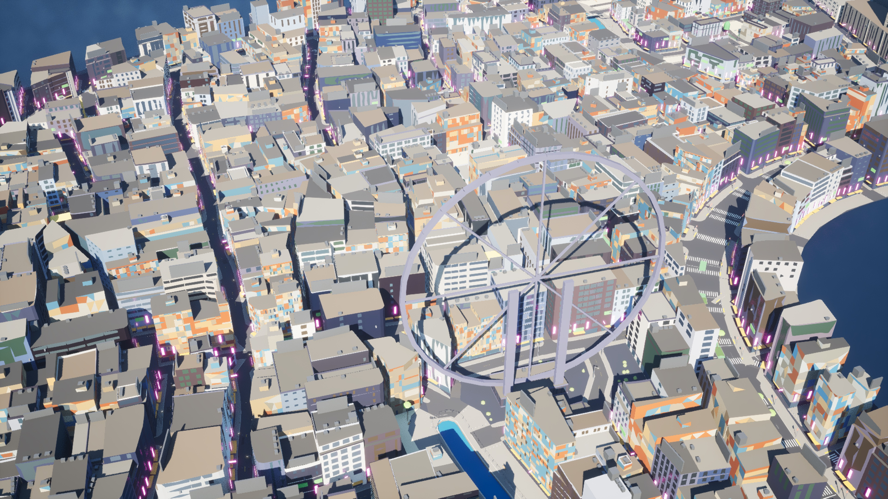
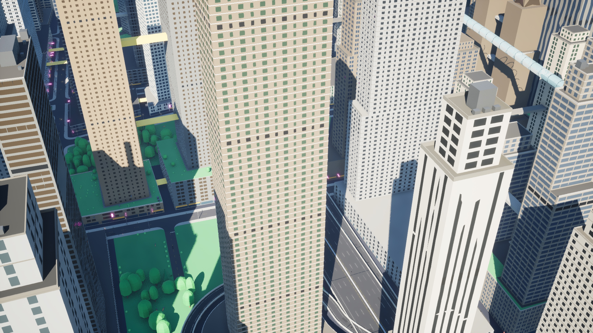
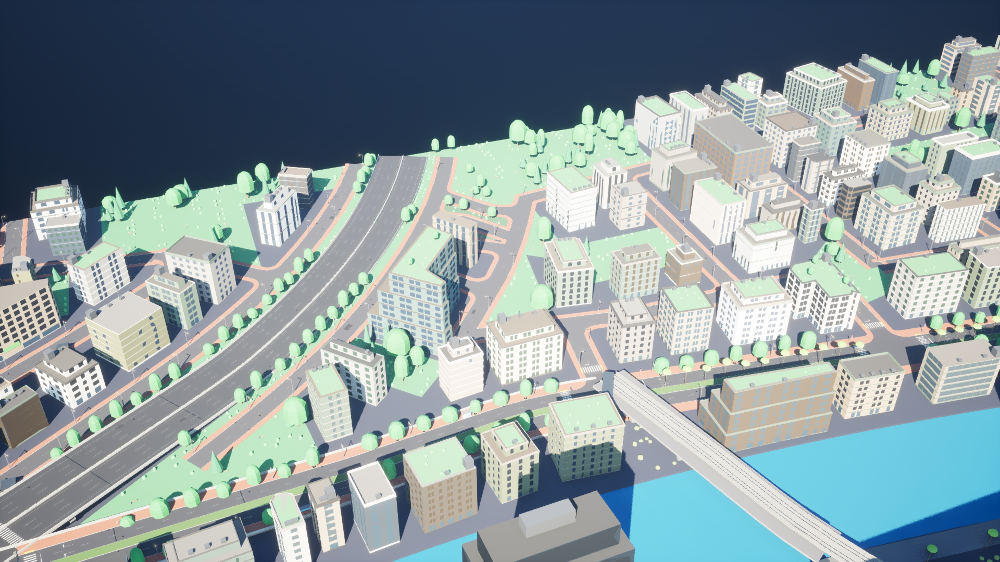
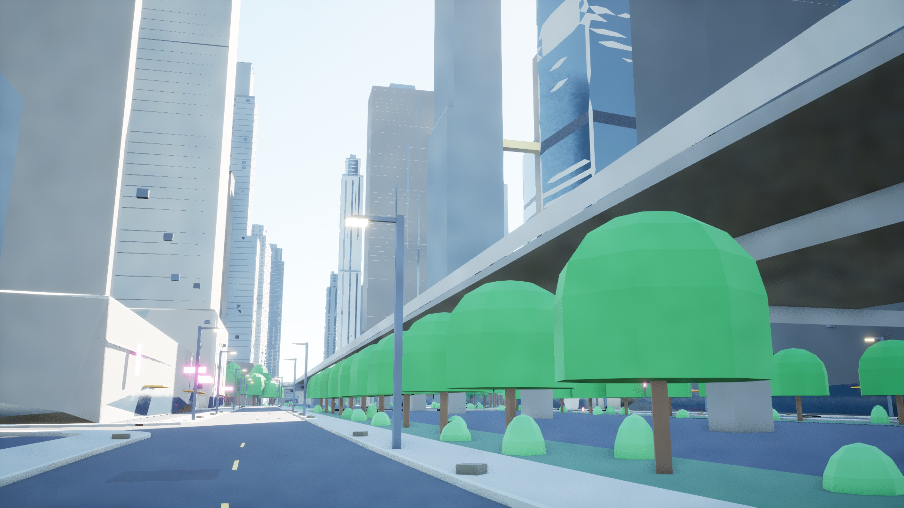
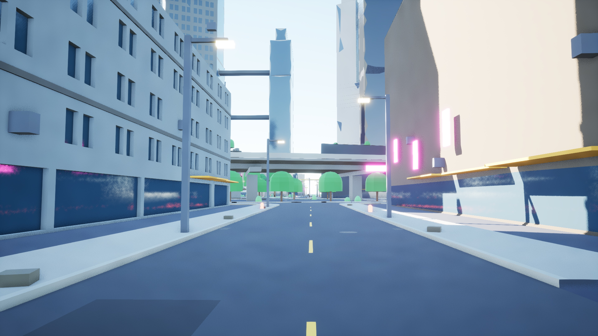
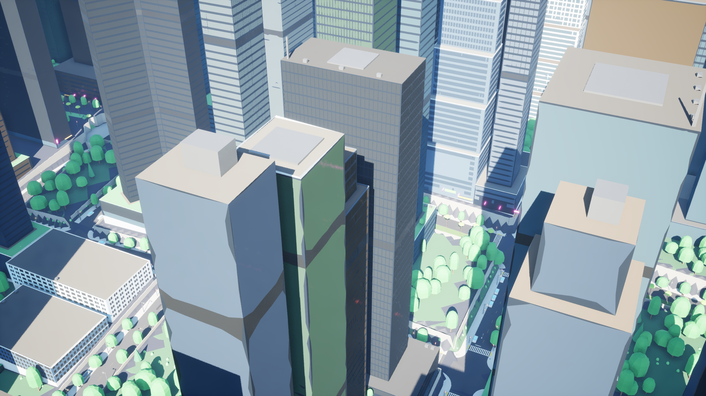
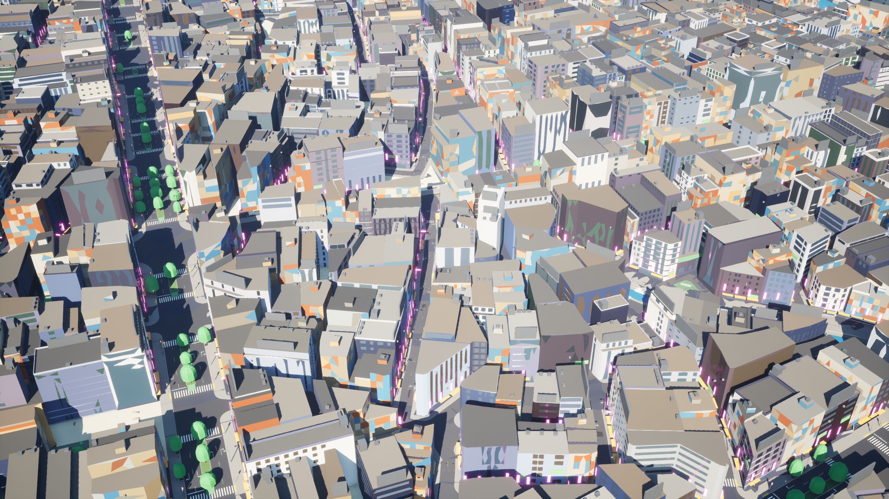
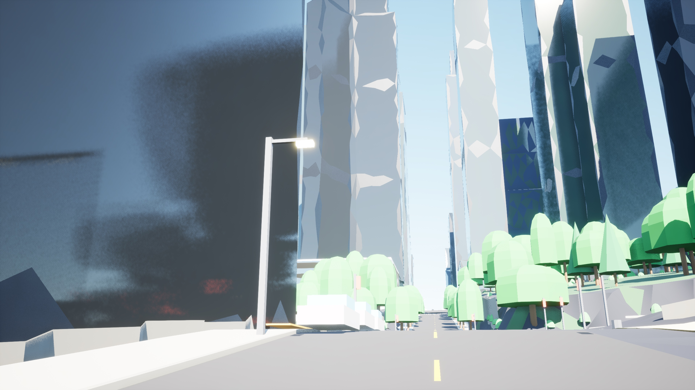
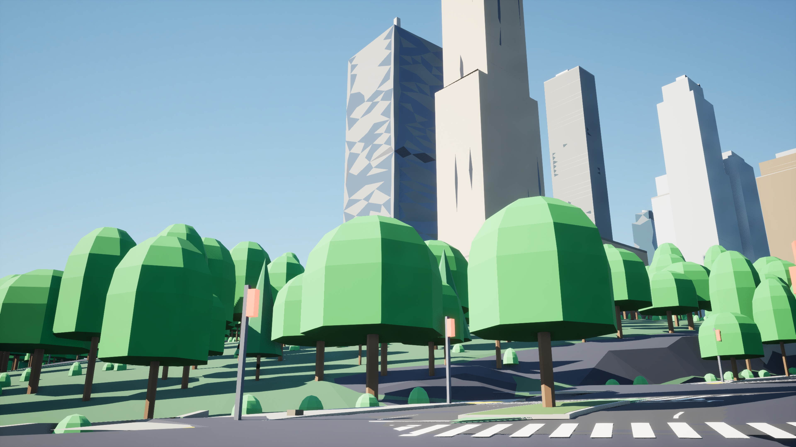

# AG1 and AG7 in Unreal (the exporter after M15)

`citygen unreal` now takes stage 2: AG1's building shells and AG7's street pieces replace
their blockout actors in the level, each at its own pivot, with stage 2's masters, the
buildings' tints from Custom Primitive Data, convex hull collision for the buildings and
complex collision for the streets (spec and what was built: `docs/unreal_export.md`).

```bash
.venv/bin/python -m citygen build docs/progress/M1a2/peninsula_city/city_spec.json out/greyhook --blockout
.venv/bin/python -m assetgen build out/greyhook
.venv/bin/python -m citygen unreal out/greyhook ~/UnrealTest/UnrealTest.uproject --new-project
.venv/bin/python -m citygen unreal out/greyhook ~/UnrealTest/UnrealTest.uproject --check --shots out/greyhook/shots
```

`--blockout-only` imports the blockout alone (stage 2's actors and meshes go if they were
there). All runs on the M4 Mac, UE 5.8, one editor at a time, in a throwaway project of
this session's own (`CyberGenStage2`, made with `--new-project`).

## Imports

| City | Import | Actors | Stage 2 | Time |
|---|---|---|---|---|
| small test city | blockout only | 5197 created | | 32 s |
| | stage 2 over it | 7435 created, 3216 updated, 498 deleted (12134) | 8489 actors over 3714 blockout actors; 11461 meshes from 218 packs | 298 s (stage 2 meshes 245 s) |
| | again | nothing changed, 0 packages saved | | 29 s |
| Greyhook | blockout only | 6169 created | | 41 s |
| | stage 2 over it | 5561 created, 2913 updated, 759 deleted (10971) | 7884 actors over 3672 blockout actors; 10573 meshes from 348 packs, 4 sky tube glass LOD chains | 278 s for the packs, 39 s for the rest |
| | again | nothing changed, 0 packages saved | | 19 s |
| Cragmouth | blockout and stage 2 at once | 23641 created | 19526 actors over 9100 blockout actors; 26332 meshes from 375 packs (6650 shells with hulls) | 830 s (stage 2 meshes 567 s, blockout meshes 29 s, actors 84 s) |
| | again | nothing changed, 0 packages saved | | 39 s |

Over the blockout, each import changed exactly the actors `unreal.manifest_changes` names
for the two manifests (a building key "updated" from its box to its shell, the joined
street objects "deleted", the street pieces and container stacks "created").

Most of a first import is building the Nanite meshes: in the small city's full re-import of
its 11461 stage 2 meshes, 8495 Nanite builds took 457 s summed over Interchange's build
threads (of 580 s of mesh builds), inside 254 s of wall time. The building hulls
(GeometryScript) and the saves take most of the rest.

Two importer changes were applied to the imports above by their version tags (and are in
the record): the Custom Primitive Data is now saved as each component's defaults (the
run-time values `SetCustomPrimitiveDataFloat` sets are not saved with the level: the first
shots had white roofs), which re-applied every stage 2 actor once (Cragmouth 20808 actors,
69 s; Greyhook 8474, 32 s); the glass master's rooms switched off (below) rebuilt the
masters and updated the 68 instances (2 s).

## Checks

| City | Streaming | Traces down | Roofs | Facades | Walk |
|---|---|---|---|---|---|
| small test city | 635 of 12134 at the start, 2623 after a teleport | 507 of 507 (building 288) | 36 of 36 | 36 of 36 | 248 m, all frames on the ground |
| Greyhook | 560 of 10971, 1673 after a teleport | 507 of 507 (building 251) | 36 of 36 | 36 of 36 | 130 m, all frames on the ground |
| Cragmouth | 625 of 23641, 3472 after a teleport | 507 of 507 (building 221) | 36 of 36 | 36 of 36 | 81 m, all frames on the ground |

The roof and facade traces hit the shells' convex hulls; the traces down land on the street
pieces (complex collision) and the blockout's ground. On Cragmouth the walk first failed:
its graph has junction corners on the slopes where the walkways' heights are those of the
cut slope beside the curb (crosswalk ends up to 3.6 m over the pavement) and the ground mesh
stands 3 to 4.3 m over the sidewalks' ends. The check's walk now takes only walkways a
player can walk (no leg over 30%, no step over 0.6 m where two join, not under the
terrain's surface) and tries up to eight starts near the player start, keeping the longest;
Greyhook and the small city walk the same paths as before.

## Glass

`M_CgGlass` has AG0's interior mapping (a room per pane on UV1, its look and whether it is
lit from the window id in the vertex alpha), but it is off by default (its `Interior`
parameter 0): the glass is the building's tinted, reflective glass. In Unreal the rooms and
lit windows of curtain walls came out per triangle (white triangles and diamonds, a faint
sawtooth over every curtain wall), although the packs give both triangles of every pane the
same window id and UV1 square (checked over all 790084 glass triangles of Crown Heights) and
punched windows, whose panes share no corners, light as whole panes. Unreal seems to merge
the panes' shared corners when it builds the meshes (Nanite, most likely), so their window
ids and UV1 blend across neighbors. A room frame from the pane's normal instead of the
mesh's tangents did not change it. AG6 (window interiors) takes it from here.

## Shots

3840 px (the check's renders, 8K for Cragmouth, scaled). Greyhook:

| Lantern Strip | The Stacks |
|---|---|
|  |  |

| Wallgate Heights | A street in The Stacks |
|---|---|
|  |  |



Cragmouth:

| Old Quarter | Crown Heights |
|---|---|
|  |  |

| Lantern Steps | A street in Crown Heights |
|---|---|
|  |  |



Old Quarter is the 8K render the root README shows. `greyhook/results.json` and
`cragmouth/results.json`: the imports' and checks' counts and timings.

## Open

- **Stage 1, terrain:** the walkway heights at junction corners on slopes (above) and the
  ground mesh over those corners; Cragmouth's player start stands on a path under its
  junction, 7 m below the street (the importer places it as M15 does).
- **AG7:** on the reshaped Greyhook one road piece (`rs.w1338n148`) fails `street_meshes`
  (one doubled directed edge); it imports and renders. AG7's contribution gives sRGB
  colors (the exporter makes them linear); a `color_space` field would say so.
- **Glass interiors** (above): off until AG6; the per-triangle blending needs a closer look
  in Unreal (the mesh's vertex attributes after the Nanite build).
- **Stage 2 to come:** building parts (AG2) go through the same instanced actors as AG7's
  containers; proxies are imported but not yet a Nanite fallback or HLOD input (AG9); the
  shells' complex collision is their hulls until AG3's ground band.
