# AG10: layered districts

Stage 2's side of citygen's M14: every deck's slab, columns, light-well stairs and elevators
as street pieces in place of their blockout objects, the deck's own streets lying on the
slab and its ramps solid, and the buildings on and under a slab kept to their side of it.
Full record: [`docs/assetgen_milestones.md`](../../assetgen_milestones.md), "AG10".

## Vesper Bay Decks

The deck over Highcrest (21.9 ha at 9 m): 8 slab pieces, 570 columns, 2 stairs and 2
elevators, 158 buildings on the deck and 164 under it (86 of their roofs closed up to the
soffit). `assetgen materials preview`, 1920 px.

| | |
|---|---|
| 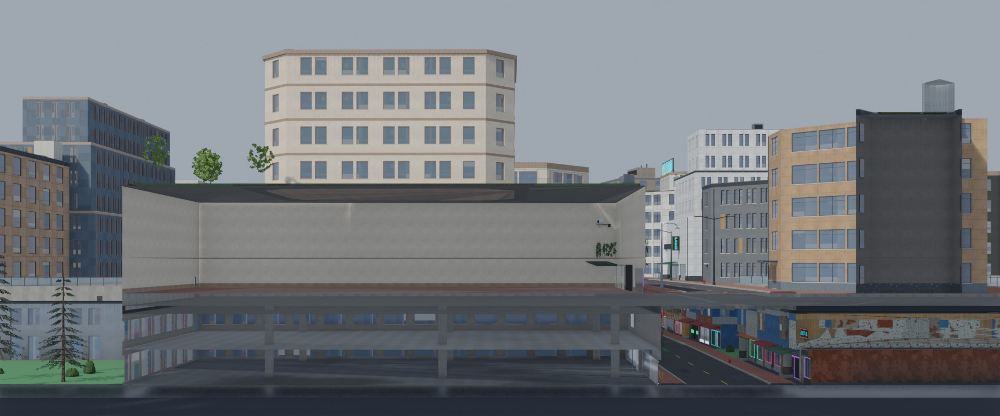 | 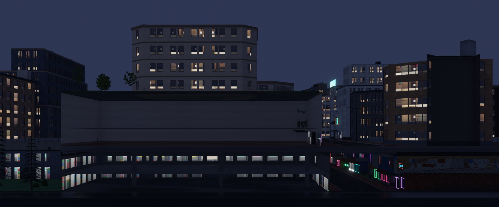 |
| The section across the deck (`--views deck`), by day | And by night |
| 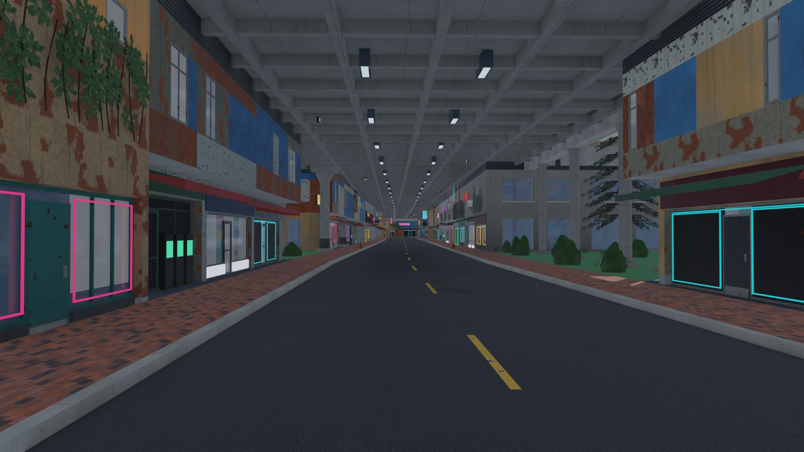 | 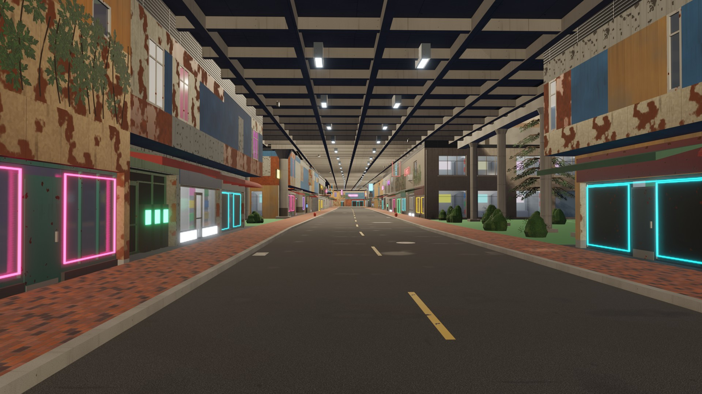 |
| A ground street under the slab: coffered soffit, lights over the street, the undercity's lit fronts | The same street by night |
| 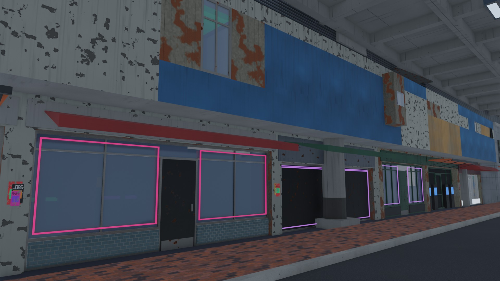 | 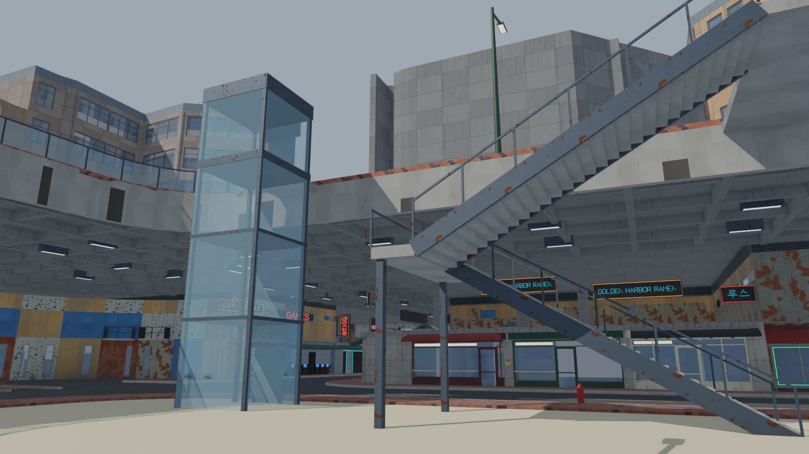 |
| An undercity shanty stack, its roof closed up to the soffit | A light well: the switchback stair, the elevator, the slab's fascia and glass rail |
| 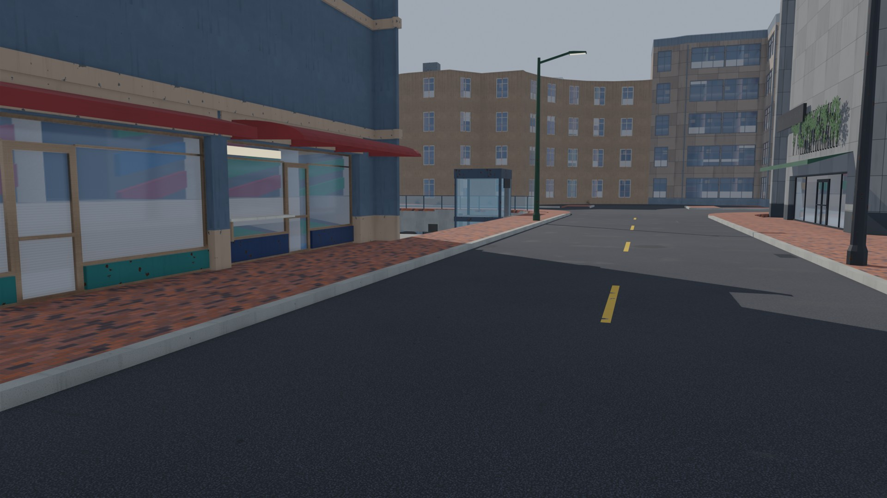 | 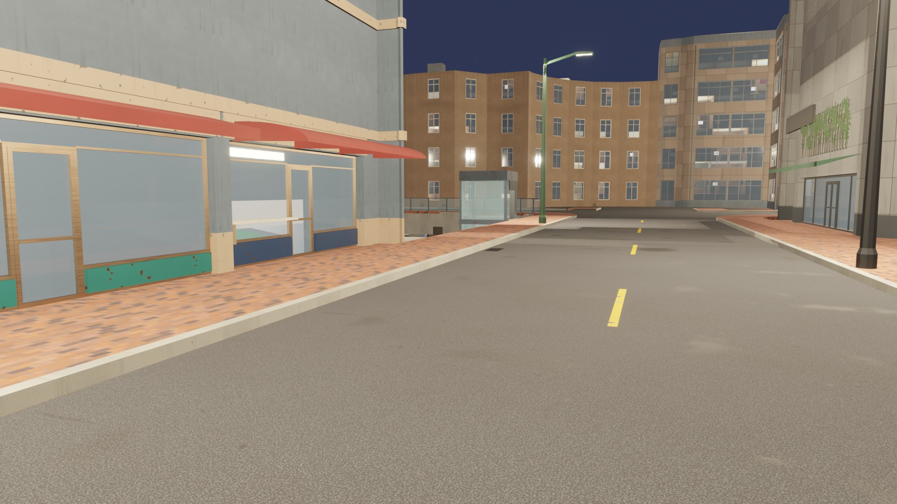 |
| The deck's own street, the well's rail and elevator ahead | By night |

At 8K: `vesper_bay_decks/8k/deck_section.jpg` (and `_night`), `8k/under_slab.jpg` (and
`_night`). Reports: `vesper_bay_decks/asset_report.txt`, `streets_report.txt`.

## Cragmouth with decks (terrain test)

Decks on Ridgeback (12.2 ha; its ground falls from 44 to 25 m under the slab, which follows
it in 8 m cells) and Hollow (5.0 ha, level), from `docs/progress/M14/cragmouth_decks/`. 14
slab pieces, 495 columns, 4 stairs and 4 elevators, 38 buildings on the decks and 40 under
them, 9 the Hollow slab is cut round with collars. Every check passes.

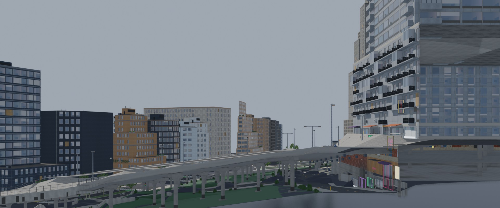

The section across Ridgeback's deck: the slab steps down the hill on its columns (left), the
undercity under it at the cut (right).

| | |
|---|---|
| 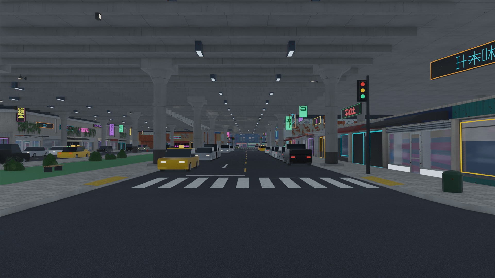 | 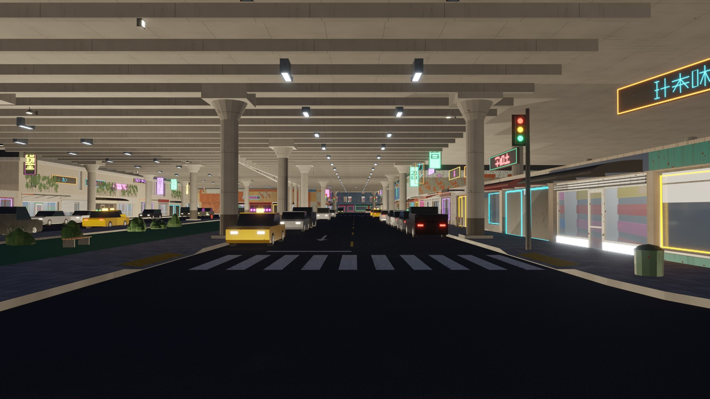 |
| A ground street under Hollow's slab | By night |
| 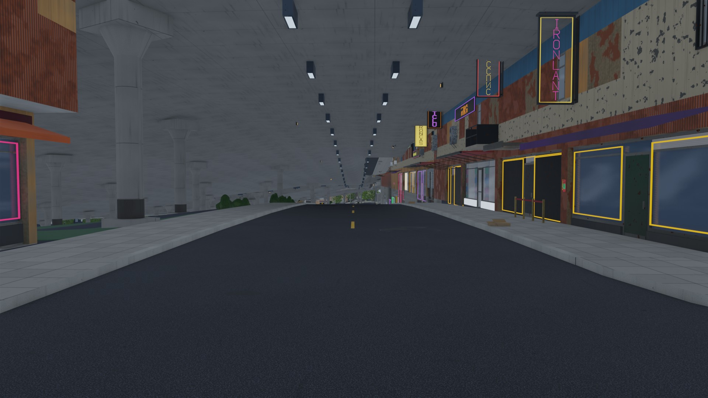 | 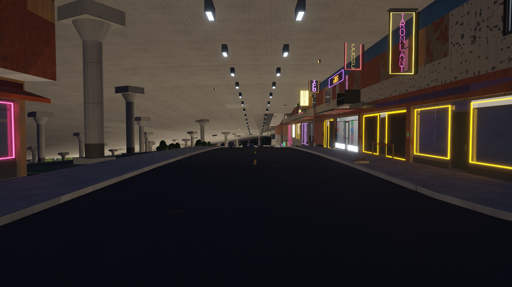 |
| A street running down the hill under Ridgeback's slab | By night |

Reports: `cragmouth_decks/asset_report.txt`, `streets_report.txt`.

## Checks

| City | `street_decks` | `asset_decks` | Every other check |
|---|---|---|---|
| Vesper Bay Decks | pass: 8 slabs, 570 columns, 4 stairs and elevators; 7.2 m over the ground streets | pass: 158 on, 164 under, 579 of 579 deck doors on deck walkways | pass |
| Cragmouth with decks | pass: 14 slabs, 495 columns, 8 stairs and elevators; 7.2 m | pass: 38 on, 40 under, 9 cut round, 255 of 255 | pass |

## For the Unreal check

The slab actors keep their blockout keys and `cg.level=1`; the columns, stairs and
elevators stand on the ground; the deck's streets and ramps keep level 1. Things to look
at: the slab's complex collision (traces onto the deck, the deck walk), the soffit lights
and lit undercity fronts under the slab by night, the ramps' walkways, a stair walked from
the well up to the deck.
