# AG10 in Unreal: the deck over Highcrest

The Unreal check of AG10 (layered districts) on Vesper Bay Decks: built from main
(`citygen build --blockout`, all 91 checks passing; `assetgen build` with 4 workers, every
check passing), imported with every stage 2 part into a new throwaway project, imported
again, read back from the level in the editor, traced against its collision and shot by day
and by night (`MPC_CityGen.Night` at 1). All on the M4 Mac (24 GB), UE 5.8, one editor at a
time. Cragmouth with decks (optional) was not imported: Cragmouth overruns Nanite's root
pages on this Mac (the AG5 check), and so does this city (below).

```bash
.venv/bin/python -m citygen build cities/vesper_bay_decks/city_spec.json out/vbd --blockout
.venv/bin/python -m assetgen build out/vbd --workers 4
.venv/bin/python -m citygen unreal out/vbd ~/CgAG10Test/CgAG10Test.uproject --new-project
.venv/bin/python -m citygen unreal out/vbd ~/CgAG10Test/CgAG10Test.uproject
.venv/bin/python -m citygen unreal out/vbd ~/CgAG10Test/CgAG10Test.uproject --check-only --shots DIR \
  --view deck_street 1351.8 1081.8 10.7 1224.3 1083.5 13.0 24 \
  --view deck_edge 967.0 1118.6 8.0 1070.3 1083.3 6.0 22 \
  --view under_deck 1360.9 1081.9 1.7 1215.2 1083.6 2.5 20
```

The read-back, the traces and the views by day and night came from an editor script of
this check's own (the actors within an 850 by 750 m box round the deck loaded, 6,353 of
them), not in the repo.

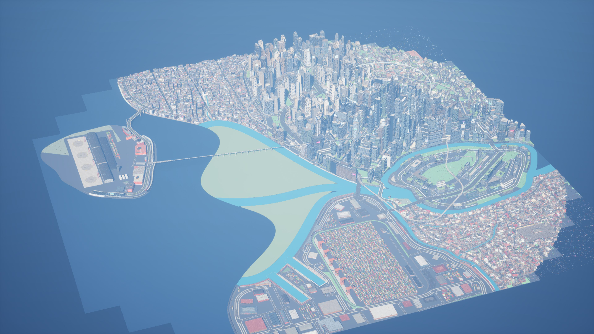

## Imports

| Import | Actors | Stage 2 | Time |
|---|---|---|---|
| first | 71,018 created | 41,461 stage 2 actors over 9,714 blockout actors; 55,409 meshes from 814 packs (49,091 with Nanite), 8,568 blockout meshes; 299 textures | 3,864 s; HLODs 237 built in 429 s |
| again | nothing changed, 0 packages saved | | 150 s; HLODs none rebuilt |
| with the fix below | the 8 slabs, 2 stairs and 2 elevators updated (12 meshes from 8 packs) | | 217 s; HLODs 8 rebuilt |

The first import logs "Bad MeshDescription" for 57 undercity shopfront rows: one storey
that the street front takes whole, so the shell node in the pack is empty. The exporter
makes no actor for them (the AG3 and AG4 check's fix) and the empty meshes go in the prune,
but Interchange still reads the empty nodes (an open item for assetgen: leave them out of
the packs).

## The deck in the level

| | In Unreal |
|---|---|
| slabs | 8 of 8 actors, keyed by their blockout object (`<deck>.slab.<tile>`, the manifest's `decks` naming them), stage 2, `cg.level=1` |
| columns, stairs, elevators | 570, 2 and 2 actors, no level (on the ground) |
| the deck's streets | 69 roads (the 2 ramps among them), 41 junctions, 136 sidewalks, `cg.level=1` |
| buildings on the deck | 158 shells and their 158 fronts, 358 part instancers, `cg.level=1` |
| data assets | `DA_VesperBayDecks_Lanes`: 399 of 18,470 at level 1; `_Walkways`: 265 of 16,553 (both as in `graphs.json`) |

### Collision

- **Onto the deck**: a trace down at every 15 m grid point of the deck (light wells left
  out, 971 points) lands on the slab (244), a deck street (251) or a roof on the deck (461),
  awnings and lamps on the rest; none falls through, and the slab's top is at 9 m.
- **Under it**: a trace up from 1.7 m meets the soffit at 7.8 m (476) or an undercity
  building's roof closed up to it (448).
- **The walk on the deck**: every level-1 walkway (140 sidewalks, 113 crossings, the ramps'
  and wells' 8 paths and the 2 stairs; 11,999 points a metre apart) has its floor (through
  props) within 0.2 m of the graph at 95% of points, no step over 0.45 m on a sidewalk,
  crossing or path. The ramps' walkways climb from the ground to the deck, their largest
  step 0.3 m where they leave the ground.
- **The light wells' stairs**: both switchback stairs have their floor at every point from
  the ground to the deck (1 m apart, so 0.69 m between treads' samples); one point on each
  has something within 2 m overhead (not looked at further).
- **The deck's edge**: a capsule (0.34 m, 1.76 m tall, its foot 0.45 m up) swept across the
  edge at 143 points stopped at the rail at 33 before the fix and 78 after (9 more at a
  building on the edge); the rest are where AG10 leaves the rail out (ramps' tops,
  buildings, stair landings). See the fix.

| | |
|---|---|
| 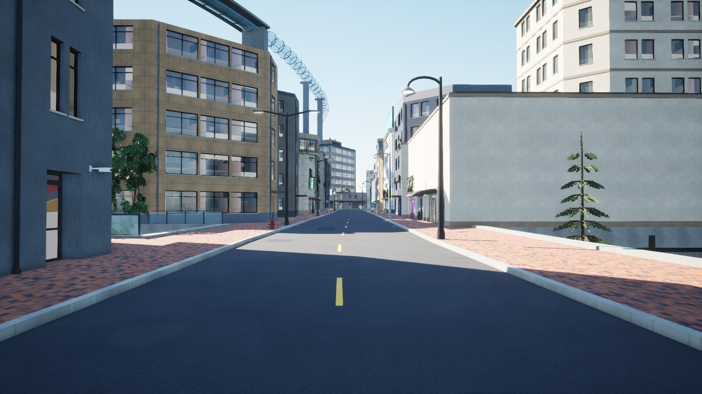 | 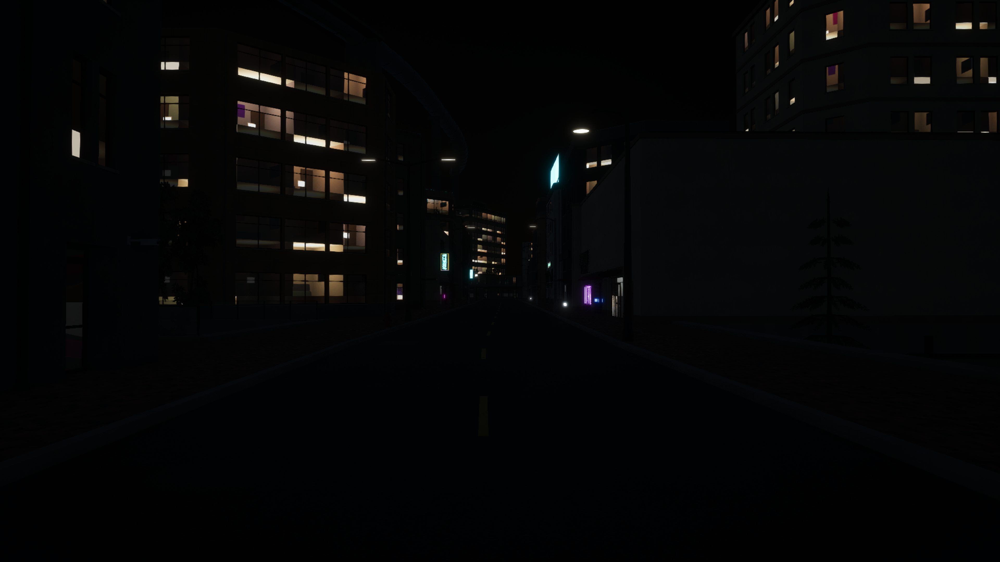 |
| The deck's own street, by day | By night |
| 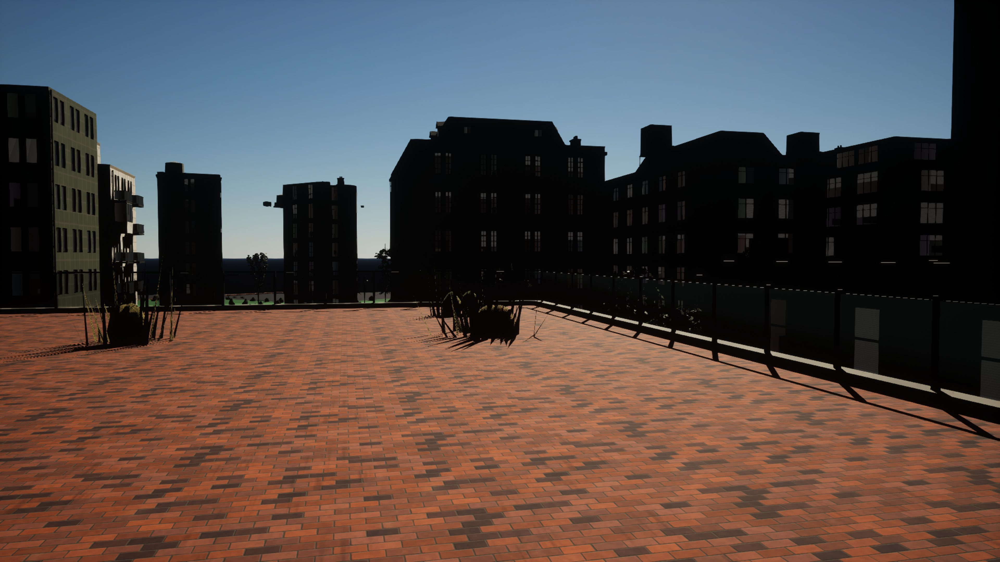 | 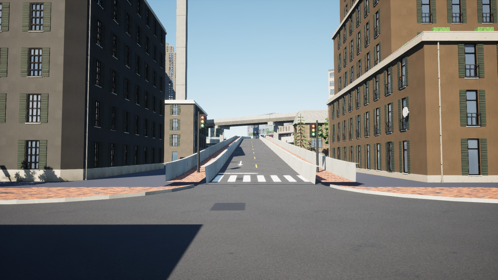 |
| The rail along the deck's edge | A ramp up to the deck |
| 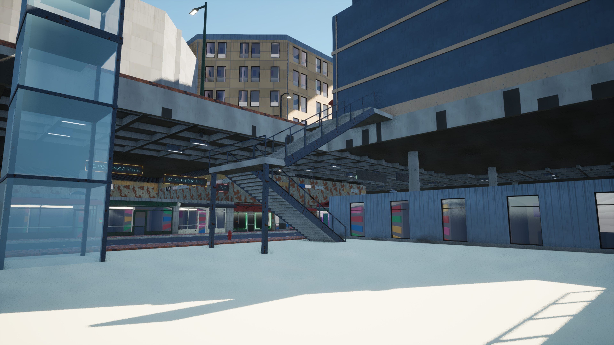 | 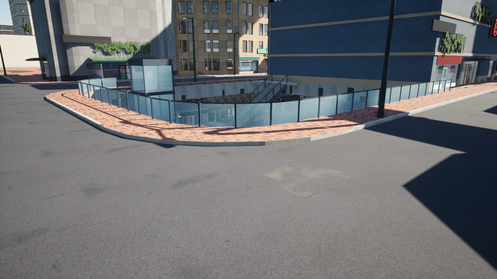 |
| A light well: the switchback stair and the elevator | The same well from the deck |

### Under the slab

The ribbed soffit with two rows of lights over the street and the undercity's lit fronts.
Before the fix the lights did not show in Unreal at all: on this Mac the editor renders with
Nanite off (`UseNanite(METAL_SM6) returned false`, though UE 5.8's Mac platform data says
SM6 supports it), so every Nanite mesh draws its fallback, and the slab's automatic fallback
(1,370 of its 17,597 triangles in one tile) had dropped the fixtures.

| | |
|---|---|
| 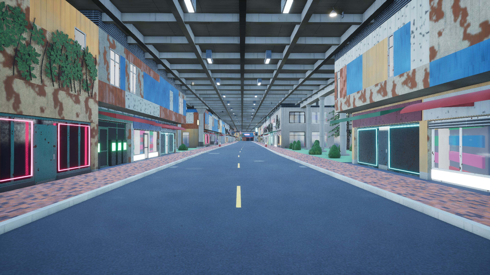 | 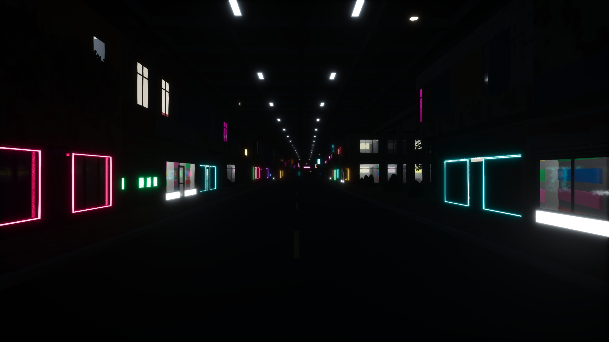 |
| A ground street under the slab, by day | By night |
| 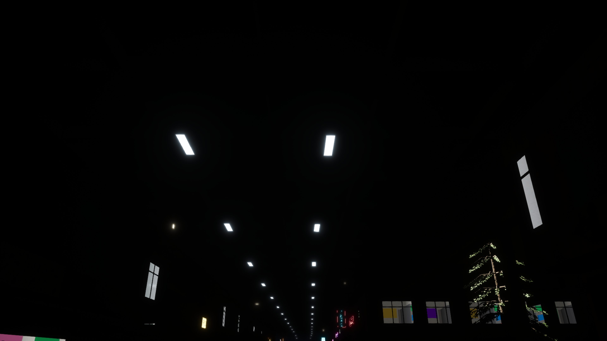 | 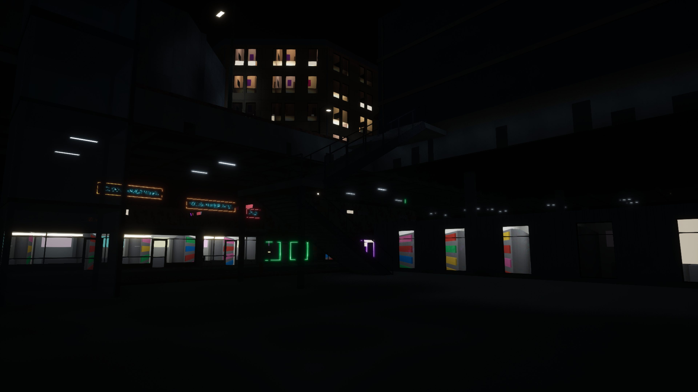 |
| The soffit lights from the street | A light well by night |

## The fix

- **Deck pieces keep every triangle in their Nanite fallback** (assetgen's street stage,
  `streets/build.py` `FULL_FALLBACK`): the slab, stair and elevator entries carry
  `fallback_full`, as AG3's street fronts do. Complex collision is built from the fallback,
  which had lost the slab's rail (above); where Nanite does not render, the fallback is also
  what is drawn (the soffit lights). No golden moves (no sample with a deck in them); test
  `test_deck_pieces_keep_a_full_fallback`, and `test_stage2_takes_assetgen_decks` checks the
  slab, stair and elevator meshes get it.
- **A stale fallback is reset** (exporter, `import_city.py`): a mesh imported again keeps its
  Nanite settings, so one whose entry no longer asks for a full fallback stayed full; it
  now goes back to the automatic one (found when measuring the rail before the fix). Test
  `test_import_resets_a_stale_fallback`.

## Open items

- **Vesper Bay Decks cannot be played as exported on the Mac**: play (`--check`, with or
  without shots) stops on Nanite's root pages ("Cannot allocate more root pages
  49152/49152"), its 50,008 meshes past them, as Cragmouth's in the AG5 check. The check's
  shots render (42,000 meshes round the middle). The exporter needs a budget of Nanite
  meshes per city (`docs/unreal_export.md`).
- **Nanite off in the editor on this Mac**: every shot here (and earlier checks') draws the
  fallback meshes; AG7's other street pieces keep their automatic fallbacks (roads' barriers,
  bridges' parapets and quays' railings may collide as loosely as the slab's rail did).
- **Glass panels in a Nanite mesh**: the slab's rail glass (`MI_streets_glass_panel`, the
  translucent master) is set its Nanite usage flag on load.
- **Empty shell nodes** in the packs (above).
