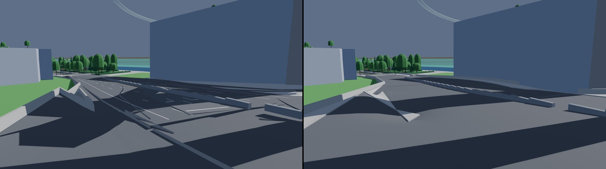
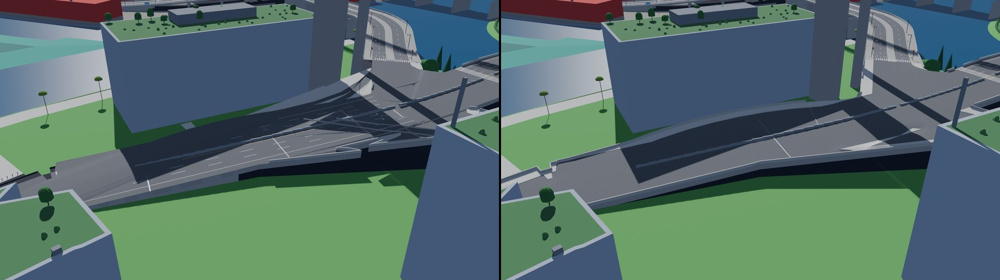
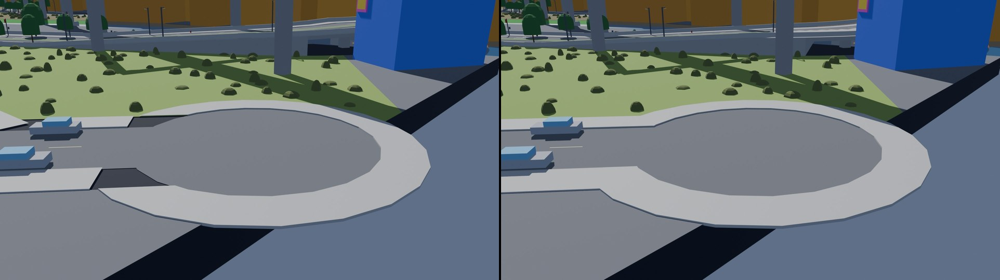
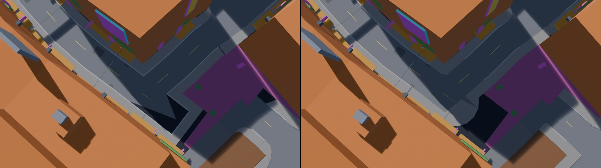
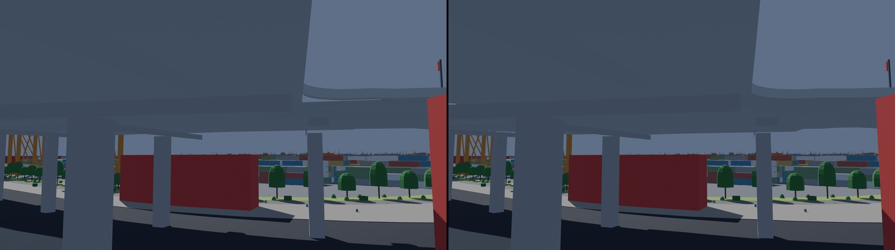
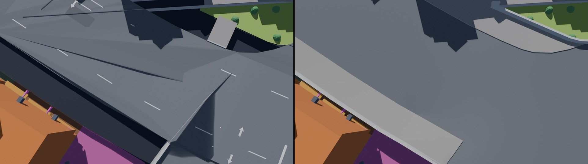
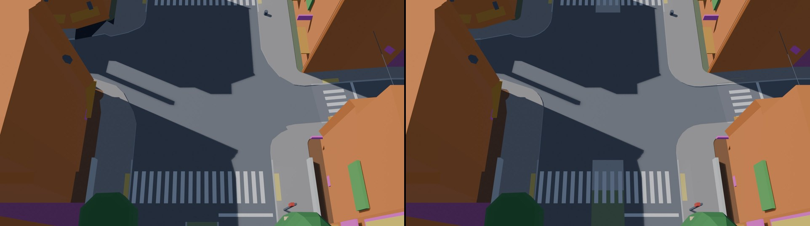
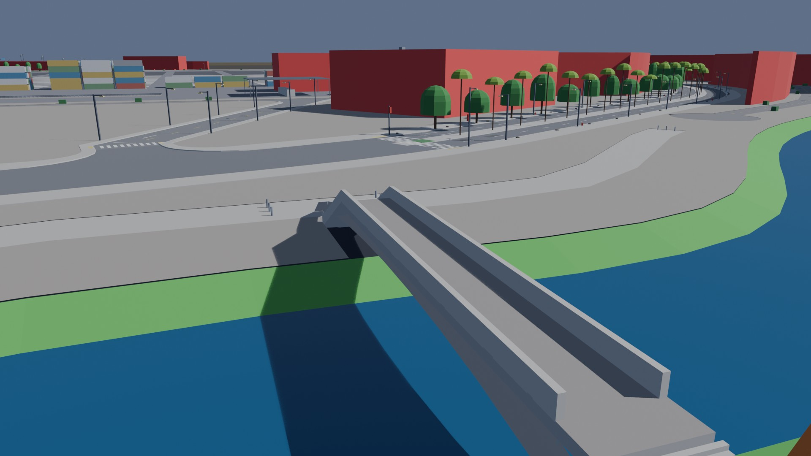

# AG17: road surfaces by construction

From run-through 2's road recheck: AG7's road, junction and sidewalk pieces each found their
own edges, so they overlapped, left gaps and stepped where they met (#105). Stage 1's M22
keeps one exact map of every road surface in the model; AG17 draws the street pieces from it
(design: `docs/assetgen_scope.md` 14.18), so two pieces meet on the same vertices at the
same heights by construction. The full record is in `docs/assetgen_milestones.md`, AG17.

## What the street pieces draw now

- **Faces of the map**, on their stored vertices and heights: a road piece its carriageway,
  bends, walking surface and median; a sidewalk piece its side's curb band, furniture zone
  and clear path; a junction piece its carriageway, corner pads and a cul-de-sac's bulb (a
  cluster's whole surface). Piece ids and keys are as before, so the Unreal exporter needs
  no change.
- **Curbs** as walls between faces at two heights (the same stored polyline at both),
  curb ramps beside crosswalks and driveways, medians as raised islands cut through at
  their crosswalks.
- **Decks**: a raised road's girder only between its cuts; a raised junction on a slab of
  its own, no girder under it.
- **Barriers** along the road between its cuts, ending on its port lines, a junction's
  corner parapets and guard walls along its own edge from one leg's port to the next.
- **Marks** on the faces as drawn.
- **Footbridges**, which the map leaves out: the walking surface on the bridge's own
  profile from junction to junction, the girder closed under it.

## Checks

`street_watertight` (new): every segment of every edge two faces share is drawn by both
faces' pieces between the same two vertices, in exactly two triangles (the two faces', or a
face's and its curb's), read back from the packs on integer millimeters. AG14's step check
compares a road's and its junction's pieces exactly at the map's ports.

Every city with the final code (`assetgen build`, models from M22's main):

| City | Street pieces | Street triangles | Shared segments | Not drawn / open / twice | Steps (largest) | Strips | Clashes | Failing assetgen checks |
|---|---|---|---|---|---|---|---|---|
| Delta Megacity | 8,827 | 1,586,006 | 196,763 | 0 / 0 / 0 | 0 (0.0 m) | 0 | 0 | asset_envelope, asset_unique, asset_grounded (#144) |
| Vesper Bay | 9,019 | 1,457,545 | 210,886 | 0 / 0 / 0 | 0 (0.0 m) | 0 | 0 | none |
| Saltreach Free Port | 5,484 | 815,404 | 118,555 | 0 / 0 / 0 | 0 (0.0 m) | 0 | 0 | none |
| Nexus City | 9,617 | 1,469,552 | 223,841 | 0 / 0 / 0 | 0 (0.0 m) | 0 | 0 | water_gaps (main's water) |
| Greyhook | 4,450 | 833,621 | 128,893 | 0 / 0 / 0 | 0 (0.0 m) | 0 | 0 | none |
| Vesper Bay Pinned | 9,817 | 1,459,331 | 219,929 | 0 / 0 / 0 | 0 (0.0 m) | 0 | 0 | asset_unique (two buildings' thumbnails) |
| Vesper Bay Stacks | 9,790 | 1,488,007 | 217,981 | 0 / 0 / 0 | 0 (0.0 m) | 0 | 0 | none |
| Vesper Bay Decks | 9,945 | 1,605,858 | 219,812 | 0 / 0 / 0 | 0 (0.0 m) | 0 | 0 | none |
| Cragmouth | 11,119 | 1,803,407 | 228,098 | 0 / 0 / 0 | 0 (0.0 m) | 0 | 0 | asset_clearance, asset_landings, asset_grounded (a roof vent) |

The failing checks are of buildings and water, whose code AG17 leaves as it was. On M22's
own Delta packs the watertight check finds 361,103 sides of shared segments not drawn
and 29,306 open (the old pieces found their own edges, off the map's vertices); Delta's
street pieces are as many as before (8,827), with 1,586,006 triangles (1,288,343 before),
246 roads inside their clusters with no mesh of their own (8 before), and 3,594 corner pads
(3,248 before, 269 left out).

## Before and after

Delta Megacity, the street pieces among the blockout's buildings (`assetgen streets`, then
`assetgen/blender/streets_preview.py`); before (main after M22) on the left, after on the
right. Full size in `before/` and `after/`.

The twin-ramp cluster `jn.e170s444` (it holds `jn.e217s328` now) from the road: the strips
across the carriageway (barriers and pads from roads inside the cluster) are gone. The pad
folded up at the gore is the map's: M22 keeps this cluster as M18 left it (its legs meet it
between 0.8 and 12.3 m), and the pad between the road at grade and the ramp follows its
curb heights.

And from above.

A cul-de-sac (`jn.e1743n682`): no wedge where the bulb meets its road.

A hairpin (`rs.w881n1363`, a bend face): no bulge, one rounded bend.

A raised junction (`jn.w867s227`, 18 m up) from below: its slab under its faces, no girder
running under it.

A corner pad of a three-node cluster (`jn.w563n1125`, one of the junctions M22 keeps as M18
left it) from above: one surface, no slivers or strips across it.

A four-way junction with its corner pads and crosswalks (`jn.w937n1204`) from above: the
medians are raised islands now, cut through at road level under their crosswalks (the
lighter concrete, the stripes over it), and each pad meets its curb and crosswalk on the
map's own vertices.

A footbridge over the river (`rs.w1449n518`, after only): the map has no faces for
footbridges, so the road piece draws its walking surface on the bridge's profile between
the parapets, the girder closed under it.

## Unreal

`unreal_before/`: M22's Delta imported with full stage 2 by the coordinating session
(`unreal_pday_jn_e170s444_low.jpg`: the strips crossing the carriageway and the concrete
wedge at the gore that AG17 removes). The same check after AG17 is the coordinating
session's to run.

Work in progress: `wip/`.
