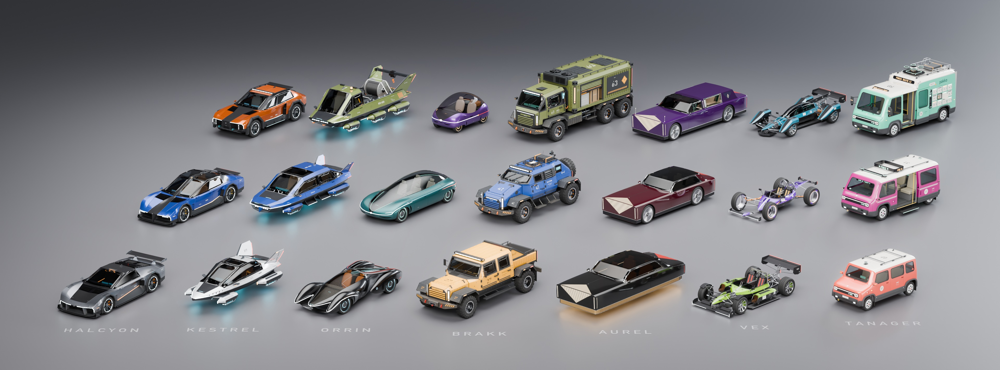

# AG18: hero vehicles

Twenty-one vehicles designed by hand, one Blender script each (`vehicles/cars/`), on a shared
kit (`vehicles/carkit.py`). Seven made-up brands, three models each; a brand is a design
language in geometry and texture, never in color (`vehicles/BRANDS.md`). Scope and the plan
for what comes next: `docs/assetgen_scope.md`, 14.19. Each folder holds one 4K multi-view
sheet and the car's notes.

The whole roster at one scale (`vehicles/blender.sh vehicles/lineup.py`).

| Brand | Model | Type | Seats | Length | Sheet |
|---|---|---|---|---|---|
| Halcyon | Vanta-R | mid-engined supercar | 2 | 4.69 m | [vanta_r](vanta_r/sheet.jpg) |
| Halcyon | Sable | four-door fastback grand tourer | 4 | 5.11 m | [halcyon_sable](halcyon_sable/sheet.jpg) |
| Halcyon | Ridge | performance crossover | 4 | 4.75 m | [halcyon_ridge](halcyon_ridge/sheet.jpg) |
| Kestrel Aerodyne | Dart | hover coupe | 2 | 4.66 m | [kestrel_dart](kestrel_dart/sheet.jpg) |
| Kestrel Aerodyne | Meridian | hover sedan | 4 | 5.32 m | [kestrel_meridian](kestrel_meridian/sheet.jpg) |
| Kestrel Aerodyne | Atlas | hover hauler with a load bed | 2 | 5.91 m | [kestrel_atlas](kestrel_atlas/sheet.jpg) |
| Orrin | Lumen | sedan under one leaf of glass | 4 | 5.03 m | [orrin_lumen](orrin_lumen/sheet.jpg) |
| Orrin | Pebble | city pod, the dome lifts as the door | 2 | 2.82 m | [orrin_pebble](orrin_pebble/sheet.jpg) |
| Orrin | Aria | hypercar with channels through the body | 2 | 4.74 m | [orrin_aria](orrin_aria/sheet.jpg) |
| Brakk Industrial | Hauler | crew cab pickup, exposed wheels | 4 | 5.69 m | [brakk_hauler](brakk_hauler/sheet.jpg) |
| Brakk Industrial | Bastion | armored utility vehicle | 4 | 5.11 m | [brakk_bastion](brakk_bastion/sheet.jpg) |
| Brakk Industrial | Mule | six-wheel cargo van | 2 | 6.65 m | [brakk_mule](brakk_mule/sheet.jpg) |
| Aurel | Prelate | formal coupe | 2 + 2 | 5.19 m | [aurel_prelate](aurel_prelate/sheet.jpg) |
| Aurel | Regent | limousine | 4 | 5.92 m | [aurel_regent](aurel_regent/sheet.jpg) |
| Aurel | Zenith | hover grand tourer on a skirt of light | 4 | 5.42 m | [aurel_zenith](aurel_zenith/sheet.jpg) |
| Vex | Wraith | open-wheel speedster of four pods | 2 | 4.37 m | [vex_wraith](vex_wraith/sheet.jpg) |
| Vex | Halo | roadster on four hubless ring wheels | 2 | 4.31 m | [vex_halo](vex_halo/sheet.jpg) |
| Vex | Strix | tandem track hypercar, floating fenders | 2 | 4.97 m | [vex_strix](vex_strix/sheet.jpg) |
| Tanager | Mino | city car | 4 | 3.43 m | [tanager_mino](tanager_mino/sheet.jpg) |
| Tanager | Cab | driverless taxi with a sliding door | 4 | 4.55 m | [tanager_cab](tanager_cab/sheet.jpg) |
| Tanager | Porter | parcel-locker delivery van | 2 | 5.30 m | [tanager_porter](tanager_porter/sheet.jpg) |

Each car's own README lists its size, its design, its brand's cues, what its designer would
improve and what the kit lacked for it.
