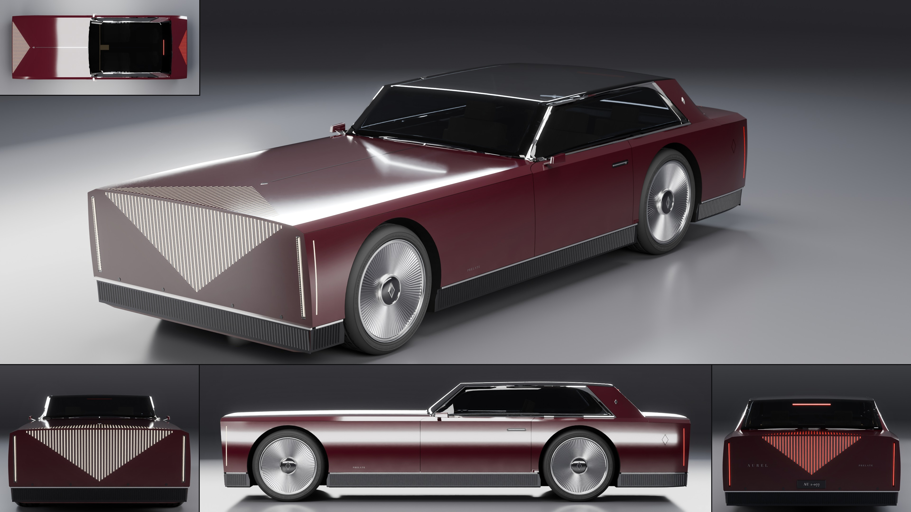

# Aurel Prelate

- **Brand, model, type:** Aurel Prelate, formal coupe, 2 + 2 seats (all names made up). The first Aurel: it sets the family's cues.
- **Size:** 5.18 m long, 1.96 m wide over the body (2.02 m over the mirror cameras), 1.31 m high; wheelbase 3.20 m (stretched from 3.1 to shorten the overhangs); wheels 0.80 m in diameter; ground clearance 0.15 m.
- **Triangles:** 296,311 in 98 objects (215,832 in 95 before step B).
- **Build:** `vehicles/blender.sh vehicles/cars/aurel_prelate.py --out docs/progress/AG18/aurel_prelate --sheet`

## The design

- A monolith on a plinth: a slab nose and a slab tail that both lean out over a dark fluted base, a hood 2.3 m long, the cabin set far back, a deck of 0.4 m.
- Ten lines over twelve stations, three of them sharp: the razor shoulder (with a narrow machined chamfer above it, nose to tail), the sill line and the plinth's foot. The flanks between are one quiet, slightly convex surface. The hood and the deck are clamshells whose cuts hide in the shoulder crease.
- No grille opening: 51 slots of light let into the nose slab hang from its top edge, the middle one longest, and go on over the edge along the hood. From the front it is a downward point, from above a lozenge folded over the edge. The tail repeats it smaller, in red.
- The glass is one folded black canopy (windshield, roof and rear glass in three flat facets) over upright side glass in a polished frame; the only body color above the shoulder is one leaning pillar each side, a band of one width that carries the crest.
- Show color: black cherry lacquer, polished trim, parchment seats, warm white light.

## Step B: lamps, cut lines, glass (2026-11-12)

The Aurel pilot on step B's kit (`docs/assetgen_milestones.md`, AG18, step B), and the first
car on `vehicles/brands/aurel.py` (Slab, crest, the disc wheel bound to this car's sizes,
the studio's light link off the canopy, the serif). The sheet, clay, zebra and check above
are of this build.

- The lozenge: every slot of light is cut into the skin, a channel 10 mm wide and deep in the
  slab hanging from its top edge and one on the hood (the deck) running back from it, the
  edge left whole between them (the slots were inlays 4 mm proud of the paint). In each a
  flush lens of its own with the body's gap all round, and a light guide whose lit face lies
  right under the lens; the bright hairline flutes between the slots are as they were. 102
  channels at the nose, 70 at the tail. The channels, the blades' pockets and the flank
  slots are cut with the kit's new `"into"` mode: the paint runs down into them, so no
  panel edge rings each (as dark housing panels of their own, the 172 slots held the game
  pack's LOD3 at 10,804 triangles against its 5,000 and failed its fidelity check).
- The corner blades: a pocket 34 mm wide and 30 mm deep under one lens (clear in front, red
  behind), a lit guide down its middle in a frosted sleeve, a stack of tilted reflector
  facets either side of it (one every 11.5 mm), a bright liner on each long wall (the
  brand's two bright edges) and a bright cap at each end. They were a box with a lit strip
  on it.
- The hairline round each corner on the flank: a slot under its own lens with a guide.
- Cut lines: the door pulls are recesses with the bright bar in them; the charge flap (the
  crest's outline) cut through each rear quarter (it was a dark ribbon on one side); 3.5 mm
  shut lines (1.2 mm before).
- Glass: the canopy's black frame and the side glass's polished frame in `"frame"` mode,
  made on one side and mirrored (they were 14 and 8.6 mm off mirror and faced into the car).
- The cuts' gaps: the kit's `shrink()` pushed the edges of the slivers a boolean leaves out of
  the surface (fins up to 14 mm, and paint over the ends of some slots); this car swaps in a
  shrink that takes a sliver's way in from its neighbors and keeps every move in the
  surface, dissolves faces under 1 mm and turns back the few left facing in (`shrink`,
  `unflip`). The sill's and the door's asymmetry (9.9 and 8.7 mm) were such fins. A probe
  (rays down every lens, every 3 mm, three across) finds no paint over any lens and no
  vertex of paint past the skin.
- Street distances: the front wells widened and deepened inside the skin (the arch keeps its
  line): the front wheels steer 30 degrees (5 before); the cabin floor narrowed between the
  rear wheels and the tub's walls over the rear wells moved inboard with a shelf over the
  arches (0.1 mm to the rear tires before, 47.6 mm to the well now); the door cards end
  ahead of the rear arch (8% of the tub in the open before, none now). The cowl slot is one
  half mirrored (19 mm off before).
- Checks: every one `ok` (tires were `fail`, symmetry and through `look`); the driver's
  wheel is told as meant.
- Left: the pack's far LODs (LOD2, LOD3) smear the nose's lozenge, the slots' channels
  folded by the collapse (its checks pass; the inlays before kept a cleaner far nose, and
  6 mm deep channels were worse, LOD3 over its budget); the blades' pocket walls are paint,
  not dark housing (cut `"into"` the slab); the quarter's narrow wedge between the door's
  rear cut and the rear arch shows a pale step at its foot where the gap is pulled round the
  sill crease (a 14 mm fin there before, on the right side only; the door's cut 6 cm ahead
  of the arch is the cause, in "What I would improve").

## Aurel's signature cues (for the Regent and the Zenith to repeat)

Geometry and texture only, none of it depends on the color:

1. **Slab and plinth.** Flat ends, top edge ahead of the foot at both ends. The whole car stands on a recessed band of fine vertical flutes (22 mm pitch, dark machined metal) with one polished strip along its top: the sill line. On the hover car the plinth runs round unbroken.
2. **The folded lozenge.** Light only as slots let into the paint (8 mm wide, 30 mm apart, two bright hairline flutes between each pair), hanging from a slab's top edge in a point and folding over the edge onto the hood or deck. Never a frame, never an opening.
3. **Blades.** A slim vertical light in a dark slot with two bright edges at each corner of each slab, from sill to shoulder, and a hairline of light round the corner on the flank.
4. **Razor and chamfer.** One shoulder crease from blade to blade with a narrow flat chamfer above it; panel cuts hide in it.
5. **Folded canopy, leaning pillar.** Flat glass facets with sharp folds, black frames on top, a polished frame round the side glass, side glass no more than 23 degrees from upright, one body-color pillar leaning with the rear glass.
6. **Pleated discs.** A shallow dished disc of 96 fine radial pleats inside a polished ring, a dark cap with the crest.
7. **Crest and wordmark.** The crest is a tall lozenge with a dark lozenge inside and a bright bar down the middle: behind the point of light on the hood (a hairline spear runs back from it), on each pillar, on each wheel cap; its outline is also the charge flap. The wordmark is wide-spaced serif capitals (Didot), once on the tail, the model name small beside it and low on the fender.

The helpers for these are in `vehicles/brands/aurel.py` (`Slab`, `lozenge`, `blade`, `crest`, `wheel`); this script's `lozenge_cuts`, `blade_cut` and `blade_lamp` are their step B form, the slots and blades cut under lenses, and `build_plinth` stays in the script.

## What I would improve

- On the hood the slots still read as ivory lines at the hero's shallow angle.
- The dark lacquer mirrors the bright floor on the nose slab, so the nose looks paler than the flanks.
- Where the canopy's dark frame and the side glass's polished frame meet at the foot of the windshield pillar the corner is untidy.
- The plinth across the two ends is laid on the flat cap; on the flanks it is truly stepped back.
- The cabin is blocks (seats, dash, console, a pillar to pillar screen); from behind, the hood's slots show through both screens.
- The door's rear cut runs 6 cm ahead of the rear wheel arch; a rear-hinged door would suit the car better.

## Kit wishes

- **A light hook.** From the hero's side the top soft box is mirrored whole in a windshield raked 35 to 45 degrees: a white pane over the cabin. This script wraps `K.build_studio` and takes the canopy out of that light with Cycles light linking; a kit option (`unlit={"top": ["body.canopy"]}`) would do it for every car.
- **Light strength in the palette** (`led_front_strength`, ...): fine slots of light clip to white at the kit's 60; this script remakes `led_front` and `led_rear` dimmer.
- **Fonts:** a `font=` argument on `text_flat` and `text_on_body` (this script sets `K._FONT[0]` to a serif).
- **End caps:** a frame for building on a flat cap (this script's `Slab`: a point at height z, a box on the plane), and a flat cap that can step back (a plinth, a bumper line).
- **Rows of ribs:** a helper that lays flutes or ribs along a run of the surface; three brands now build them by hand.
- **Gaps round many cuts:** `shrink()` taking a sliver's way in from its neighbors (this script's copy), so a dense field of cuts leaves no fins.
- **Floor brightness:** a darker floor (or a palette key for it) for very dark gloss paint.
