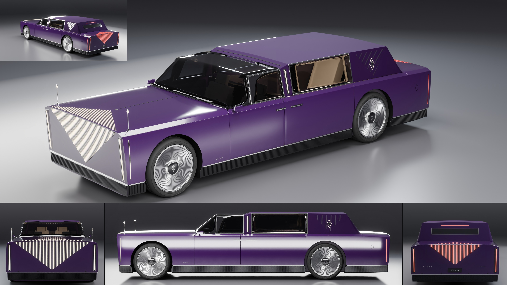

# Aurel Regent

- **Brand, model, type:** Aurel Regent, formal limousine, 4 seats: two under glass in front, two in a closed rear cabin (all names made up). The second Aurel, the Prelate's sibling.
- **Size:** 5.92 m long, 2.02 m wide over the body (2.08 m over the mirror cameras), 1.46 m high; wheelbase 3.75 m; wheels 0.80 m in diameter; ground clearance 0.15 m.
- **Triangles:** 228,554 in 114 objects.
- **Build:** `vehicles/blender.sh vehicles/cars/aurel_regent.py --out docs/progress/AG18/aurel_regent --sheet`

## The design

- The Prelate turned round: there the hood is the point of the car, here the rear cabin. The hood is 1.6 m (the Prelate's 2.3), the cabin and its roof take 3.7 m of the length.
- Two cabins, two materials. The driver sits under a folded glass canopy that wraps round the windshield pillars. Behind a division pillar the owners sit in the vault: one matte panel (pillar, solid roof, privacy panel, rear face) standing 5 cm above the glass, with a slit in a polished frame for a rear window.
- The privacy panel takes the place of a quarter light: bright hairline flutes hang from the roof's edge, the middle one longest (the lozenge again), with the crest in a lozenge of light at their heart. The chairs sit behind it, over the rear axle, with 1.2 m of floor, leg rests, a console with a screen and two screens on the division in front of them, under a ceiling of light slots.
- The doors open like a book from the division: the front one 1.08 m, the rear one 1.38 m and rear-hinged, both pulls beside the pillar, which carries a blade of light of its own. A bright band crosses the roof at the step.
- A finial at each front corner: a polished staff with a lozenge of light at its tip.
- Family cues kept as they are: slab nose and tail leaning out over the fluted plinth, the folded lozenge of 53 light slots (taller here, a shorter fold over the hood) and its red twin on the tail, blades at the four corners, the razor shoulder with its chamfer, pleated discs, crest, spear and serif wordmark.
- Show color: imperial amethyst lacquer over a matte vault of the same hue, polished trim, dove grey chairs, warm white light.

## What I would improve

- The dark lacquer mirrors the bright floor on the nose slab (as on the Prelate), so the nose reads paler than the flanks in the hero.
- The rear cabin is blocks; through the rear door's glass the hero shows mostly the lit far door card, not the chairs, which hide behind the privacy panel as intended.
- The slit rear window is a dark plate on the rear face, not glass with a cabin behind it.
- The door cut between the rear door and the quarter runs straight down into the wheel arch; a cut that follows the arch would be finer.
- The plinth across the two ends is laid on the flat cap, as on the Prelate.

## Kit wishes

- **Glass frames on one-quad panes.** `glass=(panel, inset, trim)` on a pane that is a single quad of the cage came out of the subdivision as an oval of glass in a frame with filled corners (the inner loop is creased, its corners are not held). This script leaves the side panes whole and lays its own mitred frames on them (`glass_frame`).
- **A light hook**, as the Prelate asked: this script unlinks the canopy from the top box and the side glass from the top box, the key and the strips (`UNLIT`), by wrapping `K.build_studio`.
- **Light strength and fonts in the palette** (`led_front_strength`, a `font=` on the text helpers), as the Prelate asked.
- **A matte skin finish** among the paint finishes, with little specular: a rough finish with ordinary specular went pale grey under the top box on the flat roof, so this script makes its own (`paint_vault`).
- **A helper for flutes** along a run of the surface (the plinth, a panel): still built by hand.
