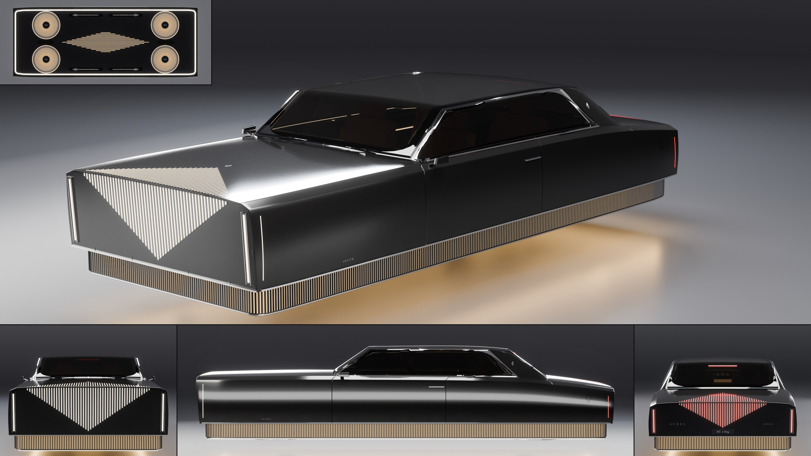

# Aurel Zenith

- **Brand, model, type:** Aurel Zenith, formal hover grand tourer, 4 seats in two rows alike, two long doors (all names made up). The third Aurel, the Prelate's and the Regent's sibling.
- **Size:** 5.42 m long, 2.05 m wide over the body (2.10 m over the mirror cameras), the hull and plinth 1.22 m high; ride height 0.30 m to the plinth's foot (0.27 m under the discs' rings), roof at 1.49 m.
- **Triangles:** 129,135 in 71 objects.
- **Build:** `vehicles/blender.sh vehicles/cars/aurel_zenith.py --out docs/progress/AG18/aurel_zenith --sheet`

## The design

- No wheel and no arch: each flank is one surface from the front blade to the rear one, cut only by a door 1.54 m long. One highlight runs its whole length, which no wheeled Aurel can show.
- The plinth is the lift system. It is a piece of its own, stepped back 6.5 cm under the hull on all four sides with rounded corners, so its flutes (some 650 of them) run round without a break. Light stands in the band behind the flutes, a line of light runs round its foot (the skirt), and the floor under the car takes the glow.
- Under it (the small tile): where the wheels would be, four of the family's pleated discs laid flat, a sliver of light in each of the 96 pleats, a polished ring and a dark cap with the crest; between them the lozenge once more, as 17 slots of light along the keel; four slim landing feet with lozenge pads folded into their slots.
- A long tail that falls away: the razor shoulder drops 16 cm from the door to the tail slab, the rear glass lies at 35 degrees, the deck is twice the Prelate's, and the red lozenge folds 0.46 m up it.
- Family cues kept as they are: slab nose and tail leaning out over the plinth, the folded lozenge of 51 light slots, blades at the four corners with a hairline round each, the razor with its chamfer, the folded dark canopy in a polished frame with one leaning pillar, crest, spear and serif wordmark.
- Show color: obsidian lacquer (a thinner coat than its siblings', so the slabs read black under the studio), smoked bronze glass, saddle seats, warm white lights, amber lift light.

## What I would improve

- The discs and the feet sit 1 to 2.5 cm proud of the plinth's floor; real recesses would let them lie flush.
- The band's light is one even strength; a fall from foot to head, or a pulse that runs round, would read more as lift.
- Where the canopy's dark frame meets the side glass's polished frame at the windshield's foot the corner is untidy, as on the Prelate.
- From behind and above, the key light is mirrored in the roof glass (not a sheet view).
- The cabin is blocks, and its floor is the hull's own (the seats stand 5 cm out of it): a tub sunk into the plinth would give real foot room.

## Kit wishes

- **A closed run helper:** points every pitch along a closed plan path with tangent and normal (this script's `walk`), and with it the flute helper both earlier Aurels asked for.
- **A stepped base:** a body whose lower band stands back all round (a plinth, a skirt, a bumper line); here it is a second piece made by hand from the hull's sill line.
- **A light hook and light strengths in the palette**, as the Prelate and the Regent asked: this script unlinks glass from four lights and dims the strips by wrapping `K.build_studio`.
- **Coat strength in a paint finish:** black lacquer wants a thinner coat (set here on the node) or it turns grey under the studio.
- **`under` on the sheet with the floor's glow:** a view from below that keeps the studio's floor as a mirror would show the skirt of light at work.
