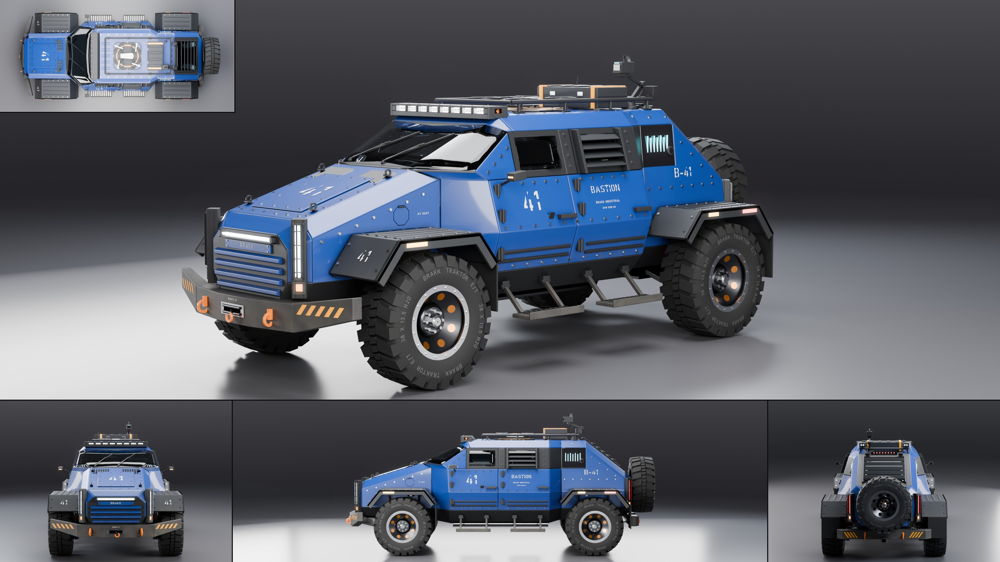
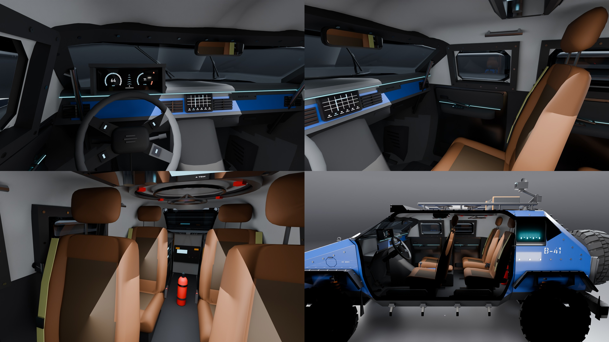

# Brakk Bastion

- **Brand, model, type:** Brakk Industrial Bastion, armored utility vehicle (all names made up).
- **Seats:** 4 (four buckets), four doors and a rear hatch.
- **Size:** 5.11 m long from the ram to the spare (5.17 m with the winch hook), 2.20 m wide over the tires, 1.86 m at the roof plate, 2.05 m over the roof case, 2.31 m with the sensor mast folded; wheelbase 3.10 m; tires 0.95 m in diameter, 0.34 m wide; hull floor a shallow V at 0.44 to 0.52 m, belly plate at 0.41 m.
- **Triangles:** 297,973 in 187 objects (269,389 in 153 before step B).
- **Build:** `vehicles/blender.sh vehicles/cars/brakk_bastion.py --out docs/progress/AG18/brakk_bastion --sheet`

## The design

- One hull that is a wedge at both ends: the hood rises at 17 degrees from the prow and the one-piece windshield (a center pane and two swept corner facets) carries on at 27; behind the roof a glass hatch falls at 38 degrees under armor louvres.
- A citadel between the wheels: the doors bulge out to a belt crease and lean in 17 degrees above it and 18 below it, over a shallow V floor with skid plates. In plan the hull is narrow at the nose and the tail and wide in the middle, so all four wheels stand in the open.
- A visor instead of windows: one dark band along the side holds a slit window on the front door, a window behind armor louvres on the rear door and a lit sensor band with a lens on the tail. Camera pods on struts replace the mirrors.
- Hub motors: no axles or shafts, double wishbones at every corner, a finned motor can inside each wheel with its orange cable, and the motors' copper behind the eight windows of the Brakk wheel's dish.
- The family, kept: plates with one 45 degree chamfer, bolted three-facet fender plates, light pylons on the chamfered corners (joined across the prow by a blade of light), the eight-cell bar over the windshield, the ribbed slab face with its badge plate, rows of bolt heads, stencils (`41`, `B-41`, `BASTION`), hazard stripes, winch, shackles, hitch.
- Its own hardware: a drone on an octagonal roof pad inside the rack rails, a strapped case, a sensor mast folded to a Z, a fold-down step under each door, a charge port on the nose, touch pads by the handles, the spare on a swing arm across the hatch.
- Show color: cobalt blue, with graphite plates, white stencils and signal orange recovery points, springs and cables.

## Step B: lamps, cut lines, glass (2026-11-13)

The second Brakk on step B's kit (`docs/assetgen_milestones.md`, AG18, step B), on
`vehicles/brands/brakk.py` (tube, bolt, plate, on_side, on_plane, stencil, chevrons, zcyl,
ring, coil and the wheel, bound to this car's sizes as its own copy built it: 96 segments,
24 lugs, the full dish, the hub motor). The brand module gains `lamp_pylon` (with `lbox` and
`lpt`): the Hauler's step B pylon as its copy builds it, which the Bastion uses; the Hauler
keeps its own copy and builds exactly as before (signed before and after). The sheet, clay,
zebra and check above are of this build.

- Light pylons: the brand's step B pylon on each chamfered corner, a housing of plates sunk
  30 mm into the corner round two pockets, an LED bar right under a clear (front) or red
  (rear) lens in a V of reflector plates, an amber cell on a reflector plate under an amber
  lens, bolted bezels and a guard of four bars. They were a box with a lit strip on its face.
- Prow blade: a frame of plates proud of the nose round one long window, an LED bar right
  under its clear lens on a reflector plate, four bolts (proud, so it reads far off).
- Roof bar: the housing's front a frame over a pocket, eight cells of three LED modules in
  reflector cups between dividers behind one clear lens, bolts along its top, amber end lamps
  as reflectors in pockets of bolted end plates under amber lenses (the clearance lamps were
  lit strips on its ends).
- Work lamps (new): two on the rack's rear bar facing back, housings with two reflectors under
  a clear lens and a guard of two bars each; the whip antenna moved forward out of their way.
- Stop lamp over the hatch: eight LEDs in cups under a red lens in a slim housing (a lit strip
  on a box before).
- Cut lines: the charge port's flap an octagon cut through each nose side, with a hinge on its
  top edge (it was a raised plate on the left only, with bolts); the "HV 800V" stencil on both
  sides. 3.5 mm shut lines everywhere (8 mm before; the plates keep their 8 mm bevel).
- Glass: the windshield, side windows, rear door windows and hatch glass in `"frame"` mode
  (the old frames were mirrored off at their corners and faced into the car).
- Wipers: the kit's wiper (boss, tapered arm, yoke, blade lying on the glass), both parked to
  the left.
- Step A's findings: the cabin tub's floor ends 10 cm sooner, inside the floor's slope (5% of
  it in the open, up to 9.9 mm, before); the rear seats' backs are narrower and inboard,
  inside the tail's lean (1%, up to 29.9 mm); none in the open now. The one-sided parts (the
  folding mast and its eye and light, the driver's wheel and screens, the wipers, the spare's
  swing arm, the winch hook and rollers, the hood louvres' and the drone blades' lean) are
  told to the checks as meant; the charge port is on both sides now. Tires as before (52.2 mm
  front, 25.8 mm rear, steers 20 degrees).
- Checks: every one `ok` (symmetry and through were `look`).
- 297,973 triangles (269,389 before).
- Pack rebuilt, every check passing: 145,150, 59,993, 20,233, 8,187 triangles (main 145,477,
  59,997, 20,168, 8,078), large class, texels 330 px/m (5th percentile; 307 before), LOD3
  12.7 of 40 degrees, 0.016 of 0.10 bent, 0.005 of 0.04 texture (main 16.9, 0.021, 0.006);
  the pylons, the prow blade and the roof bar read lit at every LOD, LOD2 and LOD3 as main's.
  Not published.
- Left: the sensor band's layered glow (step C), the fender markers as lit strips, the nose
  ribs' small gap at LOD3 (main's LOD2 had a dent there).

## Cabin

The full citadel from `vehicles/cabin.py` (`style="brakk"`), in place of the box seats and slab dash: `cab_fwd`, `cab_side`, `cab_back` and `cab_in` above, 128 samples.

- **What it has.** An armored car's interior lined from the windshield's base to a wall inside the tail plate, a grey spall liner over the slit windows' sills and hard dark trim under them, a black rubber floor with ribbed mats; four upright buckets in brown work vinyl with post headrests and belts on the pillars; a hard black dash with a cobalt band, slat vents, the gauge hood, a small map screen and BASTION on a bolted steel plate; a four-spoke wheel on a 34 degree column, pedals with a dead pedal, a louvred kick panel in each footwell; the console with the lever and a row of switches; steel door cards with bolted edges and bar pulls, BASTION lit on the front sills; every window in a thick bolted steel frame (the slit windows a box frame each, sleeve, flange and bolt heads; the windshield the same section up its sides and across its header); grab bars up the A pillars and on the B pillars and over the doors; an overhead switch and radio console over the front seats' backs ("NET 4"); a round roof hatch with its handwheel and red latches over the rear seats (under the drone pad); behind the rear seats the bay under the glass hatch: an equipment rack of cases on the left, a comms rack of radios on the right, tie-down rails, a power panel on the rear wall and a fire extinguisher.
- **The lining.** The firewall plane just behind the windshield's base (1.24), the spine on to 20 cm of each end (`cap=0.20`), a 30 mm grid, the vertices under the cowl pressed 30 mm inside the shell, the reveals in the dark trim (`reveal=`), and the car's `zone()`. The lining's faces standing in the footwells (a sliver of the cowl, as a spike) are deleted; the fender plates' inner flange that stands 6 cm through the hull's side by the footwells is hidden by the kick panels. The steel frames replace the earlier mouldings laid on the lining, which stayed ragged round the slit windows and the header.
- **Triangles.** Interior about 4,500 before (the schematic tub), 78,630 now (lining 22,836, the buckets 7,316 to 7,788 each, the hardware 6,258); the whole vehicle 300,634 before, 374,764 now (of 400,000).
- **Check.** `--check` says `ok` on every check: tires, ground, symmetry (the cabin's one-sided parts told as meant), panels, through (0 cabin parts in the open), triangles. The log's "through the shell" says nothing.
- **Exterior.** Signed before and after: only `interior.*` objects, cabin materials and the studio's `cab*` lamps differ.
- **Weakest from the seat.** The seats' backs show the cabin lamps' hard shadow edges (as on the Hauler); the bay's racks sit behind the rear seats and are hard to see from the front; the corner facets of the windshield show the hood's bright chamfer through the glass; the frames' inner sleeves leave a few grey slivers of lining at their corners.

## What I would improve

- The raked windshield mirrors the studio's top light from the front quarter; the hero stands lower and more to the side to keep most of it clear. A slight crown in the glass would fix it for every view.
- The spare hides the hatch's lower half and the unit plate; a spare offset to one side on a longer arm would show more of the tail.
- The steps are drawn down only; a folded one beside a lowered one would explain them. The drone's rotors could fold, and the pad could sit in a recess with doors.
- A second sensor band across the brow of the windshield.

## Kit wishes

- **Glass:** a glass material or studio option that keeps the top light out of raked flat glass (a light invisible to glossy rays from glass, or an anti-reflection weight), and a note of where each studio light stands, so a view can be chosen by arithmetic instead of trial renders.
- **Family helpers:** a place for helpers a brand shares (`plate`, `pylon`, `bolt`, `stencil`, `chevrons`, the Brakk wheel), so the third Brakk does not carry a third copy; the brand wheel with options (a motor can, a spare without one).
- **Hero framing:** the fitted hero sits right of the frame's middle on a tall car; a way to center the silhouette, or to say where the fifth tile is so the fit leaves it room.
- **Geo:** an upright cylinder and a ring about any axis (`lathe` turns about y only, so every upright part needs a transform), a bolt row along a path on the body, and louvres that take a frame.
