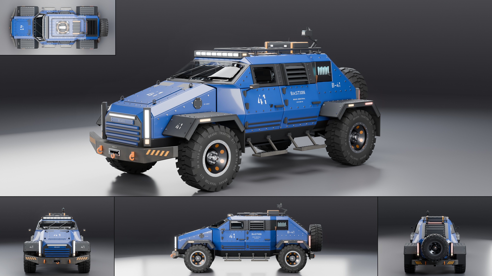

# Brakk Bastion

- **Brand, model, type:** Brakk Industrial Bastion, armored utility vehicle (all names made up).
- **Seats:** 4 (four buckets), four doors and a rear hatch.
- **Size:** 5.11 m long from the ram to the spare (5.17 m with the winch hook), 2.20 m wide over the tires, 1.86 m at the roof plate, 2.05 m over the roof case, 2.31 m with the sensor mast folded; wheelbase 3.10 m; tires 0.95 m in diameter, 0.34 m wide; hull floor a shallow V at 0.44 to 0.52 m, belly plate at 0.41 m.
- **Triangles:** 269,389 in 153 objects.
- **Build:** `vehicles/blender.sh vehicles/cars/brakk_bastion.py --out docs/progress/AG18/brakk_bastion --sheet`

## The design

- One hull that is a wedge at both ends: the hood rises at 17 degrees from the prow and the one-piece windshield (a center pane and two swept corner facets) carries on at 27; behind the roof a glass hatch falls at 38 degrees under armor louvres.
- A citadel between the wheels: the doors bulge out to a belt crease and lean in 17 degrees above it and 18 below it, over a shallow V floor with skid plates. In plan the hull is narrow at the nose and the tail and wide in the middle, so all four wheels stand in the open.
- A visor instead of windows: one dark band along the side holds a slit window on the front door, a window behind armor louvres on the rear door and a lit sensor band with a lens on the tail. Camera pods on struts replace the mirrors.
- Hub motors: no axles or shafts, double wishbones at every corner, a finned motor can inside each wheel with its orange cable, and the motors' copper behind the eight windows of the Brakk wheel's dish.
- The family, kept: plates with one 45 degree chamfer, bolted three-facet fender plates, light pylons on the chamfered corners (joined across the prow by a blade of light), the eight-cell bar over the windshield, the ribbed slab face with its badge plate, rows of bolt heads, stencils (`41`, `B-41`, `BASTION`), hazard stripes, winch, shackles, hitch.
- Its own hardware: a drone on an octagonal roof pad inside the rack rails, a strapped case, a sensor mast folded to a Z, a fold-down step under each door, a charge port on the nose, touch pads by the handles, the spare on a swing arm across the hatch.
- Show color: cobalt blue, with graphite plates, white stencils and signal orange recovery points, springs and cables.

## What I would improve

- The raked windshield mirrors the studio's top light from the front quarter; the hero stands lower and more to the side to keep most of it clear. A slight crown in the glass would fix it for every view.
- The spare hides the hatch's lower half and the unit plate; a spare offset to one side on a longer arm would show more of the tail.
- The steps are drawn down only; a folded one beside a lowered one would explain them. The drone's rotors could fold, and the pad could sit in a recess with doors.
- A fuller cabin (door cards, belts, a rear cargo deck) and a second sensor band across the brow of the windshield.

## Kit wishes

- **Glass:** a glass material or studio option that keeps the top light out of raked flat glass (a light invisible to glossy rays from glass, or an anti-reflection weight), and a note of where each studio light stands, so a view can be chosen by arithmetic instead of trial renders.
- **Family helpers:** a place for helpers a brand shares (`plate`, `pylon`, `bolt`, `stencil`, `chevrons`, the Brakk wheel), so the third Brakk does not carry a third copy; the brand wheel with options (a motor can, a spare without one).
- **Hero framing:** the fitted hero sits right of the frame's middle on a tall car; a way to center the silhouette, or to say where the fifth tile is so the fit leaves it room.
- **Geo:** an upright cylinder and a ring about any axis (`lathe` turns about y only, so every upright part needs a transform), a bolt row along a path on the body, and louvres that take a frame.
