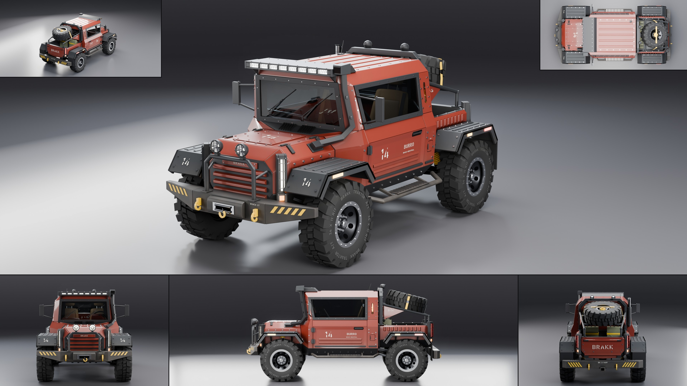
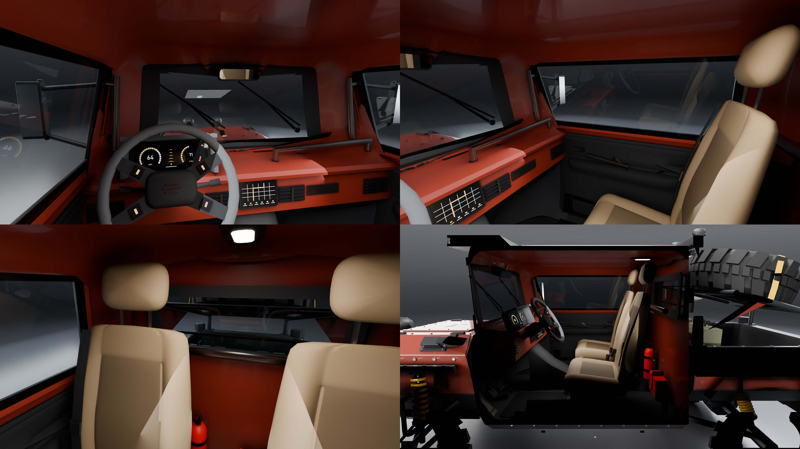

# Brakk Burro

- **Brand, model, type:** Brakk Industrial Burro, compact two-door 4x4 with a short load tub under a pack rack (all names made up).
- **Seats:** 2 (two buckets), two doors.
- **Size:** 4.02 m long (winch hook to hitch), 1.95 m wide (1.90 m over the tires), 1.80 m high at the roof, 1.87 m at the roll hoop and 1.95 m at its work lamps (1.96 m with the antenna); wheelbase 2.50 m; tires 0.86 m in diameter, 0.28 m wide; hull floor at 0.48 m, lowest point (front lower arms, rear axle housing) 0.30 m.
- **Triangles:** 267,928 in 190 objects.
- **Build:** `vehicles/blender.sh vehicles/cars/brakk_burro.py --out docs/progress/AG18/brakk_burro --sheet`
- **Checks:** every one `ok` (`check.json`); the front wheels steer 20 degrees each way. One-sided parts (the raised intake, the exhaust stack, the antenna, the driver's wheel and screens, the wipers, the winch hook, the spare) are told to the checks as meant.

## The design

- Brakk's smallest machine: as tall as it is wide and barely two wheels longer than its wheelbase. Nose, hood and cab are one hull of flat plates, every edge sharp, 45 degree chamfers on the hood, the roof and the nose corners; the wheels stand outside it under bolted three-facet fender plates, wishbones, dampers and yellow springs in the gap.
- The windshield leans forward seven degrees under a brow: the roof's front edge run out as a thick plate with the brand's bar of light (eight cells behind one lens, amber end lamps) in its face. The corner posts are chamfers in plan; the hood's chamfer runs on as the doors' shoulder, so the plates of nose and cab read as one fold.
- The pack on its back: a roll hoop behind the cab, and from it a rack sloping down to two posts on the tub's tail, the spare strapped flat on it under a hand wheel and a ratchet strap, its face up and to the rear. Under it a short tub with a tread plate floor, tie rings, two fuel cans and a stencilled tailgate. Two round work lamps sit on the hoop like ears, a stop lamp under its top bar.
- The face: the family's dark slab with four body-color ribs and a bolted name plate between two light pylons, behind a nudge bar of tube that carries two round lamps with cross guards; a winch bumper with rising ends, yellow shackles and hazard stripes under it.
- One-sided hardware that says what the car is for: a raised intake off the hood's chamfer up the left corner post, an exhaust stack with a slatted heat shield up the hoop's right leg.
- Doors with a pressed panel and two ribs, external hinges, a grab bar across a recess, a rub strip; rock sliders with a tread step; tube-frame mirrors; a marker blade in each pillar; rows of bolt heads; stencils (`14` on doors, hood and fender slopes, `B-14` on the rack's webs, `BRAKK` on the tailgate and the name plate).
- The Brakk wheel at its smallest: a 34 inch lugged tire with raised sidewall lettering on a dished steel rim with a bolted bead ring.
- Show color: oxide red, with graphite plates, bone white stencils and yellow recovery points.

## Step B's kit in this car

- Lamps: the brand's step B pylons on the nose and tail corners (an LED bar in a reflector V and an amber cell under lenses, bolted bezels, a guard); LED modules in reflector cups behind one clear lens in the brow, reflectors in pockets of the end plates under amber lenses; four round lamps (a bowl housing, a bolted bezel, a faceted reflector round its emitter, a domed lens, a cross guard); eight LEDs behind a red lens in the stop lamp; a marker blade in each pillar: a pocket cut into the hull (`pocket()` as `"skin"`) with an amber bar on a bright plate under an amber lens that is the skin the cutter took away.
- Cut lines: the filler flap on each quarter (`groove()`, closed), the recess behind each door's grab bar (`pocket()`), the cab's rear window (a `pocket()` dropped through the back wall); 3.5 mm shut lines between the panels.
- Glass: the rear pane is bonded over its hole with a frit border printed on it and two guard bars against the load. The windshield and the side windows are whole flat panes in thick frames of the car's own (`frame()`: a mitred bar bolted over the pane's edge, bolt heads every 16 cm), shaded flat. The kit's `"frame"` mode was tried first and dropped: see Kit wishes.
- Wipers: the kit's wiper, both parked to the left.

## Cabin

The full cab from `vehicles/cabin.py` (`style="brakk"`), in place of the box seats and slab dash: `cab_fwd`, `cab_side`, `cab_back` and `cab_in` above, 96 samples.

- **What it has.** The Burro is bare inside: no headliner, the roof, the pillars, the walls over the doors, the rear wall and the dash in the body's own red paint on the steel; a black rubber floor and mats; two upright seats in tan vinyl with orange stitching, post headrests, belts on the pillars; a steel dash with a hard brow, slat vents, the gauge hood, a small route screen and BURRO on a bolted steel plate; a four-spoke wheel on a 32 degree column, three pedals; a bare shift tunnel with the gear lever, the transfer lever and the hand brake; thin door cards with a pull bar, a window crank and a bolted steel kick plate, BURRO lit on the sills; a grab bar up each A pillar and one across the dash before the mate on bolted posts; a harness bar behind the seats down to the floor; a fire extinguisher and a strapped first aid case behind the seats; a dome light; the rear window through the back wall (the module's smoked pane taken out: the body's own glass is right behind); a black moulding round the windshield.
- **The lining.** The windshield leans forward, so the firewall plane stands just ahead of its top (behind its base it closed the whole windshield off); the spine on to 20 cm of each end (`cap=0.20`), a 30 mm grid (`cab.step`), the belt given (`belt=BELT`: the module found 1.08), the vertices under the cowl pressed 40 mm inside the shell, and what still stood in the open there taken out: faces any point of which is outside, and the firewall's fill above the cowl's height (ahead of the leaning glass it stood in the air over the cowl; `room()` missed it, its rays slip under the glass's edge). The car's `zone()`: rubber up the footwells, the cowl in the dark trim, the body's paint over the doors' tops. The mouldings (`glass_trim()`) hide the ragged reveals at the windshield's sides, header and base.
- **Studio.** The car's own cabin lamp (`K.cabin_light`) mirrored as a square in the windshield from the driver's seat: in the cabin views only it is unseen in glossy rays (`no_glint`, a view hook); every other view renders as before.
- **Triangles.** Interior 3,356 before, 42,178 now (lining 11,876, each seat 7,316); the whole car 267,928 before, 306,750 now (of 400,000).
- **Check.** `--check` says `ok`: tires, ground, symmetry (the cab's one-sided parts and the lining's cut under the cowl, 3.5 mm off each side, told as meant), panels, through, triangles. The log's "through the shell" says nothing.
- **Exterior.** Signed before and after: only `interior.*` objects, cabin materials (the kit's `seat` set to a rougher vinyl) and the studio's `cab*` lamps differ.
- **Weakest from the seat.** A few red slivers of the dash's front edge still show between the dash and the windshield's base moulding; the bare painted roof is one smooth sheet (no ribs or bolted seams inside); through the forward-leaning windshield the cab's own interior mirrors strongly.

## What I would improve

- The cab is still a plain box above the belt: a second fold in the roof (a raised hatch, a rack) or a stepped rear wall would give the top view more to read.
- The intake is a square duct with two clamps; a real one would have a cast elbow, a flexible sleeve at the hood and a cyclone head.
- The tub is short on load: one tool roll, a jack and a shovel clipped to the rack would say more than two cans.
- The rear suspension is a beam axle with links and short dampers that hide behind the wheels; leaf springs with shackles under the tub would show from the side.
- The front fender plate's rear slope is cut back round the cab's shoulder with a plain step in its inner edge.
- Tread as real carved blocks with sipes, mud on the tires and plates (as the Hauler's list says).

## Kit wishes

- **The glass frame folds over the pane.** `build_body`'s `"frame"` (and `"frit"`) mode makes the frame a ring of four long quads round the pane; their diagonal edges are not creased, so subdivision pulls each diagonal's middle toward the middles of the two long strips and the frame's faces fold over the pane's corners (several centimeters on a window a meter long). It shows in clay as a pane with cut corners and crumpled bits in them, and in paint as lighter corner triangles; the Hauler's clay has it too. Creasing the diagonals (or insetting after the subdivision) would cure it. This car builds its frames itself.
- **Flat panes shaded flat.** A pane on a `glass*` material is shaded smooth, and with its thickness the normals of its outer ring of faces bend toward the rim: the studio's reflections form a bright ring round every flat window (white bands in the side view). `shade_flat()` on a planar pane, or sharp edges on the solidified rim, cures it; this car calls `shade_flat()` on its panes.
- **A broad bevel on a panel with a small cut.** The plates' 8 mm bevel folded round the marker's 36 mm window (star-shaped shading on the pillar, and the mirrored side came out 14 mm different); a per-panel bevel is in the kit, a warning when a cut is narrower than a few bevels would have saved the hunt.
- **A mirrored `pocket()` with fully rounded ends** (`K.rounded(x, z, w, h)` with no radius) cut the right side 14 mm unlike the left; with a radius under half the width both sides match.
- **`brakk.wheel` turns a spare only about z** (`yaw`); a spare lying on a slope needs `rot` (this car sets the rotation on the objects after the call).
- **`K.meant()` patterns** only end in `*`; `*.spare` would name a spare's six objects at once.
- **Helpers worth sharing:** `frame()` (a mitred, bolted frame over a flat pane's edge) and `round_lamp()` (a round lamp on a bracket: bowl, bezel, reflector, lens, guard).
