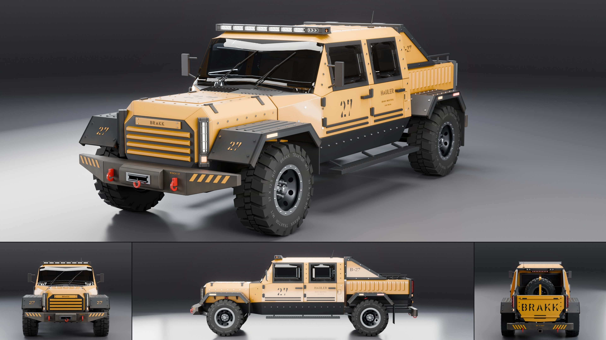

# Brakk Hauler

- **Brand, model, type:** Brakk Industrial Hauler, crew cab pickup truck with an open load bed (all names made up).
- **Seats:** 4 (two buckets, a rear bench), four doors.
- **Size:** 5.69 m long, 2.20 m wide over the tires, 1.95 m high at the roof bar (2.08 m with the antenna); wheelbase 3.50 m; tires 0.90 m in diameter, 0.32 m wide; hull floor at 0.48 m, lowest point (rear axle housing) 0.31 m.
- **Triangles:** 259,196 in 156 objects.
- **Build:** `vehicles/blender.sh vehicles/cars/brakk_hauler.py --out docs/progress/AG18/brakk_hauler --sheet`

## The design

- A narrow monolith: nose, hood and cab are one hull of flat plates, every edge sharp, every top edge a 45 degree chamfer; the bed is a second, narrower tub behind it.
- The wheels stand outside the hull, in the open, each under a bolted three-facet fender plate (slope, flat, slope) with a folded outer edge, ribs on top and gussets to the body. Wishbones, half shafts, dampers and red springs show in the gap; a beam axle with links at the rear.
- The face: a dark slab with four body-color ribs and a stencilled badge plate between two light pylons on the chamfered corners; a winch bumper with rising ends, shackles and hazard stripes under it.
- Behind the cab a sail frame (bar frame, plate web, a crossbar with two work lamps) runs down to the bed rail; the bed has corrugated sides, a tread plate floor, tie-down rings, rack rails, a strapped spare and a stencilled tailgate.
- Upright glass in thick frames, a plate gusset for an A-pillar, external hinges, bar handles, rub strips, side steps, tube-frame mirrors.
- Lugged tires with side biters and raised sidewall lettering on dished steel rims with a bolted bead ring.
- Show color: signal ochre, with graphite plates and red recovery points.

## Step B: lamps, cut lines, glass (2026-11-12)

The Brakk pilot on step B's kit (`docs/assetgen_milestones.md`, AG18, step B), and the first
car on `vehicles/brands/brakk.py` (tube, bolt, plate, on_side, on_plane, stencil, chevrons,
coil and the wheel, bound to this car's sizes as its own copy built it: 88 segments, the
small dish, no hub motor). The sheet, clay, zebra and check above are of this build.

- Light pylons: each is now a housing of plates sunk 30 mm into its chamfered corner with
  two pockets 50 mm deep. The tall one holds an LED bar right under the lens in a V of
  reflector plates (white in front, red behind, under clear and red lenses); the one at its
  foot an amber cell on a reflector plate under an amber lens (an amber reflector bowl first,
  but its emitter sat too deep for the game pack, which baked it white). Each window has a bolted bezel, four bolts a
  window, and the tall one a guard of four bars on two posts. The bar was a lit strip lying
  on a box.
- Roof bar: the housing's front is a frame with a pocket behind it; eight cells between
  dividers, three LED modules in reflector cups each, behind one clear lens; bolts along its
  top; the amber end lamps are reflectors in pockets of bolted end plates under amber lenses.
- Work lamps on the sail frame: housings with two reflectors under a clear lens and a guard
  of two bars each. The stop lamp over the rear window: ten LEDs in cups under a red lens in
  a slim housing.
- Cut lines: a fuel flap cut through each quarter (its hinge on the front edge; two of the
  quarter's bolts moved out of its way); 3.5 mm shut lines everywhere (8 mm before; the
  plates keep their broad 8 mm bevel).
- Glass: the windshield and side windows in `"frame"` mode, thick frames made on one side
  and mirrored (the old frames were mirrored off at their corners and faced into the car).
- Wipers: the kit's wiper (a boss, a tapered arm, a yoke, a blade lying on the glass), both
  parked to the left; the antenna an object of its own.
- Street distances: the front upper wishbones' ball joints lower in the rims (inner pivots
  0.86 to 0.78 m, outer 0.63 to 0.58 m) and the tie rods 6 cm nearer the axle: the front
  tires 7.1 mm from the chassis and steering 0 degrees before, 47.8 mm and 20 degrees now;
  the rear dampers 2 cm inboard and the rear fender gussets 3 cm shorter: 13.5 mm to the
  springs before, 33.1 mm now; the cabin tub's floor narrowed into the hull's floor slope and
  its back wall shaped to the hull, the dash 3 cm shorter: 41% of the tub in the open before,
  none now.
- Checks: every one `ok` (tires, symmetry and through were `look`). The one-sided parts
  (driver's wheel and screens, wipers, antenna, the winch hook, the tread plate's lozenges)
  are told to the checks as meant.
- About 259,000 triangles (230,000 before).

## Brakk family cues (for the Bastion and the Mule)

Geometry and texture only, none of it depends on the color:

1. **Plate and chamfer.** Flat plates, all edges sharp, one chamfer size (about 0.12 m, 45 degrees) on every top edge and on the nose and tail corners in plan. Shut lines of 3.5 mm (8 mm before step B) and a broad edge bevel (8 mm).
2. **Wheels outside the hull** under separate three-facet fender plates with a folded edge and two rows of bolt heads; never a well cut into the body.
3. **Light pylons:** a tall housing with a vertical bar and an amber cell at its foot, standing on each chamfered corner (white in front, red behind), and one full-width bar of eight cells over the windshield with amber end lamps.
4. **The ribbed slab** as a face: horizontal trapezoid ribs in body color on a dark plate, the name on a bolted plate above them. Cargo walls take the same rib upright (corrugation); doors take it lying as rub strips.
5. **Fasteners in rows:** hex heads every 0.10 to 0.15 m along plate edges, sills, pillars and rails.
6. **Hardware you can name:** winch and fairlead, shackles, hitch, side steps, tie-down rings, rack rails, a sail or roll frame with work lamps, external hinges, bar handles.
7. **Stencils:** large capitals cut by bridges, a unit number on the doors, hood, fender slopes and frame (`27`, `B-27`), small print under the model name, hazard stripes on the bumpers.
8. **The Brakk wheel:** lugged tire, raised sidewall text, dished steel disc with eight round windows, bolted bead ring, eight lug nuts.

The script's helpers for these (`plate`, `pylon`, `bolt`, `stencil`, `chevrons`, `build_wheel`, `tube`, `coil`) can be copied into the next Brakk's script as they are.

## What I would improve

- A see-through rear window in the cab's back wall (it is a dark pane in a frame now) and a fuller cabin: door cards, pedals, belts.
- The front suspension is hidden from most angles by the bumper ends and the fender slopes; a higher, shorter bumper would show the wishbones.
- Tread as real carved blocks with sipes rather than blocks set on a carcass; mud on the tires and plates.
- Fender plates on stays that move with the wheel, a tailgate with hinges and chains, a cable on the winch drum.

## Kit wishes

- **View fitting:** fit to the car's silhouette (vertices), not to the corners of every object's box. For a tall, long car the hero and the end views come out small (this script sets negative margins), and the side tile of the sheet put the camera 24 m away, behind the studio's wall at 16 m, so the tile was empty: a shorter default lens for the side view, a larger cove or a warning.
- **Studio:** the two low strip lights are seen straight through both side windows in the side view (white windows). This script switches off their camera and transmission visibility after `build_studio()`.
- **Wheels:** a tire style for off-road tread, a way to skip the kit's tire or rim, and a rotation for a wheel that is not on an axle (a spare).
- **Body:** a flat end cap that can hold a glass panel (an upright cab back with a window); the bevel width and the gap as they are now can only be changed after the build; the paint's dust height range as a palette key.
- **Helpers worth sharing:** a straight tube or bar between two points, a bolt row along a path, stencil lettering laid out letter by letter, hazard stripes, a rotation argument on `Geo.obj`.
