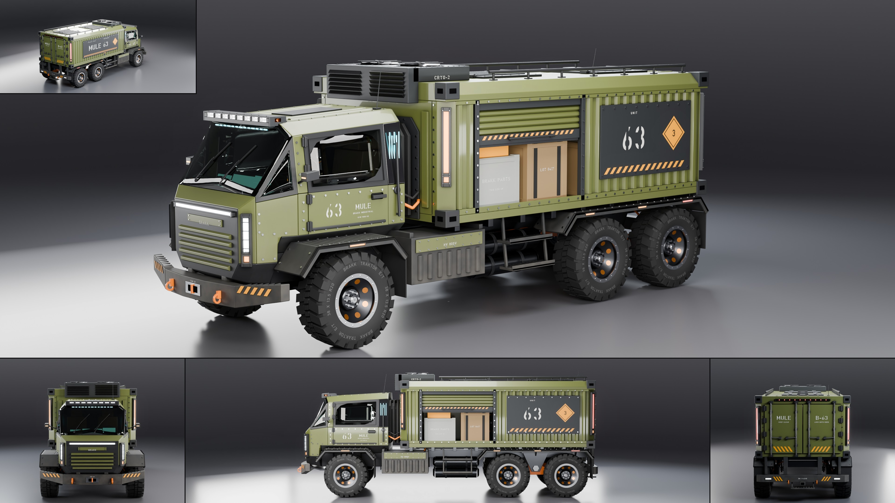

# Brakk Mule

- **Brand, model, type:** Brakk Industrial Mule, six-wheeled cargo van (all names made up).
- **Seats:** 2 (two buckets in a cab-over cab), plus a cargo box of 4.1 x 2.1 x 1.16 m inside.
- **Size:** 6.65 m long from the tow pin to the tail step, 2.30 m wide over the tires (2.35 m over the fender plates' folded edges), 2.24 m at the cab roof, 2.50 m at the box roof, 2.68 m over the cooling unit's fans, 2.76 m with the whip; three axles, 4.11 m from the front axle to the bogie's pivot, the rear pair 1.24 m apart; tires 0.95 m in diameter, 0.34 m wide; hull floor at 0.58 m, frame at 0.81 m.
- **Triangles:** 392,506 in 234 objects.
- **Build:** `vehicles/blender.sh vehicles/cars/brakk_mule.py --out docs/progress/AG18/brakk_mule --sheet`

## The design

- A narrow wedge cab that stands between its front wheels (1.6 m wide, the box behind it 2.2 m): the slab face, a 45 degree cowl, a one-piece windshield raked 27 degrees with two swept corner facets, a triangular quarter window, a roof that rises toward the box. The door is over the wheel; the bumper's rising end and the fender plate with its tread ribs are the steps up to it.
- A bellows collar on a turntable joins the cab to the box, with hoses and high voltage cables looping across the gap, so the two read as separate bodies.
- The box is a container on a frame: corrugated walls between bolted rails, corner castings with their oval holes, posts chamfered in plan, barn doors with four lock rods, cams, catches and hinges, and bolted number plates over the ribs (`63`, `MULE 63`, a hazard placard, stripes).
- The roller door on the left is shown two thirds open over a lit hold: lashing rails, strapped crates, a hazard case, drums. A ladder hangs under it.
- Hub motors at all six wheels, as on the Bastion: wishbones in front, and the rear pair on a signal orange walking beam that pivots on a trunnion between the tires. Battery cases with ribbed faces, air tanks and under-run bars fill the space between the axles.
- A sensor band in place of mirrors: camera pods on struts, a dark rear pillar with lit cells and a lens, a row of cells under the roof bar. A cooling unit hangs over the collar with louvres in front and two fans on top; two hatches and lashing rails on the roof.
- The family, kept: plates with one 45 degree chamfer, bolted three-facet fender plates, light pylons on the chamfered corners (white on the face, tall red ones on the tail posts, tall amber markers on the box beside the cab), the blade across the face, the eight-cell bar over the windshield, the ribbed slab with its badge plate, rows of bolt heads, stencils, hazard stripes, the Brakk wheel.
- Show color: olive drab, with graphite plates, white stencils and signal orange for the beam, springs, cables and hazard marks.

## Step B: lamps, cut lines, glass (2026-11-13)

The third Brakk on step B's kit (`docs/assetgen_milestones.md`, AG18, step B), on
`vehicles/brands/brakk.py` (tube, bolt, plate, on_side, on_plane, stencil, chevrons, zcyl,
ring, coil and the wheel, bound to this car's sizes as its own copy built it: 96 segments,
24 lugs, the full dish, the hub motor; the switch alone signed the same as main). The Mule's
own prisms (`yz_prism`, `xy_prism`, `xz_prism`) stay in the car. The brand module's
`lamp_pylon` gains `bar`, the LED bar's width (0.018 m by default, so the Hauler and the
Bastion build the same, signed before and after). The sheet, clay, zebra and check above
are of this build.

- Light pylons: the brand's step B pylon (`lamp_pylon`) on every chamfered corner: white
  with a guard on the cab's face, tall red ones on the box's tail posts and tall amber
  markers on the box's front posts beside the cab (both without a guard, between the corner
  castings). Each a housing of plates sunk into the corner round two pockets, an LED bar
  right under its lens filling the mouth of a V of reflector plates, an amber cell under an
  amber lens, bolted bezels. They were boxes with lit strips on their faces. The bar is the
  window's width (`bar=0.05`): the Bastion's 18 mm bar left most of the window to the V's
  chrome, which the first pack baked dark, so the amber markers on the box read unlit at
  every LOD.
- Face blade: a frame of plates proud of the slab round one long window, an LED bar right
  under its clear lens on a reflector plate, as tall as the window (26 of 30 mm, to read
  far off), four bolts.
- Roof bar: as the Bastion's (the two bars are the same housing): eight cells of three LED
  modules behind one clear lens between dividers, bolts along its top, amber end lamps as
  reflectors in pockets of bolted end plates under amber lenses.
- Stop lamp over the barn doors: ten LEDs in cups under a red lens in a slim bolted housing
  (a lit strip on a box before).
- Reversing lamps in the rear beam's face and the fender plates' side markers (amber, red at
  the rear): an LED bar right under a lens in a bezel (bolted on the beam). They were lit
  strips.
- Cut lines: a recess cut behind each door's bar handle (the handle's standoffs reach into
  it); 3.5 mm shut lines everywhere (8 mm before; the plates keep their 8 mm bevel; the far
  LODs keep them closed, so 2.4 mm was not needed). A charge port's flap cut through each
  nose side, as the Bastion's, was tried and left out: its plate collapsed in the pack's
  LOD2 and LOD3 and showed a black octagon.
- Glass: the windshield, the quarter and door windows in `"frame"` mode (the old frames were
  mirrored off and faced into the cab).
- Wipers: the kit's wiper, both parked to the left.
- Step A's findings: the fender plates' folded edge is 60 mm deep (80 before), so the tires
  clear it by 42 mm (22.2 mm before); the nearest part is now a gusset, 35.3 to 38.7 mm, and
  the front pair still steers 20 degrees. The dash is the cab's width all along, inside the
  hull's sides (its one-sided extrusion left 6% of it in the open, up to 11.8 mm, and made it
  asymmetric). The one-sided parts (the roller door on the left with its opening, ribs,
  guides, curtain, bar, sill, bolts, the lit hold and the cargo it shows; the ladder under it
  and the under-run bars on the right; the number plates and their marks; the third hose;
  the whips; the driver's wheel and screens; the wipers; the louvres' lean and the fans'
  blades) are told to the checks as meant.
- Found on the way: the cab roof's hatch plate leaned the wrong way (its front edge 18 mm off
  the roof); it lies on the roof now.
- Checks: every one `ok` (tires, symmetry and through were `look`).
- 392,506 triangles (364,552 before; budget 400,000: the small bezels are plain boxes and the
  stop lamp has ten LEDs to stay under it).
- Pack rebuilt, every check passing: 146,484, 59,991, 20,080, 8,187 triangles (main 146,089,
  59,994, 20,521, 8,116), large class, texels 244 px/m (5th percentile; 243 before), LOD3
  14.3 of 40 degrees, 0.019 of 0.10 bent, 0.007 of 0.04 texture (main 13.4, 0.015, 0.007);
  the pylons, the face blade and the markers read lit at every LOD, the roof bar as a row of
  LED cells where main's was one white strip; LOD2 and LOD3 otherwise as main's. Not
  published.
- Left: the sensor band's and the brow's layered glow (step C), the camera pods' small lit
  strips.

## What I would improve

- The walking beam shows only between the tires and from behind; a cutaway fender or a higher view of the bogie would explain it better.
- The windshield is dark from the front; a brighter cabin (lit dash, door cards, belts) would read through it.
- A tail lift folded under the frame, chains on the barn doors, a second roller door on the right, and a real hinge line in the bellows.
- The side tile takes a 64 mm lens at this length, so its perspective is stronger than the other cars' side views.

## Kit wishes

- **Brand helpers:** the third Brakk carries a third copy of `tube`, `bolt`, `plate`, `pylon`, `stencil`, `chevrons`, `coil` and the Brakk wheel; a `brands/brakk.py` beside the kit would hold them once.
- **Lettering:** `text_mesh` centers text on its origin in both directions; an option for the baseline, and a note in the guide, would save a round of misplaced numbers.
- **Geo:** prisms from a polygon in a named plane (`yz`, `xy`, `xz`), an upright cylinder, a ring about any axis, and a bolt row along a line.
- **Side view of long vehicles:** an orthographic side tile, or a deeper studio, so a 6.6 m truck is drawn with the same lens as a coupe.
- **Fifth tile:** let the hero's fit know the tile's corner, so a tall vehicle never needs its size tuned by eye.
