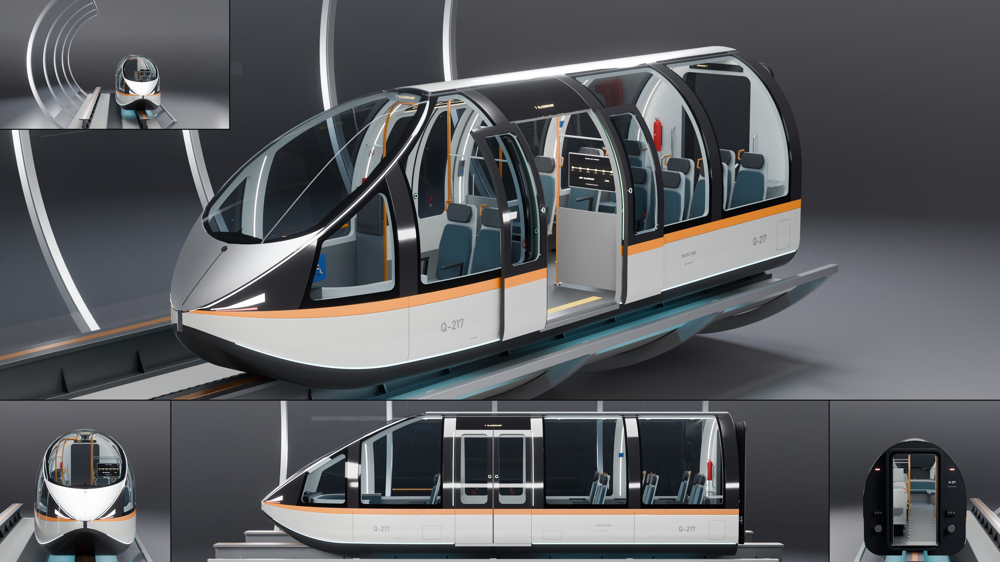
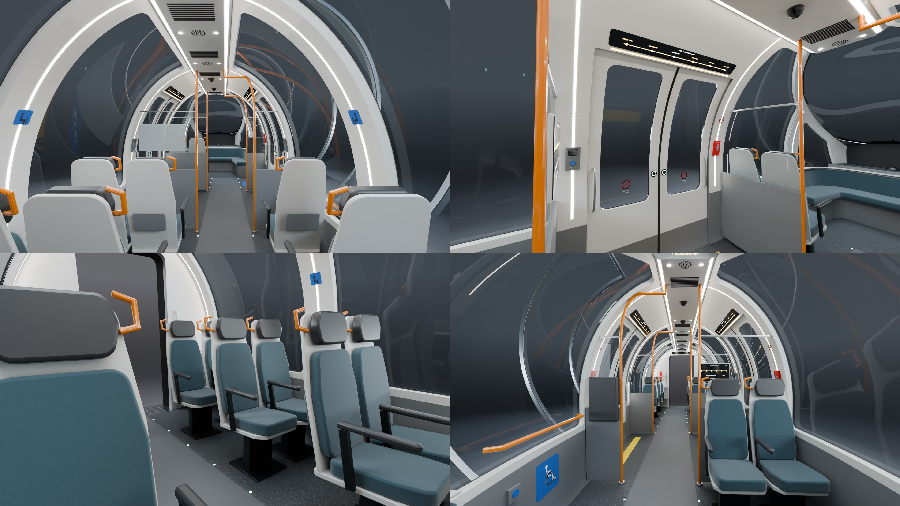

# Caldera Quill





- **Maker, model, type:** Caldera Transit Works Quill, a passenger pod for the sky tube: a
  wheel-less, magnetically levitated capsule that runs inside a 7 m glass tube, two tracks
  side by side, in trains of three (end pod, middle pod, end pod turned round). All names
  and lettering are made up (operator SKEIN TUBE, line 7, pod Q-217).
- **Script:** `vehicles/trains/caldera_quill.py`. The end pod is the default;
  `CYBERGEN_VARIANT=mid` builds the middle pod (a gangway at both ends, `mid.jpg`);
  `CYBERGEN_SHUT=1` builds every door shut (the left door is slid open only in the views
  `hero` and `door`, by `K.Group(...).pose_for`).

## Numbers as built

| | |
|---|---|
| Frame | x forward along the tube, y left, z up, meters; z = 0 is the bottom of the body |
| Length | 9.00 m over the body's ends (x = -4.5 to 4.5); each gangway collar stands 0.25 m beyond its end, half the 0.5 m gap between pods |
| Width, height | 2.40 m (y = -1.2 to 1.2; lettering and seals stand 1 mm off it), 2.70 m |
| Section | flat belly 1.56 m wide with the guide beam's channel (0.60 m wide, 0.19 m deep) in it, bilges of 0.42 m radius, upright sides to z = 1.25, then an elliptical vault to the top; the same both sides |
| Least clearance to the tube | 209 mm, at the middle of the bilge (y = 1.08, z = 0.12), the pod 1.25 m off the tube's axis on either track (the log prints it) |
| Floor | top at z = 0.30, flat from the gangway to the nose's lounge; 0.11 m of floor over the channel |
| Doors | one double plug door a side, its middle at x = 0: opening 1.40 m wide, 2.01 m clear from the floor to the header's lining (leaves from z = 0.265 to 2.35 outside); each leaf slides 0.70 m along the body, 75 mm out |
| Aisle | 0.78 m clear between the poles (0.79 m between armrests), end to end; 1.09 m between the luggage shelves; gangway 1.00 m wide |
| Headroom | 2.26 m under the spine's console in the aisle (2.20 m under a camera dome), 2.06 m in the gangway, 2.01 m in the doorways; over 2.05 m into the lounge as far as x = 2.5 |
| Seats | end pod 16: 11 seats (2 + 1 across) and a bench for five round the nose, and a wheelchair bay by the door; middle pod 17 seats and the bay |
| Skin to lining | 65 mm (the doors' leaves 42 mm); glass is one surface, flush with the skin |
| Triangles | end pod 263,395 in 131 objects, middle pod 254,909 in 139 (the track and the tube are in the studio's collection and not counted) |

## Outside

- **The quill.** A long glazed capsule on a pearl white hull: everything above the belt is
  glass, in tall panes that run from the sill over the vault to a white spine along the
  roof, between gloss black hoops. Seen from above it is a feather: the spine is the shaft,
  the panes the vanes.
- **The nib.** On the end pod the section is cut by a raked surface that starts at the
  spine's edge and comes down to a point at the nose: the cut is the windshield, a single
  leaf of glass 2.5 m long over the observation lounge, and its last half meter is a metal
  nib with a slit and an eye (a sensor under a dark lens). The plan narrows and the keel
  rises under it, so the hull closes in a blade 0.17 m tall. The rim of the cut is a black
  rail with a line of white light from the roof to the tip; the black glazing band runs out
  to a point under it with a head lamp blade and a red marker in it (an end pod leads or
  trails).
- **Line color.** One material, `paint2`: the stripe under the glass the length of the pod
  and across the doors, and inside the poles, the grab loops on the seats and the rail of
  the wheelchair bay. Recolor it and the pod is another line's.
- **Doors and lights.** Plug doors that wrap into the vault (their tops are 0.42 m inboard
  of their sills), a lit ring button on each face, a green line of light up each door post, an
  amber destination over each door and on the console's prow behind the windshield, a thin
  cyan running line along the top of the graphite skirt, red markers on the coupling ends.
- **Markings.** Pod number on both flanks and on the spine, operator and line, the maker's
  name, outlines of service hatches and a charge port.
- **Coupling end.** A flat graphite wall, the open gangway in a corrugated rubber collar
  with a steel frame, a buffer and a jumper box each side.
- **Levitation.** No wheels: a channel in the belly rides over the guide beam's head.
  Two magnet frames (`mag.lev`, `mag.coils`), guidance arms that reach in under the head from
  both channel walls (`mag.arms`), landing skids between the magnets (`mag.skids`, a hair
  lower than the magnets), and three slots in the belly with a soft cyan light (`mag.glow`).
  Nothing of the pod is under z = 0.

## Inside

- **Shell.** The lining is its own surface 65 mm inside the skin: a dark dado from a coved
  floor edge to the sill, light hoops that arch over to the spine with a line of light up
  each one, a reveal from the lining to the glass round every pane and a frit border
  printed behind it, door frames, a header over each door. The floor is one flat plate with
  an inlaid aisle path and guide lights along it.
- **Ceiling.** A console under the spine: a light line along each edge, vent slots,
  speaker grilles, reading spots, three camera domes.
- **Seats.** Shaped shells on pedestals (space under every seat), cloth cushions, a dark
  headrest, an armrest on the aisle side, a net pocket and a grab loop in the line color on
  each back; pairs on the left, singles on the right, all facing the nose.
- **Vestibule.** Draught screens (a modesty panel, glass above, a steel cap) each side of
  the doorway, a floor to ceiling pole at each (the right ones arch over to the console),
  ribbed steel thresholds with a studded tactile strip, the doors' inner faces with windows,
  buttons, pull handles and a notice on the glass, an emergency door release box on the
  front posts and a help point on the rear ones, a door-closing light bar and a line display
  with six stops on each header, a route screen on the rear left draught screen.
- **Wheelchair bay** by the front right screen: a leaning pad, a rail along the wall, a
  call button, the sign on the floor and on the wall.
- **Lounge (end pod).** A bench for five round the nose under the windshield, a low back so
  the glass starts at shoulder height, a dark deck ahead of it with demister slots and a
  sensor housing, the windshield's frame from inside.
- **Gangway end.** A lined wall with the passage through it, the bellows' folds inside the
  collar, a ribbed floor plate, a grab handle each side, a screen with the pod's number over
  it, two luggage shelves each side, a fire extinguisher, pictograms (priority seats, no
  smoking, the pod's number) on the hoops.

## Names

| Objects | What |
|---|---|
| `body.*` | the outer shell: `skirt`, `side`, `stripe`, `hoop`, `header`, `rim`, `spine`, `nib`, `end`, `bellows`, `collar`, `channel` |
| `glass.*` | panes (`glass.side.N`, `glass.windshield`) and the frit behind them |
| `door.l.a`, `door.l.b`, `door.r.a`, `door.r.b` | the four leaves, each one object (`a` slides forward, `b` back; skin, lining, pane, seals, buttons, handle) |
| `interior.*` | everything inside (`lining`, `dado`, `reveals`, `floor`, `console`, `light.*`, `seat.NN` and `seat.NN.frame` as instances of two meshes, `lounge.*`, `screens`, `poles`, `threshold`, `tactile`, `bay.*`, `display.*`, `posts.*`, `gangway.*`, `end.*`, ...) |
| `mag.*` | the levitation gear |
| `light.*`, `display.destination`, `marking` | lights, the destination and lettering outside |
| `track.*` | the guideway's deck, two guide beams and a cut of the tube (ribs, glass), in the studio's collection: not part of the pod |

## Build

```
vehicles/blender.sh vehicles/trains/caldera_quill.py --out docs/progress/AG18/caldera_quill --sheet
vehicles/blender.sh vehicles/trains/caldera_quill.py --out docs/progress/AG18/caldera_quill --clay --check
vehicles/blender.sh vehicles/trains/caldera_quill.py --out DIR --views aisle,vestibule,seats,lookback --res 1920 1080 --samples 128
CYBERGEN_VARIANT=mid vehicles/blender.sh vehicles/trains/caldera_quill.py --out DIR --preview
```

`interior.jpg` is the four interior frames (`car_aisle.jpg`, `car_vestibule.jpg`,
`car_seats.jpg`, `car_lookback.jpg`) put side by side with PIL; `mid.jpg` is the middle pod's
`preview.jpg`. Views of the pod's own: `aisle`, `vestibule`, `seats`, `lookback`, `gangway`, `lounge`
(cameras inside), `door`, `nose`, `low`, `tube`.

## Checks

`check.json` (end pod): every check `ok`. `tires` has nothing to measure (no wheels);
`ground`: the pod stands on z = 0 on its skirt; `panels`: the shell is not `build_body`'s, so
there is nothing for it to read. Told to the checks as meant: `symmetry` for `interior.*`,
`door.*`, `marking*`, `display.*` and `light.*` (two seats on one side of the aisle and one
on the other, the wheelchair bay, lettering), and `through` for `interior.*` (the passage's
liner and floor plate in the open gangway, the thresholds at the doors' sills). The script
also prints the section's least clearance to the tube.

## What I would improve

Outside:

- The keel's rise under the nib leaves a chin that reads as a beak with a pinched keel from
  straight ahead; a lower fairing drawn for that view would be better than the section
  simply scaled.
- The head lamps are lit blades laid on the black band, not lamps behind lenses (the kit's
  `Lamp` wants a `build_body` hull to cut its pocket in).
- The panes are bare sheets with a printed border: no seals standing proud of the glass, no
  demister lines, no washer or wiper on the windshield; the header over the doors is a plain
  panel, and the plug doors have no arms or guide rail (the leaves are simply moved).
- The coupling end is a flat wall with a collar, two buffers and two boxes: a real coupler
  head with its pins and hoses is missing. The white lower hull has few breaks.
- The track and the tube are a sketch (a deck, two beams, five ribs, one sheet of glass).

Inside:

- All seats are two meshes (an armrest left or right), their cushions plain cloth: no
  stitching, seat numbers, tables or coat hooks; the bench is one sweep with no places
  marked.
- The lining is one offset surface: no trim strips over its joints, no fasteners, no coved
  skirting where it meets the floor, and the hoops' lights are bare strips on it.
- Lettering on the displays is flat lit type, no pixels; the smallest notices are near the
  limit of what a render at 1080 lines shows.
- The gangway has no door, the bellows inside are a simple fold, and the vestibule has no
  ceiling grab rail (the console leaves 2.26 m, and a rail under it would come under the
  2.05 m asked for).
- Seen from inside the big panes mirror the cabin and show the studio, not a city.

## Kit wishes

- **A thin glass.** The kit's glass on a pane with real thickness bends the view at every
  facet of a big curved pane (a saw of light along its edges). I drew my own: one surface,
  tinted straight through, mirroring by its angle the same from both sides, shadows passing
  tinted, with the kit's glass left in the material unlinked so the game pack still finds
  it. As `K.glass(..., thin=True)` it would serve every vehicle one can stand in.
- **Regions of a surface.** The pod is a surface in closed form and each panel, pane,
  lining and frame a region of it between lines, meshed over a lattice with a constrained
  Delaunay triangulation (`trim`, `band`, `clip`, `fillet`, `inset`, `ruled` in the script).
  That gave exact door and window positions, rounded apertures and an inner lining at a set
  distance with no booleans; a kit module of it would save the next rail vehicle 400 lines.
- **One object from several materials.** `Geo.obj` takes one material; a door leaf that an
  engine slides must be one object of skin, lining, glass, seal and lamp (`Parts` here).
- **Lettering on a surface.** `text_on_body` projects along an axis; on a vault or an
  inner wall the type must be mapped onto the surface (`text_on` here), and an inner wall
  needs the reader's side said, or the type is mirrored.
- **Views from inside.** A view with `target` and `dist` puts a camera in the cabin as it
  is, but the studio's lights then show to the camera through the glass (I set
  `visible_camera` off in an `after_studio` hook), and `--views` with `--clay` renders only
  the clay. A view flag `inside=True` could do both, and skip the fit.
- **A longer studio.** The lights are placed for a car: for 9 m I moved and widened all six
  in a hook, and lowered the floor to show a track under z = 0. `K.studio(length=, floor_z=)`
  would do. Objects of the studio's collection (the track here) are left out of the fit,
  the checks and the count, which is right; `coll=K.STUDIO` deserves a line in the guide.
- **`K.unlit` on glossy black.** A gloss black panel that faces the top box at the mirror
  angle is drawn white in the side view (the header over the doors); the guide's note on
  glass applies to any mirror.
- **Checks for a vehicle with no body piece.** `panels` reads `K.PIECES` only; a hook to
  hand it panel objects of one's own (with their gap) would let it look for open edges here.
