# AG18 step H: hero vehicles parked in Vesper Bay

Vesper Bay built from main with every stage 2 part, then AG18's parked vehicles stage
(`assetgen vehicles`, also part of `assetgen build`), the textured Blender preview, and the
whole city imported into a throwaway Unreal Engine 5.8 project of its own on the M4 Mac,
imported again, checked (`--check`, `--check-vehicles`) and shot by day and night
(2026-11-11).

```bash
.venv/bin/python -m citygen build cities/vesper_bay/city_spec.json out/vb --blockout
.venv/bin/python -m assetgen build out/vb --spec cities/vesper_bay/asset_spec.json
.venv/bin/python -m assetgen materials preview out/vb --night --eye X Y Z --target X Y Z
.venv/bin/python -m citygen unreal out/vb ~/UnrealScratch/CityParked/CityParked.uproject \
    --new-project --check --check-vehicles --shots out/vb/shots \
    --view pday_curb 999.7 275.0 3.5 968.0 306.9 0.8 --view night_curb ...
```

Times on the Mac: the city 4 min 20 s, its assets 5 min 45 s, the vehicles stage under a
second, the textured preview (four views by day and night) 19 min, the first Unreal import
23 min (the 17 cars' library 6 min of it, HLODs 4 min), an import over it 1 min 10 s
(nothing changed), the city check 45 min (with the play features, 50 min), the vehicle check
10 min.

## What was placed

Vesper Bay's parked cars are all on the Corporate Core's streets (the only district whose
streets have parking lanes): 912 parked cars, all placed, none left out.

| Model | Placed | Model | Placed |
|---|---|---|---|
| Orrin Lumen | 136 | Vanta-R | 36 |
| Aurel Regent | 109 | Orrin Aria | 22 |
| Orrin Pebble | 101 | Tanager Porter | 22 |
| Halcyon Sable | 94 | Brakk Bastion | 16 |
| Aurel Prelate | 83 | Kestrel Meridian | 16 |
| Tanager Cab | 76 | Kestrel Dart | 10 |
| Halcyon Ridge | 66 | Brakk Mule | 9 |
| Aurel Zenith | 60 | Brakk Hauler | 8 |
| Tanager Mino | 48 | Kestrel Atlas | 0 (no weight in a corporate core) |

86 hover cars set down on their pods; 54 primary colors; the longest run of one model along a
curb 3, no two neighbors of one model in one color; every footprint on its own carriageway,
off the 422 crosswalks and 0.5 m from its neighbors (`vehicles_report.txt`, every check
passing). The district's weights scaled by its wealth (0.9) and danger (0.15) put the luxury
and upscale models first; Tanager's everyday cars are still a fifth of the street.

In the scene (AG16's count): 22 placement actors in place of AG8's 22 parked car actors, 1,528
instanced components (one per tile, model and part; AG8's 211 go), 5,930 part instances (912
cars), 104 meshes, none Nanite (12 fewer distinct Nanite meshes: AG8's variants), 114.8 million
triangles at LOD0 and 5.1 million at LOD3 across the city; every city and tile budget kept.

## Shots

Blender, the textured preview (the packs' LOD2 through their paint masks):

| | |
|---|---|
| 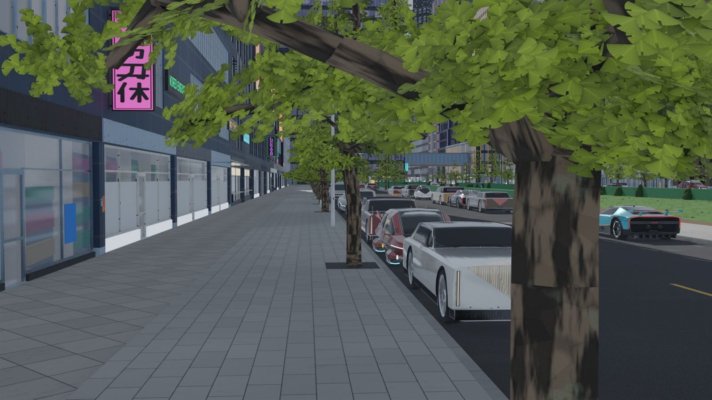 | 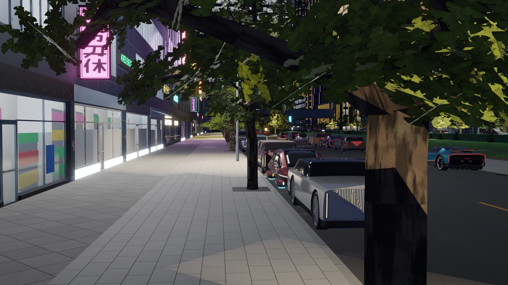 |

Unreal, a Corporate Core street by day and night from the play camera, and from above:

| | |
|---|---|
| 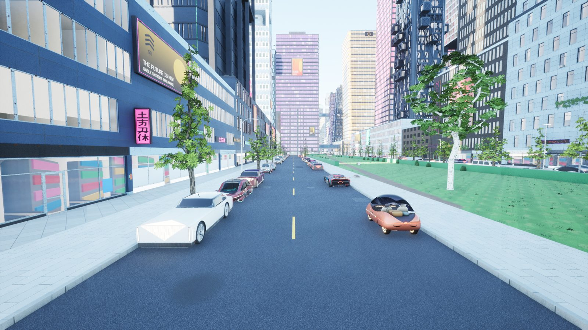 | 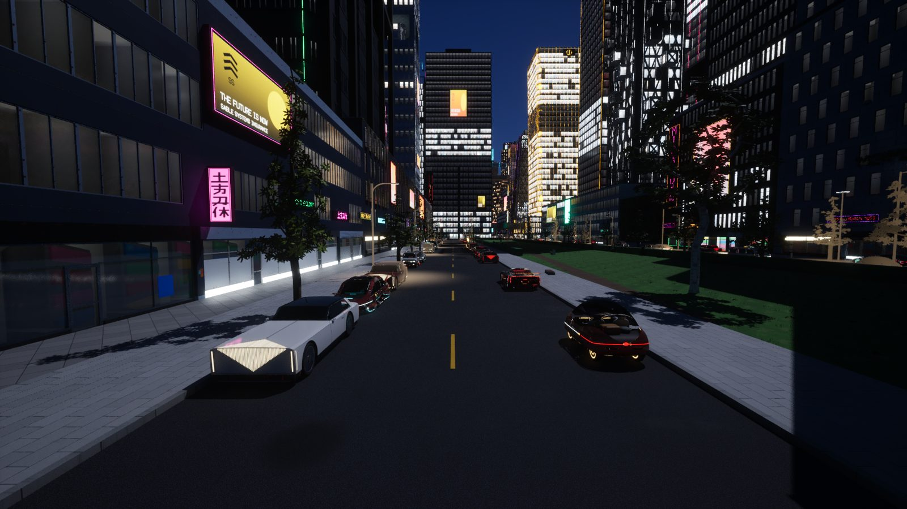 |
| 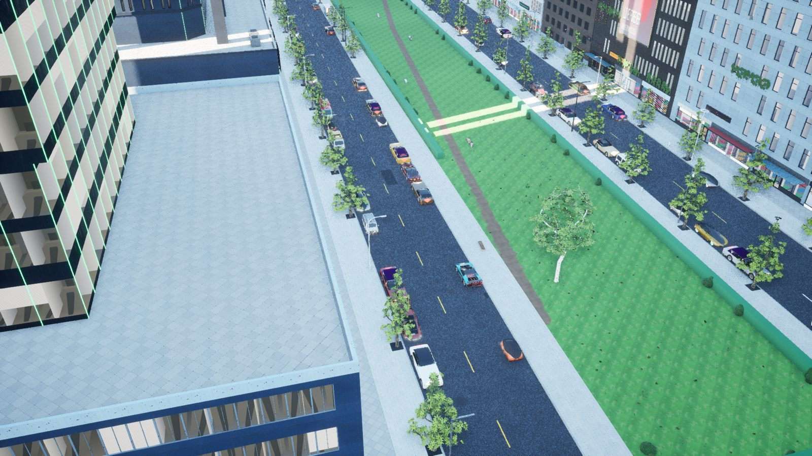 | 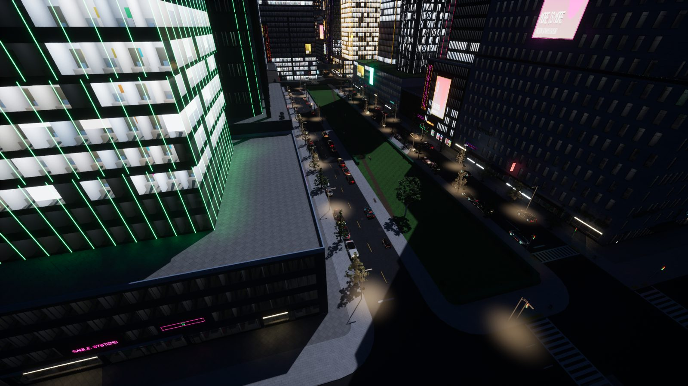 |

Unreal, cars where they parked, from their packs' hero cameras (the vehicle check):

| | |
|---|---|
| 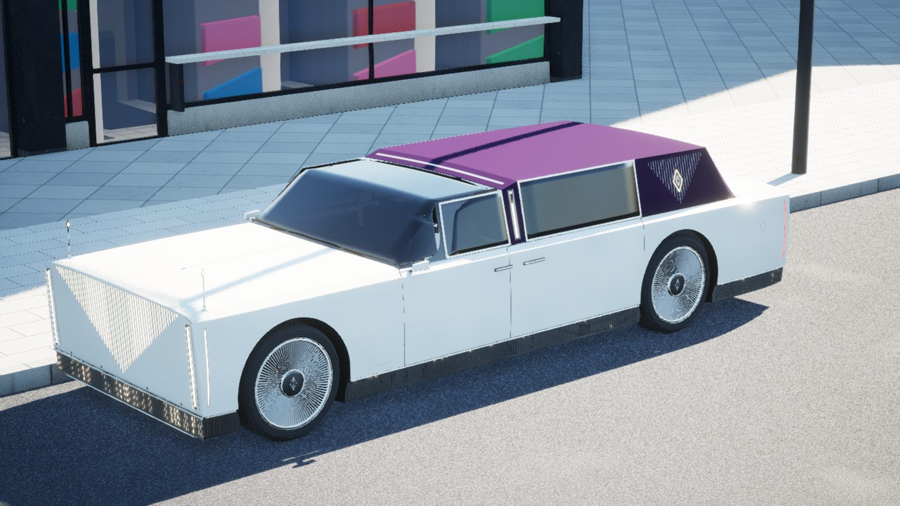 | 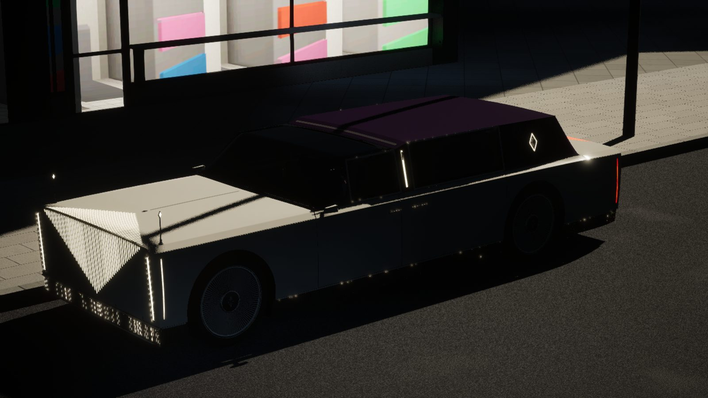 |
| 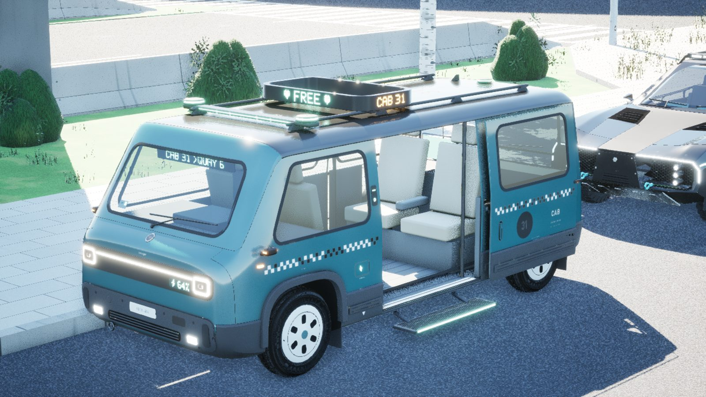 | 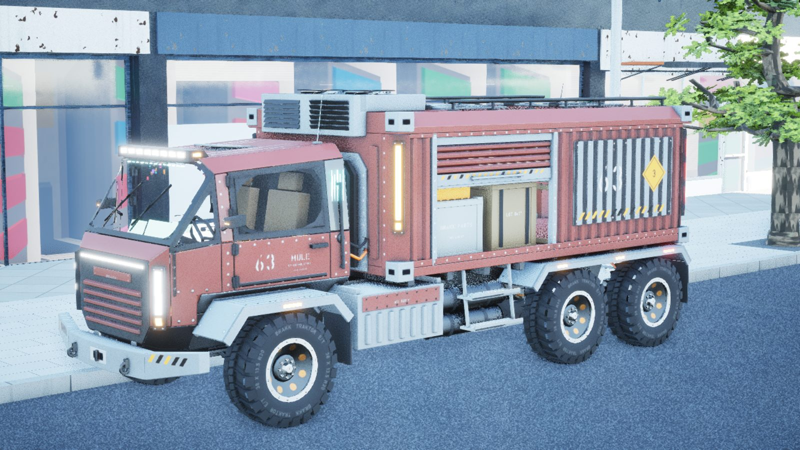 |
| 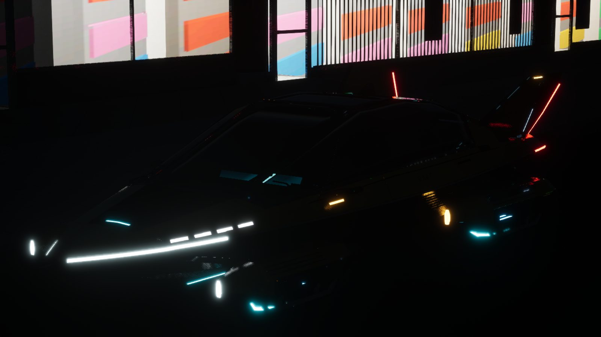 | |

## What the engine showed

- **Every check passing.** The city check (streaming, collision traces, the sidewalk walk, the
  fly pawn) and the vehicle check: the 17 cars' meshes with their four LODs (none Nanite, the
  glass's dark slot from LOD2), the 22 placements' 1,528 components with every instance at its
  pivot, 8,208 traces down and 5,472 across onto the 912 bodies all hitting the body and never
  a wheel or the glass, a wheel spun and steered in place.
- **Imported again**, nothing changed: 13,943 actors unchanged, no package saved.
- **AG8's variants gone** with the blockout's prototypes: the exporter now leaves out of stage
  2 the entries a placement replaces, so a tile's parked cars are the hero vehicles only.
- **The play features did not build on the Mac**: two loops in the `CityGenAtmos` plugin that
  return at their first pass are errors under the Mac's Clang (`-Werror`,
  `-Wunreachable-code-loop-increment`), so the first import left the play features out. Fixed
  in this PR (`ACityGenAtmos::Find`, `EnsureFog`); the plugin then built in 14 s, and the
  check run again with them (map, menu, night with 768 light pools, free camera, teleport)
  passing; the night shots are from that run.
- **The Tanager Cab parks with its sliding door open**: the pack keeps the pose its design
  sheet shows (a door as a part of its own is a later step, scope 14.19, item 9).

The project (`~/UnrealScratch/CityParked`, 5.5 GB) is a throwaway one, outside the repo.
