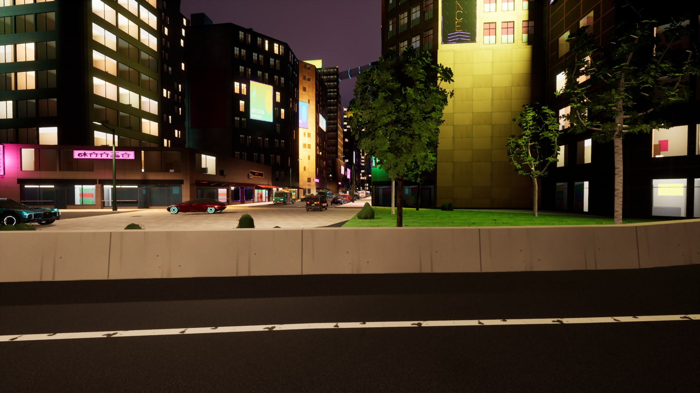
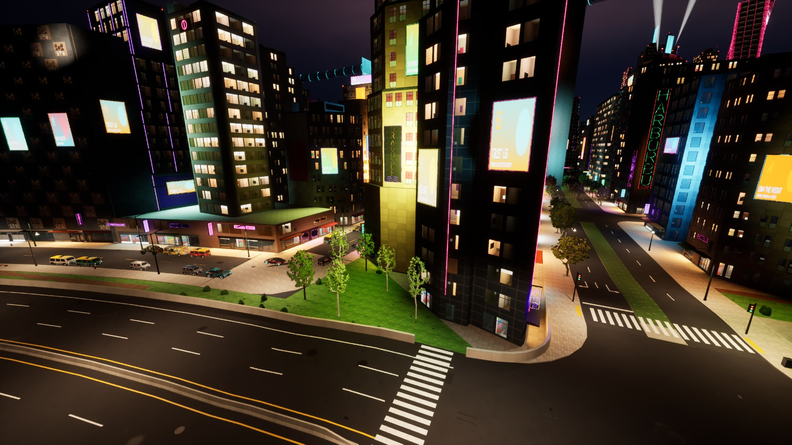
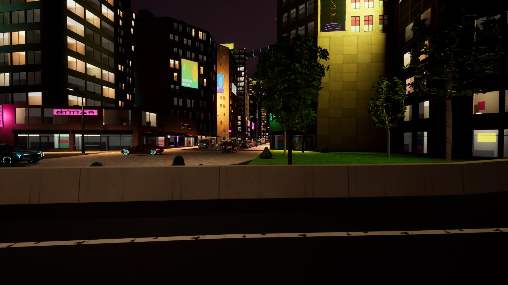
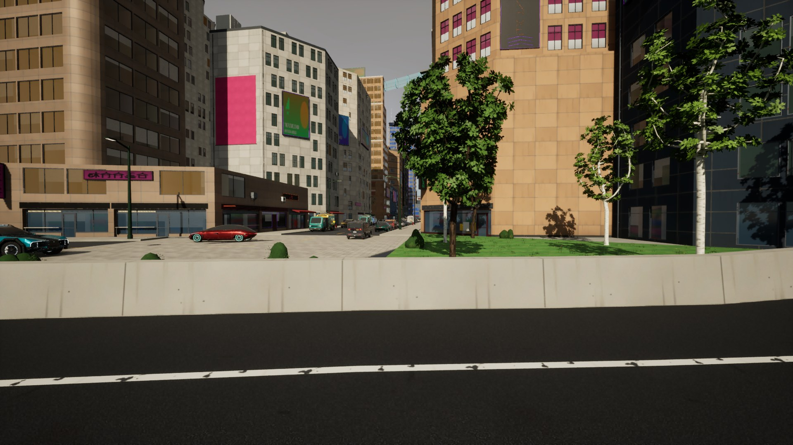
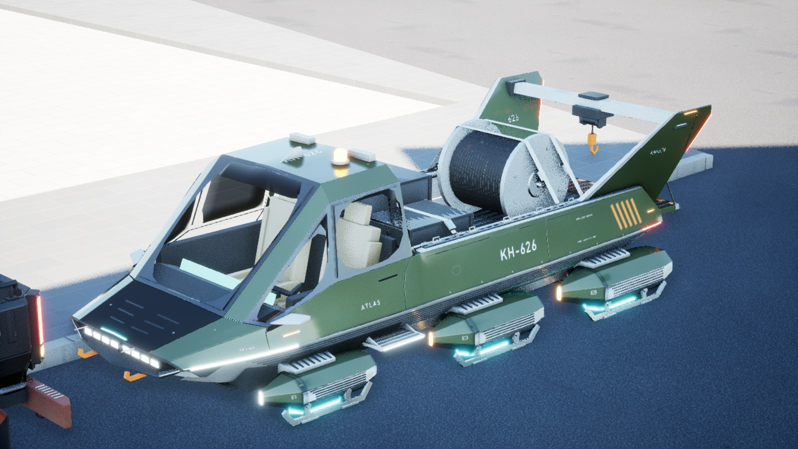
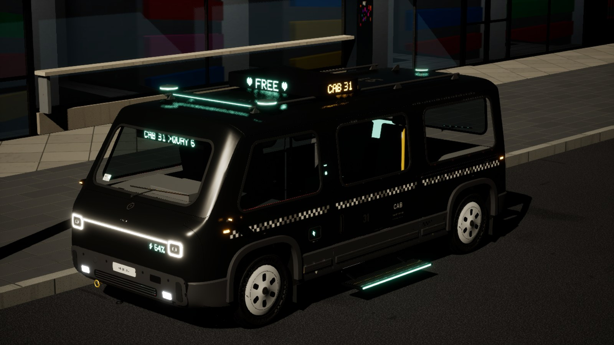

# AG18's parked cars in Delta Megacity (with AT3's sky and time)

AG18 step H's parked hero vehicles (`assetgen vehicles`, the exporter's placements;
`docs/unreal_export.md`, "Parked in the cities") in Delta Megacity, with atmosgen's AT3 plan,
on the Windows PC (RTX 4070 Ti, 32 GB), 2026-11-12. Vesper Bay had them on the Mac
(`docs/progress/AG18/city/`); this is the first city on the PC and Delta's first.

## The packs on the PC

The 18 game packs (every car of `vehicles/cars/` but the three Vex) as published:
vehicle-packs-2026-11-12, then 2026-11-12b (nine packs rebuilt for their small faults), fetched
and hash-checked by `vehicles/packs.py fetch` into `~/.cache/cybergen/vehicles/game`. No pack was
built here for the city. Main now names 2026-11-12c, which changes only the Vanta-R (step B's
kit); the import and the shots here have 12b's Vanta-R (59 of the cars).

**carkit's GPU on Windows:** `carkit.setup_render` asked Cycles for Metal only, so on the PC a
car's renders and bakes fell back to the CPU ("GPU setup failed: enum METAL not found"). It now
takes the first backend this Blender offers with a GPU on it: Metal, OptiX, CUDA, HIP, oneAPI. A
test build of the Vanta-R on the PC with it took 33 minutes (its renders 195 s, the UV atlas 671 s,
the bakes 403 s, the proof 296 s): the UV step is the CPU's either way. The change also changes
`carkit.py`'s hash, so `packs.py status` says every pack was "built before the current
carkit.py" (only the source's hash; the packs are as released).

## The placements

`assetgen vehicles` on AG16's Delta build: PASS. 3,452 parked cars from M6, 3,431 placed as 18
models in 57 tiles (21 left out: no model fits off its parking lane), each placement replacing
AG8's parked-car entry of its tile; in Unreal 57 placement actors, 4,354 instanced components,
21,940 part instances, 106 meshes (not Nanite), 456.0 M triangles at LOD0 (18.6 M at LOD3), at
most 140 cars a tile. By district: Midtown 2,003, the Corporate Core 1,113, the Transit Nexus 312,
3 outside the districts (none in Old Town, the Industrial Port or the Research Campus, whose
streets M6 gives no parking).

## Unreal

**The import** over the AT3 import in CityAG16: the 57 placements created and AG8's 57 entries
deleted, the 18 cars' meshes made (5 min 26 s; 11 min 22 s again for 12b's nine), every other
actor unchanged; then once more with the contribution written again on 12b (the placements'
hashes name the packs), 128 s.

**The city check** passes with the cars (streaming, collision, the walk, the play features, the
sky by night, dusk and day). **The vehicle check** (`--check-vehicles`): the meshes (LOD counts
and triangles against the packs, no Nanite, the glass), the placements (every instance at its
pivot) and the wheels pass; **the collision fails for the Kestrel Atlas** (side traces at the
car's middle height hit its body 76 times of 114; every trace down hits). Its `collision.glb` is
the same in 12 and 12b: its hulls leave the open cab of the hover hauler uncovered at that height.
Every other car passes (2,970 of 2,970 side traces on the Tanager Cab, for one).

| Midtown's curb by night | The same street from the air |
|---|---|
|  |  |
| **At dusk** | **By day** |
|  |  |
| **The Kestrel Atlas (hero view, the vehicle check)** | **The Tanager Cab by night** |
|  |  |

## The night's frame time with the cars

Measured in AT4 (`docs/progress/AT4/bench/before`, three runs, against AT3's after): every
night pass 0.6 to 0.9 ms p95 slower, the night without atmosgen 11.2 to 13.1 ms (walking 10.8 to
13.3), nearly all of it on the render thread (the draw calls walking 860 to 1,843: 4,354
instanced components). AT4 gave the cars' parts cull distances (bodies 450 m, glass 250, wheels
120; the wheels cast no shadow): the draws walking 1,197, the night without atmosgen 11.6 ms
(`docs/progress/AT4/README.md`).

## Open items

- **The Kestrel Atlas's hulls** fail the vehicle check's side traces (above): a pack fix in
  `game.py`'s collision for an open cab, then a republish.
- **The Vanta-R** here is 12b's; 12c's comes with the next `packs.py fetch`.
