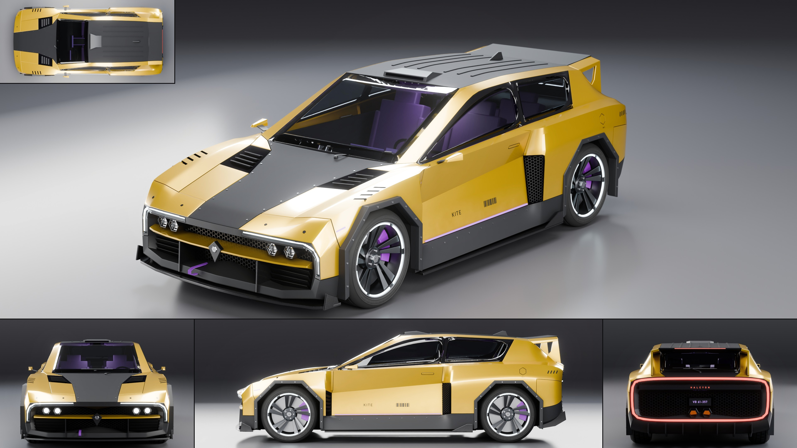

# AG18: Halcyon Kite

- **Brand, model, type:** Halcyon Kite, a compact performance hatchback (a hot hatch), Halcyon's smallest car: two side doors and a glass hatch, 2 + 2 seats (both names made up).
- **Size:** 4.05 m long (4.11 over the splitter and the diffuser), 1.88 m wide over the arch trims (1.96 over the camera pods), 1.33 m high at the roof (1.35 over the fin), 2.64 m wheelbase, overhangs of 0.70 m, 0.69 m wheels, 0.125 m ground clearance. Show color: signal yellow, violet lights and calipers.
- **The Vanta-R's, the Sable's and the Ridge's sibling:** the darker spine from the nose over the roof to the tail in bare weave, bolted down along its edges on the hood; octagonal arches with bolted trims; the light strip under the nose lip that turns down each corner; a ring of light round the whole tail; honeycomb in every opening; the scoop ahead of the rear wheel; hood extractors; twin-spoke turbine wheels with a light ring; wide-spaced capitals on the tail beam, the model name low on the door.
- **Its own ideas:**
  - The spine as a kite in plan: narrow at the nose, widest at the windshield's head, drawn in again to the tail, held between body-colored pillars and roof rails (the hoop the Ridge has in weave, here in paint).
  - A chopped tail with air in it: the roof rails run on past the hatch glass to a fin that stands on each corner of the tail, a blade with the brake light between them. From the side the tail is cut off upright with a triangle of daylight in it; from behind the hatch glass lies deep between the two fins.
  - Box flares in the brand's creases: the fenders stand 6 to 11 cm proud of the doors and end in a facet, with an outlet under it behind the front wheel and the scoop under it ahead of the rear wheel. The door between them is folded along a valley line that rises into the scoop: its upper half in shade, its lower half catching the light, a light line along its foot.
  - The arches as true half octagons with a flat top, 3 to 6 cm from the tire.
  - A body-colored blade across the mouth following the nose's plan, the kite emblem on its middle, two hexagonal projector pods a side standing on it, slatted ducts under it, a webbing tow strap on one side.
  - Small things: slots over the front wheels, a vent over the windshield's head and ribs on the roof panel, bolts along the sill, a wiper on the hatch glass, twin hexagonal outlets under the plate.
- **Step B features:** the nose strip is a channel 36 mm wide and 40 mm deep cut into the band under the lip, under a clear lens with the body's gap round it, a lit bar under the lens; the tail ring a closed channel 42 mm wide with a red bar over a chrome floor under a lens built on the skin's normals (the Ridge's way); the flush handles, the hexagonal charge flap and the fender slots are cut through the skin with `groove()` and `pocket()`; door, quarter and hatch glass carry a frit border, each pane its own (the borders of the door's and the quarter's glass meet as the B pillar), the windshield a gloss frame; 3.5 mm shut lines.
- **Triangles:** 277,665 in 115 objects.
- **Checks** (`check.json`): tires ok (29.6 mm to the arch trims, the fronts steer 25 degrees), ground ok, panels ok, through ok, triangles ok. Symmetry `look`: one finding that is not meant, the gloss band round the tail 6.7 mm off its mirror at a lower corner, where the ring's channel leaves a sliver on one side (the Ridge's finding too; it does not show); the driver's wheel and screens, the two wipers and the tow strap are told as meant.
- **Build:** `vehicles/blender.sh vehicles/cars/halcyon_kite.py --out docs/progress/AG18/halcyon_kite --sheet` (`--clay --zebra --check` for `clay.jpg`, `zebra.jpg` and `check.json` beside it)
- **What I would improve:** the rear quarter above the arch is the plainest surface on the car (a flap, a code and four slashes on a large facet); the tail fins are flat plates standing on the body, not grown out of it, and the roof rail's extension meets the hull's rail with a visible joint; the hatch has no shut line of its own below the glass (the glass alone would lift); the door's glass ends in a thin tip at the windshield's foot where a real car has a mirror patch; the cabin is blocked in (boxes for seats, no door cards worth the name, no pedals or belts); the bare weave on hood, roof and spoiler reads as plain charcoal at the sheet's size.
- **Kit wishes:**
  - A closed light channel that cuts the same on both sides: `groove(closed=True)` round a cap's band leaves slivers that differ left and right (a few millimeters, a symmetry `look` on the Ridge and here); a mirrored half that closes on the centerline would do.
  - `Geo.honeycomb` on a patch that is not flat (four corners, bilinear): the scoop's face is twisted, and this car carries its own `honey_patch`.
  - A `Geo.loft(sections)` for solids through a few sections (blades, rails, fins): written here as a helper.
  - A dry weave that stays dark as a library material (`need("carbon_dry")`): `carbon(coat=0)` still has the metal's sheen and reads as silver under the top box, so the Ridge and this car both reach into the node tree (here: no metal, little specular, rougher).
  - `well_cutter` with the steering room as an argument (a second, lower arch further in), and a note in the README that an arch corner on a station makes slivers in the sill.
  - `wiper()` and one-sided parts told as meant by default, or a `K.meant` pattern list in the brand module.
