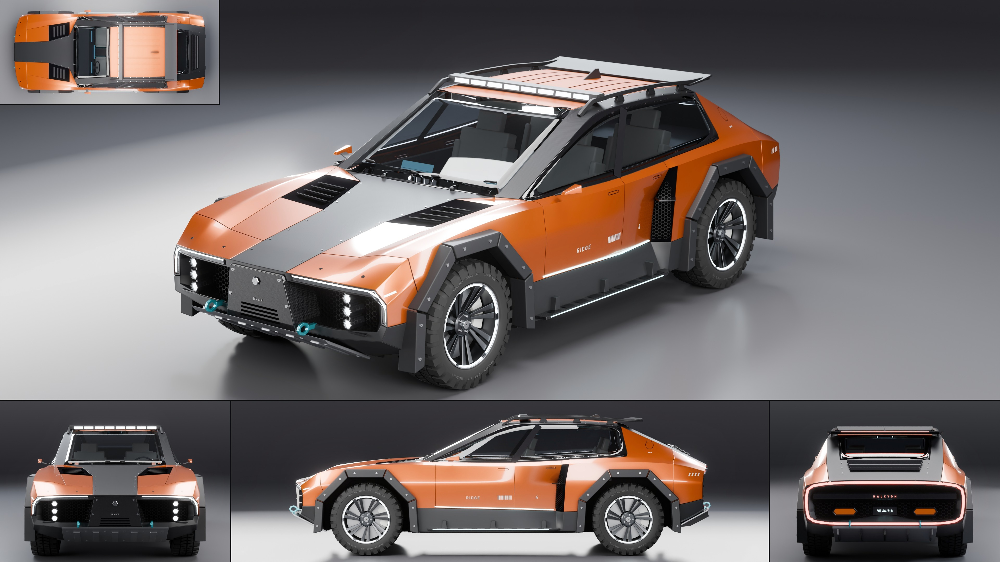

# AG18: Halcyon Ridge

- **Brand, model, type:** Halcyon Ridge, a performance crossover, four doors and a hatch, 4 seats (both names made up).
- **Size:** 4.75 m long (4.89 over the tow eyes), 2.05 m wide over the arch armor (2.09 over the camera pods), 1.59 m high over the roof bar, 2.95 m wheelbase, 0.82 m wheels, 0.24 m ground clearance. Show color: burnt orange.
- **The Vanta-R's and the Sable's sibling:** the carbon spine from nose to tail, octagonal bolted arches, the light strip under the nose lip that turns down each corner, a ring of light round the whole tail, honeycomb in every opening, the scoop ahead of the rear wheel, louvres and extractors, twin-spoke turbine wheels with a light ring, wide-spaced capitals on the tail beam, the model name low on the door.
- **Its own ideas:**
  - The spine as a wishbone that opens round the cabin: wide on the hood, up both windshield pillars, along the roof, down the hatch frame, closed again on the tail. In bare weave, bolted down along its edges.
  - It ends in the ground: a keel down the middle of the nose into a ribbed alloy skid plate, a second plate with the family's fins under the tail, anodized tow eyes on both.
  - Flying roof rails lifted off the spine's arms, a light bar between them over the windshield, and the same rails carrying the hatch spoiler clear of the glass.
  - The arches at their boldest: true half octagons with a flat top, each a ring of five armor plates with joints and two bolts a plate, 7 to 11 cm of air to the tire.
  - A scoop twice the family's height (0.53 m) with honeycomb and a blade at half height, the door's foot channelled into it with a light line.
  - Step blades on brackets with a light in their edge, three hexagonal lamps stacked in each intake, all-terrain tires of the car's own (lugged shoulders, chevron middle rows, sidewall lettering) on the kit's twin-spoke rim.
- **Triangles:** 223,779 in 114 objects.
- **Build:** `vehicles/blender.sh vehicles/cars/halcyon_ridge.py --out docs/progress/AG18/halcyon_ridge --sheet`
- **What I would improve:** the rear door is only 0.52 m long at the sill (its cut should climb over the arch); the B pillar is a strip lying on one long side glass, not a real post between two panes; the well behind the armor is empty (no arms, springs or liners to see through the gap); the door skins between the shoulder and the cladding are plain; dash, door cards and load bay are blocked in.
- **Kit wishes:**
  - A carbon without the clear coat in the library: the coated weave mirrors the top light on every upward face (hood, rails, spoiler, deck read as silver), so this car makes its own `carbon_dry` by reaching into the material's nodes.
  - `Geo.honeycomb` on any plane (an origin and two axes), not only x = const: the scoop's mesh needed a helper to turn it.
  - `arch_trim` and `arch_bolts` with the plate joints, the plate thickness and the bolt size as arguments, and `build_wheel` with a choice of tire tread (road, all-terrain, lugged), since the third car now brings its own tire.
  - `text_on_body(proj='z')` drops the whole word without a message when one point misses the surface; a log line would have saved a look.

## Step B: lamps, cut lines, glass (2026-11-13)

The Vanta-R's and the Sable's family of lamps on the Ridge's own body (`docs/assetgen_milestones.md`,
AG18, step B). The sheet, clay, zebra and check above are of this build.

- Front lamps: the strip under the nose lip is now a channel 36 mm wide and 40 mm deep cut
  into a band 56 mm wide all round (`even=True`), from the spine's edge out and down each
  corner, under a clear lens with the body's gap round it, a lit bar right under the lens
  along the whole run. The three hexagonal pods in each intake stay the main beams (projectors
  in the channel, as on the Sable, read as bolts beside them).
- Tail ring: one closed channel 42 mm wide round the whole tail, its corners rounded, a red
  lit bar 24 mm wide right under the lens over a chrome floor. Its lens is built apart, a
  3 mm band on the skin's normals with the gap each side (cut from the curved band, the
  skin's own lens kept the boolean's slivers and its reflections broke into shards).
- Cut lines: the flush handles on both doors and the hexagonal charge flap are cut through
  the skin (they were strips lying on it; the flap 55 mm lower and a little smaller, off the
  crease into the spine's arm, which emptied the hull when the outline crossed it, and the
  "HR 4X" lettering moved under it); 3.5 mm shut lines everywhere.
- Glass: the side and hatch panes with a black frit border as part of the glass, the
  windshield on a gloss frame made on one side and mirrored (the old frames faced into the
  car and were 13.8 mm off their mirror).
- Wipers: the kit's wiper, a boss at the cowl, a tapered arm, a yoke and a rubber blade.
- Tires: a lower arch (0.47 m) cut inside the skin 0.53 m out for the front tires to steer
  in, the rear wells' inner walls 25 mm further in: 14.5 mm and no steering to 45.7 mm and
  25 degrees in front, 39.5 mm behind. The cabin floor between the rear wells ends 0.10 m
  further forward and 30 mm higher, so no cabin part is seen in a wheel well (`through` ok).
  The driver's wheel and the keel's lettering are told to the symmetry check as meant.
- On `vehicles/brands/halcyon.py` (its `on_spine_edge`); the old swept strips are gone.
- 250,007 triangles (223,779 before).
- Game pack rebuilt, every check passing: 147,737, 59,992, 20,364 and 5,118 triangles,
  standard class; the tail ring and the nose strip bake lit, the LOD row reads as before.
- Left: the band round the tail is 12.5 mm off its mirror at a lower corner, where the
  channel passes close to the tail's inner frame (symmetry `look`, as before for the old
  glass frames); the charge flap's outline shows a small sliver at one corner and the ring's
  lens a faint step at the upper corners, both small at the sheet's size.
