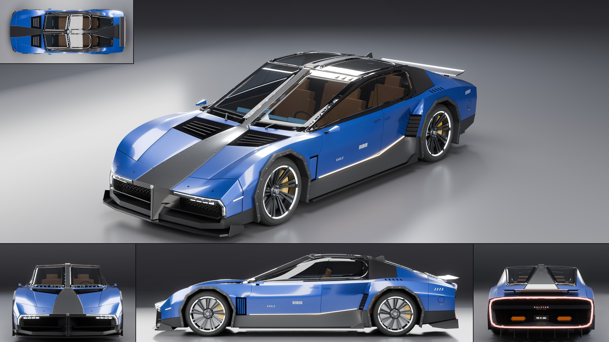

# AG18: Halcyon Sable

- **Brand, model, type:** Halcyon Sable, a four-door fastback grand tourer, 4 seats (both names made up).
- **Size:** 5.11 m long over splitter and spoiler (body 5.06), 2.06 m wide over the camera pods (body 1.99), 1.34 m high, 3.05 m wheelbase, 0.74 m wheels. Show color: cobalt blue.
- **The Vanta-R's sibling:** the carbon spine from nose to tail, octagonal bolted arches, the light strip under the nose lip that turns down each corner, honeycomb in every opening, a scoop ahead of the rear wheel, twin-spoke turbine wheels with a light ring, wide-spaced capitals on the tail beam, the model name low on the door.
- **Its own ideas:**
  - The spine as one unbroken piece, an hourglass in plan: wide on the nose, a slim rib that splits the windshield and carries the glass roof, wide again on the tail, bolted down along both edges.
  - A longer, calmer nose with no struts: the spine comes down through the mouth as a prow and parts it into two honeycomb intakes, a four-lens beam bar under each strip.
  - A glass roof in four panes over tan seats, a carbon sail panel instead of a quarter window, a fastback that ends in a closed halo of light round the whole tail.
  - Coach doors with no pillar between them (the rear pair shorter, handles either side of the split), the door's foot channelled into the scoop with a light line running into it.
  - A low spoiler blade on two struts instead of a wing, louvres on the wide end of the spine, two flat hexagonal outlets.
- **Triangles:** 250,465 in 97 objects.
- **Build:** `vehicles/blender.sh vehicles/cars/halcyon_sable.py --out docs/progress/AG18/halcyon_sable --sheet`
- **What I would improve:** the spoiler blade and the rear roof panes mirror the top light and read as silver; the door cards, dash and shelf are blocked in; the windshield rib wants a slimmer section and a wiper park of its own; rear head room under the glass is tight (under 0.9 m from the cushion); the rear doors are only 0.65 m long at the sill.
- **Kit wishes:**
  - `build_body` recesses crease their corner diagonals, and a wheel well cutter under a low hood breaks through with no warning (it cut a dart in the fender until the hood was raised): a check of cutter against surface would have saved two previews.
  - The side glass went white at 28 degrees of lean and clear at 23 (the top light, by its size, seems to lie across the car, though I did not check its orientation); a short, strongly leaning quarter window cannot be made upright, so it became a carbon sail panel: a narrower top light, or a flag to hide it from glossy rays on glass, would free the greenhouse.
  - A glass option for a crown or a fold without adding a character line to the whole cage.
  - `cap` with a light strip of its own (the ring's band points, open or closed), since every Halcyon repeats that sweep by hand.

## Step B: lamps, cut lines, glass (2026-11-12)

The Vanta-R's family of lamps on the Sable's own body (`docs/assetgen_milestones.md`, AG18,
step B). The sheet, clay, zebra and check above are of this build.

- Front lamps: the strip under the nose lip is now a channel 36 mm wide and 40 mm deep cut
  into a band 56 mm wide all round (`even=True`), from the spine's edge out and down each
  corner, under a clear lens with the body's gap round it; inside, a lit bar right under the
  lens along the whole run and three hexagonal projectors under it on the outer stretch. The
  four-lens beam bar under it is kept as it was.
- Tail halo: one closed channel 46 mm wide (nearly the band) round the whole tail under a red
  lens, its corners rounded, a red lit bar 24 mm wide right under the lens over a chrome
  floor.
- Cut lines: the flush handles either side of the pillarless split and the hexagonal charge
  flaps are cut through the skin (they were strips lying on it, the rear handle across the
  split as it is built; both handles moved 25 to 35 mm aft, the rear one 18 mm down off a fold
  the boolean left higher up, the flap 15 mm down off the shoulder crease); 3.5 mm shut lines
  everywhere (2.4 mm before). The slots over the rear haunches stay dark strips.
- Glass: the side, roof and rear panes with a black frit border as part of the glass; the
  windshield halves on a gloss frame made on one side and mirrored (the old frames faced into
  the car and were 8.7 mm off their mirror).
- Wipers: the kit's wiper, a boss at the cowl, a tapered arm, a yoke and a rubber blade on
  the glass each side of the rib.
- Tires: a lower arch (0.405 m) cut inside the skin 0.53 m out for the front tires to steer
  in, the rear wells' inner wall 25 mm further in, the cabin floor and bulkhead between the
  rear wells 30 to 40 mm narrower and the rear seats 20 mm in: 4.8 mm and no steering to
  34.2 mm and 30 degrees in front, 11.8 mm to 31.8 mm behind. The driver's wheel is told to
  the symmetry check as meant.
- On `vehicles/brands/halcyon.py` (its `on_spine_edge`); the old swept strips are gone.
- About 281,000 triangles (250,465 before).
- For the game pack (found on four packs and nine test packs): a lit face deep in a channel
  or behind ribs baked dark or as dashes (the lit faces now lie right under the lenses); the
  halo's first 30 mm channel left the band as two thin rings round the tail, which wrecked
  LOD3 into shards over the tail and flanks (hence 46 mm); the channels' walls as 1 mm
  sheets (the Lumen's cure) became spikes over the front fenders in LOD3, so they stay bare;
  dense lamp sweeps, cups with bevels and ten slot pockets starved LOD3 of triangles.
- Left: the halo's lens shows faint creases in its reflection along the tail's sides (a skin
  lens on a curved band), and the band beside it is 4.2 mm off its mirror at a rounded
  corner (symmetry `look`, as before for other parts); both small at the sheet's size. The
  front projectors read as small dark eyes by day.
