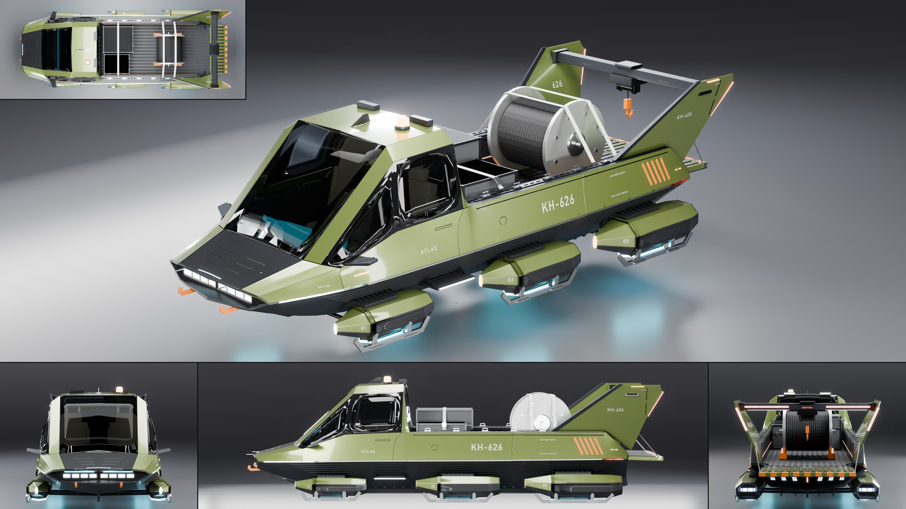
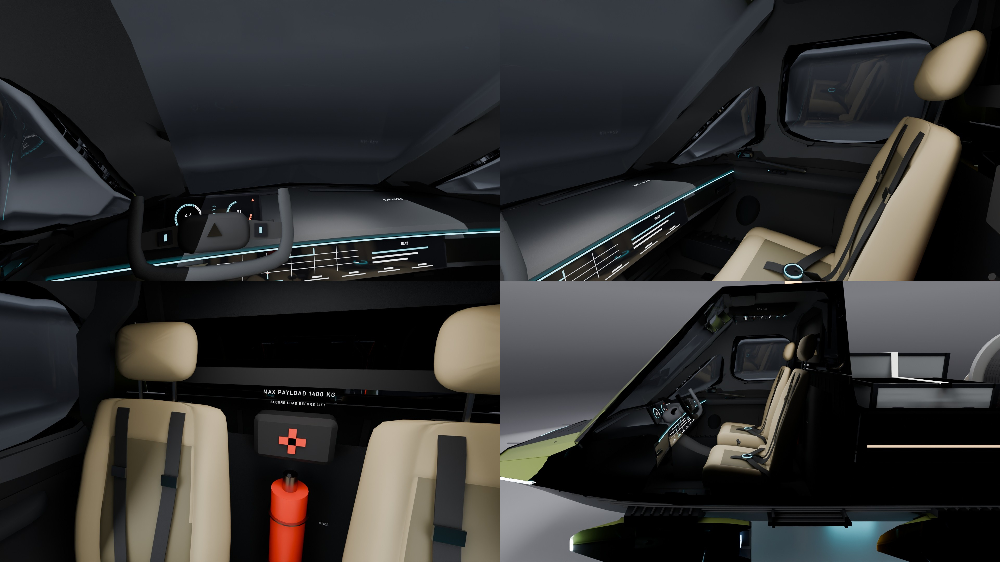

# Kestrel Aerodyne Atlas

- **Brand, model, type:** Kestrel Aerodyne Atlas, hover hauler, 2 seats side by side and an
  open load bed. The third Kestrel, the working one of the family.
- **Size:** 5.91 m long (pitot pins to the tailgate's lip; the hull 5.30 m), 2.29 m wide over
  the rear skids, 1.74 m high, hovering: skid pads 0.37 m, emitter rings 0.39 m, keel lens
  0.41 m and belly 0.50 m over the ground; roof at 2.02 m, beacon 2.11 m, fin tips 2.00 m.
  Bed 3.04 m long, 1.40 m between the rails, floor 1.00 m and rail tops 1.34 m up.
- **Triangles:** 181,915 in 180 objects (step B; 151,203 in 155 before). Show color: pearl moss olive over the graphite lower
  hull, pale stencils, signal orange hooks, chocks and hazard marks, cyan emitters, sand seats.
- **Build:** `vehicles/blender.sh vehicles/cars/kestrel_atlas.py --out docs/progress/AG18/kestrel_atlas --sheet`

## The design

- **The family, kept:** the knife chine with its bright strip from prow to stern (lit white
  at the front, red at the stern), flat top facets with flush glass and the matte visor, seven
  ribs along the graphite lower hull, the eight-sided emitter pod (the Dart's `build_pod`),
  canted fins, slanted slot thrusters either side of a stern post, the keel blade with its
  light, stencil registration (`KH-626` on the bed sides, fins and roof, `KA 2-626` by the
  nose, `E1` to `E6` on the pods).
- **One line, two jobs:** the cab's shoulder runs on unbroken as the outer top edge of two
  raised rails beside the bed, so the body-color flank is one band from the prow to the
  stern; the cab is a cab-forward wedge with a full-width back wall and a smoked rear window.
- **Its own face:** a chisel prow, wide and thin, with eight work lamps in a slot in its edge,
  a sensor slit over them and two orange tow horns under it.
- **Six pods:** three pairs growing toward the stern (0.88, 1.02, 1.14 of the Dart's rear
  pod), each on a ribbed outrigger from the lower hull, each with a heavy sled skid on two
  braced legs with pads; a boarding step under each door between the first two.
- **Fins as a gantry:** the fins stand on the rail ends and are bridged by a hoist beam
  (trolley, winch, cable, hook, a work light under it); the beam's rear face is the high
  tail light with the maker's name, so the back view is a lit portal over the tailgate.
- **The bed:** a ribbed liner, a slotted tie-down track with cleats and rings on each rail,
  a tailgate folded down as a loading shelf on two stays (hazard blocks on its lip); in it a
  cable drum on chocks and two transit cases, strapped to the rails with ratchets.
- **Fifth tile:** the top view (the bed, the load and the six pods in plan).

## Step B: lamps, cut lines, glass (2026-11-13)

The Dart's and the Meridian's family of lamps on the hauler, and the car on
`vehicles/brands/kestrel.py` (the chine, the fin plane, the heavy pods and their ribs; its
copies were the module's). The sheet, clay, zebra and check above are of this build.

- Work lamps: the prow's four cells each side are now in a slot cut 40 mm into the mouth's
  back wall, standing 3 mm proud of the wall between bright dividers that run to the slot's
  floor, under a clear lens in a dark surround standing 12 mm proud (they were boxes in the
  mouth); the sensor slit over them and the tow horns as before.
- The chine's light: the knife edge cut into channels 18 mm up the edge and 22 mm deep for
  its first 0.78 m from the prow and its last 0.30 m, under a clear (front) or red (rear)
  lens that keeps the edge's shape, a lit core and a bright liner inside; the bright blade
  runs between them.
- Stern bar: the band round the mouth is even now (35 mm all round, square to the lip; it
  narrowed to about 10 mm under the bed's edge), and the bar is two channels 14 mm wide and
  24 mm deep in it under a red lens, a red core and bright ribs inside: round the outer
  corner from the chine to the rail's end, and along the top of the mouth under the bed's
  edge (behind the folded tailgate, as the old bar was).
- The high tail light on the hoist beam: a lamp each side of the maker's name standing proud
  of the beam's rear face, three red cells between bright dividers under a red lens in a
  dark rim; the name laid on the beam (it floated) in letters 5 mm proud.
- Keel blade: its foot is a lamp channel 24 mm high along 3.70 m with dark walls, a light
  guide in a frosted sleeve over a bright reflector strip and a clear lens flush with the
  foot.
- The roof's work lamps over the bed: two cells each behind a clear lens in a dark rim on
  the lamp boxes; vanes set back in the six thruster slots.
- Cut lines: the line under the shoulder along the bed, the door's flush release and the
  six-sided charge flap are cut through the skin (they were strips lying on it); 3.5 mm
  shut lines everywhere.
- Glass: every pane (windshield, side lights, door glass, rear window) with a black frit
  border as part of the glass (the old frames were mirrored off and faced inward).
- Cabin tub: step A found it 35% in the open, up to 125 mm, under the prow. The dash now
  follows the hull's flare (narrow at its foot, as wide as the cab at the shoulder) and
  stops 100 mm further back, the floor's front corners are cut in, the cab's back wall and
  the door cards follow the flanks (`through` ok).
- The load (cases, straps, ratchets), the roof's beacon and gear and the pilot's yoke are
  told as meant (`K.meant`); the pods, fin code and drum stencil findings of 3 to 12 mm are
  as before, and the even band and the name add `body.lightband` 9.0 mm and `led.name`
  5.2 mm (a cut at the band's outer corner, the letters' own shapes).
- 181,915 triangles (151,203 before; the cut hull 21,000 of them, the lamps most of the rest).
- Game pack rebuilt, every check passing: 118,747, 59,998, 20,293 and 8,210 triangles (large
  class), texels 322 px/m (5th percentile), LOD3 37.3 of 40 degrees and 0.091 of 0.10 bent
  (main 37.3 and 0.080); its LOD row reads as main's, the prow's cells lit at LOD3 and the
  stern's corner bars baked lit.

Left: the pods' tip lamps are flat faces of the pod (as on the Dart and the Meridian); the
emitters' layered glow is step C's; the red lens over the rear chine channel shows the
skin's facets in its reflections from close by; the side glass's wavy reflections are as
before (the panes follow the flowing flank).

## Cabin (2026-11-24)

The schematic cabin (box seats, a slab tub and dash, a box yoke, flat screen slabs, a warm
strip under each roof edge) is replaced by the shared module's (`vehicles/cabin.py`,
`style="kestrel"`), styled as a work flight deck. The exterior is unchanged: its
fingerprint differs only in `interior.*`, the cabin's materials and the studio's `cab*`
lamps, and the old `led.cabin` strips went with the old cabin.

- **What it has:** a lined tub from a firewall at the windshield's base (x 2.30) to a wall
  just inside the cab's back (x 0.80), floor 0.61 m up; the back wall has a window under the
  back glass (a smoked pane in a frame), trims down its corners from the belt to the roof,
  a fire extinguisher in its bracket, a first aid case and the placards "MAX PAYLOAD 1400
  KG" and "SECURE LOAD BEFORE LIFT". Two khaki seats, tall and upright (hip 0.36 m over
  the floor, 15 degrees of rake, so the headrests clear the back wall), each with a
  five-point harness (two shoulder straps over the back, lap straps, a crotch strap, a
  round quick-release buckle ringed in cyan) in place of the module's three-point belt. A
  graphite dash with slot vents and a titanium inlay, a free cluster, a wide glass display
  across the fascia, a yoke; no pedals (the yoke flies it, the throttle is on the console):
  ribbed footrests in the footwells; a throttle quadrant of two levers in a lit gate on the
  console; door cards with bar pulls and a lit "KESTREL AERODYNE" sill plate; sun visors.
- **Overhead console:** a faceted spine on the centerline under the solid roof, from the
  windshield's header back over the seats: rows of guarded toggles, an annunciator strip,
  two rotary selectors and a small camera display (no inside mirror: the car's mirrors are
  camera blades), "KA 2-626" stencilled on its cheeks. The module's dome lamp, which hung
  inside it, is moved under it for the cabin views. "KH-626" on the dash before the
  passenger.
- **Fit:** the cab's front is raked so far that the module's default spine (at half the
  cabin's height) put its front pole over the windshield, outside the car: the rays from it
  laid lining 45 cm outside the hull and the car measured 31 cm wider. The spine is set at
  1.12 m with a cap of 0.12, the firewall at the windshield's base. The lining is held
  35 mm inside the lower hull under the chine and 30 mm inside under the windshield's base;
  nothing of the cabin comes through the shell.
- **Triangles:** the cabin about 4,000 to 42,925; the car 172,776 to 211,717 (of 400,000).
- **Check:** `look`, as before: the pods' panels, the drum's stencil, the light band, the
  stern's name and the fin code are 3 to 11 mm off their mirror images (the same findings
  as before the cabin); tires, ground, panels, `through` and triangles `ok`; the cabin's
  one-sided parts are marked meant.

## What I would improve

- The stern mouth and its thrusters sit in the shadow of the tailgate; a hinged gate drawn
  closed in one view would show both states.
- The cab's back corner (side glass to back wall to rail) is three thin facets of the one
  cage; a separate cab piece would give it a cleaner post and a real door cut.
- The straps are flat sweeps without sag or buckles at the cleats, and the hoist's hook
  hangs free; a sling to the drum would tell the story better.

## Kit wishes

- `rib`, `plate` and `chine` in the kit (copied a third time), and a `strap` (a flat band
  over given points with a ratchet).
- A `Geo.lathe` about any axis (`axis='z'`): the beacon and every upright bolt need a matrix.
- A sheet option for the fifth tile at a larger size when the hero leaves a wide empty wall.
