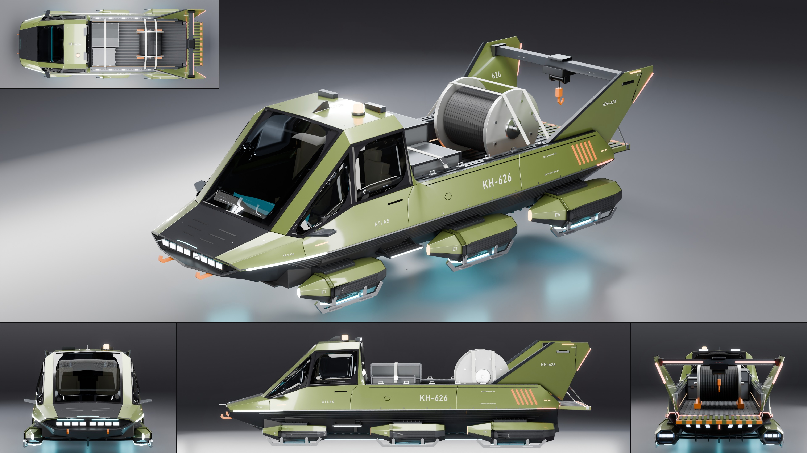

# Kestrel Aerodyne Atlas

- **Brand, model, type:** Kestrel Aerodyne Atlas, hover hauler, 2 seats side by side and an
  open load bed. The third Kestrel, the working one of the family.
- **Size:** 5.91 m long (pitot pins to the tailgate's lip; the hull 5.30 m), 2.29 m wide over
  the rear skids, 1.74 m high, hovering: skid pads 0.37 m, emitter rings 0.39 m, keel light
  0.40 m and belly 0.50 m over the ground; roof at 2.02 m, beacon 2.11 m, fin tips 2.00 m.
  Bed 3.04 m long, 1.40 m between the rails, floor 1.00 m and rail tops 1.34 m up.
- **Triangles:** 151,203 in 155 objects. Show color: pearl moss olive over the graphite lower
  hull, pale stencils, signal orange hooks, chocks and hazard marks, cyan emitters, sand seats.
- **Build:** `vehicles/blender.sh vehicles/cars/kestrel_atlas.py --out docs/progress/AG18/kestrel_atlas --sheet`

## The design

- **The family, kept:** the knife chine with its bright strip from prow to stern (lit white
  at the front, red at the stern), flat top facets with flush glass and the matte visor, seven
  ribs along the graphite lower hull, the eight-sided emitter pod (the Dart's `build_pod`),
  canted fins, slanted slot thrusters either side of a stern post, the keel blade with its
  light, stencil registration (`KH-626` on the bed sides, fins and roof, `KA 2-626` by the
  nose, `E1` to `E6` on the pods).
- **One line, two jobs:** the cab's shoulder runs on unbroken as the outer top edge of two
  raised rails beside the bed, so the body-color flank is one band from the prow to the
  stern; the cab is a cab-forward wedge with a full-width back wall and a smoked rear window.
- **Its own face:** a chisel prow, wide and thin, with eight work lamps in a slot in its edge,
  a sensor slit over them and two orange tow horns under it.
- **Six pods:** three pairs growing toward the stern (0.88, 1.02, 1.14 of the Dart's rear
  pod), each on a ribbed outrigger from the lower hull, each with a heavy sled skid on two
  braced legs with pads; a boarding step under each door between the first two.
- **Fins as a gantry:** the fins stand on the rail ends and are bridged by a hoist beam
  (trolley, winch, cable, hook, a work light under it); the beam's rear face is the high
  tail light with the maker's name, so the back view is a lit portal over the tailgate.
- **The bed:** a ribbed liner, a slotted tie-down track with cleats and rings on each rail,
  a tailgate folded down as a loading shelf on two stays (hazard blocks on its lip); in it a
  cable drum on chocks and two transit cases, strapped to the rails with ratchets.
- **Fifth tile:** the top view (the bed, the load and the six pods in plan).

## What I would improve

- The stern mouth and its thrusters sit in the shadow of the tailgate; a hinged gate drawn
  closed in one view would show both states.
- The cab's back corner (side glass to back wall to rail) is three thin facets of the one
  cage; a separate cab piece would give it a cleaner post and a real door cut.
- The straps are flat sweeps without sag or buckles at the cleats, and the hoist's hook
  hangs free; a sling to the drum would tell the story better.

## Kit wishes

- `rib`, `plate` and `chine` in the kit (copied a third time), and a `strap` (a flat band
  over given points with a ratchet).
- A `Geo.lathe` about any axis (`axis='z'`): the beacon and every upright bolt need a matrix.
- A sheet option for the fifth tile at a larger size when the hero leaves a wide empty wall.
