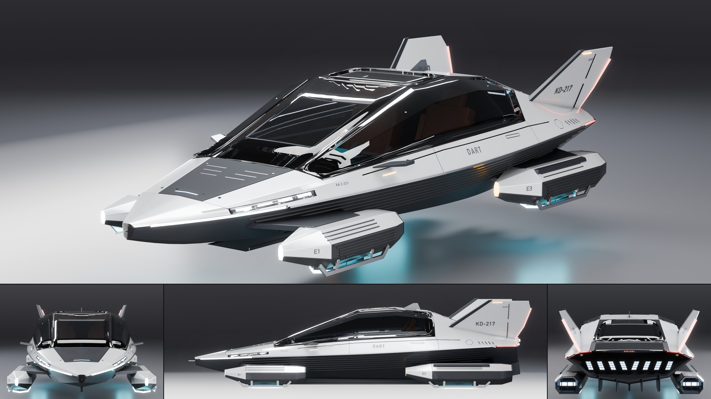

# Kestrel Aerodyne Dart

- **Brand, model, type:** Kestrel Aerodyne Dart, hover coupe, 2 seats side by side. The
  first Kestrel, so it sets the family's look.
- **Size:** 4.66 m long (pitot to fin tips), 1.99 m wide over the pods, 1.20 m high, hovering:
  keel light 0.32 m, emitter rings 0.35 m and belly 0.40 m over the ground, fin tips at 1.52 m.
- **Triangles:** 72,340 in 92 objects. Show color: pearl ice white over a graphite lower hull,
  cyan emitters.
- **Build:** `vehicles/blender.sh vehicles/cars/kestrel_dart.py --out docs/progress/AG18/kestrel_dart --sheet`

## The design

- A dart in plan: the prow is a 10 cm blade with a pitot pin, the hull widens to the rear
  pods, the front pods stand clear of the narrow nose on flat pylons (air between them).
- One knife chine from the prow's point to the stern. Above it everything is a flat facet
  (nose, a matte black sensor visor, windshield, glass roof, rear glass, ribbed deck), so the
  dark facets read as one arrowhead from above; the side glass is folded once along its length.
- Four emitter pods, the fronts 0.86 of the rears, each with a thruster slot in its stern;
  the door is meant as a gull door per side (shoulder band, side glass, half the glass roof).
- Cabin: two seats, a yoke instead of a wheel, a wide screen, a ribbed power cell under the
  rear glass.

## Kestrel family cues (for the Meridian and the Atlas)

1. **The chine blade.** The widest line of the hull is a sharp crease carrying a bright
   metal strip its whole length, lit white for its first 0.8 m from the prow (the front light
   signature, a chevron seen from ahead) and red for its last 0.3 m.
2. **Two-tone by the chine.** Body color above, satin graphite below, the lower hull covered
   in seven fine ribs that run parallel to the chine.
3. **Flat top facets, flowing flanks.** Creases at every station on the top lines, none on
   the flanks; glass flush in the facets with black frames; a matte visor facet ahead of the
   windshield with sensor slits and a status light.
4. **The emitter pod.** An eight-sided nacelle (`POD_SEC`, `build_pod`): body color on top,
   a ribbed graphite band on its sides, a vertical blade nose ending in a lamp (white in
   front, amber behind), a slot thruster with three vanes in its stern, and under it a sunk
   well with a glowing core, nine vanes, a clamped six-sided collar and a glowing ring on
   the collar's lip. A bright skid on two hinged struts folds beside the ring. `E1` to `E4`
   stencilled on the noses.
5. **Twin fins** canted 24 degrees, a graphite leading edge, a red light down the trailing
   edge, an amber tip marker, the tail number outside and its last three digits inside.
6. **Stern:** a recessed mouth with eight slanted slot thrusters, a red bar round its upper
   lip broken by the maker's name, strakes under the kick-up.
7. **Keel:** a thin blade under the centerline with a cyan light along its edge.
8. **Lettering:** tail number `KD-217`, registration `KA 2-217` by the nose, model name on
   the door, all in dark stencil grey.

## Step B: lamps, cut lines, glass (2026-11-12)

The first Kestrel on step B's kit (`docs/assetgen_milestones.md`, AG18, step B), and the
first car on `vehicles/brands/kestrel.py` (the chine, the fin plane, the pods and their
ribs; it builds exactly as before on the module). The sheet, clay, zebra and check above are
of this build.

- Nose lamps: the four lit cells in the flank facet over the chine are now a slot cut 42 mm
  into the hull under a clear lens set flush in the facet, the cells set back 9 mm with
  bright dividers between them running to the slot's floor.
- The chine's light: the knife edge itself is cut away for its first 0.76 m from the prow
  and its last 0.27 m, a channel 18 mm up the edge and 22 mm deep under a clear (front) or
  red (rear) lens that keeps the edge's shape, a lit core and a bright liner inside; the
  bright blade runs between them.
- Stern bar: a channel 16 mm wide and 26 mm deep in the band round the top of the mouth
  under a red lens, narrowing to 9 mm where the band narrows past the mouth's middle; a red
  core and bright ribs behind it.
- Keel blade: its foot is a channel 24 mm high along 2.44 m with dark walls, a light guide
  in a frosted sleeve over a bright reflector strip and a clear lens flush with the foot.
- Thruster slots: a cross of vanes set back in each of the eight slots.
- The maker's name over the stern bar is laid on the band (`text_on_body`, `'X'`); it
  floated 8 mm off it and the gloss band mirrored a second, offset copy of it.
- Cut lines: the styling groove under the side glass (7 mm), the flush door release and the
  six-sided charge flap are cut through the skin (they were strips lying on it); 3.5 mm shut
  lines everywhere (2.4 mm before). The sensor slits at the side glass's foot stay printed
  on the glass.
- Glass: every pane (windshield, roof, side, rear) with a black frit border as part of the
  glass; the flat facets take it without shards.
- Cabin tub: the dash made symmetric and narrower at its foot and the floor shortened, so
  the tub no longer shows under the nose (48 mm out before, 4.5 mm now).
- About 112,600 triangles (72,340 before; the lamps 9,000 of them, the cut hull most of the
  rest).

Left: the pods' tip lamps are flat faces of the pod (the pods are wrapped pieces built
without the uncut-hull cutters); the emitters' layered glow is step C's; the stern bar is
thin where the band narrows past the mouth's middle (an even band would widen it, a change
to the stern's look).

## What I would improve

- The flat windshield mirrors the fins and the studio's top light at the hero's angle; a
  slightly crowned glass or a deeper tint would calm it.
- The emitters' best side is underneath, which the sheet's four views never show.
- Fin roots and pod pylons meet the hull without fairings; real stencil breaks in the letters.

## Kit wishes

- A fifth sheet tile, or a low three-quarter view from under the floor line (a glass floor
  or a hidden floor), for hover cars whose detail is underneath.
- `on_body` on chosen objects without touching `K._BVH` (I called `K.body_bvh(pods)` and
  reset it by hand to rib the pods), and `text_on_body` for the `'z'` projection.
- A raised strip (`rib`: a ribbon with height) and a flat blade (`plate`) in `Geo`; both are
  in this script, as is `chine(x)`, the hull's widest point as built.
- A view's target at the car's own middle by default (every view here was retargeted from
  z = 0.5 to 0.82), and a stencil font.
- A note in the guide on the top soft box: flat side glass leaning in by more than about
  25 degrees mirrored it in the side view here (the fold in the Dart's side glass came from
  that), so it seems to reach well past the car's sides.
