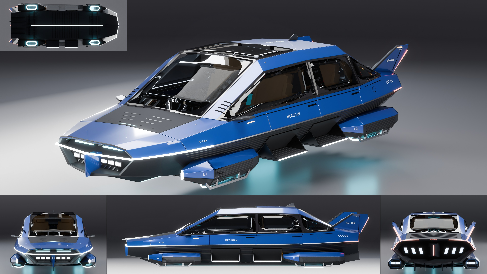

# Kestrel Aerodyne Meridian

- **Brand, model, type:** Kestrel Aerodyne Meridian, hover sedan, 4 seats, four doors. The
  second Kestrel, the calm one of the family.
- **Size:** 5.32 m long (pitot pins to fin tips; the hull 5.06 m), 2.08 m wide over the pods
  and the open step, 1.39 m high, hovering: keel light 0.33 m, emitter rings 0.38 m and belly
  0.42 m over the ground, the roof at 1.67 m.
- **Triangles:** 90,334 in 110 objects. Show color: pearl cobalt blue over the graphite lower
  hull, cyan emitters, tan seats.
- **Build:** `vehicles/blender.sh vehicles/cars/kestrel_meridian.py --out docs/progress/AG18/kestrel_meridian --sheet`

## The design

- **The family, kept:** the knife chine with its bright strip from prow to stern (lit white
  at the front, red at the stern), flat top facets with flush glass and the matte visor, seven
  ribs along the graphite lower hull, the eight-sided emitter pod (the Dart's `build_pod`),
  canted fins, slanted slot thrusters, the keel blade with its light, stencil registration
  (`KM-404` on the fins and the roof, `KA 4-404` by the nose, `E1` to `E4` on the pods).
- **Its own face:** a blunt axe-head prow, a shallow vee in plan. The lit chine turns the
  corner and bridges a recessed mouth as one blade of light; a body-color stem splits the
  mouth, three lamp cells and a sensor slit each side.
- **A sedan's cabin:** tall and framed. A body-color rail runs up the windshield pillar,
  along the roof and down beside the rear glass, over six upright side windows (a quarter
  light, two door glasses, a tapering rear light per side); a smoked glass roof over the
  front seats, a solid roof with the registration over the rear ones; every top facet folded
  along a center ridge.
- **Pods tucked in:** all four hang under the chine, half sunk in the lower hull, no pylons.
- **Boarding steps:** a ribbed tread with stringers folds out of the lower hull under each
  door, between the pods; out on the left side, stowed flat on the right.
- **Stern:** the thrusters in two banks of three either side of a stern post with a red
  light; low fins that start at the rear glass's corners and end past the stern.
- **Under the floor** (the sheet's fifth tile): four emitters, the keel light, cross ribs,
  conduits from the keel to each pod.

## What I would improve

- The step bays read as plain dark panels in the side view; a real recess with the hinge
  arms in it would say more.
- The pods meet the hull without a fairing lip, and the door cuts stop at the glass frames.
- The windshield still carries a grey sheen of the top light on its near half in the hero.

## Kit wishes

- A coated or smoked glass in the library: the top soft box is long across the car, so flat
  glass facing the sky mirrors it white in the hero and the back view, and a clear glass roof
  floods a light cabin (here `glass_coat` and `glass_smoke`, a lower IOR and a dark tint).
- `rib`, `plate` and `chine` (copied again from the Dart) and a tilted box (`slab` here) in
  the kit; a `Geo.box` that takes a frame.
- A way to say what the under view is lit by: it is dark between the emitters.
