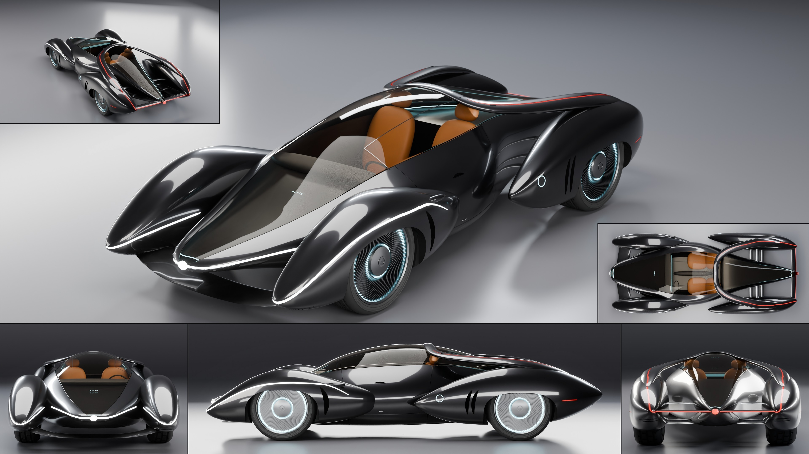

# Orrin Aria

- **Brand, model, type:** Orrin Aria, hypercar, 2 seats side by side (all names made up). The wild one of the family, after the Lumen and the Pebble.
- **Size:** 4.74 m long, 2.06 m wide, 1.12 m high, wheelbase 2.75 m, wheels 0.76 m, ground clearance 0.13 m.
- **Triangles:** 393,388 in 82 objects (the core at subdivision 4, the pods and hips at 3, the yoke at 2; 501,460 before step B).
- **Build:** `vehicles/blender.sh vehicles/cars/orrin_aria.py --out docs/progress/AG18/orrin_aria --sheet`

## The design

- Five poured drops and no crease anywhere: a core (the low nose and the cabin, one teardrop from the nose pole to the tail pole), a front fender pod each side and a rear hip each side. Every drop is a ring cage that closes on a pole at both ends, as the Lumen's hull does.
- The voids are the design. Ahead of the front axle the fender pods stand free of the nose (two slots, with a blade under the nose as the floor of the through-duct). Behind the doors the cabin draws in to a slim tail and the hips stand clear of it: a channel each side with no floor, from the door back to the tail, crossed only by three faired arms at the rear axle.
- The yoke: one hoop laid over the glass behind the heads whose two legs fly back over the channels and sink into the hips' crests. They are the flying buttresses, and the hoop is the roll bar the glass roof needs.
- The canopy is one teardrop of coated glass from pole to pole, with petal door hairlines over it; a dark gloss liner, two seats of three stones each and a strip screen under it.
- The ribbons trace the voids. White: from behind each front wheel over its lid, round the pod's tip, back up the slot and out along the nose to the lit pebble on the nose pole. Red: down each buttress from the roof, along the hip's crest, round its tip and across the tail blade to the pebble on the tail pole.
- The Orrin cues: lidded wheels on turbine discs (60 vanes, two light rings), paired crescents (the intakes on the hips, one in each front wheel's wake, a pair under the nose pole), dot lenses on the pods' fronts and the hips' tails, `aria` low on the door, `orrin` on the hoop and lit under the nose glass, a hair of light round both tongues of the canopy, a ring of light for the charge port on each hip's nose.
- Show color: obsidian black in a satin pearl, with ice blue light and cognac seats. The sheet's two small tiles are the rear three-quarter and the plan, where the channels show best.

## Step B: lamps, cut lines, glass (2026-11-13)

On the Pebble's pattern (`docs/assetgen_milestones.md`, AG18, step B), and now on
`vehicles/brands/orrin.py` (ring, snap, strip, the lid and lune cutters, the dot fields,
the lettering, the stones, the liner's rim and the turbine disc; built exactly as before
when switched). The module gains the Pebble's channel parts as copies of its own (`on_skin`,
`taper_width`, `along`, `band`, `chop`, `seated`, and `channel_lamp`, the lens, lit face and
sleeve in one call; the Lumen and the Pebble build as before). The sheet, clay, zebra and
check above are of this build.

- Ribbons: the light lines are now channels cut into the skin, 16 mm wide and 9 mm deep,
  one per body piece (each piece is cut alone): round the nose on the core from slot to
  slot; on each fender pod from behind the wheel over its lid, round the pod's tip and back
  up the slot (raised 30 mm over the wake crescent's tip, which it crossed); on each
  buttress from the roof down into the hip, where the hip's own channel takes over from
  under the leg, runs along the crest and round the hip's tip in a wide turn (a tight one
  folded into chips) down to the tail blade's light bar, drawn out to its height. In each
  the Pebble's lamp: a flush lens of its own with the body's gap each side, set 1.2 mm under
  the skin (on the nose's tight curve a flush lens's edges stood proud), a lit face right
  under it 3 mm wider than the mouth, a frosted sleeve; the walls a 1 mm sheet chopped into
  4.5 cm pieces. White at the front, red behind. The pole pebbles stay, seated on the skin
  as it stood before the cuts; the side markers are short channels of their own.
- Cut lines: a round flap (108 mm) cut round each charge port on the hips' noses (the left
  one the charge port's, the right a service flap), the port's light ring inside it laid on
  the skin as it stood before the cut; the door pulls a crescent recess (`lune_cut`) in
  place of a painted strip; the crescent slots (nose, wheel wakes, hip intakes) and the
  wheel openings told to the checks (twelve cutter holes before, none now). Shut lines stay
  the kit's 2.4 mm, as on the Pebble (3.5 mm tore round the cuts in its pack's far LODs).
- Glass: unchanged. The canopy is one teardrop leaf from pole to pole with no frame by
  design, so there was no old frame to move to `"frame"` or `"frit"`.
- Wheels: room round the tires, inside the skin. The front tires stood in the core's lower
  flank (inside the pod) and against the well's inner wall: a well cut into the core beside
  each tire, an arch reaching in beside the tire's inner sidewall under the pod's inner
  crown, and the wells' arches lowered at their top where the crown falls away close over
  the tire (the old wells broke through the skin over each front tire and into the channel
  over each rear one: four of the cutter holes). Each cutter is a solid of its own (two
  overlapping in one cutter emptied a pod). 0.0 mm front and 2.8 mm rear before, 5.0 mm
  now, at the tire's outer shoulder under the eyelid; the front still cannot steer.
- Triangles: 393,388 (501,460 before): the pods and hips at subdivision 3, as the old notes
  proposed (their zebra stays smooth), the yoke (a slim section) at 2, the liner under the
  glass at 2, the channels sampled every 18 mm and their lamps every 20 mm, the tread at 80
  segments (a 0.3 mm chord on the tire's round), the two stones hidden under the seats
  coarser; `chop` splits only the faces near each cut (the Pebble's splits the whole object
  at every cut, both sides and every turn).
- Game pack rebuilt, every check passing: 145,467, 59,963, 20,262, 5,141 triangles,
  standard class, texels 393 px/m (5th percentile, 351 before), LOD3 15.8 of 40 degrees,
  0.023 of 0.10 bent, 0.010 of 0.04 texture (main 15.0, 0.022, 0.010). The ribbons read as
  lit lines at every LOD, LOD2 and LOD3 as main's; baked up close, the channels' wall edges
  leave a fine dark rim along each line.

Left: the front wheels cannot steer (0 degrees), as on the Lumen and the Pebble: they are
faired in under the eyelids. Small chips inside the crescent slots under the nose pole
(the slot's walls where its cutter meets the skin nearly tangent), seen from close up; the
chopped walls' top edges catch light at the channels' mouths from a few tens of centimeters.

## What I would improve

- The drops meet as plain intersections (pod to core, buttress to hip); a poured car wants a fillet there, which needs the bodies built as one cage or a blend pass.
- The front wheels have little room to steer inside their pods, and the three arms across each channel stand in for a whole suspension.
- The hips' inner walls mirror the studio lights in the back view and read as bright metal; a satin finish in the channels would calm it.
- The doors are hairlines over the glass and a pull; hinges, a seal and an open state would explain the way in.

## Kit wishes

- A sheet with more than one small tile (`extra` as a list with a corner each): this script lays its second tile into the finished sheet itself (`second_tile`).
- As the Lumen and the Pebble asked: a nearest-point `on_body`, and `strip()`, `pebble()`, `lune()` and the turbine disc in the kit; three Orrins now carry copies.
- `build_body`: pole closure as an option (`front=dict(kind="pole", at=...)`), and a tube whose first ring lies on y = 0 documented as the way to carry a piece across the centerline (the yoke relies on it).
- A blend between two body pieces (a fillet along their intersection), or a boolean union of pieces before the panels are split.
- A coated glass in the palette (`glass_ior`), and `emit()` strengths in the palette: the kit's red goes pale under AgX.
