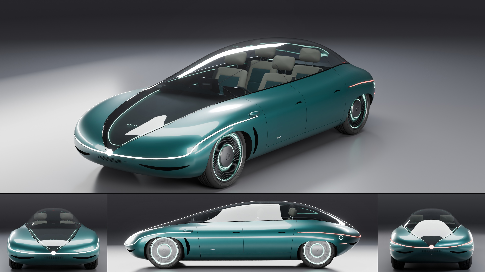
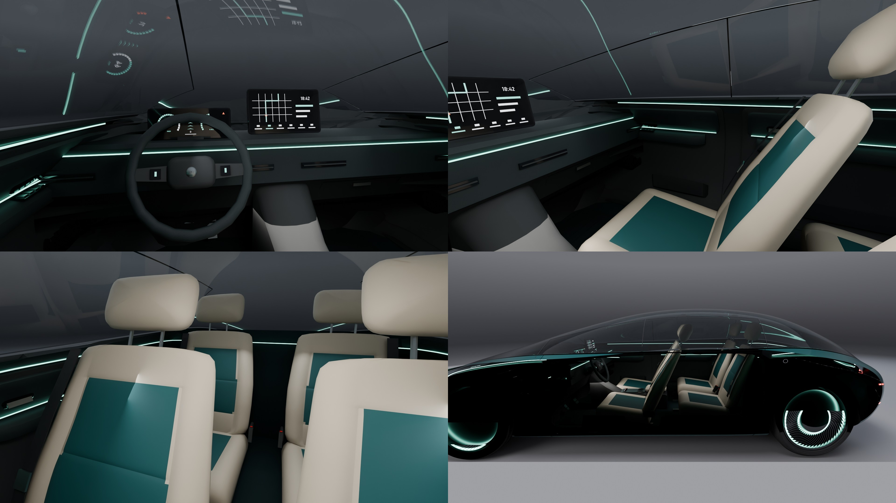

# Orrin Lumen

- **Brand, model, type:** Orrin Lumen, sedan, 4 seats (all names made up). The first Orrin: it sets the family's cues.
- **Size:** 5.03 m long, 2.00 m wide, 1.37 m high, wheelbase 3.10 m, wheels 0.74 m, ground clearance 0.13 m.
- **Triangles:** 356,940 in 54 objects (body at subdivision 4).
- **Build:** `vehicles/blender.sh vehicles/cars/orrin_lumen.py --out docs/progress/AG18/orrin_lumen --sheet`

## The design

- One poured drop: nine lines over sixteen ring stations, no crease anywhere. The rings close on a small pole at the nose tip and at the tail tip, so every line runs from one tip to the other.
- The canopy is a single leaf of glass from pole to pole, the body rising round it; front fenders swell beside it, the belt dips at the doors and rises again over the rear wheels; the tail is narrower than the nose.
- Show color: a deep tidewater teal in a satin pearl, sand seats under lightly smoked glass.

## Orrin's signature cues (for the Pebble and the Aria to repeat)

1. **Pole to pole glass.** The canopy starts and ends on the body's two poles. No frame, no trim: glass meets paint edge to edge.
2. **Ribbon and pebble.** One unbroken light ribbon round each end on the widest line, drawn out to a point along the flank past the wheel, swelling into a small lit pebble on the pole where the glass springs from it (white in front, red behind).
3. **Lidded wheels.** No round arches: the body comes down over each tire like an eyelid (a flattened superellipse opening), a little at the front, deeper at the rear.
4. **Turbine discs.** A smooth dark disc, 54 fine swept vanes in a sunk annulus, a ring of light at the inner and outer end of the vanes.
5. **Paired crescents.** Air only through slim crescent slots: a pair under each ribbon, one in the wake of each front wheel. Door pulls are small crescents too.
6. **Dot lens.** Where it must breathe, a lens of perforations that shrink toward its rim (under both poles).
7. **Petal shut lines.** Door cuts fan like petals (forward at the top, upright, back at the top) and go on over the glass as hairlines; front clip and rear clip are one piece each.
8. **Light under glass.** A hair of light round each tongue of the canopy and the word `orrin` lit under the nose glass; one small lower-case word elsewhere (`lumen` low on the door, `orrin` on the tail).

## Step B: lamps, cut lines, glass (2026-11-12)

The Orrin pilot on step B's kit (`docs/assetgen_milestones.md`, AG18, step B), and the first
car on `vehicles/brands/orrin.py` (ring, the lid and lune cutters, snap, strip, the dot
fields, the lettering, the turbine disc; the module's axis rule for normals,
`orrin.setup(axis=(2.0, 0.62))`, is this car's). The sheet, clay, zebra and check above are
of this build.

- Ribbons: each light ribbon is now a channel cut into the skin along the widest line, from
  behind the wheel round the pole to the other side, 17 mm wide and drawn out to 5.5 mm at
  its tips, 10 mm deep where it runs over a wheel's well and 16 mm round the end. Inside, a
  light guide (its lit face as wide as the lens, a frosted sleeve behind it) under a flush
  lens, clear in front; behind, a red lens over a face cut into 24 mm cells with the dark
  channel showing between them. The lens is a band of its own following the channel with the
  body's gap each side: a lens cut from the skin itself kept the boolean's slivers and its
  reflections zigzagged. For the game pack, which leaves lenses and sleeves out and is over
  its budget: the lit face sits right under the lens (a guide set deeper came out as dashes),
  the channel's walls are a sheet 1 mm thick (bare, they were baked down onto the lit face
  and painted it dark), and the tail has no ribs in front of its cells (they were baked down
  the same way).
- Pebbles: the lit bead on each pole stays, seated on the skin as it stood before the cuts
  (it now sits over the channel's lens), a little larger so it covers the canopy's tip.
- Cut lines: the door pulls are crescent recesses cut 14 mm in (they were dark strips on the
  skin); a round charge flap is cut inside each port's light ring (the ring moved 19 mm down
  and 6 mm in, clear of the rear ribbon); 3.5 mm shut lines everywhere (2.4 mm before). The
  crescent slots' outlines are told to the checks, so they are no longer listed as cutter
  holes (six before).
- Glass: unchanged. The canopy has no frame by design (the brand's pole to pole glass meets
  the paint edge to edge), so there was no old frame to move to `"frame"` or `"frit"`.
- Wheels: room cut beside the tires under the lids and over them (the wells' outer ring
  19 mm deeper at the front sidewalls and 27 mm at the rear, 17 mm wider in radius above
  the tires), all inside the skin:
  2.8 mm to the well before, 14.6 mm front and 23.7 mm rear now. The cabin tub's lower outer
  corners chamfered: it no longer shows in the rear wells (9% of it before).
- 356,940 triangles (293,582 before; the cut hull most of it, the lamps 19,928).
- Game pack rebuilt, every check passing: 144,693, 59,996, 20,358, 5,057 triangles, standard
  class, texels 404 px/m (5th percentile); the ribbons bake as unbroken lit lines.

Left: the front wheels still cannot steer (0 degrees): they are faired in under lids, and
turning them 20 degrees would swing the tires' front edges 0.13 m out through the lids, a
change to the silhouette. The front clearance stops at 14.6 mm, where the lid's edge meets
the well and the skin above leaves no more room. The side markers behind the rear wheels stay
light strips on the skin. Tiny cusps of the canopy's tip still peek past the pebbles at full
size.

## Cabin (2026-11-24)

The schematic cabin (a box tub, block seats, a ring wheel, a strip of screen) is replaced by
`vehicles/cabin.py`'s full interior, style `orrin`, between the two decks under the glass,
which stay as they were:

- **Tub:** a lining from the footwells under the nose deck (firewall at x 1.08) to a wall
  just ahead of the load deck (x -1.07), carpet in deep teal-black; the glass is the roof,
  so there is no headliner, roof kit, visors or mirror.
- **Seats:** four lounges in pale stone with deep teal inserts, one quilt bar each, pillow
  headrests on posts; the rear pair a little more upright.
- **Dash:** low and soft under the glass's foot, its top meeting the nose deck's rear edge
  (`cowl` returns that edge: the glass runs on to the nose, so the module's windshield base
  is not the dash's); a floating screen, a free cluster, slot vents, a mint light line under
  the brow; the two-spoke round wheel, a console, pedals, mats.
- **Doors:** cards on the petal doors front and rear (no speaker behind), a lit sill plate
  reading LUMEN.
- **Its own:** one hair of mint light round the cabin at the glass's foot, along both sides
  and across the rear wall, the light ribbons of the body carried inside.
- **Cabin views:** the studio's boxes are also kept out of the glass's reflections there
  (`quiet_glass()`, a view hook): seen from the side, the canopy had mirrored the top box as
  an opaque white panel over the seats.
- **Triangles:** cabin 4,448 (old) to 45,778; the car 356,713 to 398,043 (budget 400,000),
  the lining at the module's `detail=0`, the seats' quilting cut to one bar.
- **Check:** verdict `look`, as before: the tires (front lids, unchanged), symmetry (the
  cabin's one-sided parts marked meant; `led.cabin` 8.5 mm, as before); `through` ok, panels
  ok, triangles ok; the log's "through the shell" says nothing.
- **Exterior:** unchanged (signature: only `interior.*` objects, the cabin's materials and the
  studio's `cab*` lamps differ).
- **Weakest:** from the driver's seat, the displays mirror large in the long glass ahead and
  the nose deck beyond the dash reads as a dark slab; through the glass from outside the
  seats are the cabin's whole story, and the door cards and dash stay dark.

## What I would improve

- The glass doors are only hairlines; a real hinge line and a B hoop under the glass would explain the way in better.
- Small teeth can still show where a panel's rim meets a slot wall (rims are thinned to 4 mm to hide them).
- The wheel wells are plain dark cavities with a visible step; a liner would tidy them.

## Kit wishes

- `build_body`: an option for panels without a rim along cutter edges, or rims that follow the cutter's wall (the rim goes in along the surface normal and pokes into a slot cut at another angle).
- A nearest-point `on_body` (the kit only projects along axes): this car's `snap()` and `strip()` (a band on the surface along a 3D curve, with tapered ends) could move into the kit; ribbons round a nose need them.
- `build_wheel`: let a car pass its own rim builder (here the kit's rim and hub are deleted and replaced).
- Lights sunk under the skin shine into the shell (panels have no thickness): a note in the README, or a thin inner skin.
- A way to keep one studio light's reflection off the glass (a per-car light tweak hook before `shoot()` renders); here the hero direction was moved instead.
- A flag to print the skin position at given points before cutting (this car's `LUMEN_PROBE`).
