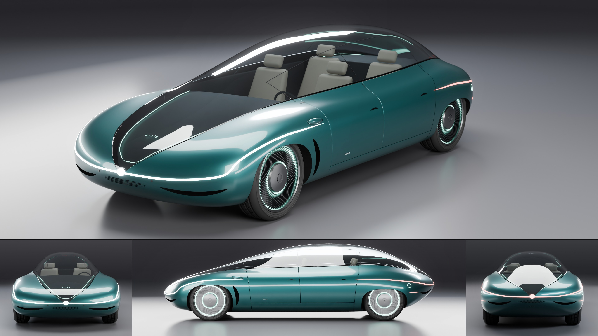

# Orrin Lumen

- **Brand, model, type:** Orrin Lumen, sedan, 4 seats (all names made up). The first Orrin: it sets the family's cues.
- **Size:** 5.03 m long, 2.00 m wide, 1.37 m high, wheelbase 3.10 m, wheels 0.74 m, ground clearance 0.13 m.
- **Triangles:** 293,582 in 47 objects (body at subdivision 4).
- **Build:** `vehicles/blender.sh vehicles/cars/orrin_lumen.py --out docs/progress/AG18/orrin_lumen --sheet`

## The design

- One poured drop: nine lines over sixteen ring stations, no crease anywhere. The rings close on a small pole at the nose tip and at the tail tip, so every line runs from one tip to the other.
- The canopy is a single leaf of glass from pole to pole, the body rising round it; front fenders swell beside it, the belt dips at the doors and rises again over the rear wheels; the tail is narrower than the nose.
- Show color: a deep tidewater teal in a satin pearl, sand seats under lightly smoked glass.

## Orrin's signature cues (for the Pebble and the Aria to repeat)

1. **Pole to pole glass.** The canopy starts and ends on the body's two poles. No frame, no trim: glass meets paint edge to edge.
2. **Ribbon and pebble.** One unbroken light ribbon round each end on the widest line, drawn out to a point along the flank past the wheel, swelling into a small lit pebble on the pole where the glass springs from it (white in front, red behind).
3. **Lidded wheels.** No round arches: the body comes down over each tire like an eyelid (a flattened superellipse opening), a little at the front, deeper at the rear.
4. **Turbine discs.** A smooth dark disc, 54 fine swept vanes in a sunk annulus, a ring of light at the inner and outer end of the vanes.
5. **Paired crescents.** Air only through slim crescent slots: a pair under each ribbon, one in the wake of each front wheel. Door pulls are small crescents too.
6. **Dot lens.** Where it must breathe, a lens of perforations that shrink toward its rim (under both poles).
7. **Petal shut lines.** Door cuts fan like petals (forward at the top, upright, back at the top) and go on over the glass as hairlines; front clip and rear clip are one piece each.
8. **Light under glass.** A hair of light round each tongue of the canopy and the word `orrin` lit under the nose glass; one small lower-case word elsewhere (`lumen` low on the door, `orrin` on the tail).

## What I would improve

- The glass doors are only hairlines; a real hinge line and a B hoop under the glass would explain the way in better.
- Seats are bevelled blocks; they deserve shells as soft as the body.
- Small teeth can still show where a panel's rim meets a slot wall (rims are thinned to 4 mm to hide them).
- The wheel wells are plain dark cavities with a visible step; a liner would tidy them.

## Kit wishes

- `build_body`: an option for panels without a rim along cutter edges, or rims that follow the cutter's wall (the rim goes in along the surface normal and pokes into a slot cut at another angle).
- A nearest-point `on_body` (the kit only projects along axes): this car's `snap()` and `strip()` (a band on the surface along a 3D curve, with tapered ends) could move into the kit; ribbons round a nose need them.
- `build_wheel`: let a car pass its own rim builder (here the kit's rim and hub are deleted and replaced).
- Lights sunk under the skin shine into the shell (panels have no thickness): a note in the README, or a thin inner skin.
- A way to keep one studio light's reflection off the glass (a per-car light tweak hook before `shoot()` renders); here the hero direction was moved instead.
- A flag to print the skin position at given points before cutting (this car's `LUMEN_PROBE`).
