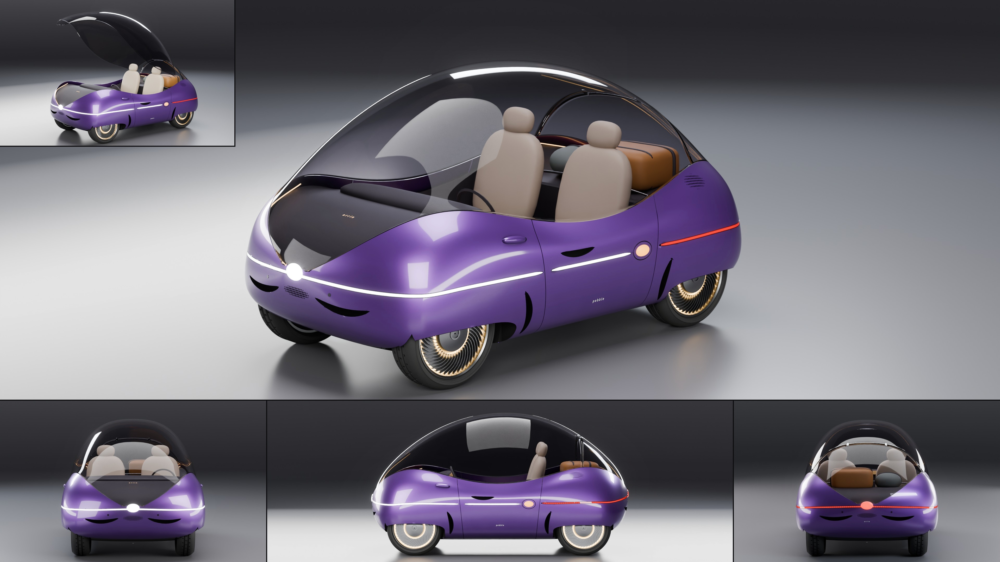

# Orrin Pebble

- **Brand, model, type:** Orrin Pebble, city pod, 2 seats side by side (all names made up). The Lumen's little sibling.
- **Size:** 2.82 m long, 1.61 m wide, 1.52 m high, wheelbase 1.78 m, wheels 0.59 m, ground clearance 0.14 m.
- **Triangles:** 326,370 in 61 objects (body at subdivision 4).
- **Build:** `vehicles/blender.sh vehicles/cars/orrin_pebble.py --out docs/progress/AG18/orrin_pebble --sheet`

## The design

- A river stone held in four soft paws: nine lines over eleven ring stations, no crease anywhere, the rings closing on a pole at the nose and at the tail as on the Lumen. Nearly the same front to back; only the lights say which way it faces.
- The glass is one dome from pole to pole. Its edge dips to the waist at the doors (the sill you step over) and the four fenders rise round it like claws round a gem.
- The dome forward of the hinge ring (a hairline and two metal knuckles over the rear axle) is one leaf that lifts as the door, with a crescent grab recess under its lowest point; the small tile shows it lifted. The glass behind the hinge is fixed over a luggage shelf with a strapped case, a soft bag and a rail.
- One ribbon all the way round the waist: white from one flank pebble round the nose to the other, red round the tail, a lit pebble on each pole and on each flank (the left one, in its flap ring, is the charge port).
- The Orrin cues: wheels under eyelid openings that hide the top half of the turbine discs (44 vanes, two light rings), paired crescents under each pole and beside each lid, dot lenses under both poles and on the rear paws, petal shut lines, `pebble` low on the petal, `orrin` on the tail and lit under the nose glass, a hair of light round both tongues of the dome.
- Seats made of three smooth stones each. Show color: a damson violet satin pearl with amber light, oat seats and a tan case.

## Step B: lamps, cut lines, glass (2026-11-13)

On the Lumen's pattern (`docs/assetgen_milestones.md`, AG18, step B), and now on
`vehicles/brands/orrin.py` (ring, the lid and lune cutters, snap, strip, the dot fields,
the lettering, the stones, the liner's rim, the turbine disc in its small size; the axis rule
for normals, `orrin.setup(axis=(0.8, 0.7))`, is this car's). The sheet, clay, zebra and check
above are of this build.

- Ribbon: the waist ribbon is now channels cut into the skin along the widest line, 17 mm
  wide and 14 mm deep: one round the nose and one round the tail, each between the petal
  cuts, and one along each petal from beside its front cut to the flank flap, drawn out to
  5 mm over their last 50 mm. Each stops 30 mm short of a shut line, so the ribbon reads as
  passing under the petal cuts and no panel is cut in two (one channel all the way round
  split the nose and tail panels into two strips each, which the game pack's far LOD
  collapsed apart). In each, a light guide's lit face right under a flush lens of its own (a
  band along the channel with the body's gap each side), a frosted sleeve behind it: clear
  in front, red behind over 22 mm cells. The pole pebbles stay, seated on the skin as it
  stood before the cuts, over the lens. For the pack the channels' walls are a 1 mm sheet
  (bare, the lit face baked dark) cut into 9 cm pieces across the channel (`chop`): whole,
  1.8 m of thin sheet round the nose starved LOD3 and collapsed into dark shards over the
  paint; in pieces LOD3 leaves them out.
- Flank flaps: an oval flap (140 by 100 mm) cut round each flank pebble, where white turns
  red; the ribbon stops 20 mm short of it in front and the red channel starts behind the rear
  petal cut. The left one is the charge port's, as
  before; the right one, cut the same for symmetry, is a service flap. They replace the
  hairline ring that was laid on the skin.
- Cut lines: the crescent slots and the leaf's grab recess (all `lune_cut`, the Lumen's,
  now in the brand module) tell their outlines to the checks: ten cutter holes before, none
  now. 3.5 mm shut lines (2.4 mm before).
- Glass: unchanged. The dome is one leaf from pole to pole with no frame by design, so there
  was no old frame to move to `"frame"` or `"frit"`.
- Wheels: room cut inside the skin beside the tires' sidewalls under the eyelids (the wells'
  outer wall 26 mm further out, 10 mm wider in radius than the tire round it): 0.0 mm to
  the well before, 16.6 mm front and 15.9 mm rear now. The tires take a narrow road tread
  (`orrin.NARROW`, the same as Tanager's): the kit's grooves fell outside a 0.185 m tire's
  crown and its blocks stood 7 mm into the ground; now 0.0 mm.
- 326,370 triangles (266,030 before; the cut hull most of it, the lamps 21,500).
- Game pack rebuilt, every check passing: 149,113, 59,991, 20,116, 5,019 triangles, standard
  class, texels 564 px/m (5th percentile), LOD3 9.9 of 40 degrees, 0.013 of 0.10 bent, 0.008
  of 0.04 texture (main 6.2, 0.006, 0.009). LOD0 and LOD1 read as main's with the ribbon lit
  all along; LOD2 shows a few dark specks along the glass edge, and LOD3 is coarser over the
  front fender with the channels a dark slit beside the lit line (main's surface strip had no
  slit to open).

Left: the front wheels still cannot steer (0 degrees), as on the Lumen: they are faired in
under the eyelids, and turning them would swing the tires through the lids, a change to the
silhouette. At a grazing angle a few millimeters of the panel's rim show in the flaps' shut
lines at their front and rear ends. The small teeth where the paint meets the glass tongue
beside each pole pebble are as before. The far LODs (above) read a little worse than main's.

## What I would improve

- The front wheels have no room to steer inside their cavities (faired in under the eyelids), and the tires stand a little ahead of the chin when seen from low in front.
- The leaf has no seal, struts or latch; the sill at the dip could carry a bright step plate.
- A few small teeth remain where the paint's rim meets the glass tongue beside each pole pebble.
- The dash is one stone with a strip screen; it deserves controls, and the cabin belts.

## Kit wishes

- A per-view hook in `shoot()` or `render_view()` (a function called before and after a view renders), for a state of the car's own such as a lifted canopy; this script wraps `K.render_view` to do it.
- A second corner tile on the sheet (`extra` as a list), for an open state and a detail view together.
- A glass with a coating in the kit (`materials(glass_ior=...)`): the kit's glass at IOR 1.5 mirrors the studio lights over most of a dome, so this car brings its own at 1.14.
- `emit()` strengths in the palette (`led_rear_strength`): AgX turns the kit's red and amber pale at their default strengths, so this car defines a dimmer red and amber of its own.
- `stats()` and `car_size()` measured from the ground, not from the lowest object: a hull probed without wheels reports its height short by its ground clearance.
- As the Lumen asked: a nearest-point `on_body`, `strip()` and `pebble()` in the kit, and a wheel builder that takes a car's own rim.
- A narrow road tread in the kit's `TREADS` (Tanager and Orrin each keep the same copy).
