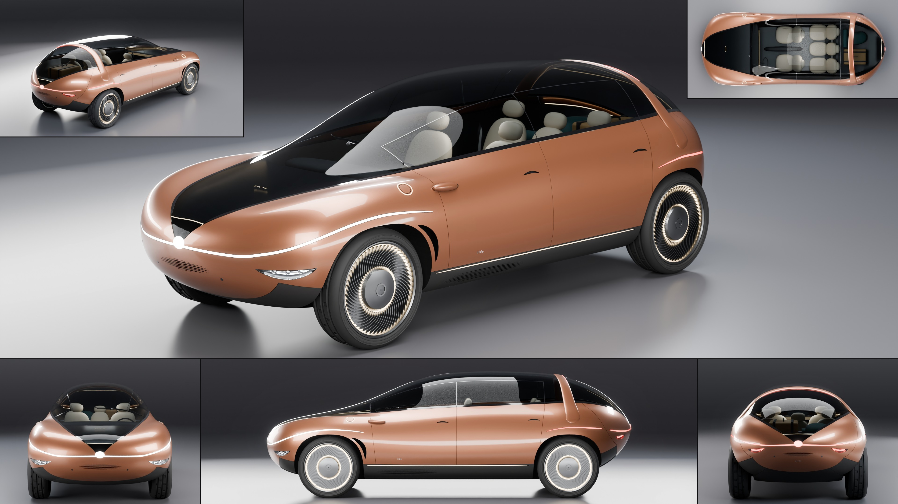

# Orrin Tide

- **Brand, model, type:** Orrin Tide, crossover estate, 5 seats, four side doors and a tailgate (all names made up). Orrin's practical car: the Lumen's long drop raised, with a long roof and a load deck.
- **Size:** 4.80 m long, 1.93 m wide, 1.60 m high, wheelbase 3.02 m, wheels 0.78 m, ground clearance 0.19 m.
- **Triangles:** 394,620 in 88 objects (body at subdivision 4).
- **Build:** `vehicles/blender.sh vehicles/cars/orrin_tide.py --out docs/progress/AG18/orrin_tide --sheet`
- **Checks** (`check.json`, with `clay.jpg` and `zebra.jpg` of this build): all ok. Tires 30 mm clear, the front pair steers 25 degrees; 193 mm under the floor; no open panel edges, no cutter holes, nothing of the cabin in the open; 394,620 of 400,000 triangles.

## The design

- **One poured drop with a long roof.** Nine lines over fifteen ring stations, no crease anywhere, the rings closing on a pole at the nose and at the tail as on the Lumen. Two boxes in profile, not a pod: a nose deck, a steeper screen, a roof that stays high over both rows and the load deck, then a round tail whose belly rises.
- **Pole to pole glass.** The canopy runs from the nose pole to the tail pole over a nose deck (the word `orrin` lit under it), five seats and the load deck, with a printed frit border and a hair of light round both tongues. The front fenders stand higher than the glass between them.
- **The hoop.** A band of the body crosses the glass behind the rear doors and lies down on the haunches: the handle of the basket. It carries the third stop light, and the tailgate hinges behind it.
- **The tide line.** Everything under the lower flank line, from under the nose to the tailgate's lower edge, is a darker keel. Between the wheels a hair of warm light runs along its top, and the widest line of the flank dives low at the doors and comes up over the rear wheel, so the highlight draws a wave.
- **Wheels shown, not lidded.** 0.78 m turbine discs (54 vanes, two light rings) in eyelid openings drawn clear of the tires, so the front pair can steer; each light ribbon runs over its wheel like a brow.
- **Lamps with depth.** Ribbons in channels cut into the skin (a lens, a light guide's lit face, a frosted sleeve), white from behind each front wheel round the nose, red from over each rear wheel round the tail, a lit pebble on each pole. Under them crescent pockets behind lenses cut from the skin: three projectors and a light guide in each head lamp, a lit blade over bright fins in each stop lamp.
- **Cut lines.** Petal door cuts (forward at the top, upright, back at the top) going on over the glass as hairlines; the tailgate cut down each quarter with `groove()` to the keel's corner, the keel's edge being its lower edge; crescent door pulls and wake crescents; a round charge flap in a ring of light on each front fender. Shut lines 2.4 mm, the Orrins'.
- **Small things.** Dot lenses under both poles and low on the keel, camera pods on the front doors, parking sensors, a wiper parked at the foot of the screen, `tide` low on the doors and `orrin` on the tail; on the load deck a strapped case, a soft bag, a roll and a rail.
- Show color: ember copper in a satin pearl over a graphite keel, oat seats under smoked glass, candle-white accents.

## What the script adds to the brand's way

- `skin(u, v)`: the built surface in the cage's own coordinates (an uncreased cage subdivides to a uniform bicubic B-spline of its points; it is within 1.2 mm of the mesh). Ribbons, the tailgate's cut, the lamps' outlines, the frit and the hairlines are all laid out in station and line numbers, so they follow the body when a station moves.
- `fair()`: a channel's lamp takes its normals from the skin on both sides of the channel. The traced path's own are those of the facets it lay on, up to 5 degrees off round the nose, and a flat lens then stood proud along one edge.
- `tidy()`: takes the folded slivers off the panels' edges. A ribbon running toward its pole runs along the mesh's rows; the boolean leaves triangles thinner than the kit's gap, the gap turns them over and the panel's rim stands on them: flakes a millimeter proud all along the channel (360 faces here).
- `ribbon_lamp()`: the lit face as wide as its lens. `orrin.channel_lamp`'s wider face showed through the gap between paint and channel as bright dashes beside the ribbon.

## What I would improve

- The hoop is a separate piece laid on the hull: its feet end in a rounded tip on the haunch instead of truly melting into it. A cage with the hoop as part of the body would do it properly.
- The form is still a soft drop. The fender valleys and the wave carry it, but the flank between the wheels is plain, and from straight behind the tail reads narrow between the tires.
- The seats are three stones each and the dash is one stone with a strip of screen; no belts, no controls, no door cards.
- The front ribbon stops 12 mm short of the centerline on each side under the pebble (see Kit wishes); the rear ribbon stops 5 cm short of the tailgate's cut on each side instead of running under it.
- The side glass shows the studio's wall through both sides as a grey panel in the side view; a darker glass hides the cabin in the hero.
- The wheel wells are plain tunnels and the wake crescents plain voids.

## Kit wishes

- `build_body`: one channel cut across a pole emptied the whole hull in the boolean (the front ribbon; the rear one, built the same way, went through). The result was silently no panels at all: an error naming the cutter that did it would help.
- `groove()`: sections closer together than the channel is wide fold and also empty the hull. A minimum spacing inside `groove()` (this car thins its paths to one point every 16 mm) would make dense paths safe.
- `shrink()` (the panel gap): skip or delete faces thinner than the gap instead of turning them over (this car's `tidy()`).
- `trace()` and `groove()`: normals from the smooth surface, not from the facet under the point (this car's `fair()`), or an option to give them.
- A surface evaluator in the kit (this car's `skin(u, v)`): laying things out in station and line numbers was the most useful tool of this build, and `on_body` only projects along axes.
- `snap()` from a point far outside lands where the surface faces the point, not at its height: the charge flap first sat 8 cm low, on the ribbon. A note in the README.
- `unlit()` by light name is hard to aim: a table of which light makes which reflection in each view, or a debug render with one light at a time, would tell which light stands in a canopy (here the rim light, as a white shard in the front view).
- The frit mode of `glass=` cannot border a canopy that runs to a pole (the inset crosses the centerline at the tip, and its creased loop would harden the poured glass edge); this car prints its frit as a strip on the glass instead.
