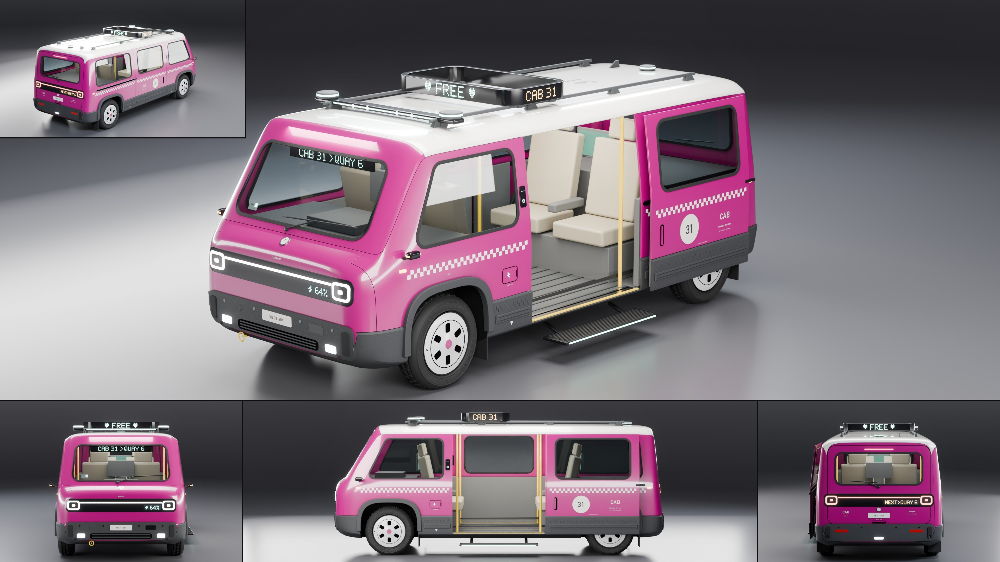

# Tanager Cab

- **Brand, model, type:** Tanager Cab, driverless city taxi, a one-box people carrier (all names made up). 4 passenger seats in two pairs facing each other, no driver's seat: a sensor bar over the windshield drives it.
- **Size:** 4.52 m long, 1.85 m wide over the arch trims (1.99 m over the corner cameras, 2.15 m with the step out), 1.78 m to the roof, 1.95 m over the roof sign, wheelbase 3.0 m, wheels 0.66 m, ground clearance 0.225 m, cabin floor 0.30 m off the road.
- **Triangles:** 285,996 in 165 objects (body at subdivision 3).
- **Build:** `vehicles/blender.sh vehicles/cars/tanager_cab.py --out docs/progress/AG18/tanager_cab --sheet` (`CAB_SHUT=1` builds it with both doors closed, `CAB_HULL=1` with `--preview` shows the bare hull; close-ups: `--views door,tail,nose,sign`).

## The design

- **One box, no hood.** The Mino's soft tall box grown to a people carrier and its hood taken away: a short brow over the visor, a windshield 31 degrees off upright, a flat cap roof, the Mino's leaning tail plane. Ten lines over fourteen stations, nothing sharp but the cladding's step.
- **The door.** One sliding door each side, 1.26 m wide, on a track let into the rear quarter under the windows. The left one is built open (its panels, glass, cladding, bump strip, checker and lettering are objects of their own, slid back 1.27 m and 9 cm out), over a fold-out step with a lit edge; the right one is shut (the small tile). Behind it a low flat ribbed floor, tread plate thresholds with yellow nosings, a yellow grab post each side of each doorway and a rail along the ceiling.
- **The cabin.** Two pairs of seats facing each other, the front pair riding backward, armrests, belts, a screen on each bulkhead, a luggage bay behind the rear seats under a hatch in the tail, a shelf with the computer's hump under the windshield.
- **Taxi gear.** A roof sign that is a hollow dot-matrix band all round on the roof rails (FREE to the front and back, CAB 31 to the sides), a destination strip under the windshield's header, the next stop on the rear visor's display, a payment pad on the pillar ahead of each door, the checker twice: molded into the cladding and as a band in the fleet's lettering color under the belt.
- **Driverless.** A gloss sensor bar over the windshield with a lidar puck on each end, lenses and a lit strip; a third puck at the back of the roof; cameras on stalks where mirrors would be; a radar plate in the bumper.
- **Family cues, all seven of the Mino's:** the visor with one light bar between two lamp rings and a display on the car's left, holes for windows with flat glass and fat seals, the cap roof with its gear on two rails, squircle arches, stepped grained cladding with a bump strip and rubber guards, steel wheels under slotted covers, the roundel (31), small print and the round T badge.
- **Show color:** hot magenta under a white cap roof.

## What I would improve

- The seats are plain blocks: shaped bolsters, stitched panels and seat bases with legs would lift the open doorway, which is the picture's centre.
- The doorway's edges are the panels' own thin rims: real jambs with seals, a striker and the upper and lower tracks would make the open door read as engineered.
- The front end is calm to the point of plain between the visor and the bumper; a service flap with a shut line and washer jets would help.
- The side tile shows the far door's card through the doorway rather than the seats; a three-quarter tile from the door's side (view `door`) would show the cabin better than the pure side.
- The white roof wraps down the tail's top corners as on the Mino; on this taller tail it reads as two ears from straight behind.

## Kit wishes

- **Where a panel edge ends up.** A station's edge is drawn toward its neighbors by subdivision ((previous + 4 x + next) / 6 along an uncreased line): the door's edges, set at 0.64 and -0.62 in the cage, were built at 0.57 and -0.56 and the door's own parts stood proud of it. `build_body` could take stations by where their edges should be built, or the README could give the rule.
- **Opening parts.** A way to ask `build_body` for one side's panel as its own object (here `split_left` cuts a mirrored panel in two after the build), and a group to hang parts on so a door, hatch or hood can be moved or swung as one.
- **Family helpers in the kit or a brand module:** `Win`, `pad`, `bar_on`, `dots`, `banner` with its 5 x 7 glyphs, `text_proj`, `grain` and the slotted wheel cover are now copied in two Tanager scripts and will be in a third (a `vehicles/tanager.py` would do).
- **A cabin light.** A palette key for a dome light: here three area lamps are added to the studio collection so the cabin reads through the glass and the doorway.
- **Lit lettering on planes** (`dots_flat` here): a dot-matrix text on any plane, for signs and screens.
