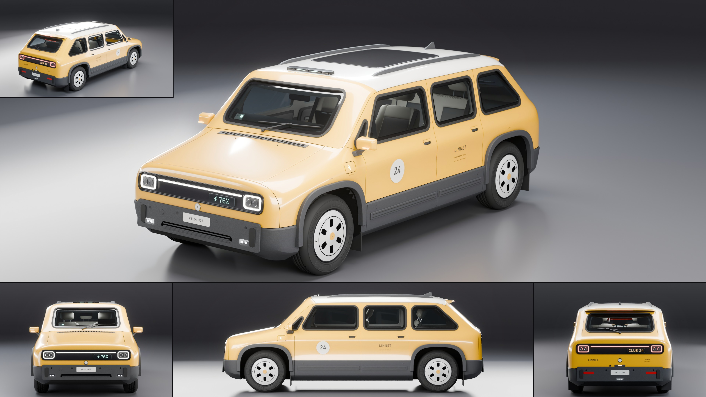
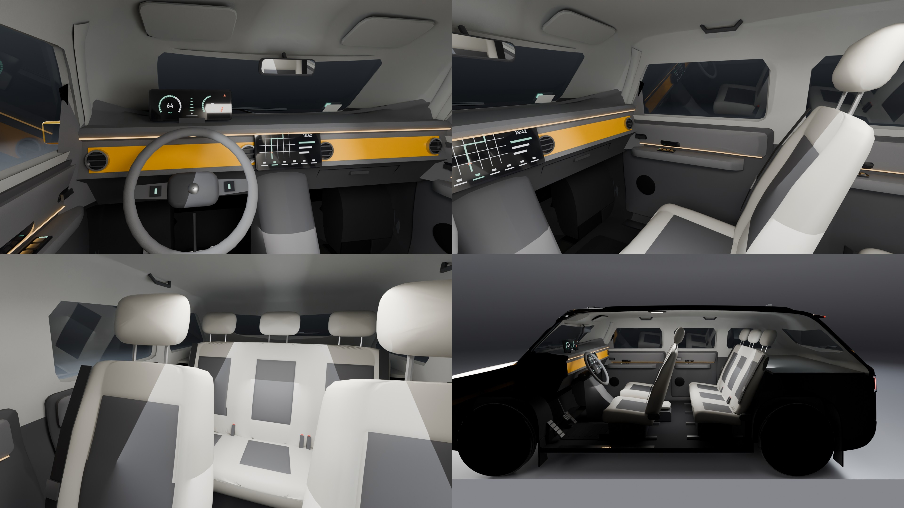

# Tanager Linnet

- **Brand, model, type:** Tanager Linnet, compact five-door hatchback, 5 seats (all names made up). The fourth Tanager: the car most people in the city drive, here as a drive club's unit 24.
- **Size:** 4.18 m long, 1.78 m wide over the arch trims (2.01 m over the mirrors), 1.55 m to the roof, 1.59 m over the antenna fin, wheelbase 2.74 m, wheels 0.67 m, ground clearance 0.18 m (0.11 m under the mud flaps).
- **Triangles:** 391,887 in 216 objects (body at subdivision 3; 319,531 in 147 before the full cabin).
- **Build:** `vehicles/blender.sh vehicles/cars/tanager_linnet.py --out docs/progress/AG18/tanager_linnet --sheet` (`LINNET_HULL=1` with `--preview` shows the bare hull; `--check --clay --zebra` wrote `check.json`, `clay.jpg` and `zebra.jpg` here).

## The design

- **A two-box hatchback in the family's soft box.** Twelve lines over twenty stations, nothing sharp but the cladding's step. Longer and lower than the Mino (4.18 m against 3.43 m, a roof no higher than its 1.55 m on a 0.3 m longer wheelbase and 0.67 m wheels, 1.59 m overall against 1.64 m): a hood that rises eleven degrees from a nose leaning back five, a windshield 45 degrees off upright standing right behind the front axle, a roof that arches 2 cm and falls toward the tail, a glass hatch leaning 47 degrees under a spoiler, a short ledge and an upright tail. A first roof stood at 1.58 m; it came down 3 cm with the glass before the sheet.
- **Flanks with form.** A soft shoulder runs under the belt from the front fender to the tail lamps (the widest line of the body), and the doors are drawn in 2 cm under it down to the cladding: the side catches one band of light on the shoulder and a second low on the doors. The hood has a low raised middle between the fender tops.
- **Cab forward, with quarter lights.** The front doors' sails carry a small triangular fixed pane ahead of the door glass; with the three panes behind it and the raked quarter window that follows the hatch, the side reads as a hatchback's, not a van's. Ten flat panes in rounded openings with fat seals and frit borders (Tanager's windows), a cabin you can read through them: five seats in warm grey, a dash with a wide screen and a cluster, a wheel, a headliner and pillar trims, a parcel shelf, a parking permit.
- **Visors.** Each end has Tanager's gloss black band under one clear lens: one light bar between two rounded lamps, here a lit ring round two reflector cups side by side (the Mino has three small ones in a row), and a dot-matrix display on the car's left (charge in front, CLUB 24 behind). Plain bumper plates in the grained plastic of the cladding, which now runs across the lower faces too, with rubber guards, sensors, fog lamps and an intake slot in front, reflectors, a reverse lamp, a lit hatch grip and a camera behind.
- **Hinged doors.** Four conventional doors by shut lines (3.5 mm) that also split the cladding and its bump strips door by door, pulls in cups cut into the shoulder, a charge door cut through the left front fender with a lit bolt, mirrors on feet under the quarter lights with a repeater in each pod.
- **Cap roof and its gear.** White down to the glass header, with low rails lying on its edges, a dark glass panel, a sensor brow over the windshield (three lenses, a lit status band), a fin antenna, and the hatch's spoiler in body color with the high stop lamp along its tip.
- **Show color:** custard yellow under the white roof, white wheel covers, charcoal plastic. No other car of the roster is yellow.

## How it was checked

- `--check`: tires `ok` (60 mm to the wells, the front pair steers 30 degrees; the kit's road tread folds on a 0.205 m tire and stood 7 mm under the ground, so the car brings three grooves that stay on the crown), ground `ok`, symmetry `ok` (the driver's wheel and screens, wipers, permit, displays, charge door, camera and lettering told as meant), panels `ok`, through `ok` (a first rear bench reached into the rear wells and a first headliner through the roof's rear corner: both cut back), triangles `ok`.
- Clay and zebra before the details and at the end (`clay.jpg`, `zebra.jpg`): the stripes run evenly along the flanks and over the roof and bend once at the shoulder. A first shoulder (crease 0.5, a 33 degree fold) broke into patches on the rear door, where the panels' bevel caught the fold on some edges and not on others; it is now a crease of 0.3 over a 28 degree fold, soft enough that the bevel catches none of it (no patches in the clay or the close-ups).
- Faults found in close-ups and put right: tabs of paint inside the window seals and a spike over a door pull (faces the cuts folded back, taken out on every painted panel), bumper pads dented where a ray fell into the gap between the face's paint and its cladding (the ends are laid on the hull before it is split, and the pads are plates in the face's own plane), the end of the cladding's step on each face, which subdivision drew 3 cm up into a hook beside the bumper plate (creased where it ends now), side glass that went white from behind (the fill light mirrored in it), a roof panel and a hatch glass that mirrored the top box.

## Cabin

The full interior from `vehicles/cabin.py` (`style="tanager"`), in place of the box seats and slab dash: `cab_fwd`, `cab_side`, `cab_back` and `cab_in` above (96 samples).

- **What it has.** A lined box from the firewall at the cowl to the hatch (the rear wells covered beside the boot), two comfort seats and a bench for three with charcoal inserts and marigold piping, a dark dash with a marigold inlay (the paint's) and round vents, a free-standing cluster, a landscape screen, a two-spoke wheel at 30 degrees, pedals, a console with a dial, door cards front and rear (LINNET lit on the front sills), a parcel shelf over the boot, dome light, visors, grab loops, mirror, mats; a trim over the narrow pillar between the quarter light and the door glass. The parking permit stays behind the windshield.
- **The lining's tears.** A first cabin showed spikes at the windshield's base and torn edges in the footwells and at the A-pillars' feet. Two causes: the module's spine stopped 0.45 m short of the firewall, so the cab-forward car's whole front (the raked glass's base, the pillars' feet, the footwells) lay in the front pole's fan, a ray every 9 degrees; and the belt (1.02 m, the side windows' sills) ran across the cowl, so headliner and trim alternated face by face in saw teeth. Now the spine runs to 4 cm from each end (`cap=0.04`), the lining's grid is 30 mm (`cab.step`, the seats stay at detail 1), the firewall stands at the cowl just ahead of the glass's base, the dash's top pad meets the glass (`tuck=0`), and the car's own `zone()` makes the footwells carpet up over the wheel wells, the cowl and the pillars' feet dark trim and the walls change color 0.9 m up, behind the door cards; the faces the module fills in behind the wells (label `fill`, trim by default) are carpet too, where they peeked round the well covers in grey.
- **Triangles.** Cabin 6,068 before, 78,424 now (lining 27,886, bench 18,228, front seats 7,588 each); the whole car 319,531 before, 391,887 now, under the kit's 400,000.
- **Check.** `--check` all `ok` (`check.json`): tires, ground, symmetry (the wheel, pedals, cluster, screen and the bench's belts for three told as meant), panels, through, triangles. The log's "through the shell" names only six faces of the front well covers at the arch's lip (28 mm, behind the fender and the tire, unseen: the module's known case).
- **Exterior.** Signed before and after: only `interior.*` objects, cabin materials and the studio's `cab*` lamps differ (and the light links' lists, by the interior objects in them).
- **Weakest from the driver's seat.** The quarter light frames the dark mirror foot outside; the A-pillar has small steps where its lining meets the glass; the seats read pale under the cabin lights.

## What I would improve

- The hood is still the plainest surface of the car: its raised middle is faint, and a cut service flap would want a finer hull there (the Mino's finding).
- The side glass reads dark in the pure side view even with a lamp in the cabin; the seats show from the three-quarter views.
- The mirrors' feet and arms are simple blocks, and the mirrors stand a little small from straight ahead.
- The nose and tail faces are flat planes; a little crown across them would make the ends less of a shield, but the visors' pads and the flat shading of the cut faces rely on the plane.
- The wheel wells are plain cavities.

## Kit wishes

- The kit's `"road"` tread needs a tire about 0.23 m wide or more: its outer grooves (0.24 of the width out, 12 mm half wide) pass the crown's end at 0.205 m as they do on Tanager's 0.165 m tires, the profile folds and the blocks stand 7 mm under the ground. A tread whose grooves scale with the crown, or a warning from `build_wheel`, would spare each car its own dict.
- `unfold()` (the Mino's: faces a cut and the gap's shrink fold back over their neighbors) was needed on every painted panel with a window or a pocket here, not only on the flat faces. It belongs in `build_body`, after the panels are split.
- A pad or bar laid with `on_body()` after the build falls into panel gaps (a dent where a ray meets a panel's rim). A way to keep the uncut hull's tree after `build_body` (`body.skin` as a target for `on_body(objs=...)` and for the brand's `skin()`) would let details that cross panels be laid at any time, not only inside `cutters()`.
- `rounded()` and Tanager's `pad()` with a radius per corner (a bumper plate square at the top and round below).
- The brand module could take the Mino's and this car's shared pieces: `visor()` (by half width, lamp and message), `small_lamp()`, `frame_on()`, `dense()`, `under()`, `unfold()`, `flatten()` and the window class with frit panes.
- A studio note in the README: the `fill` light is what a rear three-quarter view mirrors in upright side glass (`K.unlit("fill", ...)`), as the top box is in leaning glass.
