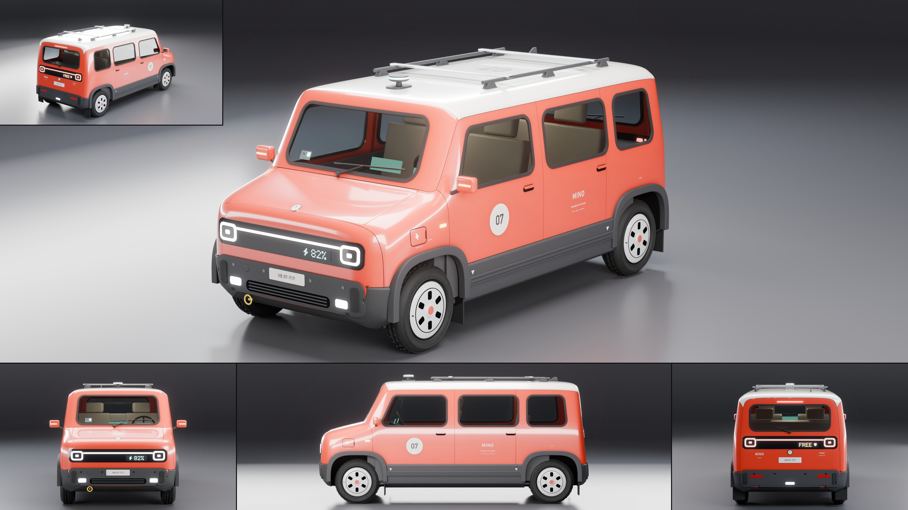

# Tanager Mino

- **Brand, model, type:** Tanager Mino, city car, 4 seats (all names made up). The first Tanager: it sets the family's cues.
- **Size:** 3.43 m long, 1.57 m wide over the arch trims (1.87 m over the mirrors), 1.55 m to the roof, 1.61 m over the rack and 1.64 m over the sensor puck, wheelbase 2.45 m, wheels 0.56 m, ground clearance 0.20 m.
- **Triangles:** 223,689 in 110 objects (body at subdivision 3).
- **Build:** `vehicles/blender.sh vehicles/cars/tanager_mino.py --out docs/progress/AG18/tanager_mino --sheet` (`MINO_HULL=1` with `--preview` shows the bare hull).

## The design

- A soft tall box: ten lines over sixteen stations, nothing sharp but the cladding's step. A short sloping hood, a windshield 27 degrees off upright, a flat roof, a tail that is one plane leaning six degrees; the wheels fill the corners.
- Flat glass all round in eight rounded openings, a cabin you can read through them: four oat seats, a dash with two screens, a wheel, a parking permit behind the windshield.
- A share car in service: fleet roundel 07 on the doors and the roof, zone and unit lettering, tire pressures over the arches, jack point arrows, a charge door with a lit bolt, a tow eye, one big wiper.
- Show color: scarlet coral under a white cap roof, white wheel covers, charcoal plastic.

## Tanager's signature cues (for the Cab and the Porter to repeat)

1. **The visor.** A gloss black rounded band across each end. In it one unbroken light bar between two rounded-rectangle lamp rings with a small lit core (the eyes), and under the bar on the car's left a dot-matrix display (5 x 7 glyphs: charge in front, hire state behind). White in front, red behind, same layout.
2. **Holes for windows.** Every window is a rounded-rectangle hole in the skin with flat glass set behind it and a fat black seal round it; pillars stay body color. Leading and trailing edges lean with the windshield and the tail.
3. **Cap roof.** The roof is a separate color down to the glass header and carries the job's gear on the same two rails: here cross bars and a sensor puck with a lit band.
4. **Squircle arches.** Wheel openings are flattened superellipses with a broad plain trim in the cladding's plastic. No bolts, no flares.
5. **Stepped cladding.** Grained plastic below a step that stands 13 mm out of the paint, one bump strip with two rubber lines along the doors, bumper pads with rubber corner guards on body-color faces.
6. **Steel wheels, slotted covers.** A flat cover with six rounded-rectangle slots, one groove and a cap in body color.
7. **Roundel and small print.** Fleet number in a round field on the front door and large on the roof, the model name in capitals, one line of service lettering, a round T badge on the hood's lip and the tailgate.

## What I would improve

- The hood is plain: a shut line for a service flap and washer jets would help. The mirrors are simple blocks.
- Side glass reads dark in the pure side view; a lighter headliner or more cabin light would show the seats there too.
- The bumper pads end in a small step where they meet the corner cladding; they deserve wrapped corners of their own.
- No door cards with pulls, no belts, no pedals; the wheel wells are plain cavities.

## Kit wishes

- Windows as holes: `build_body` could take cutters whose cut faces are dropped (here the `wincut` panel is deleted after the build), and the kit could carry this car's `Win` (cutter, flat pane and seal on the skin as built).
- `pad()`, `bar_on()` and `dots()` (a plate, a bar and a dot matrix lying on the skin) and a `text_on_body` for the nose and tail (`proj='x'`, `'X'`) are general.
- `on_body` rays slip through panel gaps now and then (`skin()` here looks beside a miss); a tolerance in the kit would spare every car that.
- Flat end caps: a note in the README that an uncreased cap shrinks a great deal (its one face pulls the ring inward) and that an inner ring station keeps the face full size; and that an uncreased line between unevenly spaced neighbors drifts toward the far one (the cladding's edge rose 10 cm across the tail until it was creased).
- A palette key for the cabin light, or a kit dome light, so tall glass cars show their cabins in side views.
