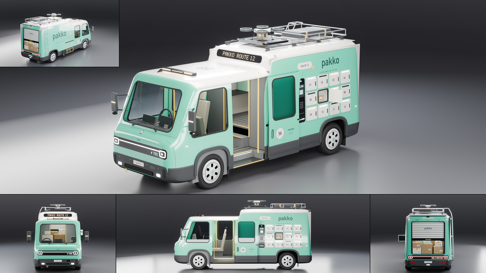

# Tanager Porter

- **Brand, model, type:** Tanager Porter, parcel delivery van (all names made up, the courier "pakko" too). 2 seats (the driver on the off side, a mate's seat facing back over the near wheel housing) plus a hold.
- **Size:** 5.30 m long, 1.91 m wide over the arch trims (2.39 m over the mirrors), 2.05 m to the cab's roof, 2.35 m to the hold's, 2.55 m over the rack and 2.70 m over the drone, wheelbase 3.4 m, wheels 0.68 m, ground clearance 0.225 m, cab floor 0.42 m over a 0.30 m step, hold floor 0.77 m.
- **Triangles:** 314,760 in 210 objects (body at subdivision 3).
- **Build:** `vehicles/blender.sh vehicles/cars/tanager_porter.py --out docs/progress/AG18/tanager_porter --sheet` (`PORTER_SHUT=1` builds it with both cab doors closed, `PORTER_HULL=1` with `--preview` shows the bare hull; close-ups: `--views door,lockers,tail,drone,nose`).

## The design

- **Two heights, three visors.** The family's soft tall box in two steps: a walk-through cab under a low cap roof and a taller hold behind it. The step between them is a brow that carries a third gloss visor, the route in amber dots (PAKKO ROUTE 12); the nose and tail keep the family's visor with a light bar between two lamp rings and a display on the car's left (charge in front, DELIVERING behind).
- **Parcel lockers in the kerb flank.** A bank of twelve white rounded hatches with numbers, pulls and status strips (ready, held, dark) beside a gloss kiosk with a screen, a code in dots, a keypad and a card slot. Number 06 is a real hole with a lit cell, a parcel in it and its hatch swung out.
- **The cab.** A sliding door each side on a track under the belt; the kerb side one is built open (its panels, glass, cladding, bump strip, roundel and lettering slid back 0.88 m) over a low step with a tread plate, yellow nosings and a lit riser. Inside: a ribbed floor, yellow grab posts, the driver's seat and wheel, two screens, a doorway through the bulkhead and a step up to the hold.
- **The back.** A roller door in a fat seal, rolled up to 1.40 m over a stack of taped and labelled parcels, shelves along the far wall, a sill plate; the bumper and the visor sit under it, the stop lamp, badge and a reversing camera over it.
- **Roof gear by job.** On the family's two rails: a drone dock with a lit ring and a small delivery drone on it (the family's face in small, a parcel in its claws), a rack with a guard rail and a strapped case, a ladder up the off side's rear corner; an amber beacon bar and the fleet number on the cab's roof.
- **Off side.** The courier's name large across the flank, a charge door, a folded hand truck clipped to the sill; mirrors on two arms with a kerb camera under each, both sides.
- **Family cues, all seven of the Mino's:** the visor, holes for windows with flat glass and fat seals (the roller door and the open locker are cut the same way), the cap roof with its gear on two rails, squircle arches, stepped grained cladding with a bump strip and rubber guards, steel wheels under slotted covers, the roundel (58), small print and the round T badge.
- **Show color:** spearmint under a white cap roof, dark ink lettering, orange and yellow working accents.

## What I would improve

- The lockers' status strips are thin: from the hero's distance the lit ones barely read. A lit frame round a ready hatch would show.
- The hand truck and the big wordmark live on the off side, so only the small rear tile shows them.
- The seats are plain blocks and the doorway's jambs are the panels' own rims, as on the Cab.
- The flat side glass mirrors a studio strip in the close views; the tail's upper corners show the white roof wrapping down as two ears.
- The drone's rotors are simple rings and blades; folding arms and a winch would make it a better machine.

## Kit wishes

- **A Tanager module** (`vehicles/tanager.py`): `Win`, `pad`, `bar_on`, `dots`, `dots_flat`, `banner` and its glyphs, `text_proj`, `grain`, the slotted wheel cover and the visor are now copied into three scripts.
- **`dots()` on a flank** writes mirrored text with `proj='y'` (the left side is read with x running right to left); a sign per projection in the helper would spare the reversed rows used here.
- **Holes with or without walls, one side or both:** `build_body` cutters that drop their cut faces, and a flag to cut only the left or the right (the open locker is on one flank).
- **Solving stations for built edges.** Subdivision draws an edge toward its neighbors; this script solves the door's two stations from where the edges should be built. `build_body` could take the built positions.
- **Interior parts that poke through the skin** are easy to miss (a liner stood through the brow and hid half its display): a check in `stats()` for non-body objects outside the hull would catch them.
