# AG18's vehicle packs in Unreal Engine 5.8

The first import of the game packs (`vehicles/GAME.md`) into Unreal, on the M4 Mac
(2026-11-11), through the exporter's vehicle library and placement entries
(`docs/unreal_export.md`, "AG18's vehicles").

## What was run

- **The packs:** seven of the 18 (the cases the contract has to cover): `vanta_r` (a standard
  wheeled car with brake calipers), `brakk_mule` (a large six-wheeled truck), `kestrel_dart`
  (a hover car: no wheels), `tanager_mino` (wheel covers), `aurel_prelate` (mirror-smooth
  paint, wheel covers, a glass roof), `orrin_aria` (a glass canopy of lower IOR) and
  `halcyon_ridge`.
- **The build:** a line-up of its own (no city: one 256 m tile of flat ground and a backdrop
  wall, written without Blender through the exporter's glTF writer) with a contribution of
  placement entries: three rows of the seven in their show colors and two other paint sets
  (pearl, black and cyan; magenta, graphite and lime), four Minos in one component each in
  its own paint, a bay per car for its pack's hero camera, and a Vanta-R with its front wheels
  steered 25 degrees.
- **The project:** a throwaway one from the First Person template, outside the repo.

```bash
.venv/bin/python -m citygen unreal BUILD PROJECT.uproject --no-play --no-hlod --no-atmos
.venv/bin/python -m citygen unreal BUILD PROJECT.uproject --check-only --check-vehicles --shots DIR
```

## Results

- **Import:** the seven cars made in about 65 s (textures, material instances, 48 meshes
  with four LODs each, 59 hulls), 12 placement actors and 208 instanced components holding
  226 part instances; imported again, nothing changed (18 actors unchanged, no package
  saved, 11 s). A pack remade (the two Aurels below) makes its car again and updates only the
  placements showing it (4 of 12); a placement moved updates only itself.
- **Meshes:** every part four LODs, no Nanite, triangles as the packs' (Unreal's build drops
  at most 0.3% as degenerate), the glass on its dark slot from LOD2, the body's hulls 7 to
  11 a car as `collision.glb` has them, every wheel mesh centered on its axle within 2 cm.
- **Placements:** every component's instances at their pivots within 1 cm, ids in order.
- **Collision:** traces down (9 a vehicle) and across (6) onto all 33 placed vehicles: every
  one hits the body, none a wheel or the glass.
- **Wheels:** a front wheel spun 40 degrees about its local y and steered 25 about its local z
  by script, in place (0 cm moved); its brake caliper steered without spinning.
- **Looks:** each car from its pack's hero camera against the pack's proof: paint, decals,
  lettering, lamps, wheels and glass as the proof has them (the studio's light differs).

What the engine showed, and what was fixed:

- **Glass in black and bright patches** (the Aurels' glass roofs, a little on the Vanta-R's
  windshield): the packs' glass is thick, two sheets, and from outside the far side's inner
  sheet faces the viewer through the near outer one; translucency drawn in triangle order
  composited them in patches, and each sheet shadowed the other. The glass master now leaves
  out the faces pointing toward the car's middle, the glass casts no shadow, and the
  transmittance is the glass color squared (the proof's ray crosses both sheets): the
  Prelate's roof is dark and glossy as in its proof.
- **The default material's checker on the glass:** the glass master was rebuilt in place and
  kept the old thin translucent output beside the new one (a material takes one), so it
  failed to compile; it is now made anew.
- **LOD3 hull stand-ins without a material** (the two Aurels): a glTF primitive with none.
  Fixed in `vehicles/game.py` (a hull wears its part's material); both remade with
  `--lods-only`.
- **LOD0 without tangents** (every pack's body, every Tanager part): Unreal computes them
  (MikkTSpace) for every LOD; noted in `GAME.md`.
- **Half float UVs:** the importer keeps them at full precision.
- **A dark first view after the night:** the scene takes seconds to light again; the check
  shoots everything by day first.

Open: the dark glass from LOD2 shows its collapsed shape on the Prelate (wavy against the
roof line), and its sill flutes thin out from LOD1 (the pack's LODs, as their proof shows);
the night's light is the play features' fixed exposure and a dim sun, not atmosgen's; the
lamps cast no light (AG18's improvement 8); from inside the cabin the glass is invisible (the
inner sheet is left out).

## Shots

| | |
|---|---|
| 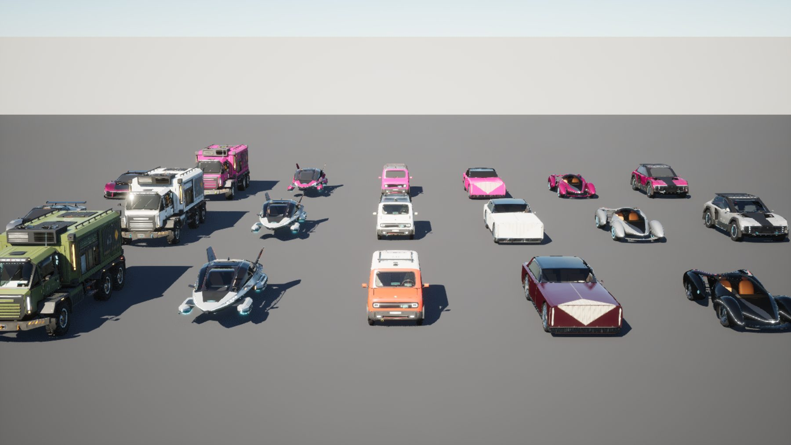 | the line-up by day: show colors at the front, then two other paint sets, from the same meshes and material instances (the paint is per-instance custom data) |
| 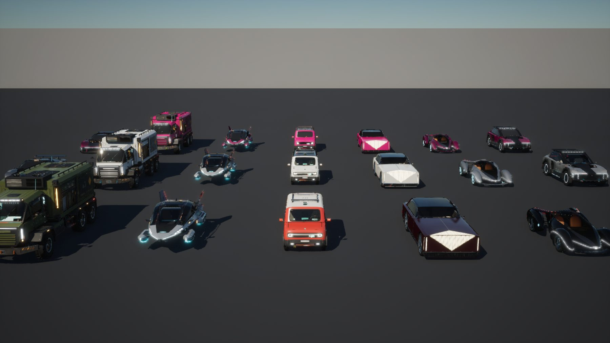 | the same by night (`MPC_CityGen`'s Night, a dim sun, the night's fixed exposure): lamps, light strips and wheel rings glow |
| 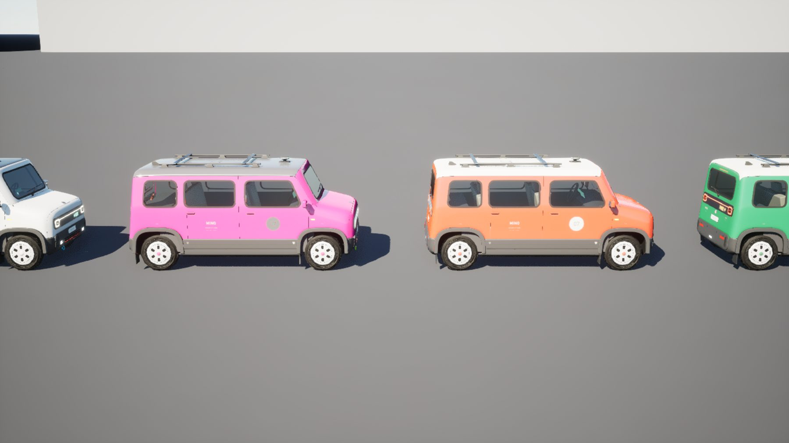 | four Minos, one instanced component per part, each instance its own paint |
| 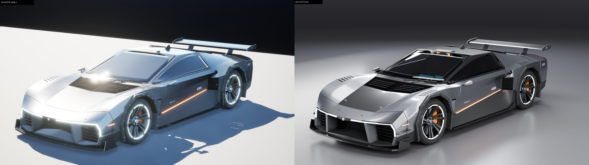 | the Vanta-R from its pack's hero camera beside the pack's proof (Cycles) |
| 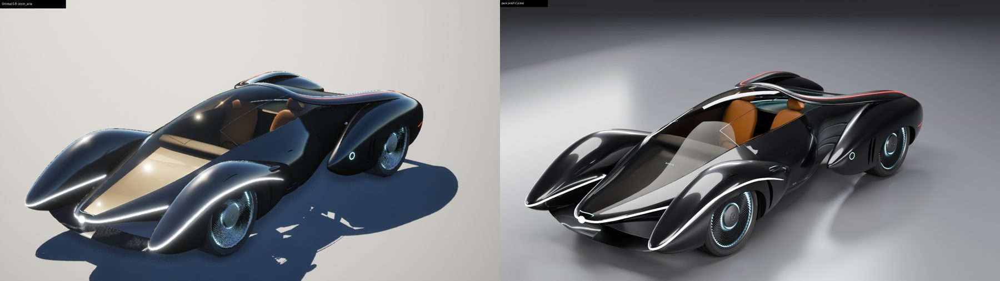 | the Aria: its canopy (IOR 1.14) thin translucent |
| 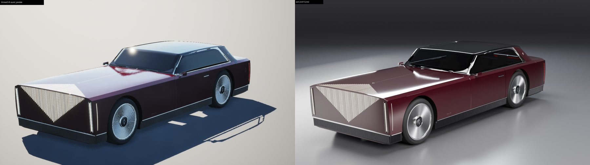 | the Prelate: mirror-smooth paint, its glass roof dark as in the proof |
| 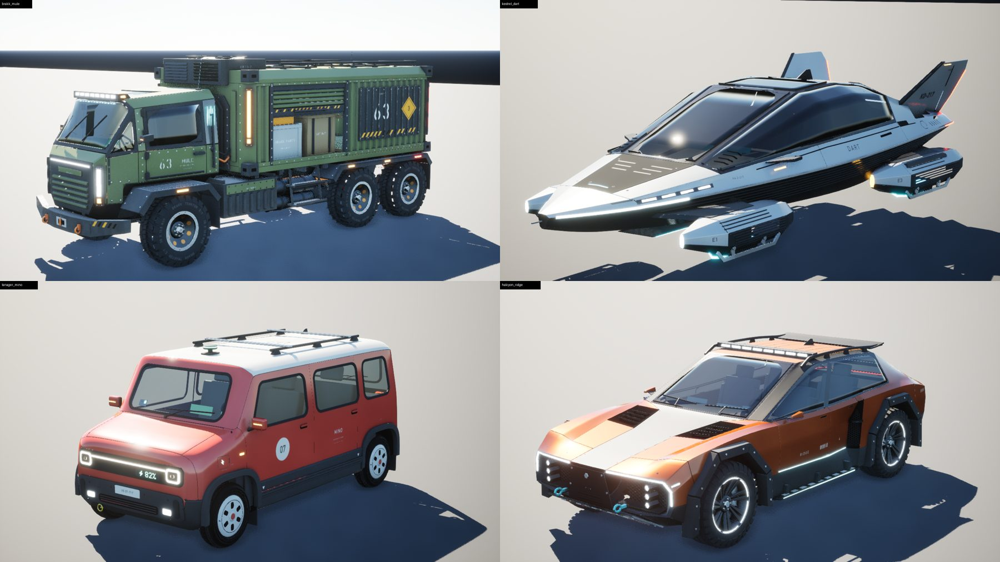 | the Mule, the Dart, the Mino and the Ridge by day |
| 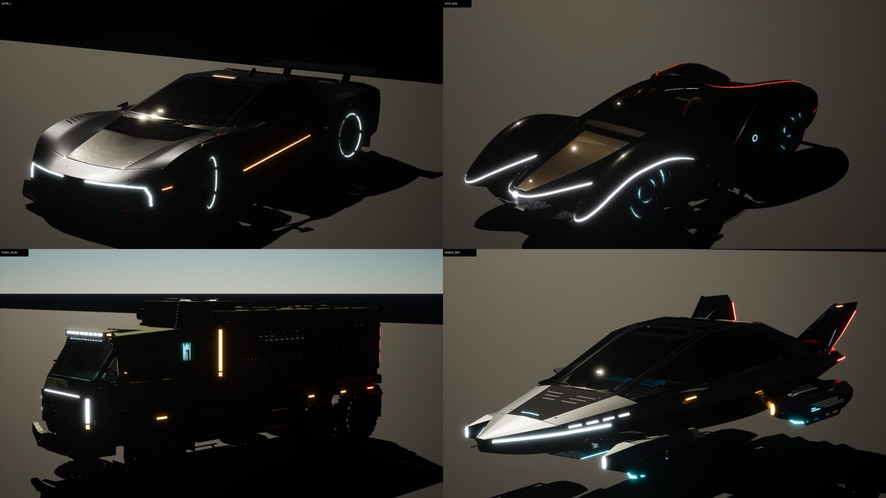 | four by night |
| 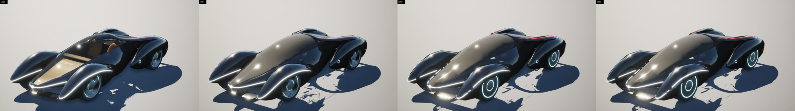 | the Aria at LOD0 to LOD3, each forced: from LOD2 the glass dark and opaque, no cabin |
| 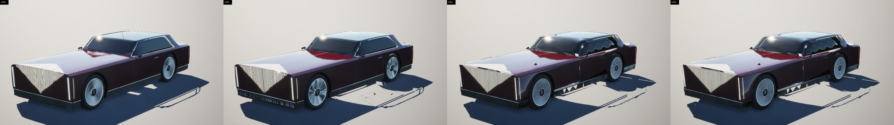 | the Prelate at LOD0 to LOD3 |
| 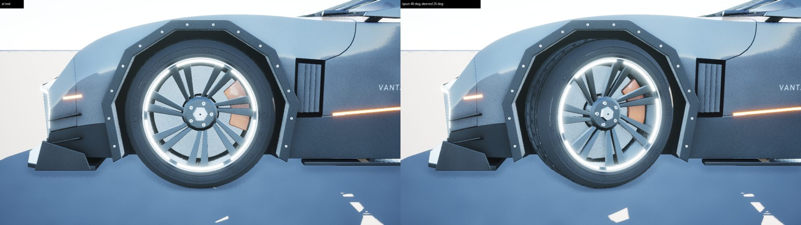 | a front wheel at rest and spun 40 degrees about its axle and steered 25 degrees by script: it turns about its pivot, the caliper steers with it and does not spin |
| 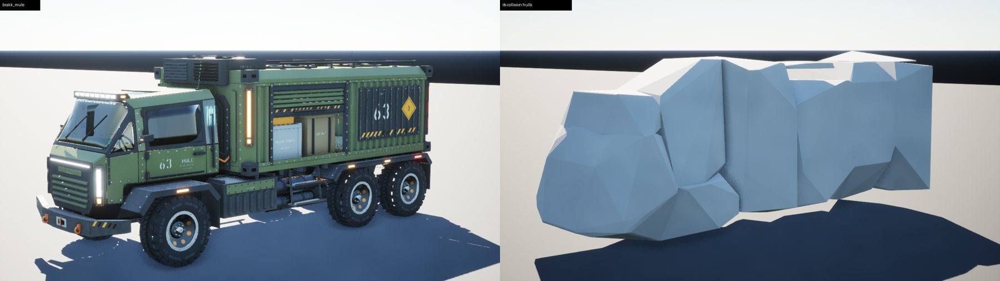 | the Mule and its collision hulls, drawn from the pack's `collision.glb` in place of its body |
