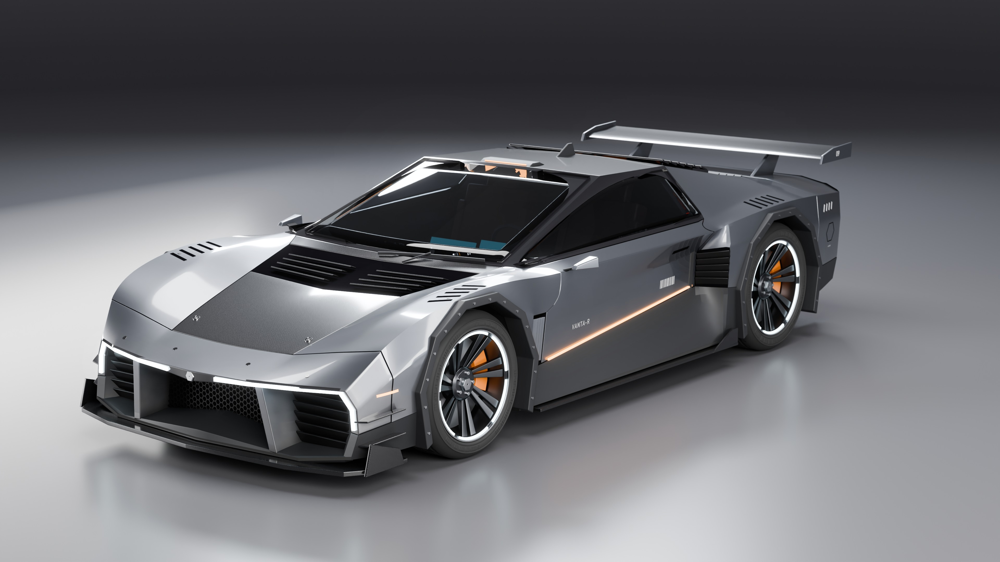
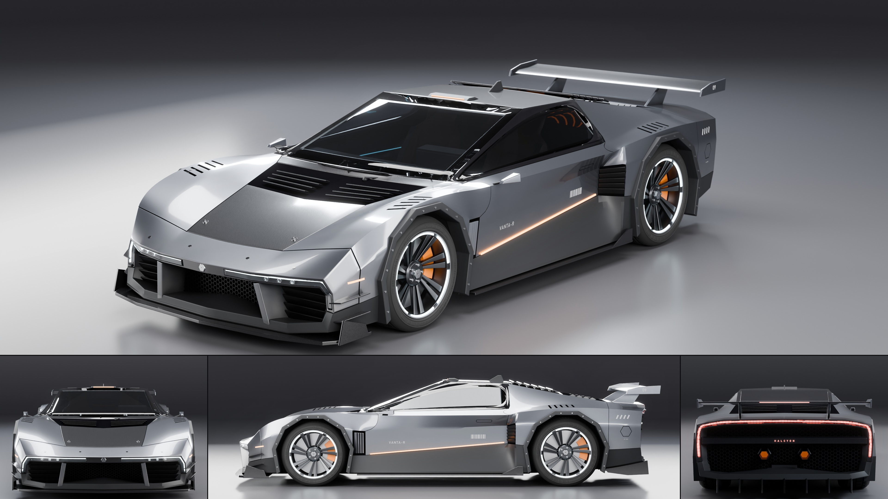
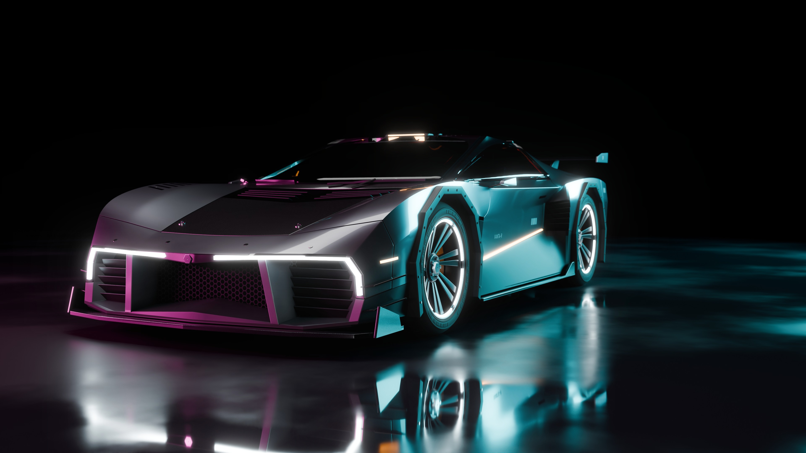

# AG18: Halcyon Vanta-R, the first hero car

One car modelled to a far higher standard than the extruded profiles the parked cars are
today, the first of AG18's hand-designed vehicles (`docs/assetgen_scope.md`, 14.19). It is
not a generator: one design, built by a Blender script, with nothing of it wired into the
generators yet.





## The car

Halcyon Vanta-R (both names made up): a mid-engined wedge, 4.69 m long, 2.06 m wide over the
mirrors, 1.19 m high, 2.72 m wheelbase, on 0.70 m and 0.74 m wheels. Titanium paint on the
flanks, a carbon spine from the nose over the roof to the tail, dark cladding low down.

- Body: nine character lines over twelve stations, a creased subdivision surface, cut by
  the wheel wells and split into 21 panels with real gaps and bevelled edges.
- Front: a lip with a light strip that turns down each corner, a honeycomb intake between two
  struts, slatted side ducts, splitter with end plates, canards.
- Side: octagonal bolted arch trims, a scoop ahead of the rear wheel, fender louvres, vent
  behind the front wheel, sill light line, skirt blades, camera pods for mirrors, a flush
  door handle, charge flap, lettering.
- Rear: a light bar round the whole tail, honeycomb panel, a beam with the maker's name, two
  hexagonal exhausts, plate, diffuser fins, wing with end plates, louvres over the glass
  engine cover and a power unit under it.
- Wheels: tires with tread blocks, grooves and sidewall lettering, seven twin-spoke rims with
  a machined lip and a light ring, discs and calipers.
- Cabin: tub, dash, console, two seats, wheel, screens, behind tinted glass.

About 240,000 triangles in 93 objects (the two honeycomb meshes are about 60,000 of them).

## Step B: lamps, cut lines, glass (2026-11-12)

The first car on step B's kit (`docs/assetgen_milestones.md`, AG18, step B). The sheet,
clay, zebra and check above are of this build.

- Front lamps: a channel 38 mm wide and 55 mm deep cut into the band under the lip, turning
  down each corner, under a clear lens with the body's gap round it; inside, a light guide in
  a frosted sleeve along the whole run and three projector lenses on the outer stretch.
- Tail lamp: one channel round the whole tail under a red lens, its corners rounded; a red
  guide and bright ribs behind it.
- Cut lines: the flush door handles and the hexagonal charge flaps are cut through the skin
  (they were strips lying on it), the ten slots over the wheels are pockets 20 mm deep.
- Gaps: 3.5 mm shut lines everywhere (2.4 mm before).
- Glass: the side and rear panes with a black frit border as part of the glass; the
  windshield with a gloss frame made on one side and mirrored (the old frames were 4 to 14 mm
  off at their corners and faced into the car). Frit on the windshield showed shards of
  reflection where its top rows curve into the roof crease, which a frame covers.
- Wiper: a boss at the cowl, a tapered arm, a yoke and a rubber blade lying on the glass.
- The light bands round the mouth and the tail are 58 mm wide all round (`even=True`), so
  the channels sit in their middle.
- About 305,000 triangles (240,000 before; the lamps 24,500 of them).

## Cabin (2026-11-24)

The first car on the shared cabin module (`vehicles/cabin.py`, style `halcyon`; guide in
`vehicles/README.md`, "Cabins"), in place of the schematic tub, box seats, ring wheel and
slab screens. What it has: a lining cast on the car as built (a flat carpeted floor and
firewall, a bulkhead behind the seats with a smoked window into the engine bay behind a
frame, a dark headliner, the A-pillars lined over the glass's frit, reveals to the glass);
two buckets with integrated headrests, carbon backs, inserts and seams, belts with reels and
buckles, on rails; a dash wrapped toward the driver with hex vents, defrost slots, a light
strip and a glovebox line; a hooded cluster kept under the raked windshield and a screen
turned to the driver; a flat-bottomed three-spoke wheel with a hex emblem on a column with
stalks; pedals and a dead pedal; a console with a toggle selector, switches, cupholders and
an armrest; door cards with strap pulls, switch packs, speakers and map pockets; lit
"VANTA-R" sill plates; visors, an inside mirror, a dome light; mats. `cabin.jpg`: the four
interior views (`cab_fwd`, `cab_side`, `cab_back`, `cab_in`). Triangles: the cabin 3,376
before, 36,247 now (the car 304,609 before, 337,480 now). The exterior's fingerprint
(`signature.py`) is unchanged but for the `interior.*` objects, the cabin's materials (and
the kit's `mirror`) and the interior views' lamps (0 W in every other view). `check.json`:
`look` for the same exterior findings as before (front tires 12.8 mm from the wells and
steering 0 degrees, `body.lightband` 8 mm off its mirror image); the cabin's one-sided
parts and the single wiper are marked meant; nothing of the cabin is in the open.

## Files

| File | What |
|---|---|
| `vehicles/cars/vanta_r.py` | the car's own design, built on the kit in Blender 5.2 |
| `vehicles/carkit.py` | the shared kit: materials, body builder, wheels, studio, cameras, renders (`vehicles/README.md`) |
| `vehicles/blender.sh` | the wrapper every build runs through, one Blender job at a time |
| `vehicles/post.py` | bloom on a render, and putting a sheet's tiles together (PIL, numpy) |
| `car.blend` | the built scene: car, studio, cameras, procedural materials (`--blend`, not in git) |
| `car.glb` | the car alone, modifiers applied, flat PBR values per material (`--glb`, not in git) |
| `car_hero.jpg`, `car_rear.jpg`, `car_side.jpg`, `car_front.jpg`, `car_back.jpg`, `car_top.jpg` | studio views, 3840 x 2160 |
| `car_wheel.jpg`, `car_nose.jpg`, `car_tail.jpg` | close-ups |
| `car_low_night.jpg`, `car_rear_night.jpg` | night views on a wet floor |
| `sheet.jpg` | hero with front, side and back, each rendered at its tile's size (`--sheet`) |

## Run

```
vehicles/blender.sh vehicles/cars/vanta_r.py --out OUT --preview
vehicles/blender.sh vehicles/cars/vanta_r.py --out OUT --sheet [--night]
vehicles/blender.sh vehicles/cars/vanta_r.py --out OUT --views hero,rear,side \
    --res 3840 2160 --samples 160 [--night] [--blend] [--glb]
.venv/bin/python vehicles/post.py bloom OUT/car_low_night.jpg OUT/car_low_night.jpg 1.0 0.8
```

Views: `hero`, `rear`, `rear_l`, `side`, `front`, `back`, `top`, `low`, `wheel`, `nose`,
`tail`, `cabin`. The build takes under a second, the preview about ten seconds, the sheet
and a 4K view about two minutes each on the M4.

## Where it stands against a shipped game car

It reads well at the distances a street scene shows a car. It is not yet a game asset:

- No UVs and no baked textures. Paint flake, dust, grime in the creases and the carbon weave
  are procedural shader nodes, so the `.glb` carries flat values only.
- No LODs, no collision, no damage states. The wheels are separate objects on their axles,
  so they can turn, but nothing is rigged (doors, wing, suspension).
- Close-ups show the limits: lights are plain emissive strips with no lens or reflector, the
  cabin is blocked in, panel lines such as the door handle and charge flap are thin strips
  lying on the surface, and the underside is a flat floor.
- One design. A generator would need the stations and lines as parameters (they already are
  the model's only inputs for the body) and families of noses, tails, wheels and trims.
