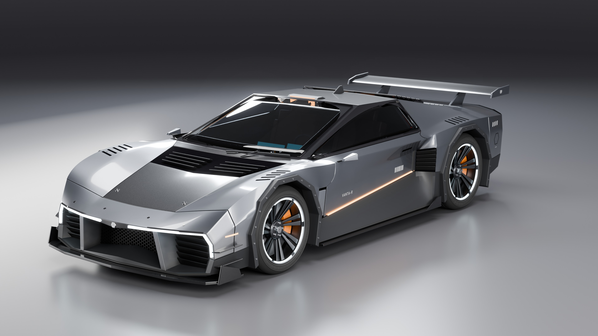
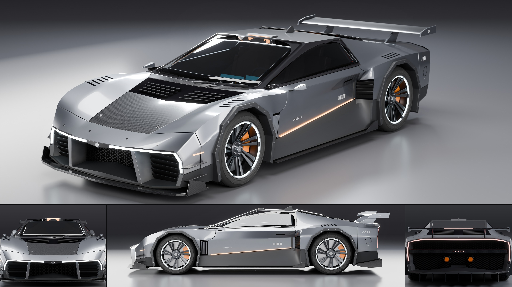
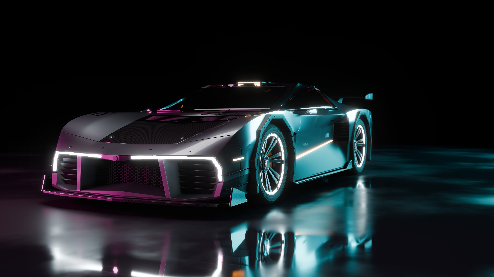

# AG18: Halcyon Vanta-R, the first hero car

One car modelled to a far higher standard than the extruded profiles the parked cars are
today, the first of AG18's hand-designed vehicles (`docs/assetgen_scope.md`, 14.19). It is
not a generator: one design, built by a Blender script, with nothing of it wired into the
generators yet.





## The car

Halcyon Vanta-R (both names made up): a mid-engined wedge, 4.69 m long, 2.06 m wide over the
mirrors, 1.19 m high, 2.72 m wheelbase, on 0.70 m and 0.74 m wheels. Titanium paint on the
flanks, a carbon spine from the nose over the roof to the tail, dark cladding low down.

- Body: nine character lines over twelve stations, a creased subdivision surface, cut by
  the wheel wells and split into 21 panels with real gaps and bevelled edges.
- Front: a lip with a light strip that turns down each corner, a honeycomb intake between two
  struts, slatted side ducts, splitter with end plates, canards.
- Side: octagonal bolted arch trims, a scoop ahead of the rear wheel, fender louvres, vent
  behind the front wheel, sill light line, skirt blades, camera pods for mirrors, a flush
  door handle, charge flap, lettering.
- Rear: a light bar round the whole tail, honeycomb panel, a beam with the maker's name, two
  hexagonal exhausts, plate, diffuser fins, wing with end plates, louvres over the glass
  engine cover and a power unit under it.
- Wheels: tires with tread blocks, grooves and sidewall lettering, seven twin-spoke rims with
  a machined lip and a light ring, discs and calipers.
- Cabin: tub, dash, console, two seats, wheel, screens, behind tinted glass.

About 240,000 triangles in 93 objects (the two honeycomb meshes are about 60,000 of them).

## Files

| File | What |
|---|---|
| `vehicles/cars/vanta_r.py` | builds the car, the studio and the renders in Blender 5.2 |
| `vehicles/post.py` | bloom on a render, and the turnaround sheet (PIL, numpy) |
| `car.blend` | the built scene: car, studio, cameras, procedural materials (`--blend`, not in git) |
| `car.glb` | the car alone, modifiers applied, flat PBR values per material (`--glb`, not in git) |
| `car_hero.jpg`, `car_rear.jpg`, `car_side.jpg`, `car_front.jpg`, `car_back.jpg`, `car_top.jpg` | studio views, 3840 x 2160 |
| `car_wheel.jpg`, `car_nose.jpg`, `car_tail.jpg` | close-ups |
| `car_low_night.jpg`, `car_rear_night.jpg` | night views on a wet floor |
| `car_sheet.jpg` | hero with front, side and back |

## Run

```
"/Applications/Blender 5.2.app/Contents/MacOS/Blender" -b -P vehicles/cars/vanta_r.py -- \
    --out OUT --views hero,rear,side --res 3840 2160 --samples 160 [--night] [--blend] [--glb]
.venv/bin/python vehicles/post.py bloom OUT/car_low_night.jpg OUT/car_low_night.jpg 1.0 0.8
.venv/bin/python vehicles/post.py sheet OUT OUT/car_sheet.jpg
```

Views: `hero`, `rear`, `rear_l`, `side`, `front`, `back`, `top`, `low`, `wheel`, `nose`,
`tail`, `cabin`. The build takes under a second; a 4K view takes about two minutes on the M4.

## Where it stands against a shipped game car

It reads well at the distances a street scene shows a car. It is not yet a game asset:

- No UVs and no baked textures. Paint flake, dust, grime in the creases and the carbon weave
  are procedural shader nodes, so the `.glb` carries flat values only.
- No LODs, no collision, no damage states. The wheels are separate objects on their axles,
  so they can turn, but nothing is rigged (doors, wing, suspension).
- Close-ups show the limits: lights are plain emissive strips with no lens or reflector, the
  cabin is blocked in, panel lines such as the door handle and charge flap are thin strips
  lying on the surface, and the underside is a flat floor.
- One design. A generator would need the stations and lines as parameters (they already are
  the model's only inputs for the body) and families of noses, tails, wheels and trims.
