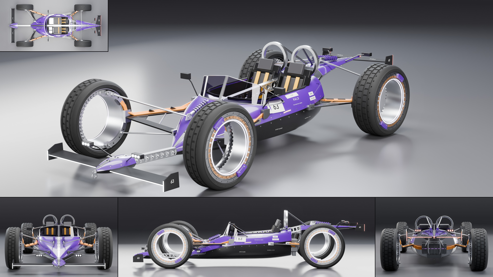

# Vex Halo

- **Brand, model, type:** Vex Halo, hubless roadster, 2 seats side by side in one open pit
  behind a wraparound screen. The second Vex, the Wraith's sibling.
- **Size:** 4.31 m long, 1.98 m wide over the wheels, 1.02 m high (the head rings),
  wheelbase 2.70 m, wheels 0.80 m (the hole in each is 0.48 m), belly 90 mm over the ground.
- **Triangles:** 234,714 in 100 objects. Show color: gloss violet caps on bare weave and raw
  metal, amber belts and feeds.
- **Build:** `vehicles/blender.sh vehicles/cars/vex_halo.py --out docs/progress/AG18/vex_halo --sheet`

## The design

- **Four open rings.** Each wheel is the kit's tire on a rotating rim whose outer lip is the
  brake rotor (24 bolts), and inside it a fixed ring: 36 copper stator segments in a channel,
  a light line on its face and another in its bore, two pad carriers in the body color
  clamped on the lip, 48 cooling fins inboard, a conical bore. Nothing in the middle: in the
  side view the far ring and the studio show through both axles.
- **The X.** Every ring is held from its inboard side only, by a bolted crescent on the half
  of the ring that faces the body (kingpin ends at its tips) on one weave A-blade. A pushrod
  runs from each crescent to a rocker and a coil-over lying on the body beside the spine;
  three amber phase cables run along each blade and round the crescent to a gland on the ring.
- **A drop in three pods.** A low bow pod ahead of the front rings, the tub (a shovel nose
  that falls to a tip, widest at the seats), and a dart of a tail that passes over the rear
  rings to a point. No motor behind the seats: an inverter on the tub's bulkhead instead.
- **The spine** is inlaid and bolted on all three pods, jumps the front gap low as the keel
  beam, crosses the cockpit as the drilled beam between the two seats, and jumps to the tail.
- **Halos.** A bolted metal ring behind each head instead of a hoop, stayed to the tail;
  whiskers on the bow and a flat feather through the tail's tip carry the hairline strips.

## Family cues kept from the Wraith

Pods that never touch, weave below a sharp crease and a color cap above, flat machined
bulkheads where the spine enters and leaves, the drilled beam (`drilled`), blades, rods and
rings as the only structure, three-dot clusters on stalks (`cluster`), the race number on a
light plate, the model name beside it, the same made-up sponsors (`block`), springs and
brakes in the body color. New for the family: the crescent and A-blade, the ring wheel
(`build_ring_wheel`), ring hoops.

## What I would improve

- The fixed rings do not steer: the kingpin is only two lugs, and there is no rack to see.
- The tub's rear bulkhead is a plain plate behind the inverter; the back view is the weakest.
- The pit is plain inside (flat walls, no door cut; the way in is over the step plates).
- The tub's weave flank is flat black at sheet scale, as on the Wraith.

## Kit wishes

- `build_wheel(..., drum=None)`: the kit always closes a wheel's middle with a drum; this car
  deletes that object after the call. A ring wheel in the kit would serve the Strix too.
- The Wraith's wishes again: `tube` along a path, `ring`, the drilled beam and a top
  projection for `text_on_body` are copied into a second script now.
- A cutter worked well as a cockpit (one pit across the centerline, which `recesses` cannot
  make); a line in the guide saying so would help the next open car.
- `Geo.lathe` arcs take radians and `rot` takes matrices of either size; a note on angle
  units per helper would save a look at the source.
