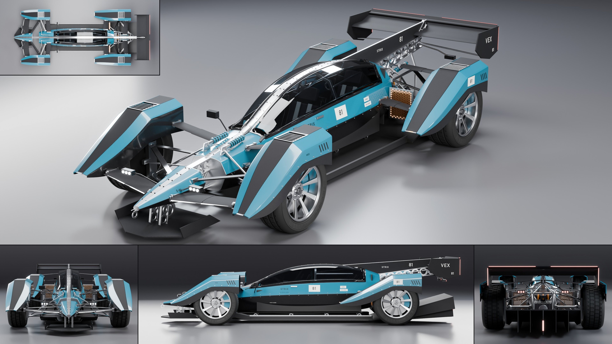

# Vex Strix

- **Brand, model, type:** Vex Strix, track hypercar, 2 seats in tandem under one canopy. The
  third Vex: the family's closed car and its most extreme.
- **Size:** 4.97 m long, 2.04 m wide over the fenders, 1.09 m high (the wing's endplates;
  the canopy is 0.975 m), wheelbase 2.90 m, wheels 0.72 m in front and 0.74 m behind, floor
  55 mm over the ground.
- **Triangles:** 269,910 in 98 objects. Show color: gloss arc cyan caps on bare weave and
  raw metal, white belts, orange phase cables.
- **Build:** `vehicles/blender.sh vehicles/cars/vex_strix.py --out docs/progress/AG18/vex_strix --sheet`

## The design

- **A fuselage and four outriggers.** The fuselage is 0.68 m wide, just the two occupants
  one behind the other; every wheel lives in a fender pod of its own that stands 0.26 to
  0.30 m clear of it. In the top tile and the front view the studio floor shows between fuselage
  and fenders, all the way down the car.
- **Wing-section arms.** Each fender is held by two weave arms of wing section with bolted
  raw metal roots, and nothing else. The front pair's fore arms are the car's canards (nose
  pod to fender tip, a hairline strip on the leading edge); wishbones, pushrods and half
  shafts cross the same gaps in plain sight.
- **Fenders as wedges.** A knife tip, a straight top line to a peak behind the axle, a
  level run to an open back with a lip: the tire's whole tread shows from behind. A bare
  weave band runs down each top with a louvred hole in it over the tire (a real hole: the
  tread shows between the slats), painted chamfers either side, gills on the outer cap.
- **The spine.** Inlaid and bolted on the needle nose pod, the Vex drilled beam across the
  0.24 m gap to the fuselage, a bolted metal rib over the canopy that splits the glass in
  two, then a drilled fin under a weave plate to a swan neck over a high wing.
- **Nothing skinned behind the cabin.** A tube frame round a finned motor and its reduction
  gear, an inverter with lit seams, orange phase cables, two bare copper radiator cores
  standing in the gaps, coil-overs lying under the fin; all of it over two venturi tunnels
  (mouths kicked up beside the nose keel, low fences) that end in a diffuser 0.43 m tall.
- **Cabin.** A faceted fighter canopy over two weave shell seats, a yoke and screen for the
  driver, a screen and grab bar for the passenger, an arch hoop between them; hinges on the
  right sill, a release on the left.

## Family cues kept

Pods that never touch (nose, fuselage, four fenders), weave below a sharp crease and a color
cap above, flat machined bulkheads, the drilled beam (`drilled`) for every jump, pylon and
the fin, blades, rods and rings as the only structure, three-dot clusters on stalks
(`cluster`), hairline strips on wing edges only, the race number on light plates, the model
name beside it, the same made-up sponsors (`block`), nine-blade raw wheels, springs and
brakes in the body color. New for the family: the canopy with the spine over it, the wedge
fender, the wing-section arm (`arm`).

## What I would improve

- The front fenders are fixed to the fuselage, so there is room for little steering lock (a
  track car); fenders on the uprights with a link would be truer.
- The canopy's facets catch the top light as white shards near the screen's base; the glass
  has no shut line of its own, only the hinges and the release say how it opens.
- The diffuser reads as one dark wedge from the side; the tunnels' roofs under the fuselage
  are only visible from low down.
- Fender interiors are bare shell; no liner, brake duct or wiring to the amber markers.

## Kit wishes

- `on_body()` sees every body piece by default, so with pods outboard of the main body a
  flank projection lands on the pod's outer wall (arm roots, pickups and lettering did, until
  the fenders were built with `project=False`). A line in the guide, or `on_body(...,
  nearest_to=y)`, would save the next multi-pod car a sheet.
- The family's helpers again (`tube` along a path, `ring`, `drilled`, `cluster`, `block`):
  three scripts carry copies now.
- A panel that is a real hole (`pmat` value `None`): here the louvred opening is built, then
  its object is deleted.
- Paint input values render much lighter than they read (this cyan took three tries); a
  table of show colors with their inputs, or a swatch view, would save previews.
- A dry weave in the kit: `carbon` goes white on a sloped face against the rim light (the
  fender bands did in the first sheet), each Vex script builds its own `weave`.
