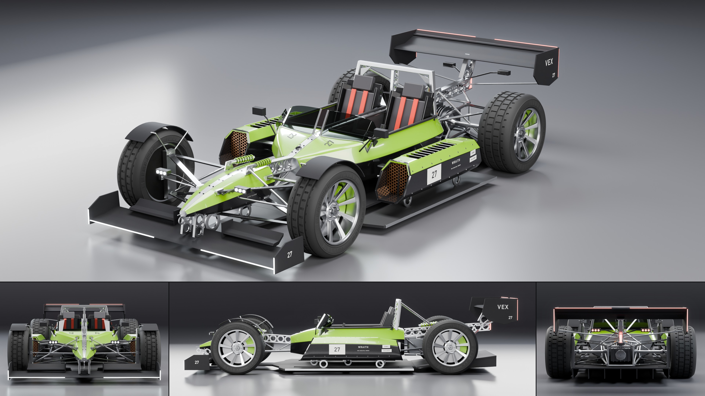

# Vex Wraith

- **Brand, model, type:** Vex Wraith, open-wheel speedster, 2 seats side by side behind a low
  screen. The first Vex, so it sets the family's look.
- **Size:** 4.37 m long, 2.01 m wide over the wheels, 1.00 m high (the hoop), wheelbase
  2.78 m, wheels 0.70 m in front and 0.72 m behind, floor 58 mm over the ground.
- **Triangles:** 244,676 in 98 objects (the four wheels are about half of it). Show color:
  gloss signal green caps on bare weave and raw metal.
- **Build:** `vehicles/blender.sh vehicles/cars/vex_wraith.py --out docs/progress/AG18/vex_wraith --sheet`

## The design

- Four pods that never touch: a needle nose pod, a boat-shaped cabin tub, two side pods with
  a radiator core in each mouth and slats over its exit. 12 cm of air between tub and side
  pods (the floor is slotted under it, so the ground shows from above), 0.38 m between nose
  and tub, 0.22 m between the tub and the rear wheels.
- The cabin is two cells, one each side of the spine, each with its own seat shell, belts,
  screen and padded rim; the driver's yoke is on the left. The screen is two low arcs that
  meet at the spine. A hoop behind both heads with a drilled post on the spine.
- Nothing is skinned behind the tub: a tube frame round a finned motor and its reduction
  gear, half shafts, a ribbed cell pack with lit seams, three orange phase cables, coolant
  lines from the side pods, the loom clipped along the boom.
- Wheels stand outside on weave blade wishbones with pushrods, rockers and coil-overs lying
  on the nose pod and the boom; cycle fenders over the fronts only, on stays from the upright.
- A slotted floor, a diffuser with seven strakes, a full-width front wing on two drilled
  pylons, one deep rear plane on the spine's mast with endplates behind the wheels.

## Vex family cues (for the Halo and the Strix)

1. **The spine.** One raw metal member from nose to tail. On every pod it is an inlaid strip
   with two rows of dark bolts (`panel "spine"`, the first interval of every pod's cage); in
   every gap it becomes the Vex beam (`drilled`): two flanges and a web of rings, so the
   holes are real and light comes through. The same beam, smaller, is every pylon, post and
   mast.
2. **Pods as capsules with a color cap.** Each pod is closed, bare weave below its widest
   line and body color above it, the two split by a sharp crease; flat machined bulkheads
   where the spine enters and leaves. No pod touches another or the floor.
3. **Standoffs.** Pods ride on the floor on single drilled rings and are tied to each other
   only by flat blades and thin rods. Anything that carries load is a blade, a round rod or a
   drilled beam, never a fairing.
4. **Side pod.** An eight-sided capsule (`POD_SEC`) with a raked mouth, a copper honeycomb
   core set back in it, slats over a sunk exit on top, three vanes in the outlet.
5. **Lights.** Three-dot clusters on stalks (`cluster`: white on the nose, red on the mast)
   and hairline strips on wing edges only (front leading edge, rear trailing edge, down the
   endplates), a rain light on the end of the boom.
6. **Lettering.** The race number on a light plate on each side pod and bare on the
   scuttle and the endplates; the model name beside it; small sponsor-like plates with dark
   words (`block`); the maker's name on the rear endplates.
7. **Wheels.** Nine single blades in raw metal, no light ring, calipers in the body color.

## What I would improve

- The cells are plain inside: no pedals to speak of, no door or step, flat walls.
- The side pod's slats mirror the top light in the rear three-quarter view.
- Wishbone pickups are plain blocks; the fenders' stays and the mirrors are simple.
- The pods' flanks are flat black at sheet scale; a coarser weave would read.

## Kit wishes

- `Geo.tube` (a round section along a path, the up vector chosen for you), `Geo.ring` and a
  drilled beam: this car is made of them, and so will the next two Vex be.
- A recess that takes several quads as one opening, and one that is not split at the
  centerline, for cockpits (here the split is the design, but only by luck).
- `text_on_body` for the `'z'` projection (`text_top` here), as the Dart asked too.
- A second weave material with no coat: the kit's `carbon` turns silver on a flat plane
  seen at a grazing angle against the rim light (the rear wing did).
- Thin glass slabs need `sharp=` rather than `shade_smooth`, or they render as a lens; a
  `Geo.glass_strip` or a line in the guide would save the next car a render.
- `build_wheel(..., bright=)` also colors the hub nut and rim lip; a separate `hub` argument.
