# AG3: street fronts

Every building's ground band, from its foot to its first floor line, is now a mesh of its
own (`<id>.front`). It has a shopfront for every ground-floor unit by its use and a door at
every other entrance: lobbies with steps and canopies, service doors, loading docks,
roll-up doors, garage mouths and yard gates. It has shutters and grilles, the fascia plates,
panels, plates, trellises and ties that AG8's signs, awnings, AC units, lamps, cables,
greenery and scaffolding sit on, fire walls with downpipes and murals, and decals from AG6's
atlas (grime, leaks, rust, graffiti, posters, cracks, moss). In Unreal the front collides as
drawn, and every door is listed with the walkway it opens to.

| Command | What it does |
|---|---|
| `assetgen build BUILD [--spec S] [--workers N]` | as AG2, with each building's front its own node in the tile pack, a decal mesh per tile, the doors in the manifest, the `asset_access` and `asset_mounts` checks, and the fronts and decals in `unreal_contribution.buildings.json` |
| `assetgen materials preview BUILD [--views street ...] [--night] [--eye X Y Z --target X Y Z]` | AG6's textured renders, now with the fronts, decals, AG2's parts and AG8's props and plants |

| City | Buildings | Front triangles (shell) | Doors | Shop / main / service / dock / garage / gate | Flush | Moved | Facing a neighbor / nothing ahead | Mounts | Decals | Tile packs | Build |
|---|---|---|---|---|---|---|---|---|---|---|---|
| Greyhook | 2,671 | 4.2 M (12.4 M) | 10,388 | 8,570 / 1,376 / 348 / 61 / 21 / 12 | 200 (1.9%) | 279 | 109 / 2 | 9,479 | 10,827 | 1.04 GB | 58 s |
| Cragmouth | 6,777 | 8.0 M (24.8 M) | 25,331 | 21,094 / 2,491 / 1,670 / 57 / 6 / 13 | 1,062 (4.2%) | 1,700 | 496 / 26 | 29,832 | 22,576 | 2.06 GB | 156 s |
| Vesper Bay Decks (checks only) | 5,856 | 7.3 M (23.9 M) | 22,710 | 18,989 / 2,335 / 1,280 / 82 / 11 / 13 | 992 (4.4%) | 1,510 | 466 / 12 | 26,654 | 20,341 | 1.95 GB | 130 s |

Front triangles are the fronts' own (the shells' without them in brackets). Doors are listed by kind (shop / main / service / dock or roll-up / garage / gate).
Flush doors hang on the wall where no recess fits. Moved doors left a wall a neighbor
stands against, or a facade too short for them. The access check reports, but does not
fail, a door facing a neighbor or with no walkway within 15 m ahead: that is where the city
model put the entrance. Mounts are the sign slots, wall props and facade plants checked
against the band's openings. Build is the building stage of `assetgen build` with 4
workers, on a Mac shared with other sessions.

## Street views

All renders are AG6's textured street views (`assetgen materials preview`, Blender 5.2,
Cycles at 32 samples): AG3's fronts and decals with AG1's shells, AG2's parts, AG7's streets
and AG8's props and plants. The `street_<n>` views are the blockout's street cameras; the
shopfront views stand on a sidewalk 3.5 m out from the row with the most shop doors in a
district.

### Greyhook

| | |
|---|---|
| 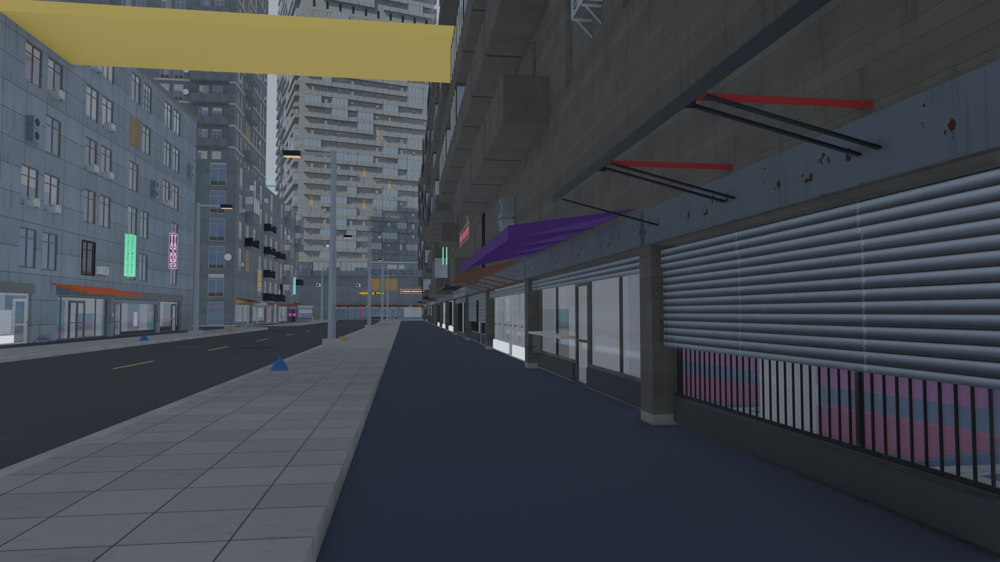 | 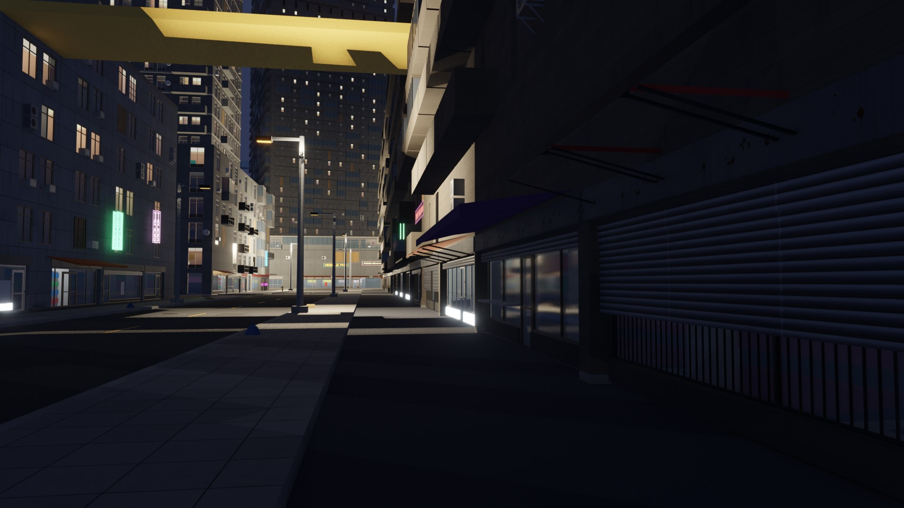 |
| A shopfront row in d03: roller shutters, grilles, counters and awnings | The same row at night: lit interiors and neon |
| 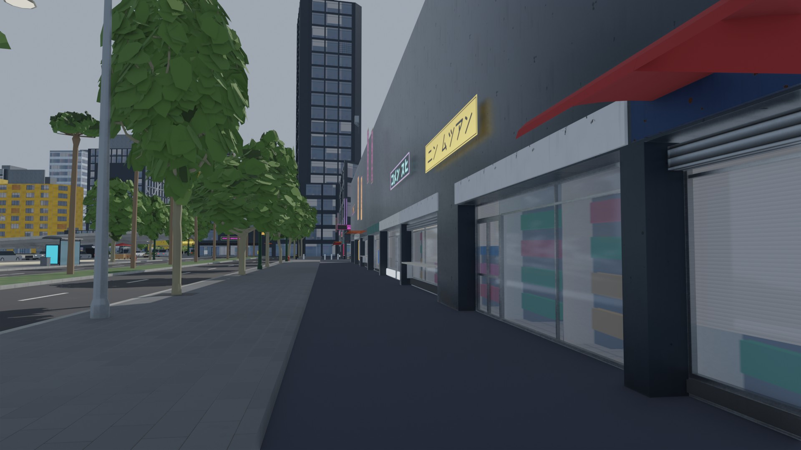 | 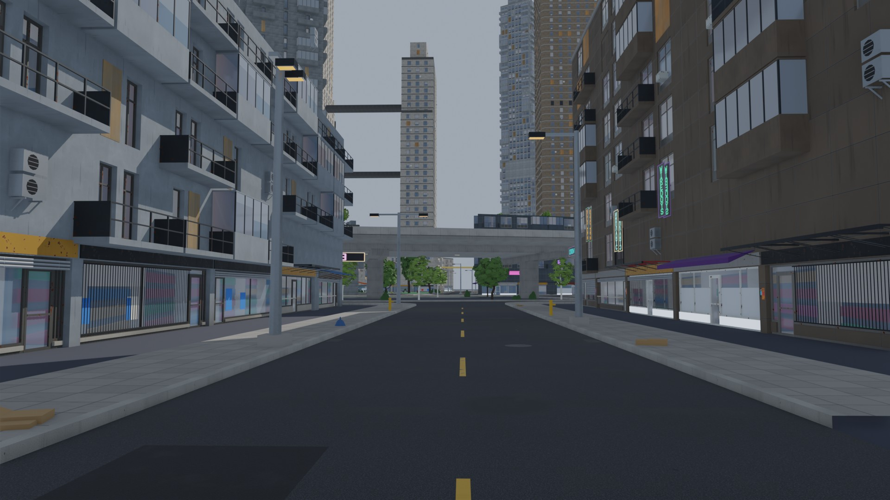 |
| Shopfronts in d02 under their signs | A shop street: grilles, recessed doors, blade signs on their plates |
| 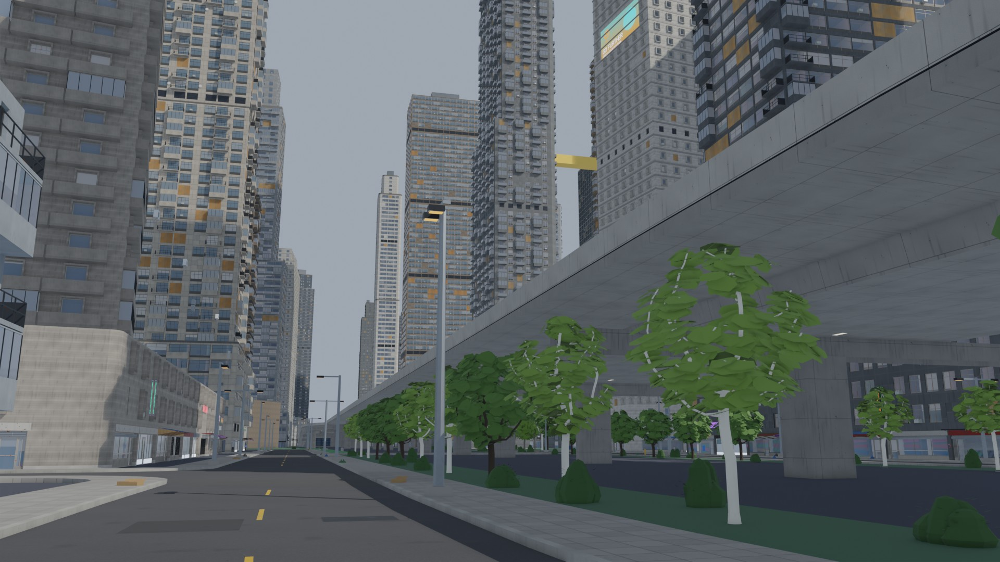 | 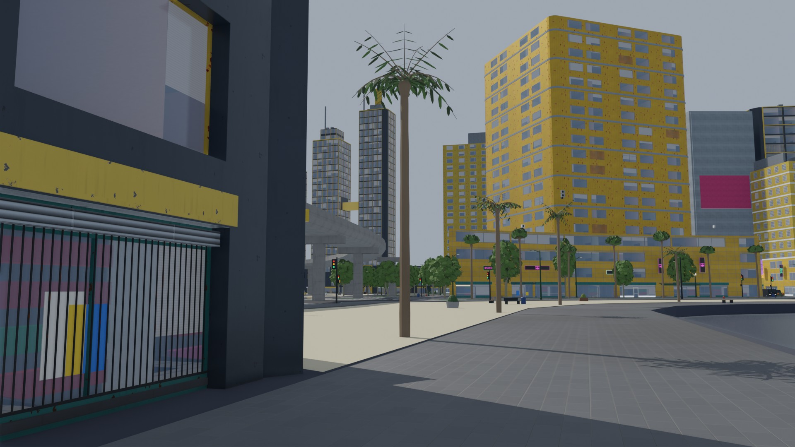 |
| A street beside a viaduct, a podium's band on the left | A plaza corner: a shuttered front with a poster behind its grille |
| 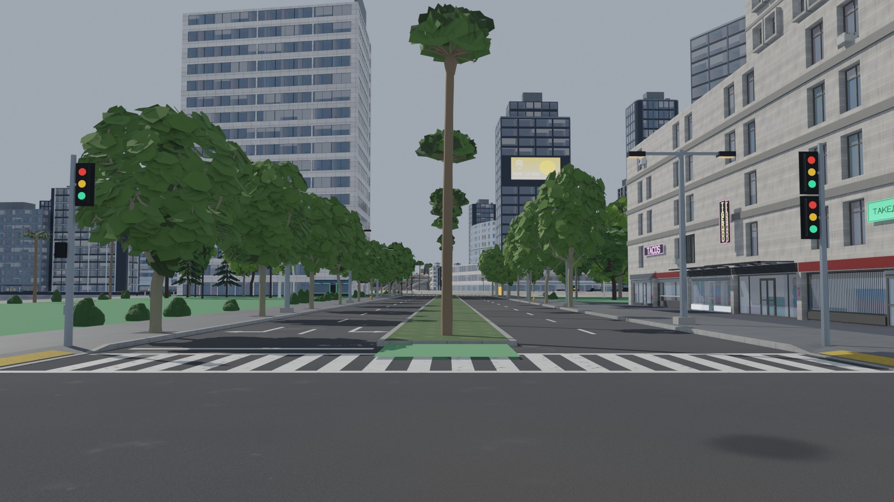 | |
| An avenue crossing, shopfronts under the takeaway and taco signs | |

8K: [day](greyhook/8k/shopfronts.jpg), [night](greyhook/8k/shopfronts_night.jpg) (the d03
row).

### Cragmouth (slopes)

| | |
|---|---|
| 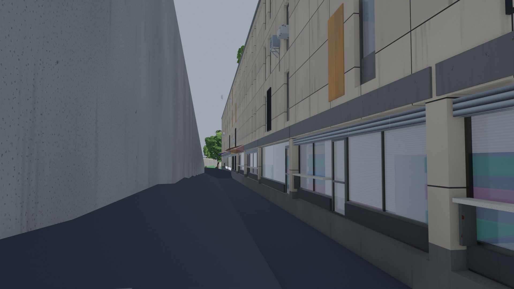 | 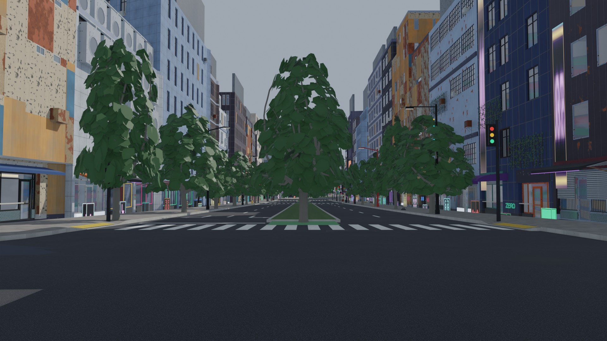 |
| Shutters down a lane beside a retaining wall | A shop avenue: neon, grilles, a median of trees |
| 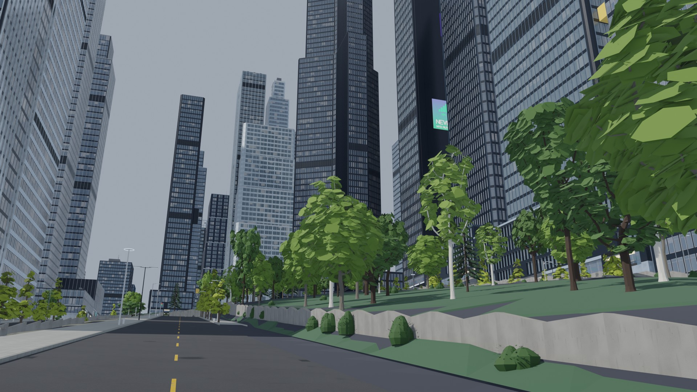 | 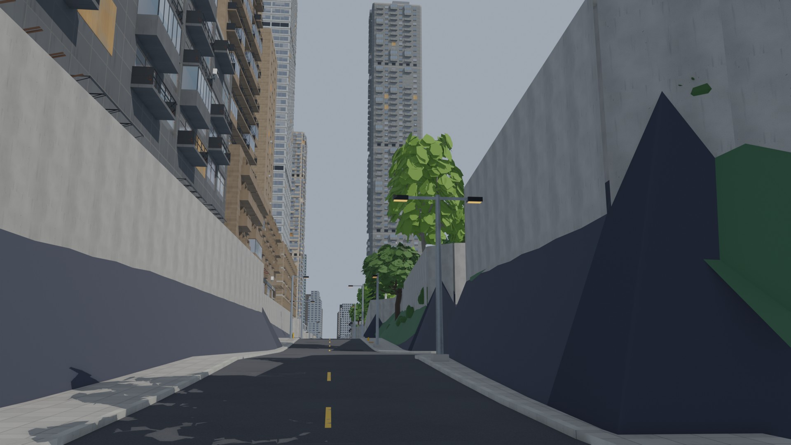 |
| A hillside street under the towers | A street cut between retaining walls |
| 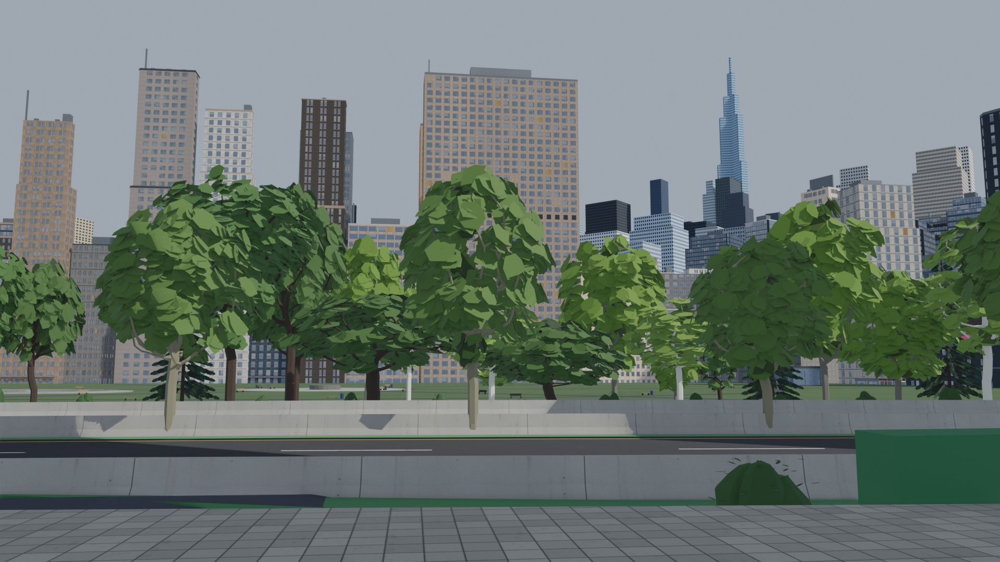 | |
| A park above a retaining wall | |

On a slope the band sits at the building's base (`base_m`, its main entrance), so on the
downhill side the shopfronts stand over the blank plinth; stepping the plinth is AG5's.
