# AG3 and AG4 in Unreal: street fronts, doors, decals, roofs and connections

The Unreal check of AG3 (street fronts) and AG4 (roofs and connections), with Vesper Bay
checked again with the AG2 and AG6 check's fixes (#54). Greyhook and Vesper Bay built from
main (`citygen build --blockout`, `assetgen build` with 4 workers, every assetgen check
passing), imported with every stage 2 part into a new throwaway project, imported again,
read back from the level in the editor, traced against its collision in the editor world,
checked in play-in-editor and shot by day and by night (`MPC_CityGen.Night` at 1, the sun
at the horizon, the sky light dimmed, exposure fixed). All on the M4 Mac (24 GB), UE 5.8,
one editor at a time. Cragmouth (fronts and plinths on slopes) was built (every assetgen
check passing) but not imported: see the open items.

```bash
.venv/bin/python -m citygen build cities/vesper_bay/city_spec.json out/vesper_bay --blockout
.venv/bin/python -m assetgen build out/vesper_bay --workers 4
.venv/bin/python -m citygen unreal out/vesper_bay ~/CgAG34Test/CgAG34Test.uproject --new-project
.venv/bin/python -m citygen unreal out/vesper_bay ~/CgAG34Test/CgAG34Test.uproject
.venv/bin/python -m citygen unreal out/vesper_bay ~/CgAG34Test/CgAG34Test.uproject --check-only
```

(Greyhook: `docs/progress/M1a2/peninsula_city/city_spec.json`, with `--shots`.) The
read-back, the traces and the views by day and night came from an editor script of this
check's own (every actor loaded, the collision given time to cook), not in the repo.

## Imports

| City | Import | Actors | Stage 2 | Time |
|---|---|---|---|---|
| Greyhook | first, blockout and stage 2 at once | 40,049 created | 19,083 stage 2 actors and 20,250 instanced actors over 5,453 blockout actors; 29,528 meshes from 654 packs, 4,619 blockout meshes; 279 textures, 369 material instances | 1,142 s: stage 2 meshes with their Nanite builds 550 s, actors 352 s, the prune of 299 unused variants 76 s (the editor's delete), save 28 s; HLODs 284 built in 192 s |
| | again | nothing changed, 0 packages saved | | 46 s; HLODs none rebuilt, 81 s |
| Vesper Bay | first, over the same project | 67,904 created | 38,504 stage 2 actors and 28,613 instanced actors over 9,626 blockout actors; 52,857 meshes from 806 packs, 8,533 blockout meshes; 41 textures imported, 259 kept from `Core/Textures`; 392 material instances | 3,524 s: stage 2 meshes with their Nanite builds 1,505 s, actors 1,274 s, the prune of 200 unused variants by their files 158 s (313 s with the editor's delete in #54), save 105 s; HLODs 239 built in 167 s, but the build failed on one empty mesh (fixed below) |
| | again, with the fix | the empty shell's actor deleted, its mesh pruned; nothing else | | 227 s; HLODs 1 rebuilt, passing, 182 s |
| | again | nothing changed, 0 packages saved | | 197 s; HLODs none rebuilt, 202 s |

No `nanite fallback_*` line in either import log (`fallback_full` set without error on
every front), and no "needed to set usage flag" line in any log of this check.

## AG3: street fronts

Read back from the levels:

| Point | Greyhook | Vesper Bay |
|---|---|---|
| Front actors | 2,671 `<id>.front`, each at its shell's pivot and yaw (0 cm, 0 degrees apart), the same 30 Custom Primitive Data floats, its era's walls on all 1,577 era slots it has | 5,793, the same (the one building its front takes whole has no shell to compare), 4,224 era slots right |
| Collision | every front `BlockAll`, complex as simple | the same |
| Nanite fallback | `fallback_full` applied: percent of triangles, 1.0, relative error 0, on every front mesh read (400); each fallback keeps all its entry's triangles (40 of 40 compared) | the same |
| Doors | 10,388 `cg.door=<id>@<walkway>` tags, every door once; `DA_Greyhook_Doors` with 10,388 elements, each with its walkway as ref (main 1,376, shop 8,570, service 348, dock 46, garage 21, rollup 15, gate 12) | 20,991 tags and elements (main 2,717, shop 16,762, service 1,385, dock 71, rollup 26, gate 23, garage 7) |
| Decals | 115 `decals.<tile>` actors, Nanite off, `NoCollision`, all 839 slots on `M_CgDecal` (deferred decal domain) | 138 actors, 1,061 slots, the same |

Traces against the levels' collision at doors drawn at random (3,000 in Greyhook, 2,000 in
Vesper Bay), once the collision had cooked (47 and 63 s after every actor loaded):

| Trace | Greyhook | Vesper Bay |
|---|---|---|
| A line into the doorway 1 m up, from 1.5 m out | 2,995 meet the front, a recessed door a median 0.25 m behind the facade (95%: 0.70 m): the recess, then the door; 4 garage mouths open into the building | 2,000 meet the front, a recessed door a median 0.22 m behind it (95%: 0.70 m) |
| A capsule (0.34 m radius, 1.76 m tall, stepping 0.45 m) into the doorway | stops at the front at 2,985: in the recess, at the door (main 393 of 394, shop 2,463 of 2,475) | 1,985 (main 245 of 250, shop 1,604 of 1,618) |
| The floor from 2 m out to 0.3 m in | steps of 0.07 m median, 0.20 m at 95% | 0.20 m, a main entrance's step |
| Steps over 0.45 m | 34 | 44, all at or behind the threshold: flush doors (drawn on a wall, no opening, so the trace meets its ledge), shop counters 1 m up, docks, two low door heads |
| Up inside the doorway to its head | nothing at 2,977 (22 meet the front's own head) | nothing at 1,992 |
| Into the wall 0.3 m over the band line | the shell's hull at 2,961: the hull starts at `band_m`, no gap | 1,986 |
| Into the wall 0.3 m under the band line | the front at 2,644, an AG8 awning at 352 | the front at 1,863, an awning at 136 |

A doorway's floor is the ground under it (the front has no floor of its own there), and
the building is empty below the band line: the 4 garage mouths in Greyhook's sample lead
into it (an open item for assetgen).

Shots: [`greyhook/shopfront_street_day.jpg`](greyhook/shopfront_street_day.jpg) and
[`greyhook/shopfront_street_night.jpg`](greyhook/shopfront_street_night.jpg) (shopfronts
with their rollup shutters, lit menus, shop rows behind the glass, neon tubes and lit signs
by night), [`greyhook/doorway.jpg`](greyhook/doorway.jpg) (a recessed glazed main door, a
gate and a shopfront under its shutter, a sticker decal upright and unmirrored beside the
door), [`vesper_bay/shopfront_street_day.jpg`](vesper_bay/shopfront_street_day.jpg) and
[`vesper_bay/shopfront_street_night.jpg`](vesper_bay/shopfront_street_night.jpg) (Old
Town's shopping street, neon frames and lanterns by night),
[`vesper_bay/doorway.jpg`](vesper_bay/doorway.jpg). No decal flickered or showed through
in any view.

## AG4: roofs and connections

| Point | Greyhook | Vesper Bay |
|---|---|---|
| Skybridges | 170 actors (43 enclosed, 127 open decks), each at its entry's pivot and yaw (0 cm, 0 degrees apart), `cg.stage=2`, 850 `cg.link=` tags all as their entries, complex collision | 258 (60 enclosed, 1 stacked, 77 open decks, 86 catwalks, 34 cable bridges), 1,290 tags, the same |
| Skybridge floors | a trace down through each bridge's middle lands on its deck at 170 of 170, 0 to 3 cm over the model's deck height | 258 of 258 |
| Skybridge ends | each mesh reaches 0.15 m into both facades; a line along the bridge from its middle meets its own building's hull at 338 of 340 ends, within 5 mm of the facade: the hulls close the landing doors, as AG4 expected; the other 2 meet an AG8 facade AC unit where a podium deck lands (the stage 1 item AG4 found) | 512 of 516; the other 4 meet AC units the same way |
| Roof equipment | 997 instanced actors (one per tile and mesh), 11,545 instances, every count its entry's, all `NoCollision`; of 4,000 sampled none floats (over 0.15 m above the hull's roof), 84 stand 0.15 to 0.25 m under its top | 1,867 actors, 22,164 instances, the same; 226 under the top by up to 0.25 m (dunnage 143, roof vents 58, huts 19, skylights 6: on the roof deck inside the parapet) |
| Building parts | all 10,462 part instancers `NoCollision` | all 13,792 |
| Green roofs | the 33 blockout green-roof objects the buildings replace are gone (none of the 5,453 replaced keys left) | 40 gone (none of 9,626 left) |
| Materials | all 369 instances on their masters (metal 104, facade 92, concrete 56, neon 29, leaves 18, decal 17, others) | all 392 |
| Sky stations | The Stacks' platform and track are inside its tower's hull (a trace from the platform starts inside it): a player cannot stand there; the other two stand on transit decks | the Corporate Core's the same; the other two on a deck and in the tube |

Shots: [`greyhook/skybridge_towers.jpg`](greyhook/skybridge_towers.jpg) (an enclosed
skybridge 121 m up between two megabuilding towers, meeting both facades),
[`greyhook/roofs_aerial.jpg`](greyhook/roofs_aerial.jpg) and
[`vesper_bay/roofs_aerial.jpg`](vesper_bay/roofs_aerial.jpg) (gravel and membrane roofs,
AC units, water tanks on dunnage, penthouses, billboards, green roofs, nothing floating),
[`vesper_bay/sky_tube_portal.jpg`](vesper_bay/sky_tube_portal.jpg) (the tube entering its
tower), [`greyhook/sky_station_platform.jpg`](greyhook/sky_station_platform.jpg) and
[`vesper_bay/sky_station_platform.jpg`](vesper_bay/sky_station_platform.jpg) (inside the
portal: the platform beside the tube at its floor, the glass clear of the lining).

## Check

| City | Streaming | Traces down | Roofs | Facades | Walk | Frames (walk) | Free memory |
|---|---|---|---|---|---|---|---|
| Greyhook | 31,362 of 40,049 at the start, 25,257 after a teleport (987 new) | 507 of 507 (building 253) | 35 of 36 | 36 of 36 | 130 m, all frames on the ground | 0.030 s median, 0.163 s at 95%, one 3.9 s | 11% at the lowest (the shots load every actor first) |
| Vesper Bay, before the check's fix | 45,457 of 67,903 at the start, none new after the teleport | 169 of 507: failed | 34 of 36 | 33 of 36 | 253 m, all frames on the ground | 0.018 s median, 0.069 s at 95%, 0.97 s at most | 1% at the lowest, 16 GB wired, swap 29 GB (two Blender renders of another session ran too) |
| Vesper Bay | 45,457 at the start, 25,661 after the teleport (11,261 new) | 507 of 507 (building 229) | 36 of 36 | 36 of 36 | 253 m, all frames on the ground | 0.019 s median, 0.079 s at 95%, 2.4 s at most; flight 0.045 s median, 2.5 s at 95% | 11% at the lowest |

Vesper Bay's stall is gone: #54 saw one frame every 12 to 14 s; with its fixes (no part
collision, the Nanite usage flag on the masters) the walk runs at about 50 frames a second.
What still failed was the check's own wait for streaming (below): its first run here hit
169 of 507, as both of #54's runs did (157 and 169), all of them at the start spot. Play's
first frame loads the 45,000 actors in view range at once (3.5 to 7 minutes on this Mac),
and the far view streams in with hitches of up to 3.5 s while flying at 50 m/s.

## Fixes

- **Empty shells** (`citygen/unreal.py`): a one-floor building its street front takes
  whole has an empty shell node in its pack, while its entry's `triangles` counts the
  front's too (shell entries count the whole building). The exporter imported an empty
  mesh, which Unreal refuses ("Bad MeshDescription" on every load), and the HLOD build
  then failed on Vesper Bay. The exporter reads each pack's node triangles from its glTF
  JSON (`glb_triangles`): such an entry makes no mesh and no actor but still takes the
  blockout building's place, its front standing there (Vesper Bay's freight terminal,
  Testport's harbor freight terminal).
- **The check's streaming wait** (`citygen/ue/check_city.py`, `settle`): it listed every
  city actor in the play world on every frame; with 45,000 actors in range that took the
  game thread about 6.5 s a frame, so its 60 s wait ended after a few frames, the far spots
  never streamed in and their traces fell through. It now lists them once the streaming
  query says done, then every 2 s (`COUNT_EVERY_S`), for up to 180 s (`LOAD_WAIT_S`).
- **Roofs traced on shells**: the roof and facade traces picked any actor of the building
  category, part instancers (no collision) and fronts too; every miss in both cities was a
  part instancer. They pick shells now.
- **Warm-up renders for shots**: the first render of a new view drew coarse Nanite
  clusters, big flat triangles across the walls, where the view's pages had not streamed in
  yet (the same view rendered again was clean). Each editor shot is now rendered once small
  from its camera first, then `WARM_S` (3 s) later at full size.
- **Frame times**: the check's walk and flight report their frames' median, 95% and
  longest (`frame_time`, and in the summary line).
- **Prunes by their files from 50 assets** (`PRUNE_FILES`, was 500): a first import's unused
  variants (200 to 300) went through the editor's delete, 76 s in Greyhook and 313 s in
  Vesper Bay with the city loaded; by their files Vesper Bay's 200 took 158 s, most of it
  loading the city again.
- **Tests**: `test_stage2_empty_shell`, `test_check_frame_times_and_warm_shots`; the
  assetgen stage 2 tests know the empty shell.

## Open items

- **Hulls close landing doors** (AG4 expected it): a bridge's floor is walkable, but a walk
  across it meets the facade's hull at the door (338 of 340 and 512 of 516 ends). It wants
  collision drawn at the landings, or hulls cut at the door (assetgen).
- **Sky station platforms inside the hull**: in The Stacks (Greyhook) and the Corporate
  Core (Vesper Bay) the platform and track lie inside the tower's convex hull, so a player
  cannot stand on them (assetgen: the portal cut out of the hull, or the hull split at it).
- **Below the band line a building is empty**: a doorway's floor is the ground and the hull
  starts at `band_m`. Doors and shopfronts are closed by their leaves and glass, but garage
  mouths are open (4 in Greyhook's sample) and lead into the empty ground floor (assetgen: a
  back wall behind a mouth, or a hull down to the ground behind the band).
- **Entry slots and `triangles`**: a building entry's `materials` can name a slot its shell
  lacks (`roof` on industrial sheds, 7 of 5,387 overrides in Greyhook, 16 of 12,458 in
  Vesper Bay; nothing wrong is applied), and a shell entry's `triangles` counts its front's.
- **Cragmouth** (fronts and plinths on slopes): built, every assetgen check passing, but not
  imported: AG5 is reworking plinths and fronts on slopes, and Vesper Bay's play already ran
  this Mac down to 11% free memory with 16 GB wired; worth its own check after AG5.
- **Memory**: Vesper Bay plays at about 50 frames a second, but play's first frame loads
  45,000 actors at once and the Mac swaps with any other heavy job running. A smaller
  `--view-range` or the Windows PC suit it better.

## Shots

3840 px, by night `MPC_CityGen.Night` at 1. Greyhook:

| A shopfront street by day | The same street by night |
|---|---|
| 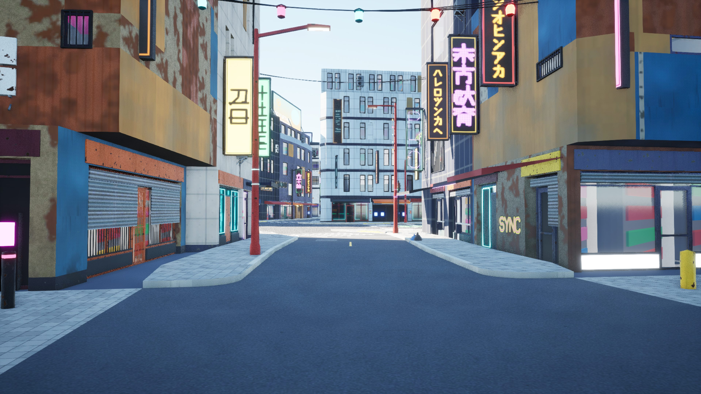 | 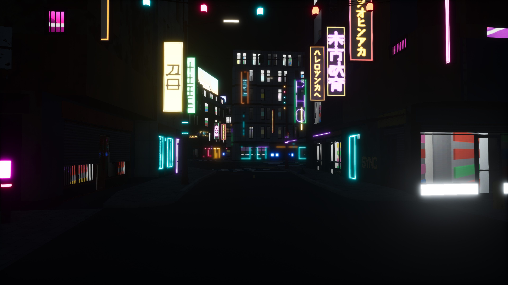 |

| A doorway | A skybridge between towers |
|---|---|
| 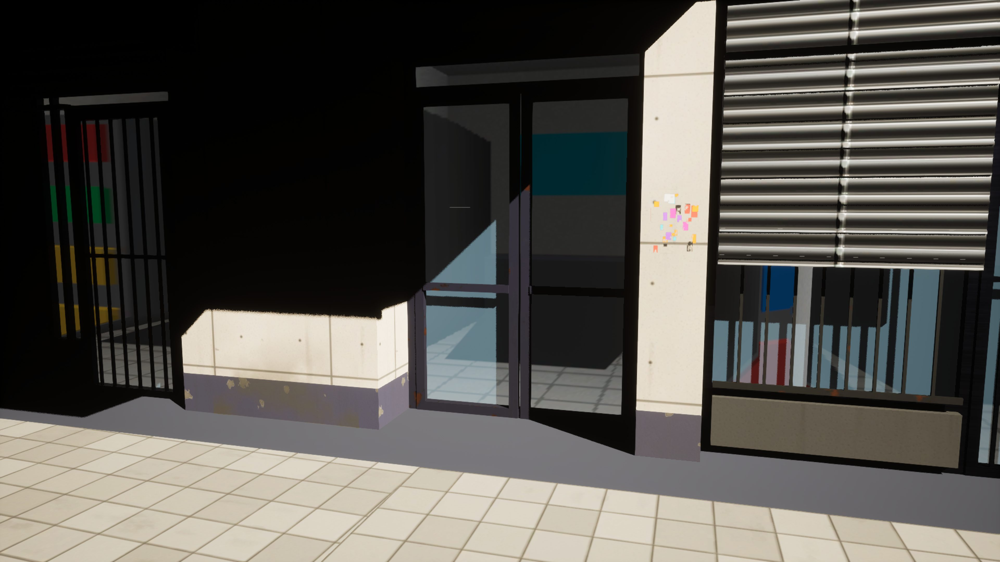 | 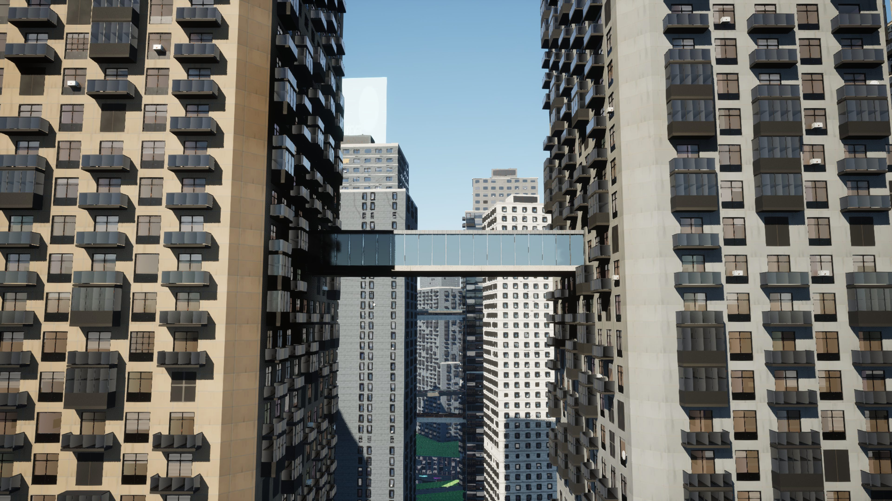 |

| Roofs from above | The sky station platform |
|---|---|
| 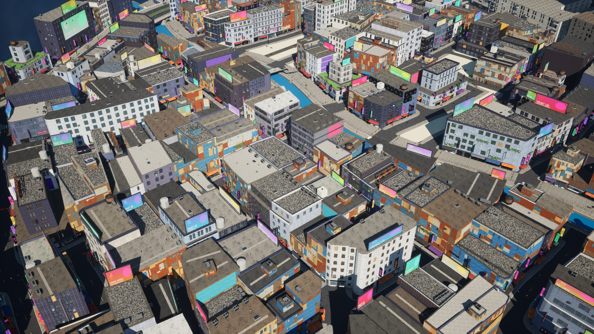 | 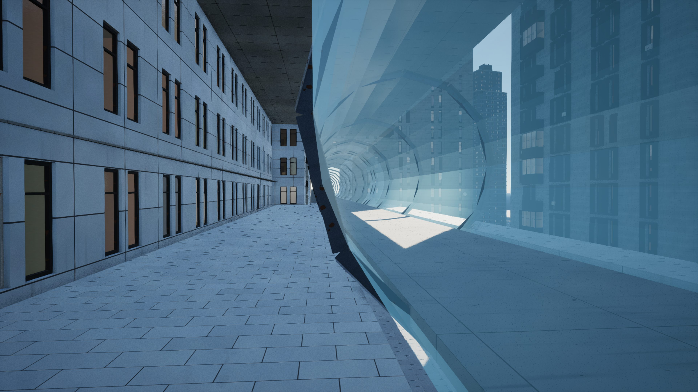 |

Vesper Bay:

| Old Town's shopping street by day | The same street by night |
|---|---|
| 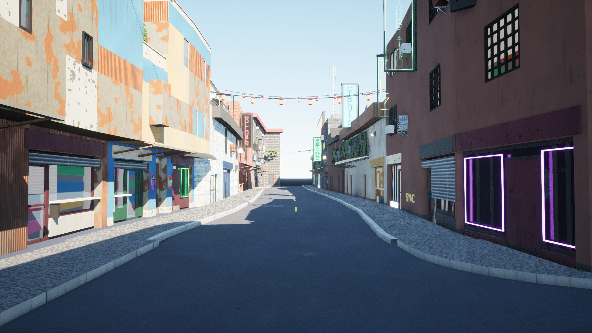 | 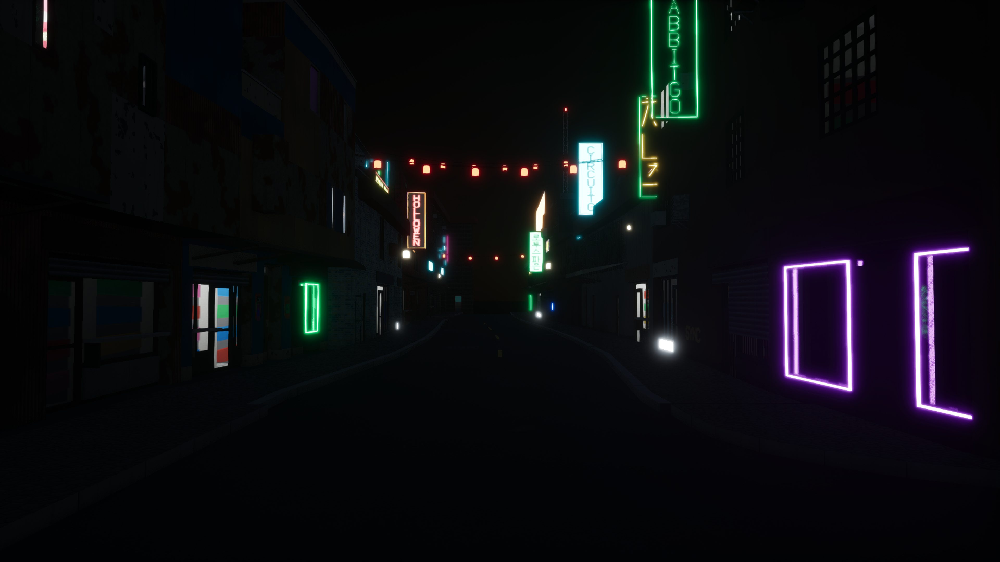 |

| A doorway | Roofs from above |
|---|---|
| 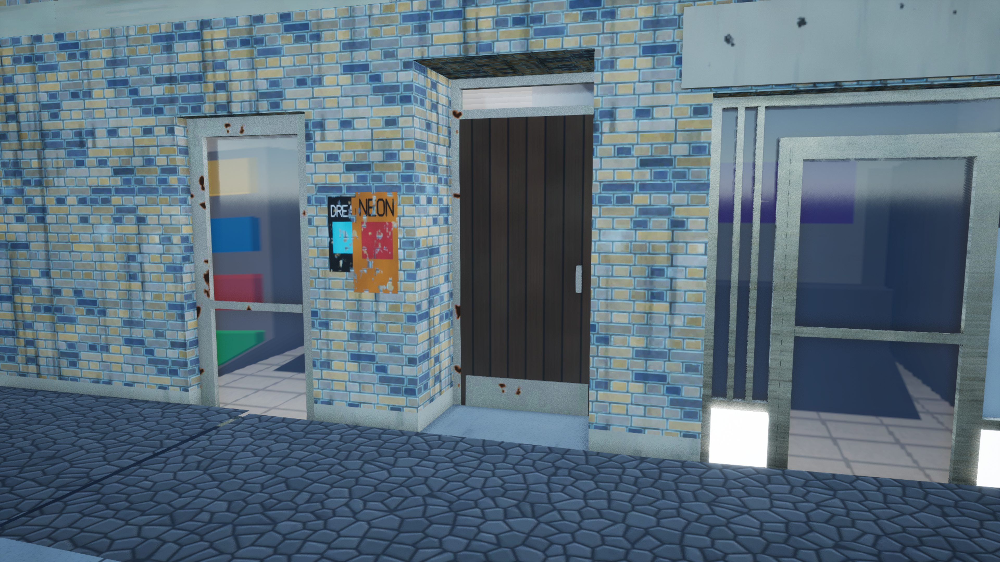 | 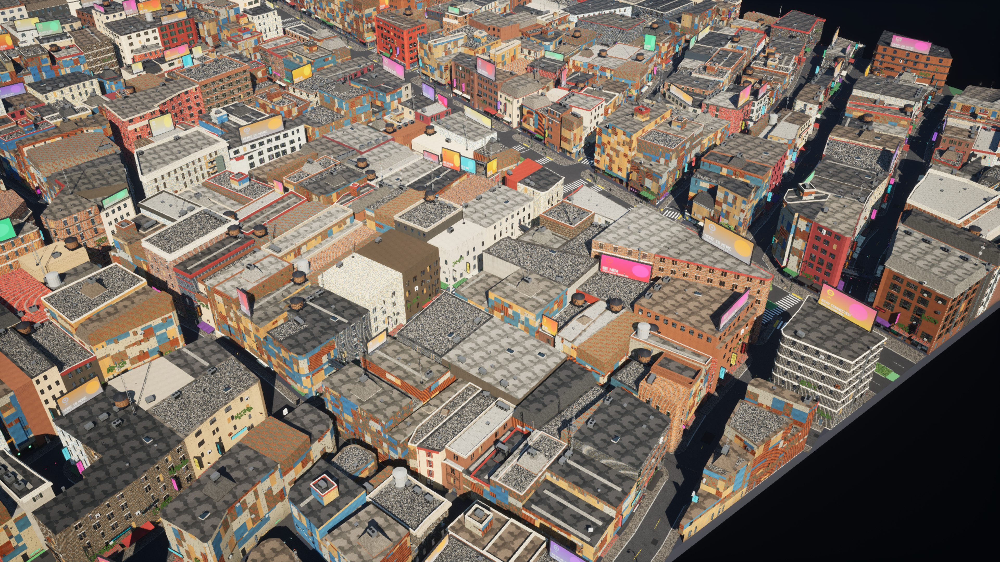 |

| The sky tube entering its tower | The sky station platform |
|---|---|
| 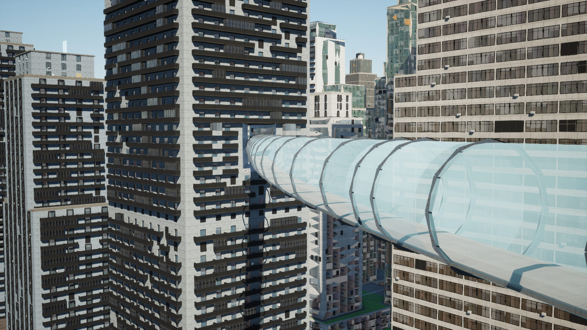 | 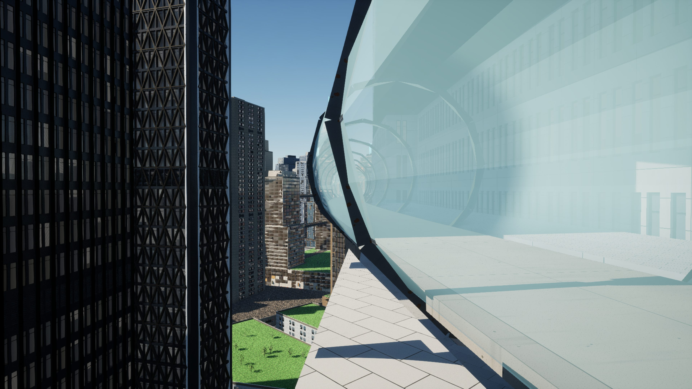 |

| A holo-ad by night (#54's open item) | The coarse clusters a first render drew (before the warm-up) |
|---|---|
| 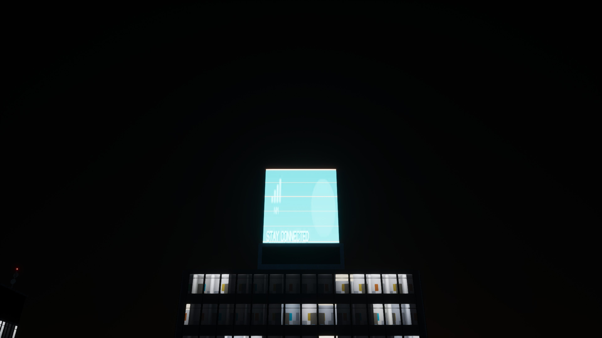 | 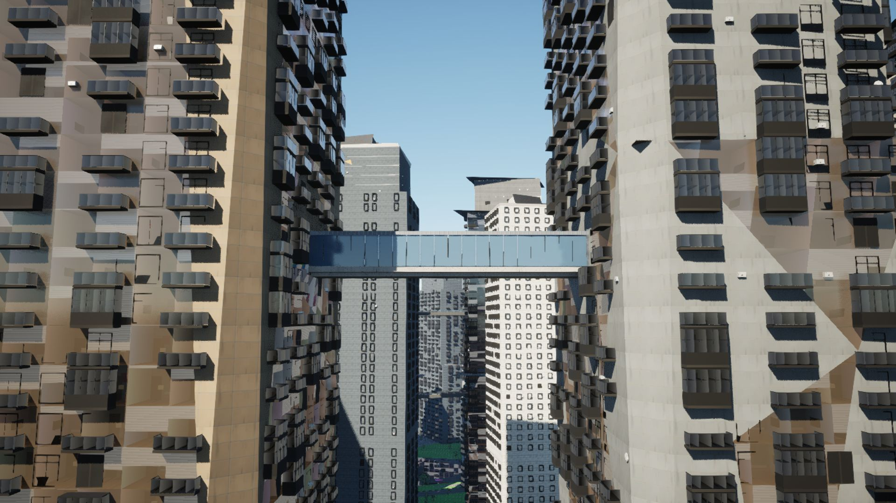 |

The holo-ad's face shows its ad page by night (the text and graphics of `holopage.ads_*`),
so the page does reach the face; by day it blows out (lighting is stage 3's).

The 8K street for the README: [`greyhook/8k/shopfront_street.jpg`](greyhook/8k/shopfront_street.jpg).
