# AG5 in Unreal: heroes, types and slopes

The Unreal check of AG5 (types, landmarks and slopes), Cragmouth first. Cragmouth and
Greyhook built from main (`citygen build --blockout`, `assetgen build`, every assetgen check
passing), imported with every stage 2 part into a new throwaway project, imported again, read
back from the level in the editor, traced against its collision in the editor world and shot.
Delta Megacity's sky platforms were looked at in its data only. All on the M4 Mac (24 GB),
UE 5.8, one editor at a time.

```bash
.venv/bin/python -m citygen build cities/cragmouth/city_spec.json out/cragmouth --blockout
.venv/bin/python -m assetgen build out/cragmouth --workers 4
.venv/bin/python -m citygen unreal out/cragmouth ~/CgAG5Test/CgAG5Test.uproject --new-project
.venv/bin/python -m citygen unreal out/cragmouth ~/CgAG5Test/CgAG5Test.uproject
.venv/bin/python -m citygen unreal out/cragmouth ~/CgAG5Test/CgAG5Test.uproject --check-only --shots DIR
```

(Greyhook: `docs/progress/M1a2/peninsula_city/city_spec.json`, imported into the same
project.) The read-back, the traces and most views came from an editor script of this
check's own, not in the repo; on Cragmouth it loads one region at a time (below).

## The finding first: Cragmouth overruns Nanite's root pages

Cragmouth imports and imports again cleanly, but the editor stops on a fatal error whenever
most of the city is in memory at once:

```
Cannot allocate more root pages 49152/49152. Pool resource has grown to maximum size of 2048MB.
512MB is spent on streaming data, leaving 1536MB for 49152 root pages.
```

Every Nanite mesh in memory takes at least one root page, and the pool stops at 2 GB on this
Mac. Cragmouth has about 63,700 Nanite meshes (53,121 of its 60,471 stage 2 meshes, and
10,635 blockout meshes); Greyhook about 34,000 and Vesper Bay, which passed in the AG3 and
AG4 check, fewer than the limit. Where it stops:

- **the check's shots**, which loaded all 75,155 actors: fixed (below; Cragmouth's views
  now render, 42,000 of its 54,223 meshes loaded around its middle);
- **play** (`--check` without shots, the walk): Unreal waits for about 42,700 meshes from
  all 143 tiles before the first frame and stops within 5 minutes. Run again with the HLODs
  off (`wp.Runtime.HLOD 0`) and with a 700 m loading range as well
  (`wp.Runtime.OverrideRuntimeLoadingRange`), it stops the same way, on the same 42,700
  meshes. So Cragmouth cannot be played as exported on this Mac (an open item: the exporter
  needs a budget of Nanite meshes per city, below).

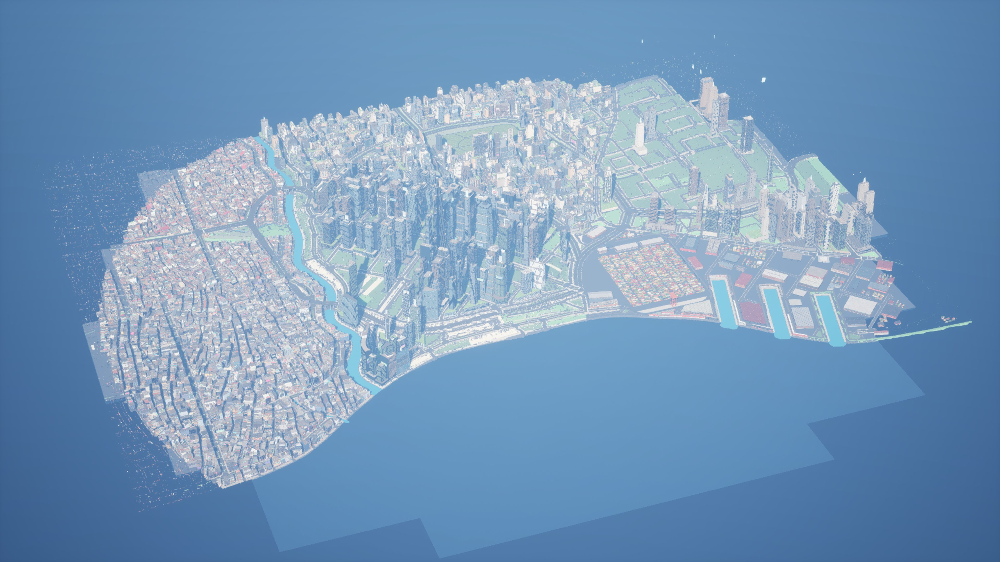

## Cragmouth

| Import | Actors | Stage 2 | Time |
|---|---|---|---|
| first | 74,957 created | 47,012 stage 2 actors and 27,240 instanced actors over 11,730 blockout actors; 60,471 meshes from 758 packs (53,121 with Nanite), 10,635 blockout meshes; 275 textures, 429 material instances; 6,651 hulls | 4,653 s: stage 2 meshes 1,884 s, actors 1,552 s, the prune of 175 unused variants by their files 157 s; the editor's shutdown 10m55s; HLODs 196 built in 694 s |
| again | nothing changed, 0 packages saved | | 249 s; HLODs none rebuilt, 242 s |

No "Bad MeshDescription", `nanite fallback_` or "needed to set usage flag" line in the logs.
The editor script loads a region at a time: the west (1.3 km square over the old quarter,
the Crown Heights slopes and the megatower: 24,776 actors, every skybridge floor's collision
in place 31 s after loading) and the harbor's sheds (871 actors).

### Hero: the megatower

`d03.lm.w245n60.bld` is tagged `cg.hero=megatower`; its shell has two UV channels; 14 of its
20 slots read `T_city_hero_d03_lm_w245n60_bld` as `HeroMask` with `HeroMaskOn` 1 (its glass
and glazing among the six without); every master is at `STAGE2_VERSION` 6
(`cg.core2=6` on all 13), and none of 303 other buildings' slots has `HeroMaskOn` on. Its
accent seams run up the tower and its foot stands on its plinth over the slope:

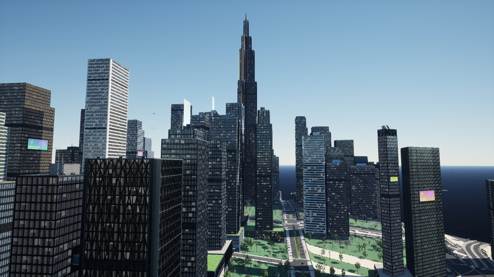
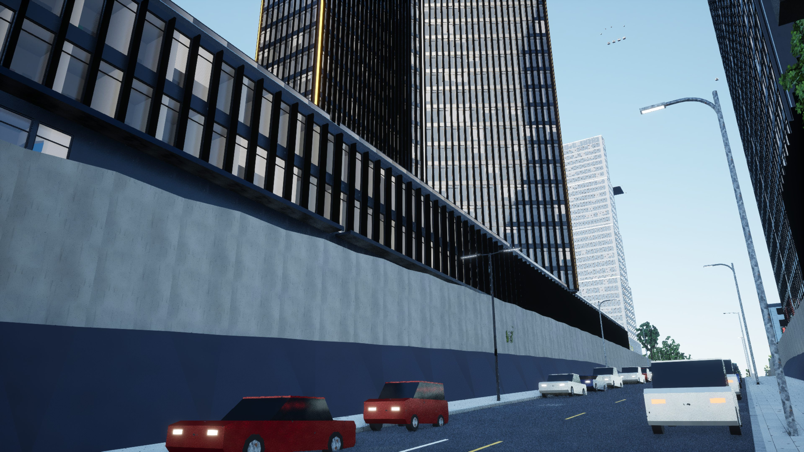

### Slopes: plinths

Traced at every footprint corner of 119 buildings in the west (all tagged `cg.plinth=`):
the ground 0.6 m out, then lines into the building 0.15, 0.5, 1 and 2.5 m over it.

| Corners | Count |
|---|---|
| the lowest line meets the building at its wall (gap median 0, 95% 0) | 732 |
| buried: the ground rises to the wall first (the uphill side, the retaining skirt) | 210 |
| floating: the building first met 0.5 to 2.5 m up | 30 |
| party corners (the ground trace lands on a neighbor) | 183 |

The 30 floating corners stand over a sidewalk, junction or road 0.5 to 2.5 m below the
plinth's foot, or over the terrain where it falls away inside a corner.

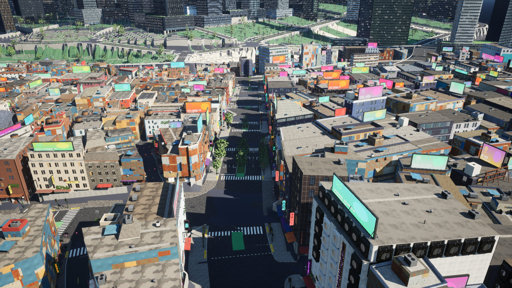
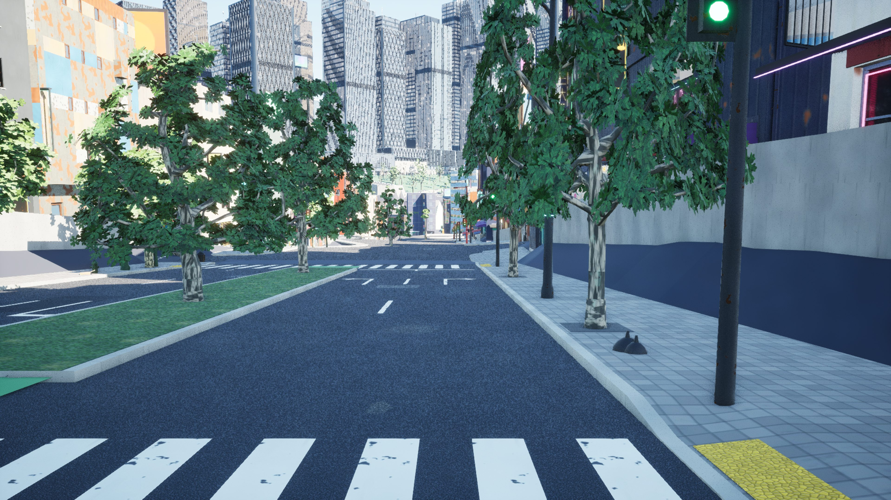

### Slopes: doors and shopfronts

710 doors in the west (586 shop, 71 main, 53 service), traced as in the AG3 and AG4 check
plus the ground 0.4 m out against the door's threshold (the door records carry AG5's raised
and lowered sills):

| Ground 0.4 m out, over the threshold | Doors |
|---|---|
| within 0.2 m | 325 |
| 0.2 to 0.45 m (a step down into the door) / 0.2 to 0.45 m under it (a step up) | 100 / 60 |
| more than 0.45 m over it / under it | 142 / 38 |
| no ground found | 45 |

75 doors face an M13 retaining wall within 1.5 m (their line in hits the wall first): the
building stands at its lot's ground while the sidewalk in front follows the road's grade
line, with the wall between them, so the shop is not reached from the street. Doors at
grade look as they should:

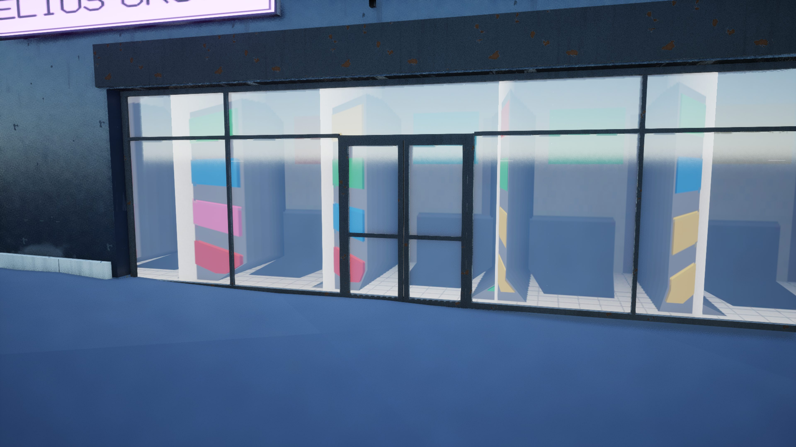
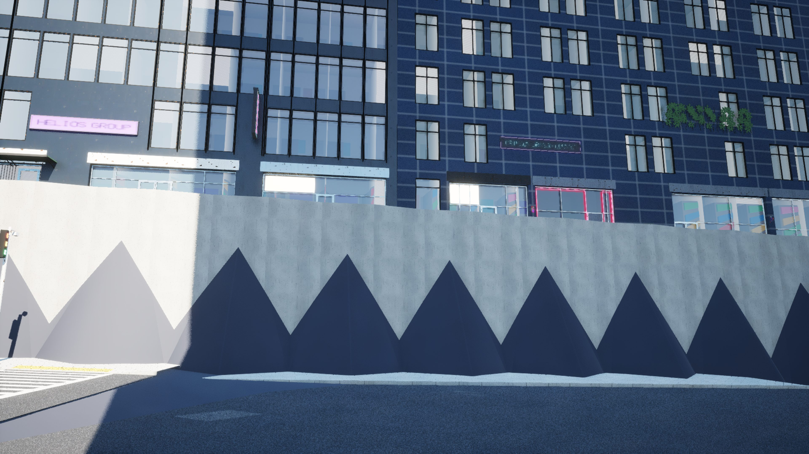

The second view also shows the terrain heightfield running up the retaining wall's face in
triangles (its 4 m grid is not cut at the wall).

### The walk on the hills

Play stops on the root pages (above), so the walk was traced in the editor instead: 1,100 of
the west's walkway edges (the steepest first), every metre the floor (through props), the
step to the last point and a line 2 m up.

| Kind | Edges | With a step over 0.45 m |
|---|---|---|
| sidewalk | 204 | 56 |
| crossing | 209 | 162 |
| crosswalk | 50 | 33 |
| path | 593 | 334 |
| alley | 34 | 8 |
| stairs, promenade, pedestrian street | 10 | 0 |

Most steps are terrain against terrain (paths and crossings over the ground's retaining
steps) or the heightfield standing over a street surface; 1,901 of 21,738 points have
something within 2 m overhead (fronts and shells where a walkway reaches a door, awnings).

### Open sheds

Cragmouth's 12 open sheds (5 in the harbor region): at every side's middle a line in at
1 m stopped at the hull at the edge (20 of 20): the hull was the whole prism from the
ground to the roof, so nobody walked under the roof. Fixed in assetgen (below).

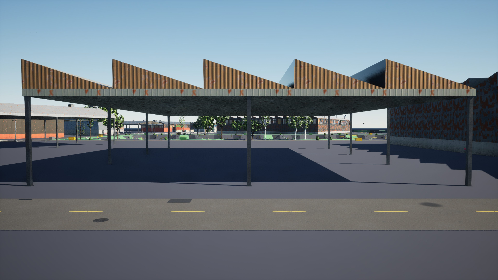

## Greyhook

| Import | Actors | Stage 2 | Time |
|---|---|---|---|
| first, into the same project | 40,099 created | 19,073 stage 2 actors and 20,310 instanced actors over 5,453 blockout actors; 29,569 meshes from 654 packs (26,499 with Nanite), 4,619 blockout meshes; 33 textures imported, 247 kept; 403 material instances | 1,097 s; HLODs 284 built in 92 s |
| again | nothing changed, 0 packages saved | | 52 s; HLODs none rebuilt, 86 s |

`citygen unreal --check-only --shots` passes: 31,379 of 40,099 actors streamed in at the
start, 507 of 507 traces down, 36 of 36 roofs and facades, 130 m walked on the ground all
the way (frames 0.015 s median), 378 m flown at 50 m/s. The editor script loaded every
actor (every skybridge floor's collision in place 31 s after loading).

Greyhook is flat, so it is the slopes' baseline: 1,989 of its 2,000 sampled doors have the
ground 0.4 m out within 0.2 m of the threshold (Cragmouth 325 of 710), and 19 of 948
sidewalk edges a step over 0.45 m (Cragmouth 56 of 204).

### Hero: the wheel

`d04.lm.w1088s127.bld` is tagged `cg.hero=ferris_wheel`, its shell has two UV channels and
4 of its 5 slots read `T_city_hero_d04_lm_w1088s127_bld` with `HeroMaskOn` 1; none of 313
other buildings' slots has it on.

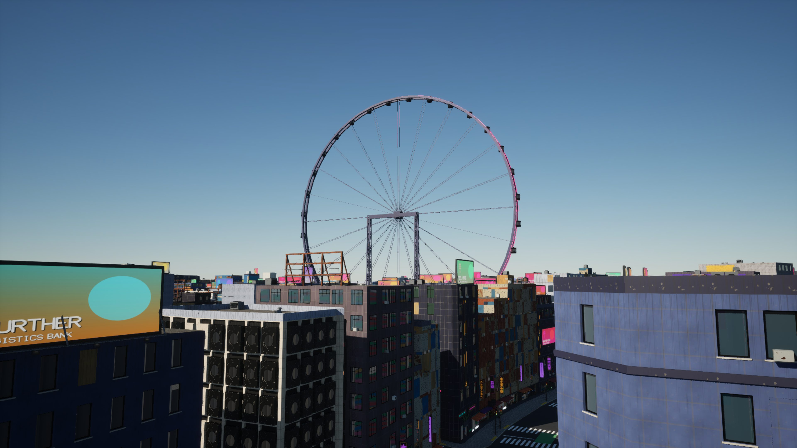

### Landing doors

At each end of every skybridge, a capsule (0.3 m radius, 1.6 m tall) swept from the
bridge's middle toward the door: 332 of 340 ends go 2.5 m past the facade (the notch,
`VESTIBULE_MM`) and stop at the hull there; two stop on an AC unit AG8 hangs beside the
door. Cragmouth's west: 184 of 204, ten on AC units. All 170 bridge floors collide.

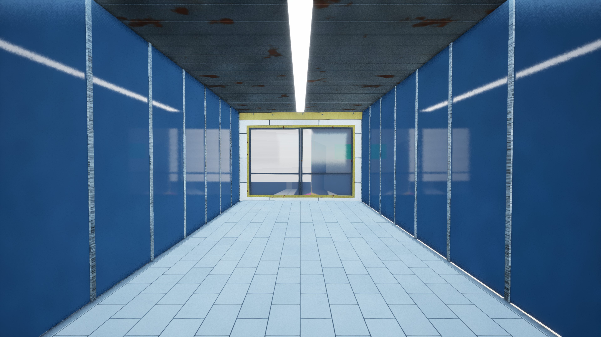
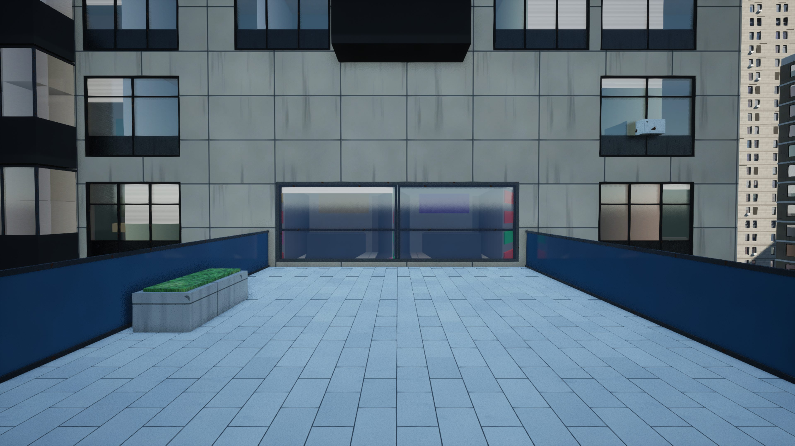

### Types

Open sheds, with this check's fix: at the middle of each side of Greyhook's 10 open sheds a
line in at 1 m passes under the roof (40 of 40; before the fix every one stopped at the
hull, as Cragmouth's did). The control tower's cab and the hangars (15) as built; neither
city has a temple colonnade.

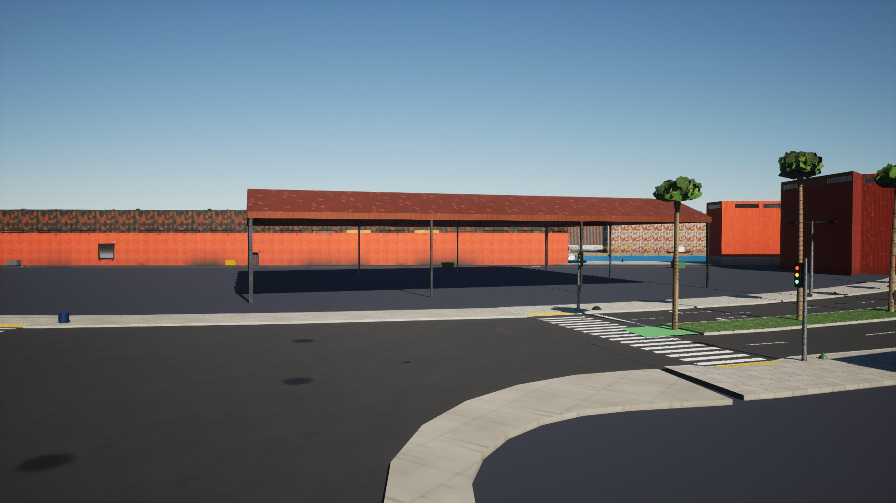
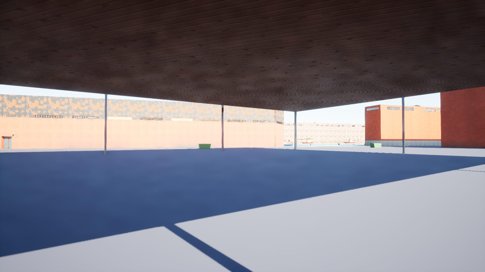
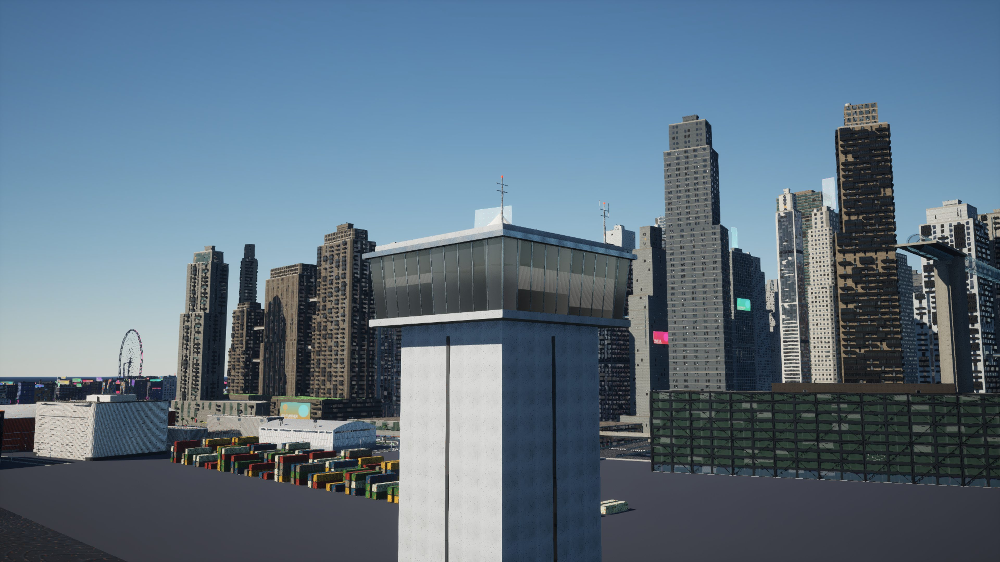
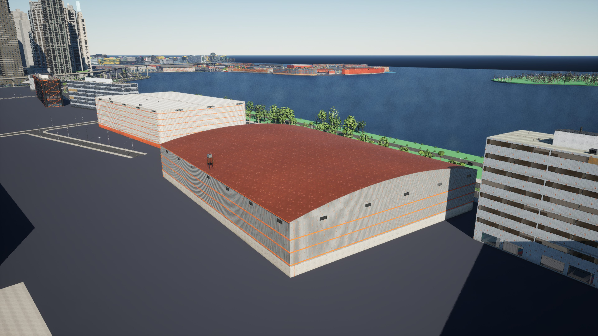

## Delta Megacity's sky platforms (data only)

Delta was not imported (one big city at a time on this Mac). Its two platforms beside a
tower, `d02.lot.e698n1243.bld` (floor 89.98 m, deck about 334 m2) and
`d03.lot.e693n395.bld` (109.98 m, about 356 m2), reach their tower's wall (0 m from its
hull) but lie outside every hull: the deck is in the shell mesh, whose collision is the
hulls of the masses, so nothing stands on it in Unreal.

## Fixes

- **Open sheds** (assetgen): an open shed's mass collides only from its roof's underside up
  (`collision.build(..., open_under)`, from the shell's `under_m`, `types.shed_mass`), so a
  walk passes under the roof between the columns; `GEN_VERSION` ag5.1, the `ag1`, `ag6` and
  Vesper Bay goldens written again (the version is in every pack); test
  `test_collision_lets_a_walk_under_an_open_shed`.
- **The check's shots** (exporter): the views load every actor but the HLODs, or for a
  city with more than 42,000 meshes (the manifest's mesh of each actor key) the actors
  nearest its middle up to 42,000 meshes, one set for every view (`SHOT_MESHES`,
  `view_load`, `mesh_of`; loaded per view, Cragmouth stopped at the fourth: an actor
  unloaded between views keeps its meshes' root pages); test
  `test_check_shots_stay_under_nanites_root_pages`.

## Open items

- **Nanite's root pages** (the exporter): Cragmouth cannot be played as exported on the Mac
  (above). What could bring a city under 49,152: a far view of merged HLODs instead of the
  instanced layer, fewer meshes (streets, signs and building parts are a mesh per piece or
  kind: one per tile and category), no Nanite on small meshes, or a smaller streaming pool.
- **Slopes** (M13 with AG5): doors at their lot's ground behind a retaining wall from the
  sidewalk (75 of 710 in the west); the terrain heightfield in teeth up retaining walls and
  over street surfaces; park paths across the ground's retaining steps.
- **Sky station platforms inside their tower's hull** (AG4's, still): The Stacks' station in
  Greyhook, a trace down from its track starts inside the hull. A cut of the tube's corridor
  out of the hull, as the landing doors' notch, would open it (AG14).
- **Sky platforms beside a tower without collision** (Delta, above; AG14).
- **Garage mouths** opening into the empty ground floor below the band line (AG4's, still;
  AG14).
- **AC units at landing doors**: AG8 hangs some where a skybridge lands (2 in Greyhook, 10
  in Cragmouth's west), in the walk's way.
