# AG2 and AG6 in Unreal: facades, materials and textures

The Unreal check of AG2 (facade parts, `docs/assetgen_milestones.md`) and AG6 (materials and
textures), then of AG8 on AG6 (leaves, sign faces, textured holo-ads and props). Greyhook and
Vesper Bay built from main, `assetgen build` (4 workers), imported with their shells, parts,
streets, props, plants and signs into a new throwaway project, imported again, read back
from the level in the editor, checked in play-in-editor and shot by day and by night
(`MPC_CityGen.Night` at 1). All runs on the M4 Mac (24 GB), UE 5.8, one editor of this check
at a time, on a Mac shared with other sessions' builds.

```bash
.venv/bin/python -m citygen build docs/progress/M1a2/peninsula_city/city_spec.json out/greyhook --blockout
.venv/bin/python -m assetgen build out/greyhook --workers 4
.venv/bin/python -m citygen unreal out/greyhook ~/UnrealTest/UnrealTest.uproject --new-project
.venv/bin/python -m citygen unreal out/greyhook ~/UnrealTest/UnrealTest.uproject --check --shots out/greyhook/shots \
    --view leaves_close 517.7 75.9 5.6 523.66 79.94 7.1 28 --view trees_600m -75.0 75.2 330.0 525 75 4.0 50
```

## Imports

| City | Import | Actors | Stage 2 | Time |
|---|---|---|---|---|
| Greyhook | first, blockout and stage 2 at once | 36,454 created | 16,127 stage 2 actors and 19,408 instanced actors over 5,250 blockout actors; 29,539 meshes from 603 packs; 237 textures imported, 255 material instances | 824 s (stage 2 meshes 330 s, actors 344 s, prune 76 s, textures 13 s); HLODs 285 built in 178 s |
| | again (three times, while fixing the prune) | nothing changed, 0 packages saved | the city's 5 sign pages, which the prune deleted after every import, imported again and their 5 instances rebuilt (fixed below); then nothing: 237 textures and 255 instances kept | 48, 39, 34 s |
| Vesper Bay | first, over the same project | 60,634 created | 32,315 stage 2 actors and 27,234 instanced actors over 9,328 blockout actors; 52,639 meshes from 735 packs; 44 textures imported, 217 kept from `Core/Textures` (Greyhook's), 280 instances | 2,543 s (stage 2 meshes 1,035 s, actors 997 s, prune 313 s, save 104 s); HLODs 238 built in 163 s |
| | again | nothing changed, 0 packages saved, all 261 textures and 280 instances kept | | 69 s |
| Greyhook with AG8 on AG6 (#49), over its AG6 import | after `assetgen build` again | 16,054 updated (8,212 signs: 7,119 shop signs, 1,093 billboards, neon bands and holo-ads; 7,842 prop and plant instancers), none created or deleted, no shell or street actor | 4,329 new sign meshes, 8,150 renamed away, 507 prop and sign meshes changed; 98 prop and sign material instances changed, 25 new, 37 gone; 39 new library textures (none of the 237 changed); masters `M_CgLeaves` added (`STAGE2_VERSION` 5) | the delete of 8,435 stale meshes stalled (over 90 minutes, stopped); with the prune fixed, the import again: nothing changed, 8,435 deleted by their files in 5 s, 72 s in all; HLODs 285 rebuilt in 155 s (the props changed); imported again: nothing changed, no HLOD rebuilt, 58 s |

## What the level holds

Read back from the level in the editor:

| Point | Greyhook | Vesper Bay |
|---|---|---|
| Textures | 237: 232 of the library in `/Game/CityGen/Core/Textures`, 5 city pages (ads, logos, signs) in `Greyhook/Assets/Textures`; color sRGB `TC_Default`, normals `TC_Normalmap` with the green channel flipped, masks linear `TC_Masks`; 512 to 2048 px | 261: the 256 library textures in `Core/Textures` (Greyhook's 232 shared, 24 more for its eras), 5 city pages; also 4 at 4096 px |
| Material instances | 255, none with an empty texture parameter | 280, none empty |
| Era walls on shells | 3,810 `<slot>@<era>` overrides on 2,671 building actors, every one the asked instance | 8,248 on 5,793, all as asked |
| Era walls on AG2's parts | 94 part instancers with an era override (fixed here: none had them) | 96 |
| Custom Primitive Data | 30 floats on every building actor (2,671) | 30 on all 5,793 |
| AG2's parts | 11,207 instancers, one per building and part kind, 833,694 instances; every instancer's count equals its contribution entry's transforms; no key doubled or missing | 17,227 instancers, 1,320,908 instances (AG2's 1,306,362 and 14,546 containers); counts equal |

## AG6's points

1. **Window interiors on curtain walls.** Every pane shows one whole room: back wall, floor at
   the bottom, ceiling at the top, side walls, moving with the view, the right way up. No
   white triangles, diamonds or sawtooth where panes share corners, up close or across a
   district; by day the glass reads as glass with the rooms behind it.
2. **Lit windows at night.** Whole rooms lit, about each building's lit ratio of them, the
   rest dark, none lit per triangle; storefronts show shops.
3. **Textures and orientation.** Brick courses horizontal, grey mortar, the building's tint on
   the bricks only; corrugated and paneled walls level and upright; weathering as dark spots
   and patches on the panels; rain streaks and grime at the foot of the walls are faint at
   street distance (hard to pick out in the shots); normals lit from the sun's side (the
   green flip right), masks linear.
4. **Tints over textures.** Each building keeps its AG1 tint over its texture (beige brick
   stays beige brick); era walls as above.
5. **Roads.** Asphalt with aggregate, dark patches, markings and crosswalk stripes; setts on
   the sidewalks of Vesper Bay's heritage streets (its road shot).
6. **Re-import.** Nothing changes on a second import, by pixel hash and by parameters; the
   library is imported once per project into `Core/Textures` and Vesper Bay's import reused
   Greyhook's 217 there.
7. **Cost.** Textures: 237 imported in 13 s. Shaders: the new masters' first compile queried
   2,443 shader jobs, 67% from the derived data cache, 35 compiled in 26 s of thread time.
   GPU memory (`ListTextures` in play, Greyhook): 223 textures, 539 MB at full resolution,
   65 MB resident, within the default 1,000 MB streaming pool. HLODs (#47) draw textured, not
   flat grey (the far view below).

## AG2's parts

One `BP_CityGenInstances` actor per building and part kind (`<building>.<kind>`, 17 kinds:
windows, spandrels, panels, balconies, shutters, members, AC units, balconettes, dishes,
shades, grilles, louvers, caps, pods, fins, columns, containers), its instance count the
contribution's, the era walls on its slots. In the close shots the parts sit on their walls,
nothing floating and nothing doubled.

With the fixes the part meshes carry no collision and their instancers are `NoCollision`
(10,617 instancers updated on Greyhook's import with them; the 590 container instancers keep
complex collision).

## AG8 on AG6

Greyhook built again with #49 (`assetgen build`, props, signs and materials only), imported
over its AG6 import (table above), imported again (nothing changed, HLODs none rebuilt) and
checked with shots:

- **Leaves** (`M_CgLeaves`): masked leaf cards with the sky through their gaps up close, both
  sides drawn (cards facing away are not missing); crowns full at 250 m and still full at
  600 m (Nanite `Voxelize`), no thinning or holes.
- **Sign faces**: upright, their text reading the right way, each the cell of AG6's page it
  names (two blade signs of the shopping street matched against `signs_tall_0.png`: the
  same katakana and glyphs, the same colors), neon frames lit; the five city pages in
  `Assets/Textures` and every sign instance with its textures.
- **Holo-ads** (`M_CgHolo`): the image's face on its page instance (`holopage.ads_1`:
  `SignTex` the city's ads page, `Textured` 1, emissive 3, opacity 0.6), its frame on the
  untextured holo colors; the importer kept every instance by its own-texture test, so the
  face has its page. By day the face blows out to near white against the sky (emissive 3
  over the day exposure), so whether the page reads on it was not seen: the night shot is an
  open item.
- **Props**: trunks with bark, palm trunks ringed, bollards banded, cars with painted bodies,
  glass, lit lamps and wheel rims; white blotches on the black van's paint (most likely the
  canopy's sky in its reflections; not followed up).

## Check

| City | Streaming | Traces down | Roofs | Facades | Walk |
|---|---|---|---|---|---|
| Greyhook | 28,627 of 36,454 at the start, 25,981 after a teleport | 507 of 507 (building 252) | 36 of 36 | 36 of 36 | 130 m, all frames on the ground |
| Vesper Bay, before the fixes | 41,349 of 60,634 at the start | 157 and 169 of 507: failed | 34 and 33 of 36 | 36 and 35 of 36 | fell through |
| Greyhook with the fixes and #49 | 28,622 of 36,454 at the start, 23,716 after a teleport | 507 of 507 (building 251) | 35 of 36 | 36 of 36 | 129 m, all frames on the ground |

Vesper Bay's play session ran at about one frame every 12 to 14 s, with the Mac's free
memory down to 13%, and its traces fell through the streamed cells that had not yet built
their collision. Its editor log points at two causes, both fixed here, but Vesper Bay was not
imported and checked again with the fixes (an open item):

- **Part collision**: its 1,306,362 part instances had complex collision, a physics body per
  instance on 17,227 instancers, against AG2's contract (the building's simple collision
  covers its masses).
- **Nanite usage flag**: 272 "needed to set usage flag Nanite" lines, one per stage 2
  material instance drawn on a Nanite mesh. The editor sets the flag in memory and compiles
  those shaders again in every session, during play; a cooked game would draw them with the
  default material.

Greyhook's last check ran with both fixes, with no usage flag line in its log, while another
session's Unreal import ran on the same Mac (its first roof miss, 35 of 36, is within the
check's pass).

## Fixes

- **Era walls on AG2's parts**: a building entry's `materials` now reach its part
  instancers (`citygen/unreal.py`), and the importer sets them per slot on the HISM.
- **The prune kept the city's texture pages**: `prune_meshes` deleted everything in
  `Assets/` that no mesh named, the sign pages among them, after every import; the sign
  instances then lost their textures. It keeps `Assets/Materials/` and `Assets/Textures/`
  now, and an instance whose texture parameters are empty is rebuilt (`own_textures`).
- **Nanite usage flag**: every opaque or masked surface master is made with
  `used_with_nanite` and `used_with_instanced_static_meshes` (`usage_flags`); a master
  missing one gets it and is saved.
- **No collision on building parts**: AG2's parts get `collision: {"none": true}` and their
  instancers `NoCollision` (containers keep complex collision).
- **Big prunes by their files**: the editor's delete makes a reachability pass over every
  loaded object for each package it deletes. The 8,435 meshes that #49's renames left took
  it over 90 minutes with the city loaded (stopped), and 1,000 of them over 6 minutes on an
  empty level (it falls back to its legacy reference search there). A prune of more than 500
  assets now loads `/Engine/Maps/Entry`, unloads the stale packages, deletes their files,
  rescans their folders in the asset registry (a forced scan drops what is gone) and loads
  the city again (the digests read its actors): the 8,435 in 5 s.

## Open items

- **Vesper Bay with the fixes** (the coordinator folds it into the next Unreal check):
  build it from main, import it into a new throwaway project and check it in play:

  ```bash
  .venv/bin/python -m citygen build cities/vesper_bay/city_spec.json out/vesper_bay --blockout
  .venv/bin/python -m assetgen build out/vesper_bay --workers 4
  .venv/bin/python -m citygen unreal out/vesper_bay ~/UnrealTest/UnrealTest.uproject --new-project
  .venv/bin/python -m citygen unreal out/vesper_bay ~/UnrealTest/UnrealTest.uproject --check-only
  ```

  Look for: no "needed to set usage flag" line in the project's editor log
  (`~/Library/Logs/Unreal Engine/UnrealTestEditor/UnrealTest.log`); the part instancers
  `NoCollision`; the check passing (507 of 507 traces down, the walk on the ground); play
  ticking well under a second a frame (12 to 14 s before), with memory to spare
  (`vm_stat`). Run it alone: one Unreal editor on the Mac at a time.
- **Holo-ads by night**: a night shot of a holo-ad (`MPC_CityGen.Night` at 1) to see its
  ads page on the face; by day the face is blown out (lighting is stage 3's).
- **Prunes under 500 assets** still go through the editor's delete with the city loaded:
  Greyhook's first import pruned 304 unused family variants in 76 s, Vesper Bay's 200 in
  313 s. The file route (verified here on 8,435) would take well under a minute; lowering
  `PRUNE_FILES` wants a first import to try it on.
- **Rain streaks and grime** at the foot of walls are hard to see at street distance.
- **White blotches** on a black van's paint (likely reflections; not followed up).
- **Tests**: `tests/test_unreal.py`'s `test_unreal_import*` tests start Unreal; run the file
  with `-k "not test_unreal_import"` while another editor runs.

## Shots

3840 px for AG6's shots, 2560 px for AG8 on AG6's; by night `MPC_CityGen.Night` at 1, the
sun low and the sky dimmed (exposure fixed). Greyhook:

| Curtain-wall towers by day | The same by night |
|---|---|
| 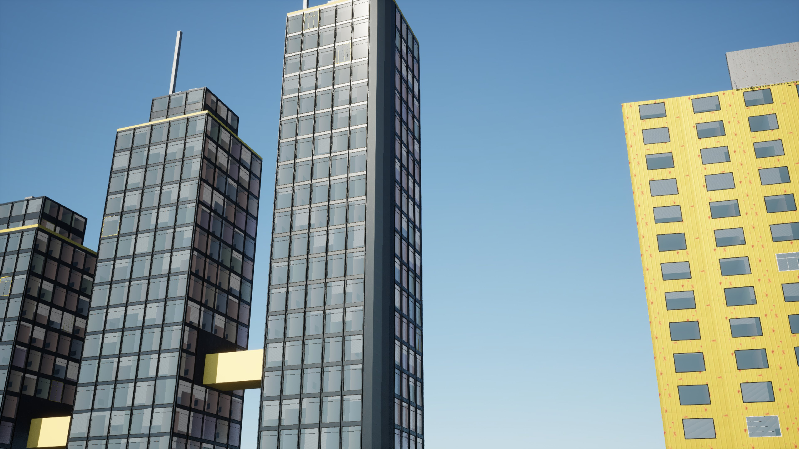 | 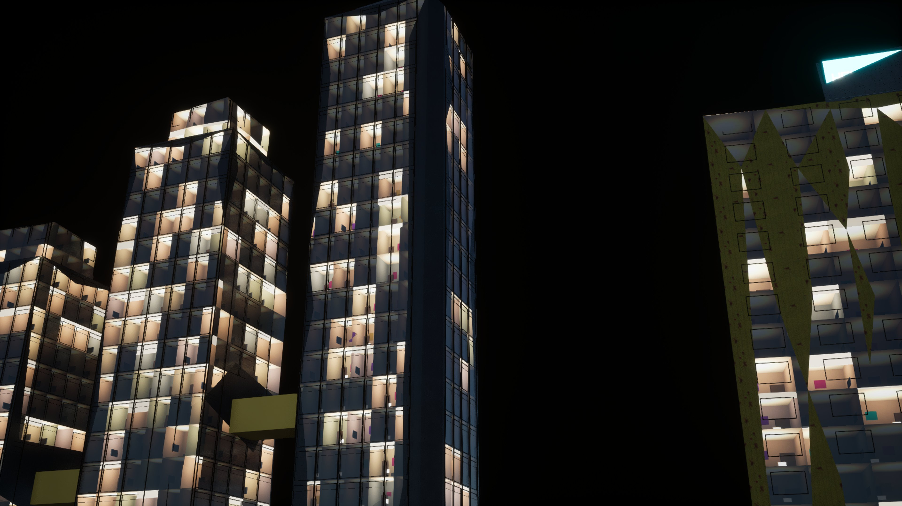 |

| A street by day | The same street by night |
|---|---|
| 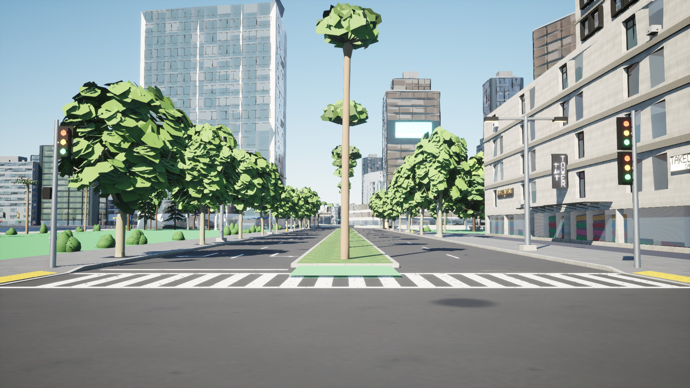 | 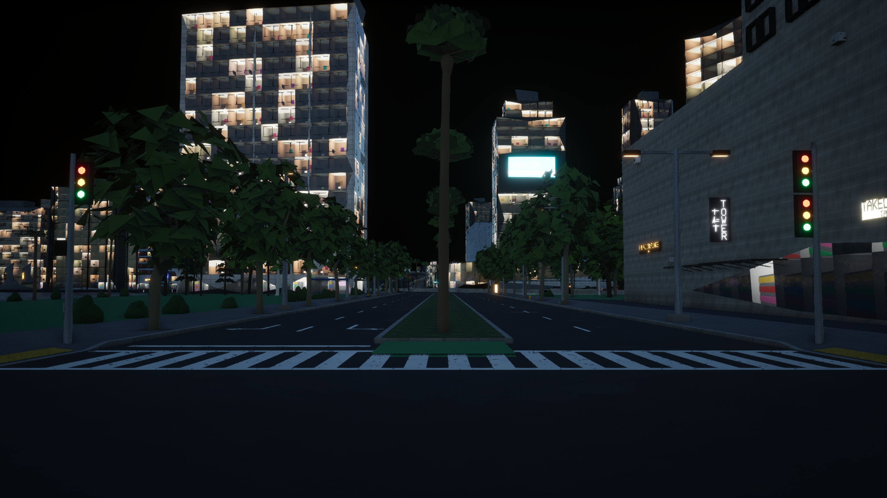 |

| A district from above by night | The far view (HLODs) |
|---|---|
| 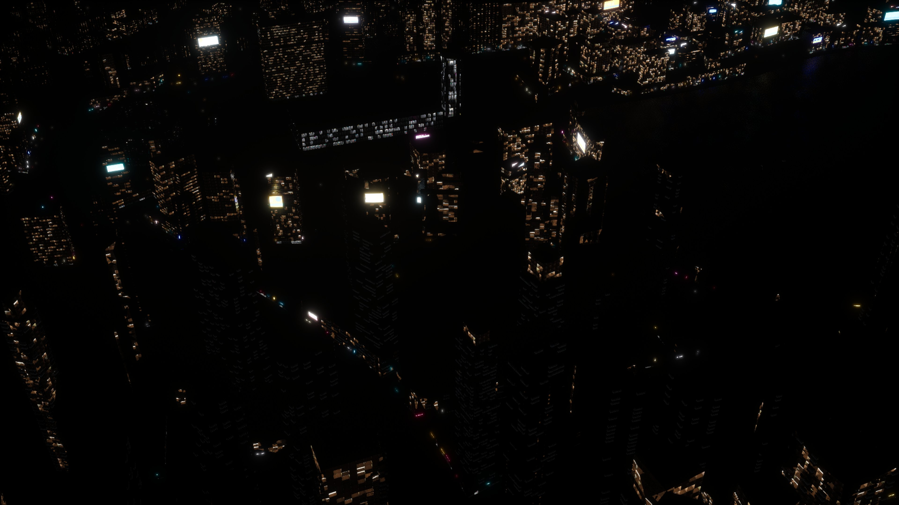 | 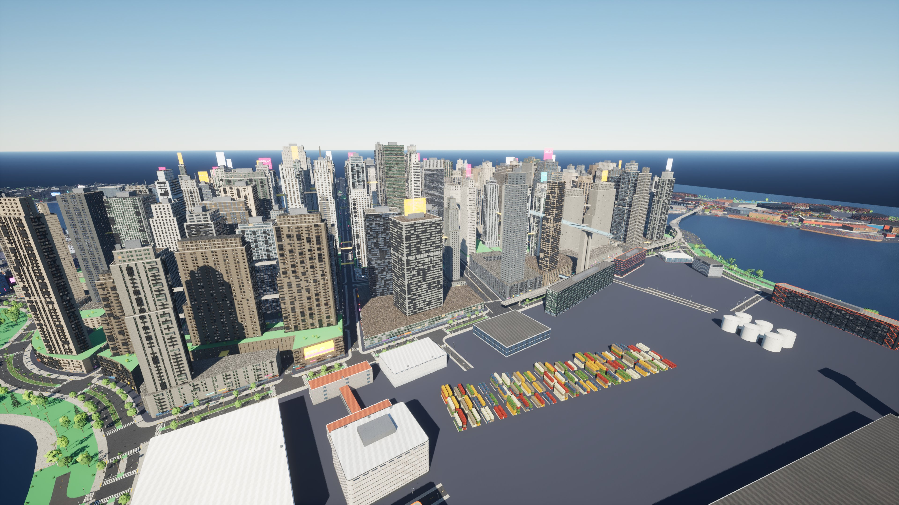 |

Vesper Bay:

| A heritage brick street | Brick close up |
|---|---|
| 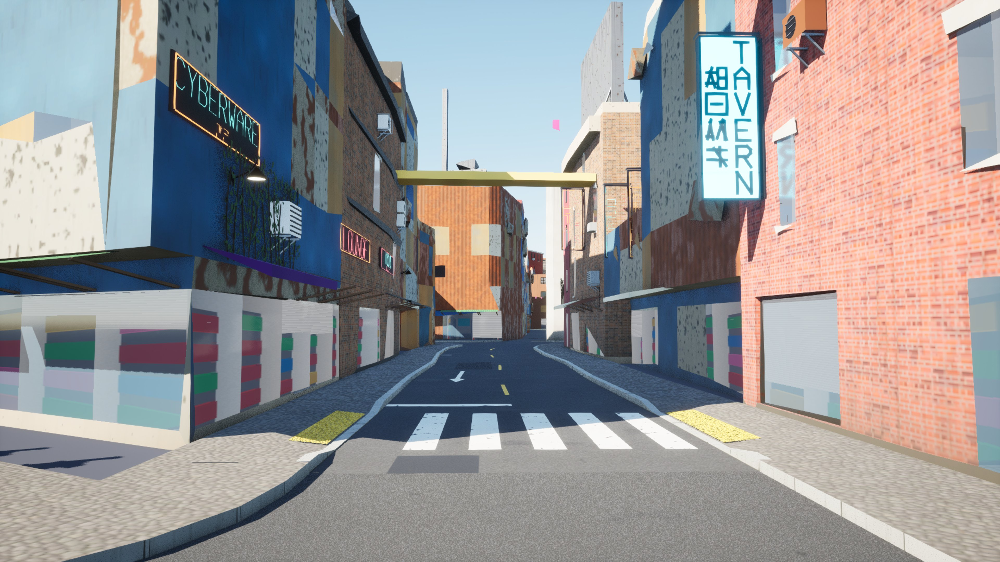 | 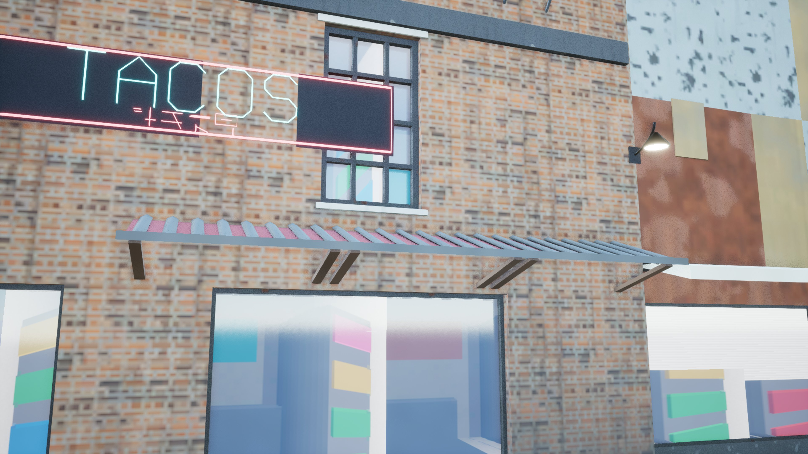 |

| Asphalt and setts | The Corporate Core from above |
|---|---|
| 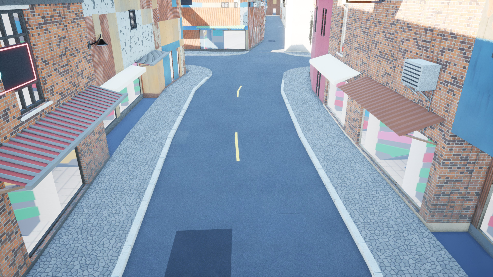 | 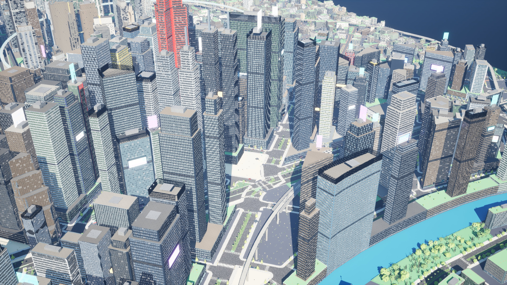 |

AG8 on AG6 (Greyhook):

| Leaf cards up close | Avenue trees at 250 m |
|---|---|
| 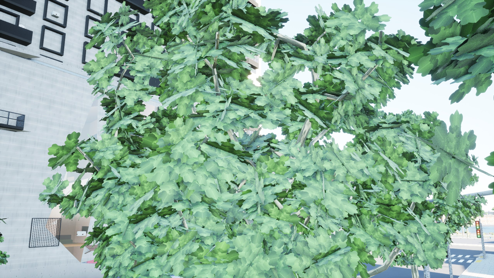 | 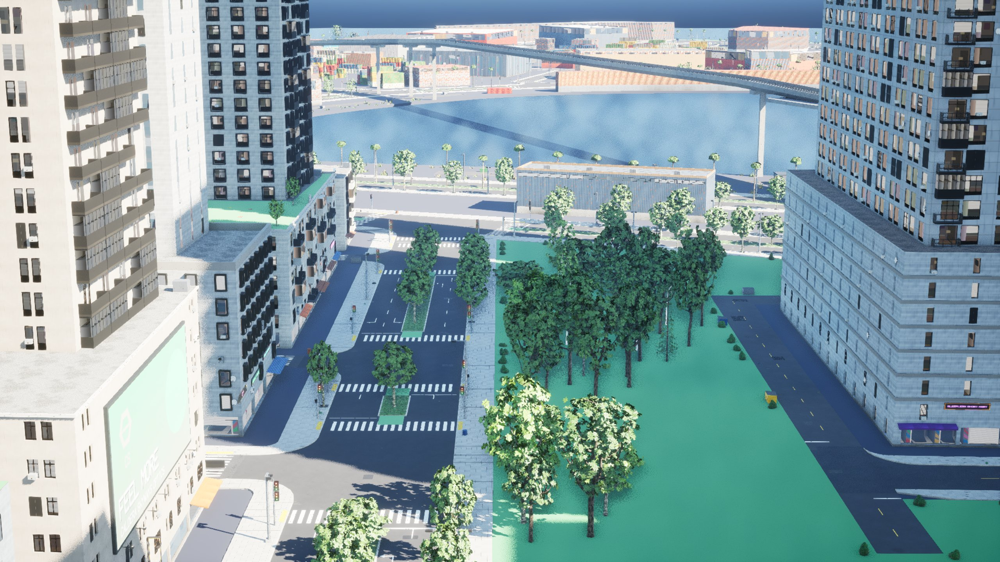 |

| Trees at 600 m | Sign faces in a shopping street |
|---|---|
| 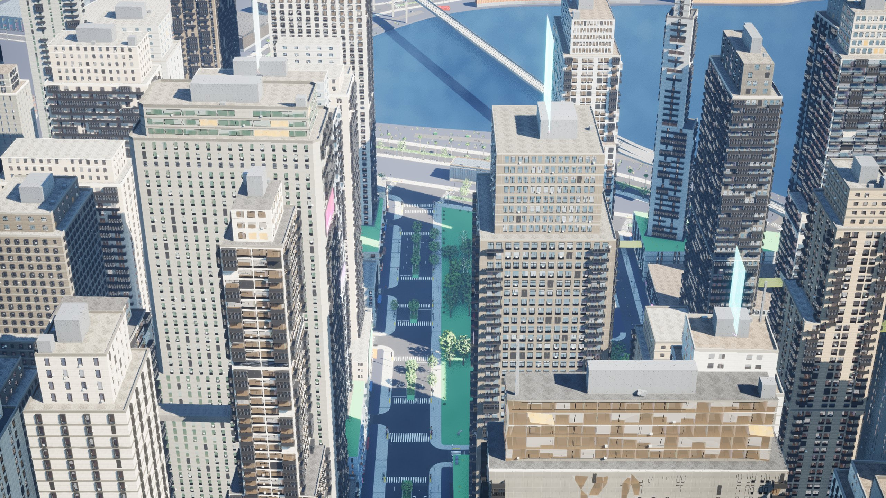 | 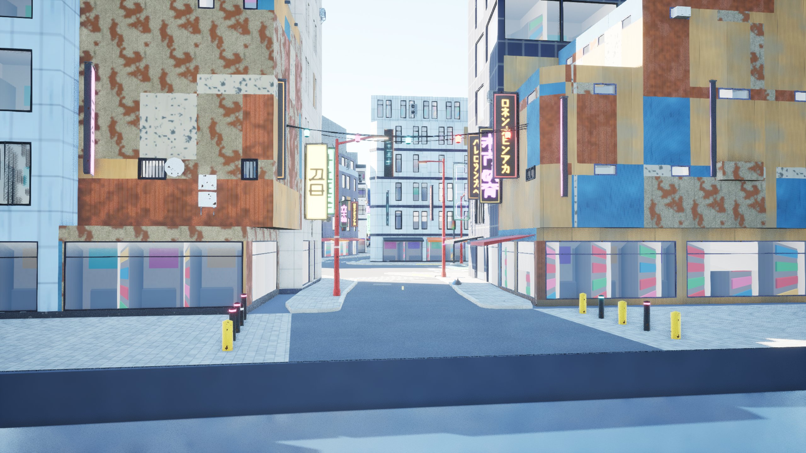 |

| Parked cars | Bark, palms and crowns along an avenue |
|---|---|
| 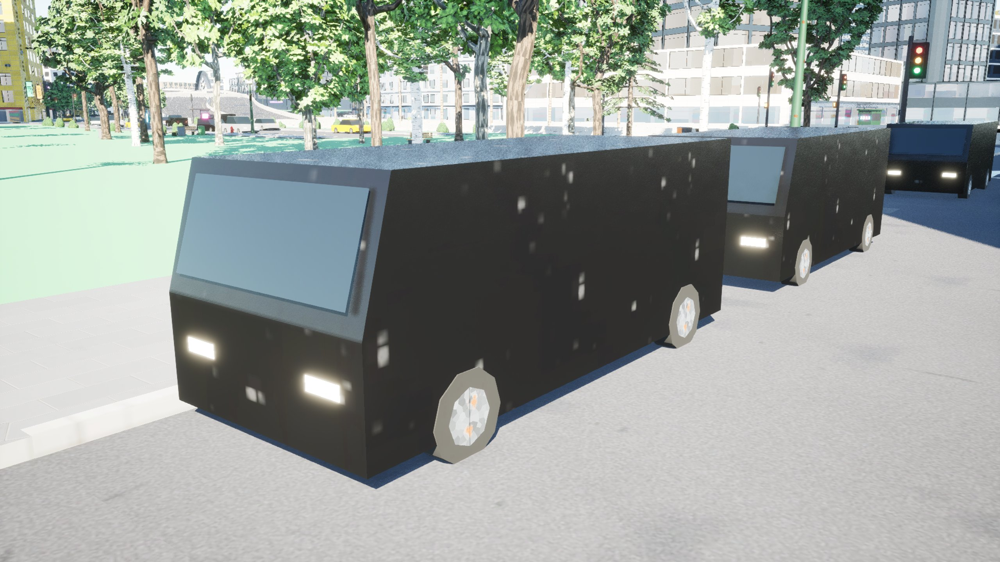 | 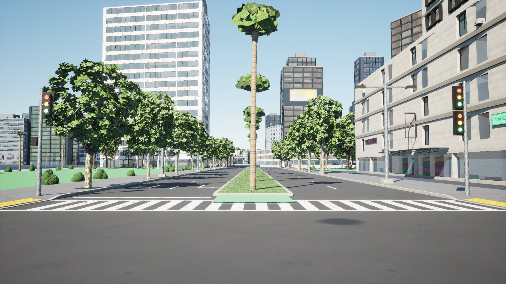 |
