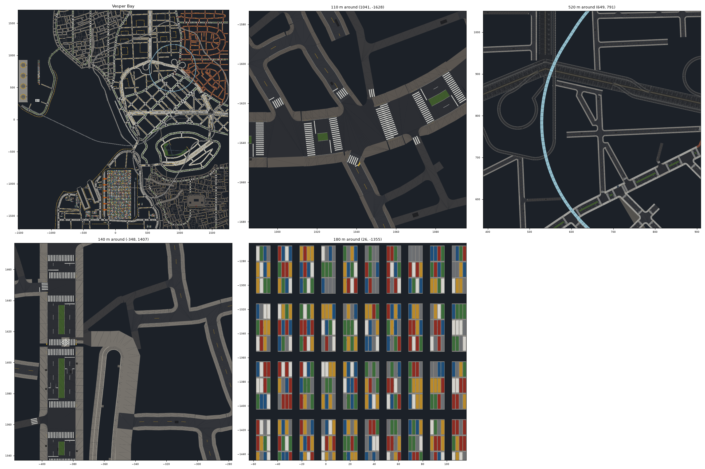
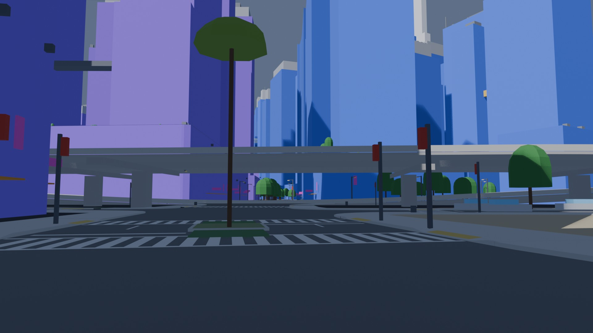
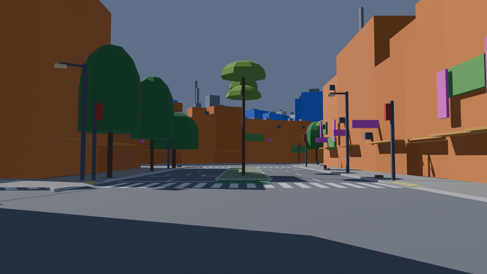
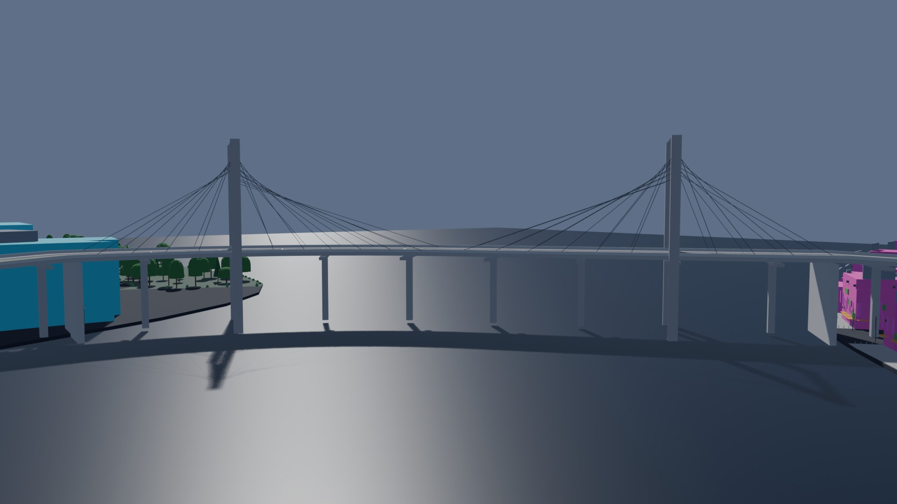
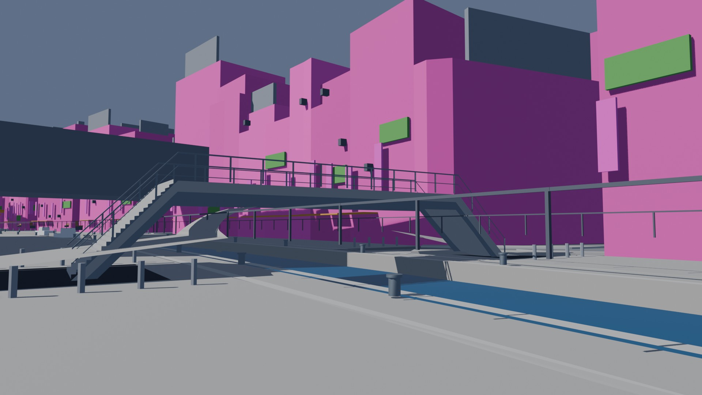
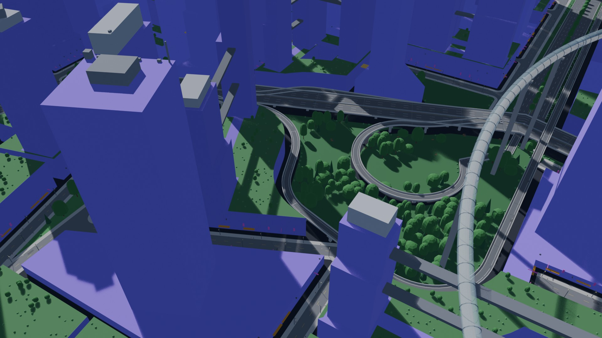
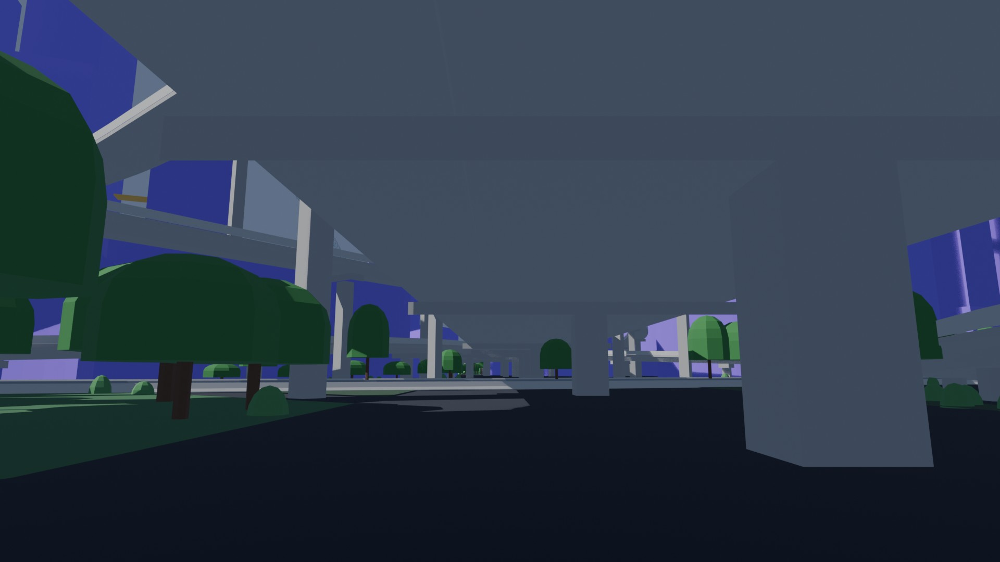
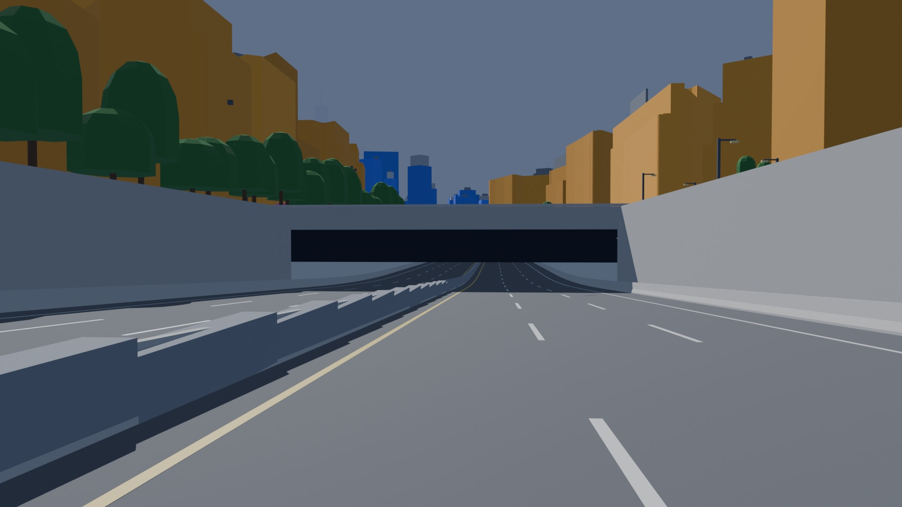
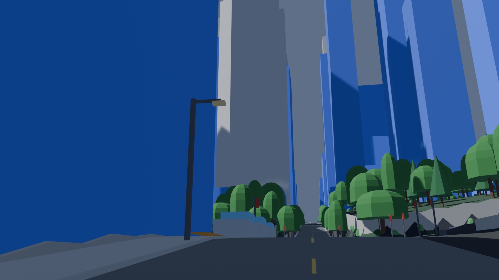

# AG7: street elements

Every street element of a city as a generated mesh: road surfaces with their markings,
crosswalks, sidewalks and curbs, junctions and their corners, medians, bridges by kind,
decks, ramps, viaducts and interchanges with their parapets, joints and columns, tunnels with
their portals and approach trenches, quays and canal walls, transit guideways, sky tubes and
pylons, station structures and megasite elements. Written per 256 m tile, keyed by citygen
ids, kept by hash, and handed to the Unreal exporter as entries that replace the blockout's
joined street pieces.

```bash
.venv/bin/python -m assetgen streets out/vesper_bay                      # BUILD/assets/streets/
.venv/bin/python -m assetgen streets seam out/vesper_bay out/vesper_bay_regenerated --district "Neon Strand"
```


The stack interchange of Vesper Bay Stacks among the blockout's buildings (8K): four tiers of
box-girder ramps on their columns and pier caps, parapets, lane markings, the sky tube's glass
crossing above.

## What a city gets

| Element | From the model | Generated |
|---|---|---|
| road surface | road segments, their lanes, junctions, crosswalks | asphalt by class between the junctions' cut edges, UV along the road; lane lines, center lines (double yellow on avenues), edge lines, stop lines and arrows from the model's lanes; manholes, drains at the curbs, patches by the district's grime and wear |
| medians | cross-section `median_m` | curbed islands with lawn (or paving in industrial districts), stopping before the crosswalks; a concrete barrier on highways, guard walls along at-grade highways |
| sidewalks | sidewalks, crosswalks, doors, street trees | the slab in the district's paving family, curb stones, the curb face, a back face to the lot; curbs dropped to 2 cm (1.2 m ramps) at crosswalks and at garage, loading and gate entrances; grates under the street trees |
| crosswalks | crosswalks | zebra (or ladder in planned districts) on the road, tactile paving on the dropped curb at both ends |
| junctions | junctions, their legs | the carriageway polygon at its node's height (blended toward each leg where a junction is graded), the sidewalk corners between legs (the curb return and the property-line fillet), their curb faces, a deck slab under a raised junction |
| decks and interchanges | raised segments (M7, M8d, M12) | a box girder under the whole width, parapets, expansion joints every 45 m, underside lights; low street ramps on embankments |
| columns | the model's columns | the shaft from the footprint and a pier cap across the road or guideway |
| bridges | bridges | girder: wall piers with caps every 40 m over the water and abutments; named crossings: a through arch or, over long spans, a cable-stayed main span with H pylons and fans of stays; footbridges: stone parapets and an arch ring in heritage districts, steel railings on girders elsewhere, steps where their ramps are stairs; a named footbridge with no road of its own gets its deck too |
| tunnels (M9) | tunnels, portals, open approaches, vents | the covered stretch's walls lined with tile, roof slab, light strips; each portal's headwall with its opening; each open approach's walls up to a parapet; metro tunnels and underpasses as lined boxes with a slab track or a walkway; underpass stair wells with steps; ventilation buildings |
| quays and canals | quays, waterways | the quay's paving, a stone coping and the quay wall down past the water, bollards every 12 m, stairs down to the water every 60 m; canal and basin walls with a coping (creeks keep natural banks) |
| transit | the lines' decks, tubes, columns, pylons | elevated rail as a U trough with slab tracks and rails, monorail beams, maglev T guideways with guide rails; sky tubes as glass (translucent, non-Nanite, a LOD chain of 24, 12 and 6 sides) with a floor and steel ribs; station platforms, skywalks, canopies, elevator cores and concourses |
| megasites | site elements | container stacks as instances of six container liveries, gantry cranes, fuel tanks, launch pads and lattice towers, berths with fenders and bollards, rail tracks on ballast and sleepers, truck gates, aprons, walls, gates, plazas, lawns, ponds |
| M13 | retaining walls, grade lines, terrain | retaining walls with a coping; everything on the ground (below) |

Each piece is gathered from the model into the inputs its generator reads (the entity, its
neighbors, the district's style, the ground under it), and its hash is theirs: the same
inputs, the same bytes. Meshes are built on integer millimeters in each piece's own frame
(grids along a road, swept cross-sections, polygons triangulated exactly), lean glTF (UV0 in
meters, no UV1 or vertex colors), flat preview colors per material slot until AG6.

## Outputs

```
BUILD/assets/streets/<tile>.glb        a node per piece, named by its citygen id
BUILD/assets/streets/parts.glb         the container liveries (instanced)
BUILD/assets/streets/manifest.json     per tile its hash and file sha256, per piece its kind,
                                       hash, tile, replaces, triangles, slots, bounds, parts
BUILD/assets/unreal_contribution.streets.json
BUILD/assets/streets_report.json, .txt
```

A piece goes into the tile of the blockout object it replaces (the blockout's own rule: the
tile of its middle). A tile is made again only when its pieces' hashes (or the code's) change,
and written only when its bytes do: a second build of an unchanged city makes nothing and
writes no pack, manifest or contribution (only the report, which carries timings).

## The samples

| City | Pieces | Tiles | Triangles | Disk | Time |
|---|---|---|---|---|---|
| Vesper Bay | 10,955 | 148 | 1,187,649 | 74.8 MB | 6.2 s |
| Saltreach Free Port | 6,383 | 105 | 670,763 | 42.3 MB | 3.7 s |
| Delta Megacity | 10,489 | 137 | 1,185,401 | 76.1 MB | 6.9 s |
| Nexus City | 11,126 | 155 | 1,170,152 | 74.3 MB | 5.7 s |
| Greyhook | 4,590 | 90 | 605,711 | 37.1 MB | 3.1 s |
| Vesper Bay Pinned | 11,161 | 156 | 1,177,214 | 75.0 MB | 6.8 s |
| Vesper Bay Stacks | 11,540 | 157 | 1,227,541 | 77.5 MB | 7.4 s |
| Cragmouth (M13's branch) | 12,729 | 130 | 1,226,030 | 83.6 MB | 8.5 s |

Every check passes in every city (coverage, meshes, replaces, budgets). Times are the whole
stage after loading the model (1 to 2 s), 4 workers, on the Mac shared with other sessions;
a rebuild with nothing changed takes 2 to 3 s. Disk is the tile packs and the parts pack
(about 63 bytes a triangle). Vesper Bay's triangles: sidewalks 441 k, roads 261 k, junctions
180 k, guideways 123 k, crosswalks 36 k, quays 30 k, sky tubes 25 k (and 23 k of glass at
LOD0), metro tunnels 21 k, the rest under 11 k each; 14,546 containers in 608 stacks as
instances; 4,370 sidewalk corners (13 left out: 7 with no sidewalk on a
leg, 5 with two legs cut by one edge, 1 whose fillet would not chain). The scope expected 10 to 20 M street triangles per city; the packs need about a
tenth of that, as markings and details are geometry only where they are on the street (AG6's
road atlases can carry more).

Previews of every city (`<city>/preview_streets.png`, drawn from the packs, with insets of a
signalized junction, an interchange, a quay and a container yard) and their reports
(`<city>/streets_report.txt`):



## Street views

Blender, the blockout's `city.blend` with the objects the contribution replaces removed and
the packs imported (`assetgen/blender/streets_preview.py`); the blockout's own street cameras
and a few of our own. Flat slot colors; buildings, props and plants are still the blockout's.

 
 
 
 

Vesper Bay under its ring viaduct; a market street with its median island and crosswalks; the
Launch Causeway (cable-stayed main span over the bay); a steel footbridge's stairs over a
canal, with the quay's bollards; the trumpet interchange from above (its loop, the flyover and
the sky tube); under the stack interchange; the Midtown Tunnel's portal from its open approach
(Nexus City; the blockout's sea plane hidden, below); a Cragmouth street climbing between
retaining walls (M13's hilly sample, on M13's branch). More in each city's folder.

## Ground (M13)

Written against M13's contract (PR #28) from the start: a road's surface is its grade line
(`RoadSegment.ground`) plus its z profile; sidewalks and crosswalks follow their road; a
junction stands at its node's `ground_m`; road tunnels, their portals and approaches follow
their road's grade line (as M13's blockout lifts them); everything else stands on the
terrain's finished ground at its point; M13's retaining walls get pieces of their own and
replace its joined wall objects. Where the model has none of these (main today), the ground is
0. M13 was not merged while AG7 ran: Cragmouth, its hilly sample, was built on M13's branch
merged locally with AG7 and passes every street check (18 tunnels, 7 of them bored, 1,280
retaining walls).

**Sidewalks on raised roads** (an M15 open item): the model's sidewalks and walkways of a
raised road sit at z 0 under its deck. The sidewalk pieces follow the road's profile, so they
stand on the deck, and the contribution carries the corrected line of each of their walkways
(`graphs.walkways`, z over the ground as the model's: 126 in Vesper Bay) for the exporter's
walkway graph.

## Regenerated districts

M10's eight district regenerations (the same builds as AG0's), each over a copy of its base
city's packs: only the tiles holding a changed piece are written. A piece changed when its
hash differs, or it is new or gone; every changed piece is explained by its own entity
changing in the model or by an input entity changing (a junction it meets, a crosswalk, a
tree, a door), in either build (`assetgen streets seam`,
[`regenerated/seam.json`](regenerated/seam.json)):

| City, district | Pieces changed | Through a neighbor | Unexplained | Tiles written | Farthest seam piece |
|---|---|---|---|---|---|
| Vesper Bay, Neon Strand | 4,933 | 32 | 0 | 23 of 148 | 84 m |
| Vesper Bay, Old Town | 7,967 | 7 | 0 | 25 of 148 | 20 m |
| Saltreach Free Port, Westreef | 7,252 | 4 | 0 | 23 of 105 | 87 m |
| Delta Megacity, Midtown | 2,679 | 12 | 0 | 31 of 137 | 41 m |
| Nexus City, Neon Market | 4,027 | 26 | 0 | 19 of 155 | 22 m |
| Greyhook, Lantern Strip | 3,414 | 5 | 0 | 17 of 90 | 27 m |
| Vesper Bay Pinned, Old Town | 8,887 | 25 | 0 | 26 of 156 | 27 m |
| Vesper Bay Stacks, The Stacks | 1,380 | 29 | 0 | 34 of 157 | 23 m |

Pieces changed counts ids added, removed or changed (a regenerated district's entities get
new ids). No tile was written without a changed piece in it. The farthest seam pieces are
sidewalks, junctions and crosswalks of roads M10 holds at the district's edge whose trees,
doors or crossing legs changed.

## Unreal

No exporter code changed (the AG1 session owns the exporter). The street contribution is
defined in [`docs/unreal_export.md`](../../unreal_export.md) ("assetgen's street contribution
(AG7)"), with what the exporter still needs to take it: a second layer-2 contribution file;
dropping every blockout actor named in a `replaces`; the masters `road`, `opaque`, `metal`,
`emissive`, `translucent` (two-sided, blended) and `foliage`; complex collision on street
meshes; non-Nanite meshes with LOD chains (sky tube glass); HISM for the container parts; the
walkway graph's z from `graphs.walkways`; the new keys in the re-import digests. Whether to run
an Unreal check is the coordinating session's call.

## Determinism

- Pure Python on integer millimeters: blake2b for every random draw, `dmath` for angles,
  exact triangulation and exact integer triangle tests, no set or dict order reaching output;
  shapely only through citygen's snapped overlays (the sidewalk corners: a sector less the
  junction polygon) and exact predicates (over the water).
- The same bytes for any worker count and another hash seed (tested).
- **Mac = x86**: in the `citygen-x86` docker image, the packs, parts and contribution of
  Vesper Bay, Nexus City and Vesper Bay Stacks are byte-identical to the Mac's
  (`outputs_digest`), and the street tests that build the small test city pass there,
  its golden included.
- Goldens (`tests/assetgen/data/golden_streets.json`, written by
  `tests/assetgen/streets_goldens.py`): the small test city's packs and Vesper Bay's, with
  its six heaviest tiles named.

## Tests

`tests/assetgen/test_ag_streets.py` (10 tests): the small city's checks and coverage; a second
build writes nothing; the same bytes for 1 and 3 workers and another hash seed; a regenerated
district rewrites only its tiles and every change is explained; the contribution matches the
packs (every entry's node and triangle count); sky tube glass as three non-Nanite LODs; M13's
ground lifting roads; the mesh kit dropping folds and checking clean; the two goldens.

## Open items

- Stations are the building line's (their structures are here); open spaces, green areas,
  the ground and water stay the blockout's.
- Markings, patches and grates are geometry a few millimeters over the asphalt; AG6 may move
  them to the road atlas as decals.
- River and sea banks have no walls (only canals, basins, inlets and marinas, and quays).
- A named footbridge with no road segment of its own (Saltreach's Lumen Footbridge) gets its
  deck from its line; its ramps to the ground are not in the model.
- Highway medians get a continuous barrier from their road piece, while M6 also places
  `prop.barrier` blocks along them (level boxes every 4 m, props staying the blockout's until
  AG8), so on a graded highway the blocks step over the barrier: AG8 should drop M6's median
  barriers where a road piece has one.
- citygen's blockout lays its sea as a plane over each whole tile at -1.2 m under the ground
  (`_land_and_water`), so it shows through the holes the ground leaves over the open
  approaches of road tunnels and the underpass stair wells, in Blender and in Unreal alike: a
  stage 1 fix (cut those holes from the sea plane too). The street previews can hide it
  (`--hide city.sea.`).
